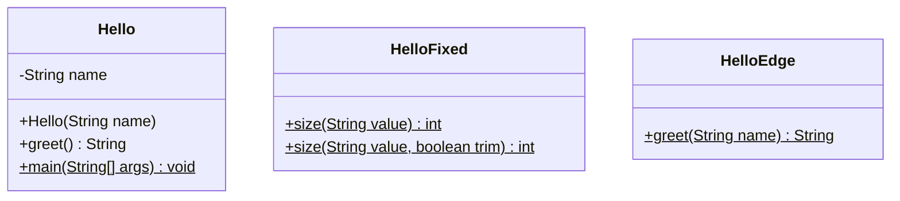

# Chapter 00 — Hello and include anchors

## What and why

This chapter proves the book pipeline: Java sources under `code/` compile with Maven, chapters pull them in with include anchors, broken samples stay outside the build, and Pages publishes static HTML only. From chapter 01 onward, every chapter also ships a full **exam bank** (see `CONTENT_STANDARDS.md`).

## Exam flash rules

- Method overloading requires a different **parameter list** (count, types, or order).
- Differing **only** by return type is not overloading; `javac` rejects it.
- Intentionally invalid demos stay in `broken/`, never on the Maven compile path.
- Book snippets must be include-anchored from files that `mvn verify` compiles.
- GitHub Pages serves HTML only; it does not run `javac` or your `main`.

## Rules table

| Allowed | Not allowed | Compiler message (when not allowed) |
|---------|-------------|-------------------------------------|
| Overload by parameter list | Overload by return type only | `method size(String) is already defined in class HelloBroken` |
| Include from `src/main/java` | Paste uncompiled snippets into Markdown | — |
| Keep invalid demos in `broken/` | Compile `broken/` in the module | — |

## Walkthrough

### Baseline

```java
{{#include ../../code/part-01-oop/src/main/java/oop/hello/Hello.java:hello-class}}
```

Program output:

```text
Hello, Java 21.
```

### Does not compile

`broken/HelloBroken.java` tries to overload `size` by return type only. It is **not** on the Maven compile path.

```java
{{#include ../../code/part-01-oop/broken/HelloBroken.java}}
```

Compiler output (verbatim from `javac`):

<div class="compiler-error">

```text
part-01-oop/broken/HelloBroken.java:12: error: method size(String) is already defined in class HelloBroken
  public static String size(String value) {
                       ^
1 error
```

</div>

### Fixed version

Different parameter lists are valid overloads:

```java
{{#include ../../code/part-01-oop/src/main/java/oop/hello/HelloFixed.java:hello-fixed}}
```

Program output:

```text
6
2
```

### Edge case

Blank or null names fall back to `"world"`:

```java
{{#include ../../code/part-01-oop/src/main/java/oop/hello/HelloEdge.java:hello-edge}}
```

Program output:

```text
Hello, world.
Hello, world.
Hello, Ada.
```

## Predict the output

**P1.** What does `HelloEdge.main` print?

```java
{{#include ../../code/part-01-oop/src/main/java/oop/hello/HelloEdge.java:hello-edge}}
```

<details>
<summary>Answer</summary>

```text
Hello, world.
Hello, world.
Hello, Ada.
```

Blank and `null` become `"world"`; `"  Ada  "` is trimmed.

</details>

## Compile or not?

**C1.** Does `HelloBroken` compile?

```java
{{#include ../../code/part-01-oop/broken/HelloBroken.java}}
```

<details>
<summary>Answer</summary>

**Fails.**

```text
part-01-oop/broken/HelloBroken.java:12: error: method size(String) is already defined in class HelloBroken
  public static String size(String value) {
                       ^
1 error
```

</details>

## Gotchas

1. **Return-type-only overload** — rejected at compile time; see `HelloBroken`.
2. **`broken/` must stay out of `src/main/java`** — otherwise `mvn verify` fails and CI blocks.
3. **Anchors must match** — a missing `// ANCHOR:` marker fails the mdBook build.
4. **Pages does not run Java** — HTML is static; `mvn verify` is the quality gate.
5. **Use Java 21** — parent POM sets `maven.compiler.release` to 21.

## UML



## Interview Q&A

1. **Q:** Does Java pass objects by reference? **A:** No. It passes the reference value by value. See later memory chapters; `Hello` stores a `String` reference field.
2. **Q:** Can two methods differ only by return type? **A:** No. `HelloBroken` fails with `method size(String) is already defined`.
3. **Q:** How do you overload correctly? **A:** Change the parameter list, as in `HelloFixed`.
4. **Q:** Where should intentionally broken samples live? **A:** Outside `src/main/java`, e.g. `broken/`.
5. **Q:** What proves a book snippet is real? **A:** An mdBook include anchor into a file that `mvn verify` compiles.
6. **Q:** Does GitHub Pages compile the examples? **A:** No. CI runs Maven; Pages serves HTML.
7. **Q:** What is `final class` doing on `Hello`? **A:** It prevents subclassing for this tiny demo type.
8. **Q:** Why trim in `HelloEdge`? **A:** Leading/trailing spaces would otherwise appear inside the greeting.
9. **Q:** Which test class covers this chapter? **A:** `oop.hello.HelloTest`.
10. **Q:** What release is the parent POM pinned to? **A:** Java 21 (`maven.compiler.release`).

## Exam writing prompts

1. Write two valid overloads of `int len(...)` that measure a `String` with and without trimming (same idea as `HelloFixed`).
2. In two sentences: why return-type-only “overloads” are rejected.
3. State where invalid samples belong in this repo’s layout and why.

## Exercises

1. Add a `Hello` constructor overload that takes no name and greets `"world"`.
2. Extend `HelloFixed` with a three-parameter overload and print its result.
3. Move `HelloBroken` under `src/main/java` temporarily and confirm CI would fail; move it back.
4. Add an assertion in `HelloTest` for `HelloEdge.greet("  Ada  ")`.
5. Capture `javap -c oop.hello.Hello` and note the `greet` bytecode (no need to paste into the chapter yet).

Solutions for later chapters live under `code/.../solutions/`. Chapter 00 has no separate solutions module yet.

## Recap checklist

- [x] Baseline file compiles and prints a greeting
- [x] Broken return-type overload kept in `broken/` with real `javac` output
- [x] Fixed overload by parameter list
- [x] Edge case for blank/null names
- [x] JUnit 5 tests in `HelloTest`
- [x] Include anchors used in this chapter
- [x] Mermaid class diagram present
- [x] Exam flash + sample predict/compile + writing prompts (full banks from ch 01)
