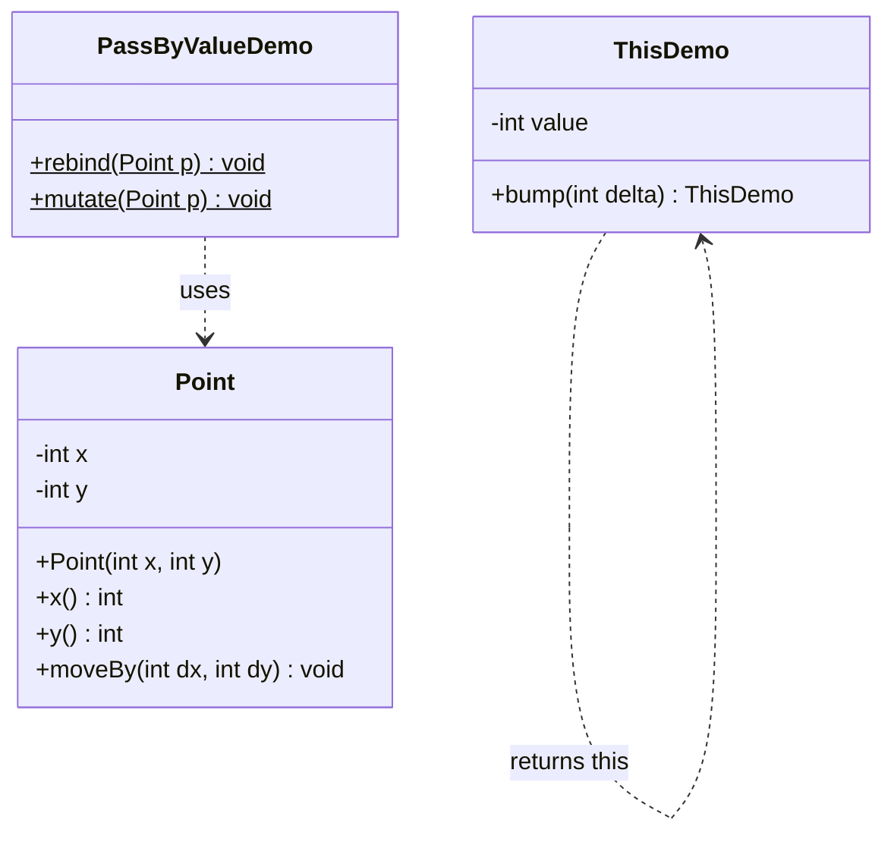

# Chapter 01 — Classes, objects, memory

## What and why

A class is the blueprint; an object is a heap allocation; a variable holds a reference (or a primitive). Exams score whether you can predict aliasing, pass-by-value, `this` shadowing, and legal uses of `var`.

## Exam flash rules

- `new` allocates an object on the **heap**; the local variable on the **stack** stores a **reference**.
- `==` on references compares **identity** (same object), not equal contents.
- Java is **pass-by-value**: for objects, the value copied is the reference.
- Reassigning a parameter (`p = new ...`) does **not** reassign the caller’s variable.
- Mutating fields through a parameter **does** affect the caller’s object (same reference).
- `this` is the current instance; use `this.field = field` when names shadow.
- You cannot assign to `this`.
- `var` is for **local** variables with an initializer; not for fields, method parameters, or return types.
- `var x = null;` and `var x;` do not compile (no usable type to infer).
- Two references can **alias** one object; changing one name’s object is visible through the other.
- A `null` reference means no object; instance calls throw `NullPointerException`.
- Primitives: the bit pattern is copied; methods cannot change the caller’s primitive variable.

## Rules table

| Allowed | Not allowed | Compiler message |
|---------|-------------|------------------|
| `var` local with non-null initializer | `var` as a field | `'var' is not allowed here` |
| Explicit field type (`int count`) | `var x = null;` | `cannot infer type for local variable x` / `(variable initializer is 'null')` |
| `this.field = field` | `var x;` then assign later | `cannot infer type ... (cannot use 'var' on variable without initializer)` |
| Mutate object via parameter | `this = other;` | `cannot assign to 'this'` |

## Walkthrough

### Baseline — class and two objects

```java
{{#include ../../code/part-01-oop/src/main/java/oop/memory/Point.java:point-class}}
```

```java
{{#include ../../code/part-01-oop/src/main/java/oop/memory/ClassesObjectsDemo.java:classes-objects-demo}}
```

Program output:

```text
a=(1, 2) b=(1, 2)
a == b ? false
same identity? false
```

Equal-looking state is still two heap objects.

### Stack and heap

```java
{{#include ../../code/part-01-oop/src/main/java/oop/memory/StackHeapDemo.java:stack-heap-demo}}
```

Program output:

```text
initially same object? false
after b=a, same object? true
a=(1, 0) b=(1, 0)
```

After `b = a`, both stack slots hold the same reference; `moveBy` through `b` changes the single heap object seen as `a`.

### Pass-by-value proof

```java
{{#include ../../code/part-01-oop/src/main/java/oop/memory/PassByValueDemo.java:pass-by-value}}
```

Program output:

```text
before rebind: (0, 0)
after rebind:  (0, 0)
before mutate: (0, 0)
after mutate:  (10, 0)
```

### `this`

```java
{{#include ../../code/part-01-oop/src/main/java/oop/memory/ThisDemo.java:this-demo}}
```

Program output:

```text
6
```

### `var` for locals

```java
{{#include ../../code/part-01-oop/src/main/java/oop/memory/VarLocals.java:var-locals}}
```

Program output:

```text
point 3,4 size=1
list runtime type: ArrayList
```

### Does not compile — `var` field

```java
{{#include ../../code/part-01-oop/broken/VarFieldBroken.java}}
```

<div class="compiler-error">

```text
part-01-oop/broken/VarFieldBroken.java:8: error: 'var' is not allowed here
  private var count = 0;
          ^
1 error
```

</div>

### Fixed — explicit field type

```java
{{#include ../../code/part-01-oop/src/main/java/oop/memory/VarFieldFixed.java:var-field-fixed}}
```

Program output:

```text
1
2
```

### Edge — aliasing

```java
{{#include ../../code/part-01-oop/src/main/java/oop/memory/AliasEdge.java:alias-edge}}
```

Program output:

```text
first=(6, 5)
second=(6, 5)
same object? true
```

## Predict the output

**P1.**

```java
{{#include ../../code/part-01-oop/src/main/java/oop/memory/exam/PredictPassByValue.java:predict-pass-by-value}}
```

<details>
<summary>Answer</summary>

```text
(3, 3)
```

`moveBy` mutates the shared object; `q = new Point(0, 0)` only rebinds the parameter.

</details>

**P2.**

```java
{{#include ../../code/part-01-oop/src/main/java/oop/memory/exam/PredictAlias.java:predict-alias}}
```

<details>
<summary>Answer</summary>

```text
(1, 2)
(1, 2)
(1, 1)
true
false
```

`a` and `b` alias; `c` is a different object with the old coordinates.

</details>

**P3.**

```java
{{#include ../../code/part-01-oop/src/main/java/oop/memory/exam/PredictThisShadow.java:predict-this-shadow}}
```

<details>
<summary>Answer</summary>

```text
1
```

`n = 5` assigns the parameter to itself; field `n` stays `1`.

</details>

**P4.**

```java
{{#include ../../code/part-01-oop/src/main/java/oop/memory/exam/PredictVar.java:predict-var}}
```

<details>
<summary>Answer</summary>

```text
3
Integer
```

`var` inferred `int`; boxing in `(Object) b` yields `Integer`.

</details>

**P5.**

```java
{{#include ../../code/part-01-oop/src/main/java/oop/memory/exam/PredictNull.java:predict-null}}
```

<details>
<summary>Answer</summary>

```text
true
caught
```

</details>

## Compile or not?

**C1.** `VarFieldBroken` — field declared with `var`.

```java
{{#include ../../code/part-01-oop/broken/VarFieldBroken.java}}
```

<details>
<summary>Answer</summary>

**Fails:** `'var' is not allowed here`

</details>

**C2.** Assigning to `this`.

```java
{{#include ../../code/part-01-oop/broken/ThisReassignBroken.java}}
```

<details>
<summary>Answer</summary>

**Fails:**

```text
part-01-oop/broken/ThisReassignBroken.java:15: error: cannot assign to 'this'
    this = other;
    ^
1 error
```

</details>

**C3.** `var x = null;`

```java
{{#include ../../code/part-01-oop/broken/VarNullBroken.java}}
```

<details>
<summary>Answer</summary>

**Fails:** `cannot infer type for local variable x` `(variable initializer is 'null')`

</details>

**C4.** `var` without initializer.

```java
{{#include ../../code/part-01-oop/broken/VarNoInitBroken.java}}
```

<details>
<summary>Answer</summary>

**Fails:** `cannot infer type for local variable x` `(cannot use 'var' on variable without initializer)`

</details>

## Gotchas

1. **Shadowing without `this`** — field stays default.

```java
{{#include ../../code/part-01-oop/src/main/java/oop/memory/ThisShadowGotcha.java:this-shadow-gotcha}}
```

```text
after setWrong: 0
after setRight: 7
```

2. **Null call**

```java
{{#include ../../code/part-01-oop/src/main/java/oop/memory/NullCallGotcha.java:null-call-gotcha}}
```

```text
NPE: NullPointerException
```

3. **Primitive vs reference argument**

```java
{{#include ../../code/part-01-oop/src/main/java/oop/memory/PrimitiveVsRefGotcha.java:primitive-vs-ref-gotcha}}
```

```text
n=3
p=(4, 0)
```

4. **Aliasing** — `AliasEdge`: two names, one object.
5. **“Java is pass-by-reference”** — false; `PassByValueDemo` is the counterexample for rebinding.

## UML



## Interview Q&A

1. **Q:** Where do objects live? **A:** On the heap; locals hold references (or primitives) on the stack (`StackHeapDemo`).
2. **Q:** Is Java pass-by-reference? **A:** No. Pass-by-value of the reference (`PassByValueDemo`).
3. **Q:** Why does `rebind` not change the caller? **A:** Only the copy of the reference is overwritten.
4. **Q:** Why does `mutate` change the caller’s object? **A:** Same heap object; fields were updated.
5. **Q:** What does `==` mean for objects? **A:** Same reference (`ClassesObjectsDemo`).
6. **Q:** When do you need `this`? **A:** When a parameter or local shadows a field (`ThisShadowGotcha`).
7. **Q:** Can you write `this = ...`? **A:** No — `ThisReassignBroken`.
8. **Q:** Where is `var` legal? **A:** Locals (and lambda/loop forms) with inferable initializers — not fields.
9. **Q:** Why is `var x = null` illegal? **A:** No target type to infer (`VarNullBroken`).
10. **Q:** What is aliasing? **A:** Two variables referencing one object (`AliasEdge`).
11. **Q:** Does `new Point(1,2)` twice yield `==` true? **A:** No — two allocations.
12. **Q:** Can a method change the caller’s `int`? **A:** No; primitives are copied (`PrimitiveVsRefGotcha`).

## Exam writing prompts

1. (5 marks) Draw stack/heap for `Point a = new Point(1,1); Point b = a; b.moveBy(1,0);` and state final `a`.
2. (5 marks) Write `void sneak(Point p)` that makes the caller’s point become `(0,0)` **without** the caller assigning the return value (mutate only).
3. (2 marks) Fix: `public void set(int value) { value = value; }` so the field updates.

## Exercises

1. Add `Point.copy()` returning a **new** object with the same coordinates; prove `p.copy() != p`.
2. Write a method that tries to “swap” two `Point` parameters; show the caller’s variables are unchanged. See `solutions/ch01/SolutionSwapRefs.java`.
3. Build a fluent `Box` with `width`/`height` using `this` return. See `solutions/ch01/SolutionBox.java`.
4. Replace every `var` in `VarLocals` with explicit types; confirm behaviour unchanged.
5. Predict, then run: two aliases, then `second = new Point(0,0)` — does `first` change?

## Recap checklist

- [x] Classes/objects — `Point`, `ClassesObjectsDemo`
- [x] Stack/heap, references — `StackHeapDemo`
- [x] Pass-by-value proof — `PassByValueDemo`
- [x] `this` — `ThisDemo`, `ThisShadowGotcha`
- [x] `var` — `VarLocals`, `VarFieldBroken` / `VarFieldFixed`
- [x] Exam flash, predict ≥5, compile ≥4, writing ≥3
