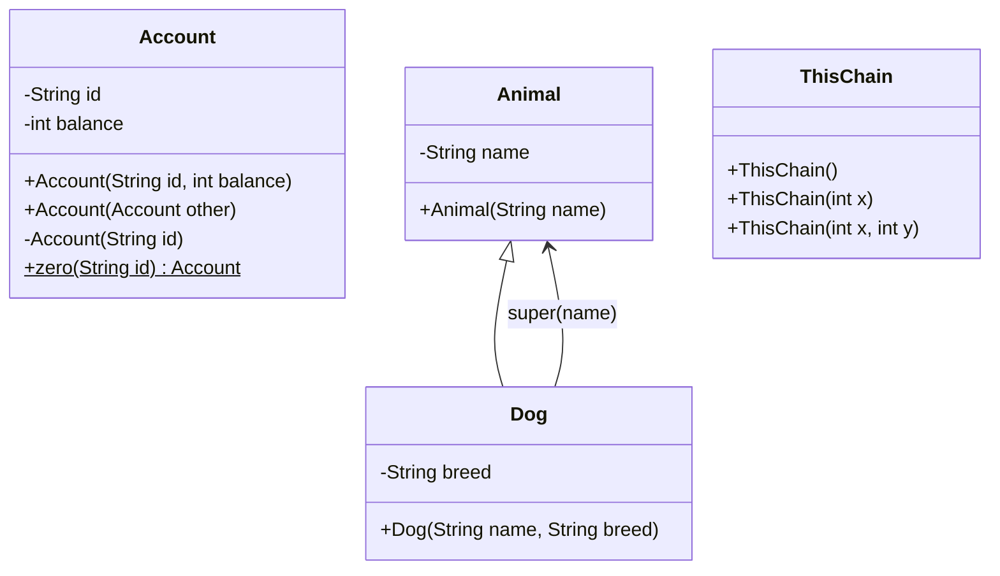

# Chapter 02 — Constructors

## What and why

Constructors initialize a new object. Exams hit default vs declared constructors, `this()` / `super()` as the **first** statement, private constructors, copy constructors, and the rule that **constructors are not inherited**.

## Exam flash rules

- If you declare **no** constructor, the compiler supplies a public **no-arg default**.
- If you declare **any** constructor, the default no-arg is **not** generated.
- A constructor’s name matches the class; it has **no return type** (not even `void`).
- `this(...)` calls another constructor of **this** class; it must be the **first** statement.
- `super(...)` calls a parent constructor; it must be the **first** statement (if present).
- If you omit `super(...)` / `this(...)`, the compiler inserts `super();` (no-arg parent).
- Parent with only a parameterized constructor → subclass must call `super(args)` explicitly.
- Constructors are **not inherited**; a subclass does not get `Parent(int)` as `Child(int)`.
- `private` constructors restrict creation (factories, singletons).
- A **copy constructor** takes another instance of the same type; field copies may be shallow.
- A method named like the class (with a return type) is **not** a constructor.
- Recursive `this()` with no terminal constructor is a compile-time error.

## Rules table

| Allowed | Not allowed | Compiler message |
|---------|-------------|------------------|
| `this(args);` as first statement | Statements before `this(...)` | `call to this must be first statement in constructor` |
| `super(args);` as first statement | Statements before `super(...)` | `call to super must be first statement in constructor` |
| `new OnlyParam(3)` | `new OnlyParam()` when only `OnlyParam(int)` exists | `constructor OnlyParam ... cannot be applied to given types` / `required: int` |
| Subclass ctor calling `super(n)` | Relying on inherited `Parent(int)` / implicit `super()` when parent has no no-arg | `constructor CtorParent ... required: int` / `CtorChild ... required: no arguments` |
| Mutual `this()` that bottoms out | `this()` cycle with no terminal ctor | `recursive constructor invocation` |

## Walkthrough

### Default constructor

```java
{{#include ../../code/part-01-oop/src/main/java/oop/ctors/DefaultBox.java:default-box}}
```

```java
{{#include ../../code/part-01-oop/src/main/java/oop/ctors/DefaultCtorDemo.java:default-ctor-demo}}
```

Program output:

```text
4
```

### Parameterized, private, copy

```java
{{#include ../../code/part-01-oop/src/main/java/oop/ctors/Account.java:account-ctors}}
```

```java
{{#include ../../code/part-01-oop/src/main/java/oop/ctors/AccountDemo.java:account-demo}}
```

Program output:

```text
A1:150
A1:100
Z:0
```

Copy is a separate object; `deposit` on `a` does not change `copy`. `zero` uses the private constructor.

### `this()` chaining

```java
{{#include ../../code/part-01-oop/src/main/java/oop/ctors/ThisChain.java:this-chain}}
```

Program output:

```text
(0,0)
(3,3)
(1,2)
```

### `super()` chaining

```java
{{#include ../../code/part-01-oop/src/main/java/oop/ctors/Animal.java:animal-super}}
```

```java
{{#include ../../code/part-01-oop/src/main/java/oop/ctors/Dog.java:dog-super}}
```

Program output:

```text
Rex/Lab
```

### Does not compile — `this()` not first

```java
{{#include ../../code/part-01-oop/broken/ThisNotFirstBroken.java}}
```

<div class="compiler-error">

```text
part-01-oop/broken/ThisNotFirstBroken.java:9: error: call to this must be first statement in constructor
    this(n, 0);
        ^
1 error
```

</div>

### Does not compile — `super()` not first

```java
{{#include ../../code/part-01-oop/broken/SuperNotFirstBroken.java}}
```

<div class="compiler-error">

```text
part-01-oop/broken/SuperNotFirstBroken.java:9: error: call to super must be first statement in constructor
    super(name);
         ^
1 error
```

</div>

### Does not compile — default gone

```java
{{#include ../../code/part-01-oop/src/main/java/oop/ctors/OnlyParam.java:only-param}}
```

```java
{{#include ../../code/part-01-oop/broken/MissingDefaultBroken.java}}
```

<div class="compiler-error">

```text
part-01-oop/broken/MissingDefaultBroken.java:9: error: constructor OnlyParam in class OnlyParam cannot be applied to given types;
    OnlyParam x = new OnlyParam();
                  ^
  required: int
  found:    no arguments
  reason: actual and formal argument lists differ in length
1 error
```

</div>

### Fixed — explicit no-arg restored

```java
{{#include ../../code/part-01-oop/src/main/java/oop/ctors/OnlyParamFixed.java:only-param-fixed}}
```

Program output:

```text
0
7
```

### Does not compile — constructor not inherited

```java
{{#include ../../code/part-01-oop/broken/CtorNotInheritedBroken.java}}
```

<div class="compiler-error">

```text
part-01-oop/broken/CtorNotInheritedBroken.java:11: error: constructor CtorParent in class CtorParent cannot be applied to given types;
class CtorChild extends CtorParent {
^
  required: int
  found:    no arguments
  reason: actual and formal argument lists differ in length
part-01-oop/broken/CtorNotInheritedBroken.java:17: error: constructor CtorChild in class CtorChild cannot be applied to given types;
    CtorChild c = new CtorChild(3);
                  ^
  required: no arguments
  found:    int
  reason: actual and formal argument lists differ in length
2 errors
```

</div>

Implicit `CtorChild()` tries `super();`, but parent needs `int`. Separately, `new CtorChild(3)` is not inherited from `CtorParent(int)`.

### Fixed — subclass declares ctor + `super`

```java
{{#include ../../code/part-01-oop/src/main/java/oop/ctors/CtorNotInheritedFixed.java:ctor-not-inherited-fixed}}
```

Program output:

```text
3
```

### Edge — shallow copy

```java
{{#include ../../code/part-01-oop/src/main/java/oop/ctors/CopyEdge.java:copy-edge}}
```

Program output:

```text
99 99
```

## Predict the output

**P1.**

```java
{{#include ../../code/part-01-oop/src/main/java/oop/ctors/exam/PredictThisChain.java:predict-this-chain}}
```

<details>
<summary>Answer</summary>

```text
label=A
no-arg done
```

`this("A")` runs fully before the rest of the no-arg body.

</details>

**P2.**

```java
{{#include ../../code/part-01-oop/src/main/java/oop/ctors/exam/PredictSuperOrder.java:predict-super-order}}
```

<details>
<summary>Answer</summary>

```text
Animal
Dog
```

Parent constructor body runs before the subclass body.

</details>

**P3.**

```java
{{#include ../../code/part-01-oop/src/main/java/oop/ctors/exam/PredictCopy.java:predict-copy}}
```

<details>
<summary>Answer</summary>

```text
X:15
X:10
```

</details>

**P4.**

```java
{{#include ../../code/part-01-oop/src/main/java/oop/ctors/exam/PredictPrivateCtor.java:predict-private-ctor}}
```

<details>
<summary>Answer</summary>

```text
Z:0
```

</details>

**P5.**

```java
{{#include ../../code/part-01-oop/src/main/java/oop/ctors/exam/PredictDefaultGone.java:predict-default-gone}}
```

<details>
<summary>Answer</summary>

```text
0
```

Explicit no-arg delegates with `this(0)`.

</details>

## Compile or not?

**C1.** `this()` after a print — see `ThisNotFirstBroken` above. **Fails:** `call to this must be first statement in constructor`.

**C2.** Field assign before `super` — `SuperNotFirstBroken`. **Fails:** `call to super must be first statement in constructor`.

**C3.** `new OnlyParam()` — `MissingDefaultBroken`. **Fails:** `required: int` / `found: no arguments`.

**C4.** “Inherited” `new CtorChild(3)` — `CtorNotInheritedBroken`. **Fails** (two errors: implicit `super()` and no `CtorChild(int)`).

**C5 (extra).** Recursive `this()`:

```java
{{#include ../../code/part-01-oop/broken/RecursiveThisBroken.java}}
```

<details>
<summary>Answer</summary>

**Fails:**

```text
part-01-oop/broken/RecursiveThisBroken.java:10: error: recursive constructor invocation
    this();
    ^
1 error
```

</details>

## Gotchas

1. **Declaring one ctor deletes the default** — `OnlyParam` / `MissingDefaultBroken`.
2. **Method named like the class** is not a constructor:

```java
{{#include ../../code/part-01-oop/src/main/java/oop/ctors/MethodNamedLikeClassGotcha.java:method-named-like-class}}
```

```text
42
```

3. **Shallow copy** shares mutable state — `CopyEdge`.
4. **Implicit `super()`** fails when the parent has no no-arg — `CtorNotInheritedBroken`.
5. **Recursive `this()`** — `RecursiveThisBroken` / safe pattern in `RecursiveThisGotcha`.

## UML



## Interview Q&A

1. **Q:** When is a default constructor generated? **A:** Only if the class declares no constructors (`DefaultBox`).
2. **Q:** What happens after you add `Foo(int)`? **A:** `new Foo()` fails unless you also declare a no-arg (`OnlyParam`).
3. **Q:** Must `this()` be first? **A:** Yes (`ThisNotFirstBroken`).
4. **Q:** Must `super()` be first? **A:** Yes (`SuperNotFirstBroken`).
5. **Q:** Are constructors inherited? **A:** No (`CtorNotInheritedBroken` / `Fixed`).
6. **Q:** What does the compiler insert if you omit `super`/`this`? **A:** `super();`
7. **Q:** Why use a private constructor? **A:** Control creation (`Account.zero`).
8. **Q:** What is a copy constructor? **A:** `Account(Account other)` — new instance, copied fields.
9. **Q:** Is copy always deep? **A:** No — `CopyEdge` shares the array.
10. **Q:** Is `void Foo()` a constructor? **A:** No; constructors have no return type (`MethodNamedLikeClassGotcha`).
11. **Q:** Parent then child print order? **A:** Parent body first (`PredictSuperOrder`).
12. **Q:** Can `this()` recurse forever? **A:** Compiler rejects recursive invocation.

## Exam writing prompts

1. (5 marks) Write three constructors for `Rect` (no-arg, square, width/height) using only `this()` chaining.
2. (2 marks) State why `new Child(3)` fails when only `Parent(int)` exists.
3. (5 marks) Fix a subclass of `Animal(String)` so `new Dog("a","b")` compiles and stores both fields.

## Exercises

1. Implement the `Rect` constructors from the writing prompt — `solutions/ch02/SolutionRect.java`.
2. Change `CopyEdge` to a **deep** copy — `solutions/ch02/SolutionDeepCopy.java`.
3. Add a private constructor + factory `Account.of(String id, int balance)` that rejects negative balances (throw `IllegalArgumentException`).
4. Trace on paper: `new ThisChain()` → which constructor bodies run, in order?
5. Create `Cat extends Animal` with only `Cat(String name)` calling `super(name)`.

## Recap checklist

- [x] Default, parameterized, private, copy
- [x] Chaining `this()` / `super()`
- [x] First-statement rule + compiler errors
- [x] Constructor not inherited
- [x] Exam flash, predict ≥5, compile ≥4, writing ≥3
