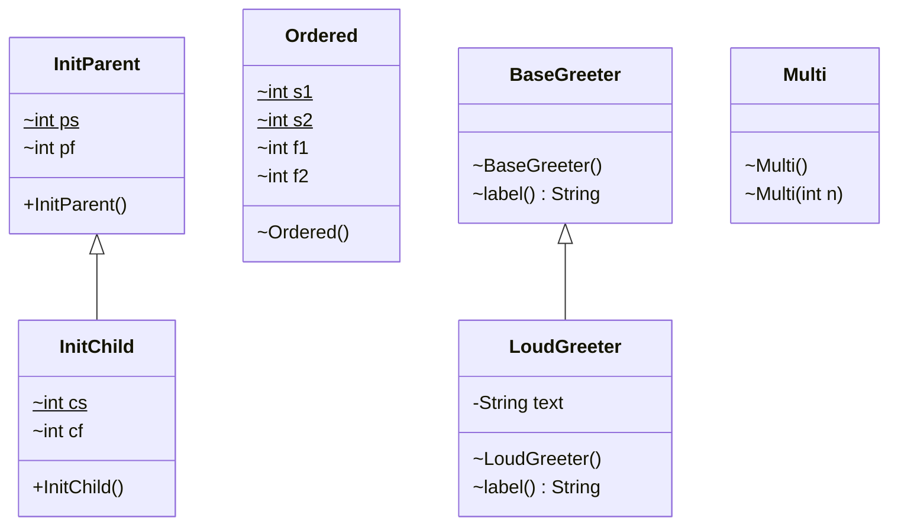

# Chapter 03 — Initialization order

## What and why

Initialization decides which values code sees while an object (or class) is still being built. Exams ask for the exact print order of static blocks, instance blocks, field initializers, and constructors, with and without inheritance.

## Exam flash rules

- Static members are initialized **once per class**, when the class is first initialized (not when the program starts).
- Class initialization runs static field initializers and `static { }` blocks in **textual order**.
- A class is initialized on `new`, a static method call, or a read/write of a **non-constant** static field.
- Reading a compile-time constant (`static final int K = 10;`, `static final String S = "s";`) does **not** initialize the class.
- Initializing a subclass first initializes its superclass; touching an inherited static through the subclass initializes **only the declaring class**.
- The class containing `main` is initialized before `main` runs, so its static blocks print first.
- For each `new`: fields get default values (`0`, `false`, `null`) first, then the constructor starts.
- A constructor first calls `super(...)` (explicit or implicit `super();`), then runs instance field initializers and `{ }` blocks in textual order, then the rest of the constructor body.
- Parent instance initializers and constructor finish **before** any child instance initializer runs.
- With `this(...)` chaining, instance initializers run only in the constructor that calls `super(...)`, not in the one that delegates with `this(...)`.
- A parent constructor that calls an overridden method runs the **child's** method on a child whose fields are still defaults.
- Reading a field by simple name before its declaration in an initializer is a compile error (`illegal forward reference`); `this.field` and method calls bypass that check and see the default value.
- A static initializer that throws raises `ExceptionInInitializerError`; later uses of the class raise `NoClassDefFoundError`.

## Rules table

| Allowed | Not allowed | Compiler message |
|---------|-------------|------------------|
| Read a static field declared **earlier** | Read a static field before its declaration | `illegal forward reference` |
| Read an instance field declared **earlier** | Read an instance field before its declaration | `illegal forward reference` |
| Assign to a field before its declaration (`early = 5;`) | — (assignment is allowed; only reads are blocked) | none |
| Static block using static members | Static block using instance members | `non-static variable count cannot be referenced from a static context` |
| Initializer that can complete normally | `static { throw ...; }` with no normal completion | `initializer must be able to complete normally` |
| Blank `final` assigned in constructor or init block | Blank `final` never assigned | `variable x not initialized in the default constructor` |
| Init block throws only what every constructor declares | Checked exception in init block, constructors declare nothing | `unreported exception Exception; must be caught or declared to be thrown` |
| `return` inside a method or constructor | `return;` inside an initializer block | `return outside method` |

## Walkthrough

### Helper used by the demos

```java
{{#include ../../code/part-01-oop/src/main/java/oop/init/InitTrace.java:init-trace}}
```

`say` prints a label and returns `0`, so a field initializer can log itself.

### Static block runs once, on first use

```java
{{#include ../../code/part-01-oop/src/main/java/oop/init/StaticBlockDemo.java:static-block-demo}}
```

Program output:

```text
main start
LazyConfig static block
LazyConfig ctor
LazyConfig ctor
loads=1
```

`main start` prints first: `LazyConfig` is not initialized until the first `new`. The static block runs once; the constructor runs twice.

### Fields, blocks, constructor in textual order

```java
{{#include ../../code/part-01-oop/src/main/java/oop/init/InstanceOrderDemo.java:ordered-class}}
```

```java
{{#include ../../code/part-01-oop/src/main/java/oop/init/InstanceOrderDemo.java:instance-order-demo}}
```

Program output:

```text
static field s1
static block
static field s2
instance field f1
instance block
instance field f2
constructor
-- second object --
instance field f1
instance block
instance field f2
constructor
```

Static items run once (first object only). Instance items run per object, in source order, **before** the constructor body.

### Parent–child inheritance order

```java
{{#include ../../code/part-01-oop/src/main/java/oop/init/InitParent.java:init-parent}}
```

```java
{{#include ../../code/part-01-oop/src/main/java/oop/init/InitChild.java:init-child}}
```

```java
{{#include ../../code/part-01-oop/src/main/java/oop/init/ParentChildDemo.java:parent-child-demo}}
```

Program output:

```text
main start
Parent static field
Parent static block
Child static field
Child static block
Parent instance field
Parent instance block
Parent constructor
Child instance field
Child instance block
Child constructor
-- second object --
Parent instance field
Parent instance block
Parent constructor
Child instance field
Child instance block
Child constructor
```

Trace for one `new InitChild()`:

| Step | What runs | When |
|------|-----------|------|
| 1 | Parent static field + block | first use of the hierarchy only |
| 2 | Child static field + block | first use only |
| 3 | Fields get defaults | every `new` |
| 4 | Parent instance field + block, then Parent constructor body | every `new` |
| 5 | Child instance field + block, then Child constructor body | every `new` |

The second object skips steps 1–2 because both classes are already initialized.

### Instance block and `this()` chaining

```java
{{#include ../../code/part-01-oop/src/main/java/oop/init/InitBlockThisChain.java:init-block-this-chain}}
```

Program output:

```text
instance block
Multi(int)
Multi()
```

`Multi()` delegates with `this(1)`, so the instance block runs once, inside `Multi(int)` (the constructor that calls `super()`), before its body.

### Does not compile — forward reference (static)

```java
{{#include ../../code/part-01-oop/broken/InitStaticBeforeBroken.java}}
```

<div class="compiler-error">

```text
part-01-oop/broken/InitStaticBeforeBroken.java:5: error: illegal forward reference
  static int a = b + 1;
                 ^
1 error
```

</div>

### Does not compile — forward reference (instance)

```java
{{#include ../../code/part-01-oop/broken/InitForwardInstanceBroken.java}}
```

<div class="compiler-error">

```text
part-01-oop/broken/InitForwardInstanceBroken.java:5: error: illegal forward reference
  int x = y;
          ^
1 error
```

</div>

### Edge — forward reads that do compile

```java
{{#include ../../code/part-01-oop/src/main/java/oop/init/ForwardReferenceEdge.java:forward-reference-edge}}
```

Program output:

```text
viaMethod=0
viaThis=1
later=5
```

The compiler only blocks a **simple-name read**. A method call (`readLater()`) or `this.later` compiles and sees the default `0`.

### Does not compile — static block uses instance field

```java
{{#include ../../code/part-01-oop/broken/InitStaticUsesInstanceBroken.java}}
```

<div class="compiler-error">

```text
part-01-oop/broken/InitStaticUsesInstanceBroken.java:8: error: non-static variable count cannot be referenced from a static context
    count = 1;
    ^
1 error
```

</div>

### Does not compile — static initializer never completes

```java
{{#include ../../code/part-01-oop/broken/InitBlockCannotCompleteBroken.java}}
```

<div class="compiler-error">

```text
part-01-oop/broken/InitBlockCannotCompleteBroken.java:5: error: initializer must be able to complete normally
  static {
  ^
1 error
```

</div>

### Does not compile — blank final never assigned

```java
{{#include ../../code/part-01-oop/broken/InitFinalNotAssignedBroken.java}}
```

<div class="compiler-error">

```text
part-01-oop/broken/InitFinalNotAssignedBroken.java:5: error: variable x not initialized in the default constructor
  final int x;
            ^
1 error
```

</div>

Fixed two ways (exercise 4 solution): assign in an instance block or in the constructor — `solutions/ch03/SolutionFinalFixed.java`.

### Does not compile — checked exception in an instance block

```java
{{#include ../../code/part-01-oop/broken/InitCheckedInBlockBroken.java}}
```

<div class="compiler-error">

```text
part-01-oop/broken/InitCheckedInBlockBroken.java:7: error: unreported exception Exception; must be caught or declared to be thrown
      throw new Exception("checked");
      ^
1 error
```

</div>

### Does not compile — `return` in an initializer

```java
{{#include ../../code/part-01-oop/broken/InitReturnInBlockBroken.java}}
```

<div class="compiler-error">

```text
part-01-oop/broken/InitReturnInBlockBroken.java:6: error: return outside method
    return;
    ^
1 error
```

</div>

### Edge — what triggers class initialization

```java
{{#include ../../code/part-01-oop/src/main/java/oop/init/InitTriggerDemo.java:init-trigger}}
```

Program output:

```text
K=10
S=s
Constants static block
NOT_CONSTANT=11
```

`K` and `S` are compile-time constants: the compiler inlines them, so `Constants` is not initialized. `NOT_CONSTANT` is `static final` but not a constant expression, so reading it initializes the class.

### Edge — failed static initialization

```java
{{#include ../../code/part-01-oop/src/main/java/oop/init/StaticInitFailureDemo.java:static-init-failure}}
```

Program output:

```text
first: ExceptionInInitializerError, cause NumberFormatException
second: NoClassDefFoundError, Could not initialize class oop.init.FailingStatic
```

The first use fails the initializer; the class stays unusable for the rest of the run.

## Predict the output

**P1.**

```java
{{#include ../../code/part-01-oop/src/main/java/oop/init/exam/PredictInitOrder.java:predict-init-order}}
```

(Other predict sources: `PredictStaticMain`, `PredictSubViaSuper`, `PredictOverrideCtor`, `PredictThisChainBlock`, `PredictStaticCounter`, `PredictConstantTrigger` under `oop/init/exam/`.)

<details>
<summary>Answer</summary>

```text
S
I
C
I
C
```

Static block once; then instance block → constructor for each object.

</details>

**P2.**

```java
{{#include ../../code/part-01-oop/src/main/java/oop/init/exam/PredictStaticMain.java:predict-static-main}}
```

<details>
<summary>Answer</summary>

```text
static
main
```

The main class is initialized before `main` is invoked.

</details>

**P3.**

```java
{{#include ../../code/part-01-oop/src/main/java/oop/init/exam/PredictOverrideCtor.java:predict-override-ctor}}
```

<details>
<summary>Answer</summary>

```text
side=0
side=4
```

`Shape0()` runs first and dispatches to `Square0.describe()` while `side` is still `0`; `side = 4` runs after `super()` returns.

</details>

**P4.**

```java
{{#include ../../code/part-01-oop/src/main/java/oop/init/exam/PredictSubViaSuper.java:predict-sub-via-super}}
```

<details>
<summary>Answer</summary>

```text
Sup static
v=1
```

`Sub.v` is declared in `Sup`, so only `Sup` is initialized; `Sub static` never prints.

</details>

**P5.**

```java
{{#include ../../code/part-01-oop/src/main/java/oop/init/exam/PredictThisChainBlock.java:predict-this-chain-block}}
```

<details>
<summary>Answer</summary>

```text
116
```

`n`: `1` (field) → `11` (block) → `16` (`Box(int)` body) → `116` (`Box()` body). The block runs once.

</details>

**P6.**

```java
{{#include ../../code/part-01-oop/src/main/java/oop/init/exam/PredictStaticCounter.java:predict-static-counter}}
```

<details>
<summary>Answer</summary>

```text
3
```

Each `new` runs `next++` in the `id` initializer; the third object gets `3`.

</details>

**P7.**

```java
{{#include ../../code/part-01-oop/src/main/java/oop/init/exam/PredictConstantTrigger.java:predict-constant-trigger}}
```

<details>
<summary>Answer</summary>

```text
5
K init
6
```

`A` is a constant (inlined, no init). `B` is an `Integer`, not a constant, so reading it initializes `K`.

</details>

## Compile or not?

**C1.** `static int a = b + 1; static int b = 2;` — `InitStaticBeforeBroken`. **Fails:** `illegal forward reference`.

**C2.** `int x = y; int y = 1;` — `InitForwardInstanceBroken`. **Fails:** `illegal forward reference`.

**C3.** `static { count = 1; }` with instance `count` — `InitStaticUsesInstanceBroken`. **Fails:** `non-static variable count cannot be referenced from a static context`.

**C4.** `static { throw new RuntimeException("boom"); }` — `InitBlockCannotCompleteBroken`. **Fails:** `initializer must be able to complete normally`.

**C5.** `final int x;` with no assignment — `InitFinalNotAssignedBroken`. **Fails:** `variable x not initialized in the default constructor`.

**C6.** Instance block throws `Exception`, constructor declares nothing — `InitCheckedInBlockBroken`. **Fails:** `unreported exception Exception; must be caught or declared to be thrown`.

**C7.** `{ return; }` in an instance block — `InitReturnInBlockBroken`. **Fails:** `return outside method`.

**C8 (looks wrong, compiles).**

```java
{{#include ../../code/part-01-oop/src/main/java/oop/init/exam/CompileForwardOk.java:compile-forward-ok}}
```

<details>
<summary>Answer</summary>

**Compiles.** Assigning (`early = 5;`) before the declaration is legal, and `this.later` is not a simple-name read.

```text
early=1
viaThis=1, later=7
```

`early` ends as `1`: the block assigns `5`, then the declaration's initializer `= 1` runs after it.

</details>

## Gotchas

1. **Overridable call in a parent constructor** sees the child's default fields:

```java
{{#include ../../code/part-01-oop/src/main/java/oop/init/OverrideInCtorGotcha.java:override-in-ctor}}
```

```text
Base ctor sees: null
Loud ctor sees: loud
```

2. **Forward read through a method or `this.`** compiles and yields the default — `ForwardReferenceEdge`.
3. **Constants do not trigger initialization**; non-constant `static final` does — `InitTriggerDemo`, `PredictConstantTrigger`.
4. **Inherited static through the subclass** initializes only the declaring class — `PredictSubViaSuper`.
5. **Failed static init is permanent**: `ExceptionInInitializerError`, then `NoClassDefFoundError` — `StaticInitFailureDemo`.

## UML



## Interview Q&A

1. **Q:** Order inside one class? **A:** Static fields/blocks (once), then per object: instance fields/blocks in textual order, then constructor body (`InstanceOrderDemo`).
2. **Q:** When does a static block run? **A:** On first class initialization, not at program start (`StaticBlockDemo`).
3. **Q:** How many times does it run? **A:** Once per class (per class loader) — `loads=1` in `StaticBlockDemo`.
4. **Q:** Instance block vs constructor body? **A:** The block runs first, after `super()` returns (`InstanceOrderDemo`).
5. **Q:** Parent/child order for `new Child()`? **A:** Parent static, child static, parent instance + ctor, child instance + ctor (`ParentChildDemo`).
6. **Q:** Does `this(...)` run the instance block twice? **A:** No; once, in the constructor that reaches `super()` (`InitBlockThisChain`).
7. **Q:** Why does a parent constructor print `null` for a child field? **A:** The child's initializers have not run yet (`OverrideInCtorGotcha`, `PredictOverrideCtor`).
8. **Q:** What is an illegal forward reference? **A:** A simple-name read of a field declared later in an initializer (`InitStaticBeforeBroken`); `this.f` or a method call is not blocked (`ForwardReferenceEdge`, `CompileForwardOk`).
9. **Q:** Does reading `static final int K = 10` initialize the class? **A:** No, it is a constant (`InitTriggerDemo`).
10. **Q:** What happens when a static initializer throws? **A:** `ExceptionInInitializerError`, then `NoClassDefFoundError` on reuse (`StaticInitFailureDemo`).
11. **Q:** Can a static block use instance fields? **A:** No (`InitStaticUsesInstanceBroken`).
12. **Q:** Does the main class's static block run before `main`? **A:** Yes (`PredictStaticMain`).
13. **Q:** Does `Sub.v` initialize `Sub` when `v` is declared in `Sup`? **A:** No, only `Sup` (`PredictSubViaSuper`).
14. **Q:** How can a blank `final` instance field be set? **A:** In every constructor or in an instance block (`SolutionFinalFixed`); otherwise `InitFinalNotAssignedBroken`.

## Exam writing prompts

1. (5 marks) Write `LogParent` and `LogChild` so that `new LogChild()` records, in order: `P-static, C-static, P-block, P-ctor, C-block, C-ctor` in a shared list — `solutions/ch03/SolutionOrderLog.java`.
2. (3 marks) Fix `BaseGreeter` / `LoudGreeter` so the parent constructor prints `loud`, not `null`, without calling an overridable method — `solutions/ch03/SolutionSafeParent.java`.
3. (2 marks) Rewrite `static int a = b + 1; static int b = 2;` so it compiles with `a == 3` — `solutions/ch03/SolutionForwardFixed.java`.

Reference outputs:

```text
[P-static, C-static, P-block, P-ctor, C-block, C-ctor]
```

```text
Base ctor sees: loud
Loud ctor done
```

```text
a=3, b=2
```

## Exercises

1. Count objects created with an instance block shared by two constructors — `solutions/ch03/SolutionInstanceCounter.java` (prints `created=3, last serial=3`).
2. Fill a lookup table once in a static block; show the block prints once — `solutions/ch03/SolutionStaticTable.java` (prints `table built`, `2`, `-1`).
3. Catch the error from a failing static initializer and print the cause message — `solutions/ch03/SolutionInitFailure.java` (prints `cause: cannot start`).
4. Fix `InitFinalNotAssignedBroken` in two ways — `solutions/ch03/SolutionFinalFixed.java` (prints `4`, `5`).
5. On paper, list the 10 lines printed by the first `new InitChild()` (excluding `main start`), then compare with the `ParentChildDemo` output above.

## Recap checklist

- [x] Static blocks, instance init blocks, field initializers, constructor
- [x] Parent–child order demo with captured output
- [x] Forward reference rules + compiler errors
- [x] Class initialization triggers (constants, inherited statics)
- [x] Exam flash, predict ≥5, compile ≥4, writing ≥3
