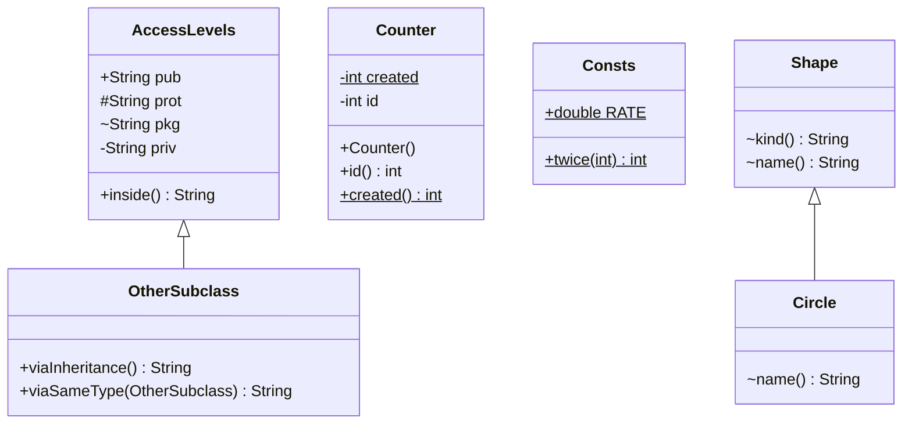

# Chapter 04 — Access, static, final

## What and why

Access modifiers decide **who may name a member**; `static` decides **whether a member belongs to the class or to each object**; `final` decides **what cannot be reassigned, overridden, or extended**. Exams hit the four access levels (including `protected` across packages), `static` context errors, `final` on variables/methods/classes, and static imports.

## Exam flash rules

- Four access levels, widest to narrowest: `public` > `protected` > *(no modifier)* = package-private > `private`.
- No modifier means **package-private**, not `protected` and not `public`.
- `private` is **class-level**, not object-level: one instance may read another instance's `private` field of the same class.
- `protected` = package access **plus** subclasses in other packages, and in another package only through the **subclass type** (or a subtype).
- A top-level class may be `public` or package-private only; `private class` at top level does not compile.
- An overriding method may keep or **widen** access; it may not narrow it (`toString()` needs `public`).
- `static` members belong to the class: one copy, shared by every object.
- A static method has no `this`; it cannot use instance members without an object.
- A static member accessed through a reference uses the reference's **declared type**; a `null` reference is fine for a static member.
- Static methods are **hidden**, not overridden: the call is chosen at compile time.
- `final` variable: assigned **once**; `final` reference does not make the object immutable.
- A **blank final** field must be assigned exactly once on every constructor path.
- `final` method cannot be overridden; `final` class cannot be extended.
- `final` parameter cannot be assigned in the body.
- `import static` brings a static member in by simple name; a method declared in the class **hides** a static-imported method of the same name.

## Access matrix

| Modifier | Same class | Same package | Subclass, other package | Other package, non-subclass |
|----------|:---:|:---:|:---:|:---:|
| `public` | yes | yes | yes | yes |
| `protected` | yes | yes | yes (via subclass type) | no |
| *(none)* | yes | yes | no | no |
| `private` | yes | no | no | no |

## Rules table

| Allowed | Not allowed | Compiler message |
|---------|-------------|------------------|
| Read `private` inside its own class | Read `private` from another class | `priv has private access in AccessLevels` |
| Read package-private in same package | Read package-private from another package | `pkg is not public in AccessLevels; cannot be accessed from outside package` |
| `protected` via `this` / subclass type in another package | `protected` from a non-subclass in another package | `prot has protected access in AccessLevels` |
| `protected` via subclass-typed reference | `protected` via parent-typed reference in another package | `prot has protected access in AccessLevels` |
| Name a public class from any package | Name a package-private class from another package | `PackagePrivateHelper is not public in oop.access; cannot be accessed from outside package` |
| Top-level `public` or package-private class | Top-level `private class` | `modifier private not allowed here` |
| Instance member via an object | Instance member from `static` context | `non-static variable n cannot be referenced from a static context` |
| Assign a `final` local once | Second assignment | `cannot assign a value to final variable x` |
| Read a `final` parameter | Assign a `final` parameter | `final parameter n may not be assigned` |
| Override a non-final method | Override a `final` method | `run() in FinalMethodChild cannot override run() in FinalMethodParent` / `overridden method is final` |
| Extend a non-final class | Extend a `final` class | `cannot inherit from final FinalClassParent` |
| Assign blank final in every constructor | Constructor that leaves it unassigned | `variable limit might not have been initialized` |
| Override with same or wider access | Override with narrower access | `toString() in AccessNarrowOverrideBroken cannot override toString() in Object` / `attempting to assign weaker access privileges; was public` |
| One static import per simple name | Two on-demand imports both supplying `twice(int)` | `reference to twice is ambiguous` |

## Walkthrough

### All four levels inside one class

```java
{{#include ../../code/part-01-oop/src/main/java/oop/access/AccessLevels.java:access-levels}}
```

Program output:

```text
public,protected,package-private,private
```

### Same package

```java
{{#include ../../code/part-01-oop/src/main/java/oop/access/PackagePrivateHelper.java:package-class}}
```

```java
{{#include ../../code/part-01-oop/src/main/java/oop/access/SamePackageDemo.java:same-package}}
```

Program output:

```text
public,protected,package-private
helper
```

### Does not compile — `private` from another class

```java
{{#include ../../code/part-01-oop/broken/AccessPrivateBroken.java}}
```

<div class="compiler-error">

```text
part-01-oop/broken/AccessPrivateBroken.java:7: error: priv has private access in AccessLevels
    System.out.println(a.priv);
                        ^
1 error
```

</div>

### Other package, not a subclass

Only `public` remains. The second package is `oop.access.other`.

```java
{{#include ../../code/part-01-oop/src/main/java/oop/access/other/OtherPackageDemo.java:other-package}}
```

Program output:

```text
public
```

### Does not compile — `protected` from a non-subclass

```java
{{#include ../../code/part-01-oop/broken/AccessProtectedBroken.java}}
```

<div class="compiler-error">

```text
part-01-oop/broken/AccessProtectedBroken.java:9: error: prot has protected access in AccessLevels
    System.out.println(a.prot);
                        ^
1 error
```

</div>

### Other package, subclass

```java
{{#include ../../code/part-01-oop/src/main/java/oop/access/other/OtherSubclass.java:other-subclass}}
```

Program output:

```text
public,protected
protected
```

`prot` is reachable through `this` and through another `OtherSubclass`. A reference typed `AccessLevels` is rejected (see **C2** below).

### `static` vs instance

```java
{{#include ../../code/part-01-oop/src/main/java/oop/access/Counter.java:counter}}
```

Program output:

```text
1 2 2
```

| | `static` member | Instance member |
|---|---|---|
| Belongs to | the class | one object |
| Copies | one | one per object |
| Has `this` | no | yes |
| May use instance members directly | no | yes |
| May use static members directly | yes | yes |
| Chosen by | declared type, compile time (methods: hiding) | runtime class (overriding) |

### Does not compile — instance field from `static`

```java
{{#include ../../code/part-01-oop/broken/AccessStaticThisBroken.java}}
```

<div class="compiler-error">

```text
part-01-oop/broken/AccessStaticThisBroken.java:8: error: non-static variable n cannot be referenced from a static context
    System.out.println(n);
                       ^
1 error
```

</div>

### Fixed — create an object first

```java
{{#include ../../code/part-01-oop/src/main/java/oop/access/StaticContextFixed.java:static-context-fixed}}
```

Program output:

```text
10
1
11
```

### `final` — variable, parameter, constant

```java
{{#include ../../code/part-01-oop/src/main/java/oop/access/FinalDemo.java:final-demo}}
```

Program output:

```text
15
3
```

### Does not compile — reassign a `final`

```java
{{#include ../../code/part-01-oop/broken/AccessFinalVarBroken.java}}
```

<div class="compiler-error">

```text
part-01-oop/broken/AccessFinalVarBroken.java:7: error: cannot assign a value to final variable x
    x = 2;
    ^
1 error
```

</div>

### Edge — `final` reference, mutable object

```java
{{#include ../../code/part-01-oop/src/main/java/oop/access/FinalRefEdge.java:final-ref-edge}}
```

Program output:

```text
[9, 2]
xy
```

### `final` method and class

```java
{{#include ../../code/part-01-oop/src/main/java/oop/access/FinalMethodDemo.java:final-method-demo}}
```

Program output:

```text
shape
circle
4
```

### Static import

```java
{{#include ../../code/part-01-oop/src/main/java/oop/access/other/Consts.java:consts}}
```

```java
{{#include ../../code/part-01-oop/src/main/java/oop/access/StaticImportDemo.java:static-import-demo}}
```

Program output:

```text
7
8
0.5
```

`import static` works only for **static** members. Use it sparingly: the simple name hides where a method came from.

## Predict the output

**P1.**

```java
{{#include ../../code/part-01-oop/src/main/java/oop/access/exam/PredictStaticCounter.java:predict-static-counter}}
```

<details>
<summary>Answer</summary>

```text
3 3
```

Trace: three constructions → `count` reaches 3; `c.id` is the third value.

</details>

**P2.**

```java
{{#include ../../code/part-01-oop/src/main/java/oop/access/exam/PredictStaticShared.java:predict-static-shared}}
```

<details>
<summary>Answer</summary>

```text
6 6
```

Trace: `a.x`, `b.x` and `Box.x` are one variable: 5, then 6.

</details>

**P3.** Does the program print `end`?

```java
{{#include ../../code/part-01-oop/src/main/java/oop/access/exam/PredictStaticNull.java:predict-static-null}}
```

<details>
<summary>Answer</summary>

stdout:

```text
hi
```

stderr (exit code 1):

```text
Exception in thread "main" java.lang.NullPointerException: Cannot invoke "oop.access.exam.PredictStaticNull.inst()" because "p" is null
	at oop.access.exam.PredictStaticNull.main(PredictStaticNull.java:16)
```

Trace: static call through `null` succeeds; the instance call throws; `end` is never reached.

</details>

**P4.**

```java
{{#include ../../code/part-01-oop/src/main/java/oop/access/exam/PredictFinalRef.java:predict-final-ref}}
```

<details>
<summary>Answer</summary>

```text
ab 7
```

Trace: `final` blocks re-pointing `sb` / `arr`, not mutating what they refer to.

</details>

**P5.**

```java
{{#include ../../code/part-01-oop/src/main/java/oop/access/exam/PredictStaticDispatch.java:predict-static-dispatch}}
```

<details>
<summary>Answer</summary>

```text
Parent
Child
```

Trace: static `who()` is picked by declared type `Parent`; instance `me()` by runtime type `Child`.

</details>

**P6.**

```java
{{#include ../../code/part-01-oop/src/main/java/oop/access/exam/PredictPrivateSameClass.java:predict-private-same-class}}
```

<details>
<summary>Answer</summary>

```text
true
false
```

Trace: `o.v` compiles because `private` is checked per class, not per object.

</details>

## Compile or not?

**C1.** Package `oop.access.other` reads `a.pkg` of `AccessLevels`.

```java
{{#include ../../code/part-01-oop/broken/AccessPackageBroken.java}}
```

<details>
<summary>Answer</summary>

**Fails:**

```text
part-01-oop/broken/AccessPackageBroken.java:9: error: pkg is not public in AccessLevels; cannot be accessed from outside package
    System.out.println(a.pkg);
                        ^
1 error
```

</details>

**C2.** A subclass in another package reads `prot` through a parent-typed parameter. Looks fine because the class **is** a subclass.

```java
{{#include ../../code/part-01-oop/broken/AccessProtectedViaRefBroken.java}}
```

<details>
<summary>Answer</summary>

**Fails:**

```text
part-01-oop/broken/AccessProtectedViaRefBroken.java:11: error: prot has protected access in AccessLevels
    return other.prot;
                ^
1 error
```

Fix: take an `AccessProtectedViaRefBroken` (subclass type) parameter, as `OtherSubclass.viaSameType` does.

</details>

**C3.** Override of a `final` method.

```java
{{#include ../../code/part-01-oop/broken/AccessFinalMethodBroken.java}}
```

<details>
<summary>Answer</summary>

**Fails:**

```text
part-01-oop/broken/AccessFinalMethodBroken.java:10: error: run() in FinalMethodChild cannot override run() in FinalMethodParent
  void run() {}
       ^
  overridden method is final
1 error
```

</details>

**C4.** `toString()` without `public`.

```java
{{#include ../../code/part-01-oop/broken/AccessNarrowOverrideBroken.java}}
```

<details>
<summary>Answer</summary>

**Fails:**

```text
part-01-oop/broken/AccessNarrowOverrideBroken.java:6: error: toString() in AccessNarrowOverrideBroken cannot override toString() in Object
  String toString() {
         ^
  attempting to assign weaker access privileges; was public
1 error
```

</details>

**C5.** Assignment to a `final` parameter.

```java
{{#include ../../code/part-01-oop/broken/AccessFinalParamBroken.java}}
```

<details>
<summary>Answer</summary>

**Fails:**

```text
part-01-oop/broken/AccessFinalParamBroken.java:6: error: final parameter n may not be assigned
    n = n + 1;
    ^
1 error
```

</details>

**C6.** Blank final never assigned.

```java
{{#include ../../code/part-01-oop/broken/AccessBlankFinalBroken.java}}
```

<details>
<summary>Answer</summary>

**Fails:**

```text
part-01-oop/broken/AccessBlankFinalBroken.java:7: error: variable limit might not have been initialized
  public AccessBlankFinalBroken() {}
                                   ^
1 error
```

The error points at the constructor end, not the field.

</details>

**C7.** Subclass of a `final` class.

```java
{{#include ../../code/part-01-oop/broken/AccessFinalClassBroken.java}}
```

<details>
<summary>Answer</summary>

**Fails:**

```text
part-01-oop/broken/AccessFinalClassBroken.java:6: error: cannot inherit from final FinalClassParent
class FinalClassChild extends FinalClassParent {}
                              ^
1 error
```

</details>

**C8.** Another package imports and calls a package-private class.

```java
{{#include ../../code/part-01-oop/broken/AccessPackageClassBroken.java}}
```

<details>
<summary>Answer</summary>

**Fails** (the import and the use are both reported):

```text
part-01-oop/broken/AccessPackageClassBroken.java:3: error: PackagePrivateHelper is not public in oop.access; cannot be accessed from outside package
import oop.access.PackagePrivateHelper;
                 ^
part-01-oop/broken/AccessPackageClassBroken.java:8: error: PackagePrivateHelper is not public in oop.access; cannot be accessed from outside package
    System.out.println(PackagePrivateHelper.hello());
                       ^
2 errors
```

</details>

**C9.** Top-level `private class`.

```java
{{#include ../../code/part-01-oop/broken/AccessPrivateClassBroken.java}}
```

<details>
<summary>Answer</summary>

**Fails:**

```text
part-01-oop/broken/AccessPrivateClassBroken.java:4: error: modifier private not allowed here
private class AccessPrivateClassBroken {}
        ^
1 error
```

</details>

**C10.** Two on-demand static imports; both classes declare `twice(int)`.

```java
{{#include ../../code/part-01-oop/broken/AccessStaticImportAmbiguousBroken.java}}
```

<details>
<summary>Answer</summary>

**Fails:**

```text
part-01-oop/broken/AccessStaticImportAmbiguousBroken.java:9: error: reference to twice is ambiguous
    System.out.println(twice(1));
                       ^
  both method twice(int) in Consts and method twice(int) in OtherConsts match
1 error
```

</details>

**C11.** Looks like a second assignment to a `final`. Compiles or fails?

```java
{{#include ../../code/part-01-oop/src/main/java/oop/access/exam/CompileFinalDeferredOk.java:compile-final-deferred}}
```

<details>
<summary>Answer</summary>

**Compiles.** Each path assigns `x` exactly once (definite assignment). Output with no arguments:

```text
2
```

</details>

## MCQ-style traps

**M1.** A member declared with no modifier is visible to…

- (a) subclasses in any package
- (b) classes in the same package only ✔
- (c) every class
- (d) the declaring class only

(a) is `protected`; (c) is `public`; (d) is `private`.

**M2.** `final int[] a = {1}; a[0] = 2;`

- (a) compile error: `a` is final
- (b) compile error: arrays are immutable
- (c) compiles; `a[0]` is 2 ✔
- (d) runtime exception

`final` fixes `a`, not its elements (`FinalRefEdge`).

**M3.** Which may be `static`?

- (a) a top-level class
- (b) a method ✔
- (c) a constructor
- (d) a local variable

Top-level classes, constructors, and locals cannot be `static`. A *nested* class can (chapter 05).

**M4.** `Parent p = new Child();` and both declare `static void who()`. `p.who()` runs…

- (a) `Child.who()`
- (b) `Parent.who()` ✔
- (c) either, chosen at runtime
- (d) compile error

Static methods are hidden; declared type decides (`PredictStaticDispatch`).

## Gotchas

1. **Static call through `null` works** — `StaticNullGotcha`:

```java
{{#include ../../code/part-01-oop/src/main/java/oop/access/StaticNullGotcha.java:static-null}}
```

```text
0
NullPointerException
```

2. **`final` reference ≠ immutable object** — `FinalRefEdge`.
3. **`protected` through a parent-typed reference fails** in another package — `AccessProtectedViaRefBroken`.
4. **A class's own method hides a static import** of the same name:

```java
{{#include ../../code/part-01-oop/src/main/java/oop/access/StaticImportShadowGotcha.java:static-import-shadow}}
```

```text
3
8
```

5. **`private` is per class, not per object** — `PredictPrivateSameClass`.

## UML



Package split: `AccessLevels`, `Counter`, `Shape` live in `oop.access`; `OtherSubclass`, `Consts` live in `oop.access.other`.

## Interview Q&A

1. **Q:** Order the four access levels. **A:** `public`, `protected`, package-private, `private` (`AccessLevels`).
2. **Q:** What does omitting the modifier mean? **A:** Package-private (`AccessPackageBroken`).
3. **Q:** Can a subclass in another package read a `protected` field? **A:** Yes, through its own type (`OtherSubclass`).
4. **Q:** Can it read it through a parent-typed reference? **A:** No (`AccessProtectedViaRefBroken`).
5. **Q:** Can one object read another object's `private` field? **A:** Yes, if both are the same class (`PredictPrivateSameClass`).
6. **Q:** Can a top-level class be `private`? **A:** No (`AccessPrivateClassBroken`).
7. **Q:** Can an overriding method be less visible? **A:** No (`AccessNarrowOverrideBroken`).
8. **Q:** Why can `main` not use an instance field directly? **A:** `static` has no `this` (`AccessStaticThisBroken`).
9. **Q:** Does a `static` call through `null` throw? **A:** No (`StaticNullGotcha`).
10. **Q:** Are static methods overridden? **A:** No, hidden; declared type decides (`PredictStaticDispatch`).
11. **Q:** Does `final` make an object immutable? **A:** No, only the variable (`FinalRefEdge`).
12. **Q:** What is a blank final? **A:** A `final` field without an initializer; every constructor must assign it once (`AccessBlankFinalBroken` / `SolutionBlankFinalChain`).
13. **Q:** Effect of `final` on a method / class? **A:** Cannot be overridden / extended (`AccessFinalMethodBroken`, `AccessFinalClassBroken`).
14. **Q:** Can a `final` local be assigned later? **A:** Once, on each path (`CompileFinalDeferredOk`).
15. **Q:** What does `import static` import? **A:** Static members by simple name (`StaticImportDemo`); a same-named method in the class hides it (`StaticImportShadowGotcha`).

## Exam writing prompts

1. (5 marks) Write class `Ticket` with a `private static` counter, a `final` instance `id` assigned from the counter, a `public` accessor, and a `public static` method returning how many tickets exist.
2. (5 marks) Write an immutable `Point` (`final` class, `final` fields, no setters, `withX(int)` returning a new `Point`).
3. (2 marks) Fix `class A { String toString() { return "a"; } }` so it compiles, and state the rule.
4. (3 marks) Complete the table of the four access levels against *same class*, *same package*, *subclass in another package*, *other package*.
5. (5 marks) Write a class with a blank `final int limit` and two constructors, one of which delegates with `this(...)`.

## Exercises

1. Implement `Ticket` — `solutions/ch04/SolutionTicket.java`.
2. Implement the immutable `Point` — `solutions/ch04/SolutionFinalPoint.java`.
3. Compute a circle area using `import static java.lang.Math.PI` and `pow` — `solutions/ch04/SolutionStaticImport.java`.
4. Fix the `toString()` access — `solutions/ch04/SolutionToStringPublic.java`.
5. Blank final assigned on every constructor path — `solutions/ch04/SolutionBlankFinalChain.java`.
6. Paper: fill the access matrix without looking, then check it against the table above.

## Recap checklist

- [x] Four access levels + cross-package demo (`oop.access`, `oop.access.other`)
- [x] `static`, `final` (variable / method / class / parameter)
- [x] Static vs instance, static import
- [x] Exam flash, predict ≥5, compile ≥4, writing ≥3
