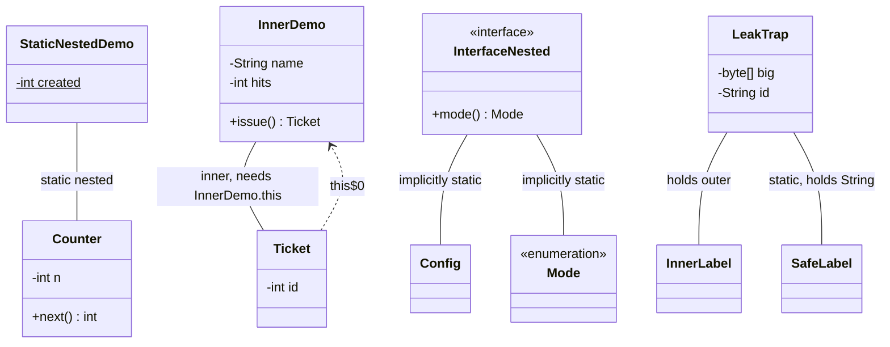

# Chapter 05 — Nested classes

## What and why

A **nested class** is declared inside another type. Java has **four kinds** — static nested, inner (member), local, anonymous — and exams ask which kind may touch the outer instance, which names `Outer.this` / `outer.new Inner()` resolve, what a captured local must look like, and which kind silently keeps the outer object alive.

## Exam flash rules

- Four kinds: **static nested**, **inner (non-static member)**, **local** (in a block), **anonymous** (no name).
- A **static nested** class has **no** enclosing instance; it may read only the outer's **static** members directly.
- An **inner** class instance is bound to an **enclosing instance**; it may read and write the outer's `private` members directly.
- The outer class may read a nested class's `private` members (same top-level class).
- `Outer.this` names the enclosing instance; `outer.new Inner()` creates an inner object bound to `outer`.
- Creating an inner class from a `static` method without an outer object fails: `non-static variable this cannot be referenced from a static context`.
- `outer.new Sn()` on a **static** nested class is an error: `qualified new of static class`.
- Name lookup goes innermost → outward; a field or parameter with the same name **shadows** the outer one. Pick with `this.x` and `Outer.this.x`.
- Local and anonymous classes may use a local variable or parameter only if it is **final or effectively final** (never reassigned anywhere, before or after).
- Effectively final protects the **reference**, not the object: `box[0]++` on a captured array is legal.
- A local class cannot have an access modifier (`private class Local` → `illegal start of expression`).
- An anonymous class has **no constructor**; `new Base(args) { ... }` passes `args` to the **superclass** constructor; an interface takes none.
- Types declared inside an **interface** are implicitly `public static`; nested **enum**, **record**, **interface** are implicitly `static`.
- Inner classes keep a hidden reference to the outer instance (`this$0`); a long-lived inner object keeps the whole outer object reachable.
- Binary names: `Outer$Inner`, `Outer$1` (anonymous), `Outer$1Local` (local). Anonymous `getSimpleName()` is `""`.
- Java 16+: inner classes may declare static members; records, enums and interfaces may be local. Older papers say neither is allowed.

## Rules table

| Kind | Declared | Outer instance | Outer members seen | Captures locals | Access modifier |
|------|----------|----------------|--------------------|-----------------|-----------------|
| **Static nested** | member, `static` | none | static only | n/a | any |
| **Inner (member)** | member, no `static` | required | all, incl. `private` | n/a | any |
| **Local** | in a block | if block is non-static | per the block (static/instance) | effectively final | **none** |
| **Anonymous** | in a `new` expression | if block is non-static | per the block | effectively final | **none** |

| Not allowed | Compiler message (`javac`, Java 21) |
|-------------|--------------------------------------|
| Static nested reads outer instance field | `non-static variable x cannot be referenced from a static context` |
| `new Inner()` from `static` code, no outer object | `non-static variable this cannot be referenced from a static context` |
| `o.new Sn()` where `Sn` is static nested | `qualified new of static class` |
| Captured local reassigned (before or after the class) | `local variables referenced from an inner class must be final or effectively final` |
| Anonymous class assigns a captured local | same message as above |
| `private class Local` inside a method | `illegal start of expression` |
| `new Runnable(5) { ... }` | `anonymous class implements interface; cannot have arguments` |
| Constructor in an anonymous class | `invalid method declaration; return type required` |
| `private class` inside an interface | `illegal combination of modifiers: public and private` |
| Nested record reads outer instance field | `non-static variable base cannot be referenced from a static context` |

## Walkthrough

### Static nested

```java
{{#include ../../code/part-01-oop/src/main/java/oop/nested/StaticNestedDemo.java:static-nested}}
```

Program output:

```text
n=2 created=2
1
```

`new Counter()` needs no `StaticNestedDemo` object. `Counter` writes the outer `private static` field; the outer reads `Counter`'s `private n`.

### Inner (member) class, `outer.new Inner()`

```java
{{#include ../../code/part-01-oop/src/main/java/oop/nested/InnerDemo.java:inner-demo}}
```

Program output:

```text
A#1
A#2
B#1
A#3
```

Each `Ticket` reads `name` and bumps `hits` of **its own** outer. Inside the outer, `new Ticket()` means `this.new Ticket()`. From outside, write `a.new Ticket()`.

### Shadowing and `Outer.this`

```java
{{#include ../../code/part-01-oop/src/main/java/oop/nested/ShadowDemo.java:shadow-demo}}
```

Program output:

```text
3 2 1
```

Parameter `x` (3) shadows field `this.x` (2), which shadows `ShadowDemo.this.x` (1).

### Local class and effectively-final capture

```java
{{#include ../../code/part-01-oop/src/main/java/oop/nested/LocalClassDemo.java:local-class}}
```

Program output:

```text
hi Ann;hi Ann;
```

The class is visible only inside `greeter`. The compiler copies `greeting` and `times` into the object when it is created, which is why they cannot change.

### Local record, enum, interface (Java 16+)

```java
{{#include ../../code/part-01-oop/src/main/java/oop/nested/LocalRecordDemo.java:local-record}}
```

Program output:

```text
abcd:4
```

Local records are implicitly static: they cannot capture locals or `this`.

### Anonymous class

```java
{{#include ../../code/part-01-oop/src/main/java/oop/nested/AnonymousDemo.java:anonymous-demo}}
```

Program output:

```text
Hello, Bo
sq 16
1 2
```

Three shapes: implement an interface, extend a class (args go to `Shape(String)`), and add private state. Anonymous classes capture effectively final locals like local classes.

### Binary names

```java
{{#include ../../code/part-01-oop/src/main/java/oop/nested/NamesDemo.java:names-demo}}
```

Program output:

```text
oop.nested.NamesDemo$Sn
oop.nested.NamesDemo$In
oop.nested.NamesDemo$1Local
oop.nested.NamesDemo$1
Sn
[]
```

### Inner classes in interfaces; nested enum, record, interface

```java
{{#include ../../code/part-01-oop/src/main/java/oop/nested/InterfaceNested.java:interface-nested}}
```

Program output:

```text
3
1
Pair[a=x, b=y]
cb:ok
oop.nested.InterfaceNested$Config
```

An interface has no instance to bind to, so a class declared in it is **static** (`public static` implied). There is no true "inner" class inside an interface.

```java
{{#include ../../code/part-01-oop/src/main/java/oop/nested/NestedKinds.java:nested-kinds}}
```

Program output:

```text
(1,2) 8 10
99
```

`Level`, `Point` and `Visitor` read the outer's `static` field but have no outer instance. `private` is legal on nested types inside a **class**; inside an interface it is not (see C8).

### Memory-leak trap

```java
{{#include ../../code/part-01-oop/src/main/java/oop/nested/LeakTrap.java:leak-trap}}
```

Program output:

```text
[this$0 (synthetic)]
[text]
true
false
[h1, h1]
```

`InnerLabel` carries a compiler-generated `this$0` that points to its `LeakTrap`, so a label stored in a cache keeps the 1 MB `big` array alive. `SafeLabel` holds only a `String`. Typical real leaks: an anonymous `Runnable` or listener registered in a static collection; an inner `Iterator` handed out and kept; a thread started from an inner class.

Fix: make it a static nested class and pass only the data needed (`solutions/ch05/SolutionFixLeak.java`).

### When to use which

| Need | Use | Example in this chapter |
|------|-----|-------------------------|
| Helper type with no outer instance (node, entry, builder, constants) | **static nested** | `WhichKind.Node` |
| Object that only makes sense with its outer (iterator, view) | **inner** | `WhichKind.It` |
| Named helper used in one method, needs that method's locals | **local** | `WhichKind.joinWith` |
| One-off implementation / subclass at the call site | **anonymous** (or a lambda for a functional interface) | `WhichKind.printer` |
| Value type or constant set grouped with the outer | nested **record** / **enum** | `NestedKinds` |

Default to **static nested**; make it inner only when it truly needs the outer instance.

```java
{{#include ../../code/part-01-oop/src/main/java/oop/nested/WhichKind.java:which-kind}}
```

Program output:

```text
cba
c-b-a
size=3
```

## Predict the output

**P1.**

```java
{{#include ../../code/part-01-oop/src/main/java/oop/nested/exam/PredictShadow.java:predict-shadow}}
```

<details>
<summary>Answer</summary>

```text
30
20
10
```

Parameter → `this.v` → `PredictShadow.this.v`.

</details>

**P2.**

```java
{{#include ../../code/part-01-oop/src/main/java/oop/nested/exam/PredictTwoOuters.java:predict-two-outers}}
```

<details>
<summary>Answer</summary>

```text
10 1
```

`a` is bound to `p`, `b` to `q`; each `add` updates its own outer's `total`.

</details>

**P3.**

```java
{{#include ../../code/part-01-oop/src/main/java/oop/nested/exam/PredictCapture.java:predict-capture}}
```

<details>
<summary>Answer</summary>

```text
a2
a3
3
```

`box` and `s` are never reassigned; the array **contents** change, which is allowed.

</details>

**P4.**

```java
{{#include ../../code/part-01-oop/src/main/java/oop/nested/exam/PredictAnonInit.java:predict-anon-init}}
```

<details>
<summary>Answer</summary>

```text
Base ctor
anon hook n=0
init block n=5
```

Super constructor → overridden `hook()` runs while `n` is still `0` → then the anonymous class's field initializers and instance initializer.

</details>

**P5.**

```java
{{#include ../../code/part-01-oop/src/main/java/oop/nested/exam/PredictStaticNested.java:predict-static-nested}}
```

<details>
<summary>Answer</summary>

```text
3 3
```

`made` belongs to the outer class and is shared by every `Item`.

</details>

**P6.**

```java
{{#include ../../code/part-01-oop/src/main/java/oop/nested/exam/PredictNames.java:predict-names}}
```

<details>
<summary>Answer</summary>

```text
oop.nested.exam.PredictNames$Inner
oop.nested.exam.PredictNames$Nested
oop.nested.exam.PredictNames$1Local
oop.nested.exam.PredictNames$1
oop.nested.exam.PredictNames$2
```

Member: `Outer$Name`. Local: `Outer$<n>Name`. Anonymous: `Outer$<n>`, numbered in source order.

</details>

**P7 (Java 16+).**

```java
{{#include ../../code/part-01-oop/src/main/java/oop/nested/exam/PredictInnerStatic.java:predict-inner-static}}
```

<details>
<summary>Answer</summary>

```text
3
```

A static field in an inner class is one per **class**, not per outer instance. Before Java 16 this did not compile.

</details>

## Compile or not?

**C1.** Static nested reads an outer instance field — `NestedStaticReadsInstanceBroken`.

```java
{{#include ../../code/part-01-oop/broken/NestedStaticReadsInstanceBroken.java}}
```

<details>
<summary>Answer</summary>

**Fails:**

```text
part-01-oop/broken/NestedStaticReadsInstanceBroken.java:9: error: non-static variable x cannot be referenced from a static context
      return x;
             ^
1 error
```

</details>

**C2.** `new Inner()` inside `static main` — `NestedInnerFromStaticBroken`.

```java
{{#include ../../code/part-01-oop/broken/NestedInnerFromStaticBroken.java}}
```

<details>
<summary>Answer</summary>

**Fails:**

```text
part-01-oop/broken/NestedInnerFromStaticBroken.java:8: error: non-static variable this cannot be referenced from a static context
    Inner i = new Inner();
              ^
1 error
```

Fix: `new NestedInnerFromStaticBroken().new Inner()`, or make `Inner` static.

</details>

**C3.** Looks fine; the reassignment is **after** the class — `NestedCaptureMutatedBroken`.

```java
{{#include ../../code/part-01-oop/broken/NestedCaptureMutatedBroken.java}}
```

<details>
<summary>Answer</summary>

**Fails:**

```text
part-01-oop/broken/NestedCaptureMutatedBroken.java:9: error: local variables referenced from an inner class must be final or effectively final
        System.out.println(count);
                           ^
1 error
```

The error is reported at the **use** inside the class, not at `count = 1`.

</details>

**C4.** Anonymous class increments a captured local — `NestedAnonMutatesCaptureBroken`.

```java
{{#include ../../code/part-01-oop/broken/NestedAnonMutatesCaptureBroken.java}}
```

<details>
<summary>Answer</summary>

**Fails:**

```text
part-01-oop/broken/NestedAnonMutatesCaptureBroken.java:11: error: local variables referenced from an inner class must be final or effectively final
            total++;
            ^
1 error
```

Use `int[] total = {0}` or an `AtomicInteger` field.

</details>

**C5.** `new Runnable(5) { ... }` — `NestedAnonCtorArgsBroken`.

```java
{{#include ../../code/part-01-oop/broken/NestedAnonCtorArgsBroken.java}}
```

<details>
<summary>Answer</summary>

**Fails:**

```text
part-01-oop/broken/NestedAnonCtorArgsBroken.java:7: error: anonymous class implements interface; cannot have arguments
        new Runnable(5) {
                     ^
1 error
```

</details>

**C6.** `outer.new` on a static nested class — `NestedOuterNewWrongBroken`.

```java
{{#include ../../code/part-01-oop/broken/NestedOuterNewWrongBroken.java}}
```

<details>
<summary>Answer</summary>

**Fails:**

```text
part-01-oop/broken/NestedOuterNewWrongBroken.java:9: error: qualified new of static class
    Sn s = o.new Sn();
           ^
1 error
```

</details>

**C7.** `private` on a local class — `NestedLocalModifierBroken`.

```java
{{#include ../../code/part-01-oop/broken/NestedLocalModifierBroken.java}}
```

<details>
<summary>Answer</summary>

**Fails** (the second error is parser fallout):

```text
part-01-oop/broken/NestedLocalModifierBroken.java:6: error: illegal start of expression
    private class Local {}
    ^
part-01-oop/broken/NestedLocalModifierBroken.java:8: error: class, interface, enum, or record expected
}
^
2 errors
```

</details>

**C8.** `private class` in an interface — `NestedInterfacePrivateBroken`.

```java
{{#include ../../code/part-01-oop/broken/NestedInterfacePrivateBroken.java}}
```

<details>
<summary>Answer</summary>

**Fails:**

```text
part-01-oop/broken/NestedInterfacePrivateBroken.java:5: error: illegal combination of modifiers: public and private
  private class Hidden {}
          ^
1 error
```

</details>

**C9.** Nested record reads an outer instance field — `NestedRecordReadsInstanceBroken`.

```java
{{#include ../../code/part-01-oop/broken/NestedRecordReadsInstanceBroken.java}}
```

<details>
<summary>Answer</summary>

**Fails:**

```text
part-01-oop/broken/NestedRecordReadsInstanceBroken.java:9: error: non-static variable base cannot be referenced from a static context
      return base + d;
             ^
1 error
```

</details>

**C10.** Constructor inside an anonymous class — `NestedAnonConstructorBroken`.

```java
{{#include ../../code/part-01-oop/broken/NestedAnonConstructorBroken.java}}
```

<details>
<summary>Answer</summary>

**Fails** (the class has no name, so `Base() {}` parses as a method with no return type):

```text
part-01-oop/broken/NestedAnonConstructorBroken.java:10: error: invalid method declaration; return type required
          Base() {}
          ^
1 error
```

Use an instance initializer block `{ ... }` instead.

</details>

**C11.** Compiles — all uses are legal:

```java
{{#include ../../code/part-01-oop/src/main/java/oop/nested/exam/CompileOkOuterNew.java:compile-ok-outer-new}}
```

<details>
<summary>Answer</summary>

**Compiles.** Output:

```text
3 1
```

`Sn` reads only a static field; `In` reads both; `o.new In()` supplies the outer.

</details>

## Gotchas

1. **Inner from static context** — `new Inner()` in `main` fails; supply `outer.new Inner()` (`NestedInnerFromStaticBroken`, `InnerDemo`).
2. **Hidden outer reference** — an inner object pins its outer (`LeakTrap`, `SolutionFixLeak`).
3. **Effectively final means never reassigned** — even after the class body (`NestedCaptureMutatedBroken`); array/object contents may change (`PredictCapture`).
4. **Shadowing** — nearest name wins; use `this.x` / `Outer.this.x` (`ShadowDemo`, `PredictShadow`).
5. **Anonymous quirks** — overridden call before its field initializers run (`PredictAnonInit`); `getSimpleName()` is empty and binary names are numbered (`NamesDemo`, `PredictNames`).

## UML



Plain links labelled *nested* mean “declared inside”; UML's own nesting symbol (circled plus) is not available in Mermaid.

## Interview Q&A

1. **Q:** What are the four kinds of nested class? **A:** Static nested, inner (member), local, anonymous (`NamesDemo`).
2. **Q:** Can a static nested class read the outer's instance fields? **A:** Not without an outer reference (`NestedStaticReadsInstanceBroken`).
3. **Q:** How do you create an inner object from outside? **A:** `outer.new Inner()` (`InnerDemo`).
4. **Q:** What is `Outer.this`? **A:** The enclosing instance of an inner class; disambiguates shadowed names (`ShadowDemo`).
5. **Q:** What does "effectively final" mean? **A:** A local never assigned after initialization; required for capture (`NestedCaptureMutatedBroken`, `LocalClassDemo`).
6. **Q:** Why must captured locals be effectively final? **A:** The class holds a copy made at creation; a later change could not be seen by both (language rule: the compiler enforces it).
7. **Q:** Can a captured array be modified? **A:** Yes, only the variable is constrained (`PredictCapture`).
8. **Q:** How can an inner class cause a memory leak? **A:** It keeps the outer object reachable through `this$0` (`LeakTrap`).
9. **Q:** Can an anonymous class have a constructor? **A:** No; use an instance initializer. Arguments go to the superclass constructor (`NestedAnonConstructorBroken`, `AnonymousDemo`).
10. **Q:** Can an anonymous class pass arguments to an interface? **A:** No (`NestedAnonCtorArgsBroken`).
11. **Q:** Are classes declared in an interface static? **A:** Yes, implicitly `public static` (`InterfaceNested`).
12. **Q:** Are nested enums and records static? **A:** Yes, implicitly (`NestedKinds`, `NestedRecordReadsInstanceBroken`).
13. **Q:** Can an inner class have static members? **A:** Since Java 16, yes (`PredictInnerStatic`); earlier, no.
14. **Q:** Name the `.class` file of an anonymous class in `Outer`. **A:** `Outer$1.class` (`PredictNames`).
15. **Q:** Which kind is the default choice? **A:** Static nested; inner only when the outer instance is needed (`WhichKind`).

## Exam writing prompts

1. (5 marks) Write a class `Library` with a **static nested** class `Book(String title)` and an **inner** class `Shelf` that counts books added through the enclosing `Library` instance.
2. (5 marks) Given `class A { int x = 1; class B { int x = 2; void f(int x) { /* print all three */ } } }`, complete `f` to print `x`, `this.x`, and `A.this.x`, and show the statement that creates a `B` from `main`.
3. (5 marks) Write a method `counterFrom(int start, int step)` that returns an object (via a **local class**) whose `next()` returns `start`, then `start+step`, and so on. State why `start` and `step` may be captured.
4. (3 marks) Rewrite an inner class `Label` so it no longer keeps its large outer object alive.
5. (3 marks) Sort a `List<String>` by length then alphabetically using an **anonymous** `Comparator`.

## Exercises

1. Implement a generic stack with a `private static` nested `Node` and an iterator class — `solutions/ch05/SolutionLinkedStack.java`.
2. Anonymous `Comparator`: length, then alphabetical — `solutions/ch05/SolutionAnonComparator.java`.
3. Local class `Stepper` capturing `start` and `step` — `solutions/ch05/SolutionLocalStep.java`.
4. Replace the leaking inner `Label` with a static nested class — `solutions/ch05/SolutionFixLeak.java`.
5. Inner method with the same name as the outer's; call both — `solutions/ch05/SolutionOuterThis.java`.

Expected outputs: `321` · `[fig, kiwi, pear, apple]` · `10 15 20` · `k9 false` · `inner+outer`.

## Recap checklist

- [x] Static nested, inner, local, anonymous
- [x] Outer member access, `Outer.this`
- [x] `outer.new Inner()`
- [x] Shadowing, effectively-final capture
- [x] Inner class memory-leak trap
- [x] When to use which
- [x] Inner class in interfaces
- [x] Nested enums/records/interfaces
- [x] Exam flash, predict ≥5, compile ≥4, writing ≥3
