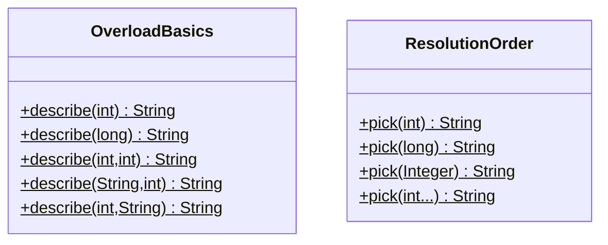

# Chapter 06 — Overloading

## What and why

Overloading = same method name, different parameter lists. Exams score what is allowed, resolution order (exact > widening > boxing > varargs), and ambiguities (`null`, erasure).

## Exam flash rules

- Overload by parameter **count**, **types**, or **order** — not by return type, `throws`, modifiers, or parameter names alone.
- Compile-time resolution: **exact > widening > boxing > varargs**.
- Fixed-arity overload beats varargs when both apply.
- `null` is ambiguous if two reference overloads are equally specific.
- Widening beats boxing (`int` → `long` preferred over `Integer`).
- Generics that erase to the same raw type cannot overload each other.
- You may overload `main`; JVM still invokes `main(String[])`.
- Overloads in a subclass expand the set for that compile-time type; a parent-typed reference does not see subclass-only overloads.
- Static and instance methods can overload each other if signatures differ.
- Casts fix many ambiguities (`(String) null`).

## Rules table

| Allowed | Not allowed | Compiler message |
|---------|-------------|------------------|
| Different param lists | Return type only | `method size(String) is already defined` |
| | Throws only | `method go() is already defined` |
| | Modifiers only | `method run() is already defined` |
| | Param names only | `method add(int,int) is already defined` |
| Cast to disambiguate `null` | `f(null)` with `String` vs `StringBuilder` | `reference to f is ambiguous` |
| | `List<String>` vs `List<Integer>` | `name clash: ... have the same erasure` |

## Walkthrough

### Baseline — count / types / order

```java
{{#include ../../code/part-01-oop/src/main/java/oop/overload/OverloadBasics.java:overload-basics}}
```

```text
int:1
long:1
ii:1,2
si:a,1
is:1,a
```

### Resolution order

```java
{{#include ../../code/part-01-oop/src/main/java/oop/overload/ResolutionOrder.java:resolution-order}}
```

```text
exact-int
box-Integer
varargs
varargs
```

### Fixed ambiguities

```java
{{#include ../../code/part-01-oop/src/main/java/oop/overload/AmbiguityFixed.java:ambiguity-fixed}}
```

```text
String
Object
int
long
```

### Does not compile — return / throws / modifiers / names

<div class="compiler-error">

```text
part-01-oop/broken/OverloadReturnOnlyBroken.java:9: error: method size(String) is already defined in class OverloadReturnOnlyBroken
```

```text
part-01-oop/broken/OverloadThrowsOnlyBroken.java:9: error: method go() is already defined in class OverloadThrowsOnlyBroken
```

```text
part-01-oop/broken/OverloadModifiersOnlyBroken.java:7: error: method run() is already defined in class OverloadModifiersOnlyBroken
```

```text
part-01-oop/broken/OverloadNamesOnlyBroken.java:9: error: method add(int,int) is already defined in class OverloadNamesOnlyBroken
```

</div>

Sources: `broken/OverloadReturnOnlyBroken.java`, `OverloadThrowsOnlyBroken.java`, `OverloadModifiersOnlyBroken.java`, `OverloadNamesOnlyBroken.java`.

### Does not compile — null ambiguity & erasure

```java
{{#include ../../code/part-01-oop/broken/OverloadNullAmbiguousBroken.java}}
```

```text
part-01-oop/broken/OverloadNullAmbiguousBroken.java:11: error: reference to f is ambiguous
    f(null);
    ^
  both method f(String) in OverloadNullAmbiguousBroken and method f(StringBuilder) in OverloadNullAmbiguousBroken match
```

```java
{{#include ../../code/part-01-oop/broken/OverloadErasureBroken.java}}
```

```text
part-01-oop/broken/OverloadErasureBroken.java:9: error: name clash: take(List<Integer>) and take(List<String>) have the same erasure
```

### Inheritance, main, static/instance, varargs edge

```java
{{#include ../../code/part-01-oop/src/main/java/oop/overload/OverloadInherit.java:overload-inherit}}
```

```text
P-int
F-String
P-int
```

```java
{{#include ../../code/part-01-oop/src/main/java/oop/overload/OverloadMain.java:overload-main}}
```

```text
String[]
int:3
```

```java
{{#include ../../code/part-01-oop/src/main/java/oop/overload/StaticInstanceOverload.java:static-instance-overload}}
```

```text
static-int
instance-String
```

```java
{{#include ../../code/part-01-oop/src/main/java/oop/overload/VarargsEdge.java:varargs-edge}}
```

```text
fixed
varargs len=1
varargs len=0
```

## Predict the output

**P1.** `PredictResolution` — `m(1)` with `long` and `Integer` overloads.

```java
{{#include ../../code/part-01-oop/src/main/java/oop/overload/exam/PredictResolution.java:predict-resolution}}
```

<details><summary>Answer</summary>

```text
long
```

Widening beats boxing.

</details>

**P2.**

```java
{{#include ../../code/part-01-oop/src/main/java/oop/overload/exam/PredictVarargs.java:predict-varargs}}
```

<details><summary>Answer</summary>

```text
one
var:2
```

</details>

**P3.**

```java
{{#include ../../code/part-01-oop/src/main/java/oop/overload/exam/PredictWiden.java:predict-widen}}
```

<details><summary>Answer</summary>

```text
double
Object
```

</details>

**P4.**

```java
{{#include ../../code/part-01-oop/src/main/java/oop/overload/exam/PredictInherit.java:predict-inherit}}
```

<details><summary>Answer</summary>

```text
A
```

Compile-time type `A` only sees `f(int)`.

</details>

**P5.**

```java
{{#include ../../code/part-01-oop/src/main/java/oop/overload/exam/PredictMain.java:predict-main}}
```

<details><summary>Answer</summary>

```text
entry
```

</details>

## Compile or not?

**C1–C4.** Return / throws / modifiers / names only — all **fail** (`method … already defined`). See rules table.

**C5.** `f(null)` String vs StringBuilder — **fails** ambiguous.

**C6.** `List<String>` / `List<Integer>` — **fails** same erasure.

## Gotchas

1. Thinking return type overloads — it does not.
2. `int` prefers `long` over `Integer` — widening > boxing.
3. Parent-typed reference hides subclass overloads — `OverloadInherit`.
4. Erasure clash with generics.
5. Fixed arity beats varargs — `VarargsEdge`.

## UML



## Interview Q&A

1. **Q:** Can you overload on return type? **A:** No.
2. **Q:** Resolution order? **A:** Exact > widening > boxing > varargs.
3. **Q:** Why is `m(1)` → `long` not `Integer`? **A:** Widening beats boxing.
4. **Q:** When is `null` ambiguous? **A:** Two incomparable reference overloads (`String` vs `StringBuilder`).
5. **Q:** Can `main` be overloaded? **A:** Yes; entry is still `main(String[])`.
6. **Q:** Do subclass overloads apply via parent type? **A:** No — compile-time type limits the set.
7. **Q:** Why can’t `List<String>` and `List<Integer>` overload? **A:** Same erasure.
8. **Q:** Fixed vs varargs for `f(1,2)`? **A:** Fixed wins.
9. **Q:** Static vs instance same signature? **A:** Illegal (already defined); different params OK.
10. **Q:** How to fix null ambiguity? **A:** Cast the null.
11. **Q:** Parameter names in signature? **A:** No.
12. **Q:** Throws clause alone? **A:** No.

## Exam writing prompts

1. (5) List four illegal “overload” attempts and the idea of the compiler message for each.
2. (5) Given `void a(int)`, `void a(long)`, `void a(Integer)`, which is chosen for `a(1)` and why?
3. (2) Fix `f(null)` for overloads `f(String)` and `f(Object)`.

## Exercises

1. Write `max(int,int)` and `max(double,double)` — `solutions/ch06/SolutionOverload.java`.
2. Add a `print(char)` overload and show it beats widening to `int` if you also have `print(int)`.
3. Demonstrate an ambiguous call with two varargs overloads; fix with an explicit array.
4. Show `Printer`/`FancyPrinter` style overload vs override difference in one file.
5. Predict `pick(Integer.valueOf(1))` in `ResolutionOrder` without running, then verify.

## Recap checklist

- [x] Allowed overload shapes
- [x] Illegal return/throws/modifiers/names + errors
- [x] Resolution order + ambiguities + inheritance + main + static/instance + erasure
- [x] Exam banks complete
