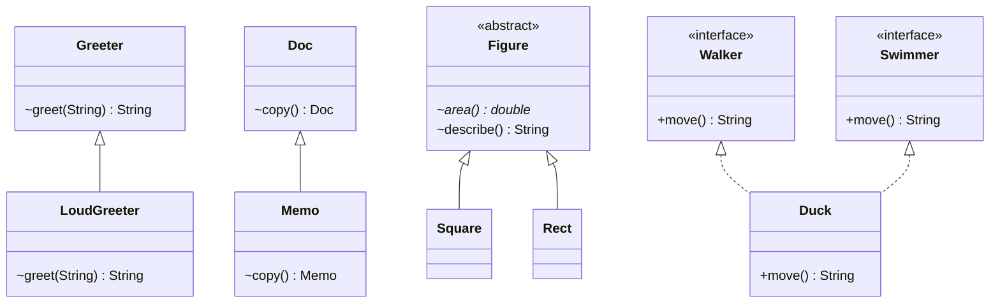

# Chapter 07 — Overriding

## What and why

Overriding = a subclass supplies a new body for an inherited instance method with the **same signature**; the object's runtime class picks the body. Exams score the legality rules (return, access, `throws`, `static`/`private`/`final`), hiding vs overriding, and the "constructor calls an overridable method" trap.

## Exam flash rules

- Override = same name **and** same parameter types (same signature), inherited **instance** method.
- Return type: primitives and `void` must match exactly; reference types may be a **subtype** (covariant return).
- Access may stay the same or **widen** (`protected` → `public`); it may never narrow.
- Overrider may throw **fewer or narrower checked** exceptions, or none; **unchecked** exceptions are unrestricted.
- `@Override` makes the compiler verify the override; a typo or a different parameter type becomes an error.
- `static`, `private`, and `final` methods cannot be overridden.
- A same-signature `static` method in a subclass **hides** the parent's; the **reference type** picks it, not the object.
- Fields are never overridden; a same-named field **hides** the parent's, chosen by reference type.
- `super.m()` calls the parent's version and is not virtual.
- Constructors are not inherited, so they are never overridden; they chain with `super(...)`/`this(...)`.
- A parent constructor that calls an overridable method runs the **subclass** body before subclass fields are initialized.
- Generic overrides get compiler-generated **bridge methods** (erased signature, `isBridge() == true`).
- Two unrelated interface defaults with the same signature: the class **must** override and may pick with `X.super.m()`.
- Class wins: an inherited class method beats an interface `default` of the same signature.
- An abstract method must be implemented by the first concrete subclass; a subclass may re-declare a concrete method `abstract`.
- `equals(Point)` is an **overload**, not an override of `equals(Object)`.

## Rules table

| Rule | Allowed | Not allowed | Compiler message (verbatim) |
|------|---------|-------------|-----------------------------|
| Return type | Same, or subtype (reference types) | Different primitive | `return type long is not compatible with int` |
| Access | Same or wider | Narrower | `attempting to assign weaker access privileges; was public` |
| Checked exceptions | Same, narrower, none | Broader | `overridden method does not throw Exception` |
| Unchecked exceptions | Any | — | (no restriction) |
| `static` parent | — | Instance overrides static | `overridden method is static` |
| `static` child | — | Static hides instance | `overriding method is static` |
| `final` parent | — | Override | `overridden method is final` |
| `private` parent | New unrelated method (no `@Override`) | `@Override` on it | `method does not override or implement a method from a supertype` |
| `@Override` | Real override | Overload / typo | `method does not override or implement a method from a supertype` |
| Interface method | `public` implementation | Package-private body | `attempting to assign weaker access privileges; was public` |
| Abstract method | Implemented in concrete subclass | Missing body | `... is not abstract and does not override abstract method area() in NeedsBody` |
| Diamond defaults | Override and pick with `X.super.m()` | Inherit both silently | `class ... inherits unrelated defaults for m() from types DiamondI and DiamondJ` |
| Constructor | Own constructor per class | "Overriding" parent constructor | `invalid method declaration; return type required` |
| Generic clash | Parameterized override | `compareTo(Object)` beside `Comparable<String>` | `name clash: ... have the same erasure, yet neither overrides the other` |

### Overload vs override

| | Overload | Override |
|-|----------|----------|
| Signature | Different parameter list | Identical |
| Resolved | Compile time (reference type) | Run time (object class) for instance methods |
| Return / `throws` | Free | Constrained (rules above) |
| Where | Same class or subclass | Subclass only |
| `static` / `private` / `final` | Allowed | Not overridable |

## Walkthrough

### Baseline — same signature, `super.greet`

```java
{{#include ../../code/part-01-oop/src/main/java/oop/override/OverrideBasics.java:override-basics}}
```

```text
HELLO ANN!
Hello ann
LoudGreeter
```

### Covariant return

```java
{{#include ../../code/part-01-oop/src/main/java/oop/override/OverrideCovariant.java:override-covariant}}
```

```text
memo-only
Memo
Memo
```

`Memo c = m.copy();` needs no cast because the override returns `Memo`. Through a `Doc` reference, `copy()` is still the `Memo` body.

### Does not compile — primitive return mismatch

```java
{{#include ../../code/part-01-oop/broken/OverrideReturnTypeBroken.java}}
```

<div class="compiler-error">

```text
part-01-oop/broken/OverrideReturnTypeBroken.java:11: error: size() in OverrideReturnTypeBroken cannot override size() in ReturnBase
  long size() {
       ^
  return type long is not compatible with int
```

</div>

### Access can widen, never narrow

```java
{{#include ../../code/part-01-oop/src/main/java/oop/override/OverrideAccessWiden.java:override-access-widen}}
```

```text
base protected=true
open public=true
open
```

```java
{{#include ../../code/part-01-oop/broken/OverrideAccessNarrowBroken.java}}
```

<div class="compiler-error">

```text
part-01-oop/broken/OverrideAccessNarrowBroken.java:12: error: id() in OverrideAccessNarrowBroken cannot override id() in NarrowBase
  String id() {
         ^
  attempting to assign weaker access privileges; was public
```

</div>

Interface methods are implicitly `public`, so the implementation must be too:

```java
{{#include ../../code/part-01-oop/broken/OverrideInterfaceAccessBroken.java}}
```

<div class="compiler-error">

```text
part-01-oop/broken/OverrideInterfaceAccessBroken.java:9: error: speak() in OverrideInterfaceAccessBroken cannot implement speak() in Speaks
  String speak() {
         ^
  attempting to assign weaker access privileges; was public
```

</div>

### Checked exceptions: narrow, drop, or go unchecked

```java
{{#include ../../code/part-01-oop/src/main/java/oop/override/OverrideExceptions.java:override-exceptions}}
```

```text
IOException: source
FileNotFoundException: narrow
quiet: no throws
IllegalStateException: unchecked
```

```java
{{#include ../../code/part-01-oop/broken/OverrideThrowsBroadenBroken.java}}
```

<div class="compiler-error">

```text
part-01-oop/broken/OverrideThrowsBroadenBroken.java:10: error: run() in OverrideThrowsBroadenBroken cannot override run() in ThrowsBase
  void run() throws Exception {}
       ^
  overridden method does not throw Exception
```

</div>

### `@Override` catches fake overrides

```java
{{#include ../../code/part-01-oop/broken/OverrideAnnotationBroken.java}}
```

<div class="compiler-error">

```text
part-01-oop/broken/OverrideAnnotationBroken.java:7: error: method does not override or implement a method from a supertype
  @Override
  ^
```

</div>

`equals(OverrideAnnotationBroken)` is an overload of `equals(Object)`. Without `@Override` it compiles and silently never replaces `Object.equals` (see P5).

### `super.method()` chain

```java
{{#include ../../code/part-01-oop/src/main/java/oop/override/OverrideSuperChain.java:override-super-chain}}
```

```text
A>B>C
A>B
```

### `static` / `private` / `final` cannot be overridden

```java
{{#include ../../code/part-01-oop/src/main/java/oop/override/OverridePrivateFinal.java:override-private-final}}
```

```text
parent-private|parent-final
child-secret
parent-final
```

`SealedChild.secret()` is a new method; `run()` still calls the parent's private `secret()`.

```java
{{#include ../../code/part-01-oop/broken/OverrideFinalBroken.java}}
```

<div class="compiler-error">

```text
part-01-oop/broken/OverrideFinalBroken.java:10: error: lock() in OverrideFinalBroken cannot override lock() in FinalBase
  void lock() {}
       ^
  overridden method is final
```

</div>

```java
{{#include ../../code/part-01-oop/broken/OverridePrivateAnnBroken.java}}
```

<div class="compiler-error">

```text
part-01-oop/broken/OverridePrivateAnnBroken.java:9: error: method does not override or implement a method from a supertype
  @Override
  ^
```

</div>

```java
{{#include ../../code/part-01-oop/broken/OverrideStaticBroken.java}}
```

<div class="compiler-error">

```text
part-01-oop/broken/OverrideStaticBroken.java:9: error: tick() in OverrideStaticBroken cannot override tick() in StaticBase
  void tick() {}
       ^
  overridden method is static
```

</div>

```java
{{#include ../../code/part-01-oop/broken/OverrideStaticHidesInstanceBroken.java}}
```

<div class="compiler-error">

```text
part-01-oop/broken/OverrideStaticHidesInstanceBroken.java:9: error: tick() in OverrideStaticHidesInstanceBroken cannot override tick() in InstBase
  static void tick() {}
              ^
  overriding method is static
```

</div>

### Static hiding vs overriding

```java
{{#include ../../code/part-01-oop/src/main/java/oop/override/OverrideStaticHiding.java:override-static-hiding}}
```

```text
HideChild.me
HideParent.who
HideParent.who
HideChild.who
HideChild.me
```

`p.me()` follows the object (`HideChild`); `p.who()` follows the reference type (`HideParent`). Calling a static method through an instance expression is legal but misleading (`javac -Xlint:static` warns).

### Field hiding

```java
{{#include ../../code/part-01-oop/src/main/java/oop/override/OverrideFieldHiding.java:override-field-hiding}}
```

```text
parent-field
child-field
child-field / parent-field
```

### Generics and bridge methods

```java
{{#include ../../code/part-01-oop/src/main/java/oop/override/OverrideBridge.java:override-bridge}}
```

```text
TextHolder.get() -> Object bridge=true
TextHolder.get() -> String bridge=false
Label.compareTo(Label) -> int bridge=false
Label.compareTo(Object) -> int bridge=true
text
ClassCastException via bridge
```

After erasure the parent method is `Object get()` / `compareTo(Object)`. The compiler adds a synthetic bridge with that erased signature that casts and forwards to your method. A raw call with the wrong type fails inside the bridge with `ClassCastException`.

```java
{{#include ../../code/part-01-oop/broken/OverrideBridgeClashBroken.java}}
```

<div class="compiler-error">

```text
part-01-oop/broken/OverrideBridgeClashBroken.java:5: error: name clash: compareTo(Object) in OverrideBridgeClashBroken and compareTo(String) in Comparable have the same erasure, yet neither overrides the other
  public int compareTo(Object o) {
             ^
```

</div>

### Default methods and the diamond

```java
{{#include ../../code/part-01-oop/src/main/java/oop/override/OverrideDefaultDiamond.java:override-default-diamond}}
```

```text
walk+swim
crawl
walk+swim
```

```java
{{#include ../../code/part-01-oop/broken/OverrideDiamondBroken.java}}
```

<div class="compiler-error">

```text
part-01-oop/broken/OverrideDiamondBroken.java:16: error: types DiamondI and DiamondJ are incompatible;
public class OverrideDiamondBroken implements DiamondI, DiamondJ {}
       ^
  class OverrideDiamondBroken inherits unrelated defaults for m() from types DiamondI and DiamondJ
```

</div>

### Constructors are not overridden

```java
{{#include ../../code/part-01-oop/src/main/java/oop/override/OverrideCtorNotInherited.java:override-ctor-not-inherited}}
```

```text
Vehicle(a)
Car(a)
Vehicle(default)
Car(default)
1
2
```

`Car` does not get `Vehicle(String)` and `Vehicle` has no no-arg constructor; `Car()` exists only because `Car` declares it. Redeclaring the parent's constructor name is just a method without a return type:

```java
{{#include ../../code/part-01-oop/broken/OverrideCtorBroken.java}}
```

<div class="compiler-error">

```text
part-01-oop/broken/OverrideCtorBroken.java:9: error: invalid method declaration; return type required
  CtorBase(int x) {}
  ^
```

</div>

### Overridable call from a constructor — the trap

```java
{{#include ../../code/part-01-oop/src/main/java/oop/override/OverrideCtorTrap.java:override-ctor-trap}}
```

```text
TrapBase ctor
derived hook label=null size=0
TrapDerived ctor label=ready
```

Order: `TrapBase` constructor → overridden `hook()` (subclass fields still `null`/`0`, even the `final` one) → subclass field initializers → `TrapDerived` constructor body.

Fix: keep constructors free of overridable calls (use `private`/`final` helpers) and run overridable work after construction:

```java
{{#include ../../code/part-01-oop/src/main/java/oop/override/OverrideCtorTrapFixed.java:override-ctor-trap-fixed}}
```

```text
derived hook label=ready state=base-ready
```

### Abstract overriding

```java
{{#include ../../code/part-01-oop/src/main/java/oop/override/OverrideAbstract.java:override-abstract}}
```

```text
Square area=9.0
Rect area=10.0
fast-run
```

```java
{{#include ../../code/part-01-oop/broken/OverrideAbstractMissingBroken.java}}
```

<div class="compiler-error">

```text
part-01-oop/broken/OverrideAbstractMissingBroken.java:8: error: OverrideAbstractMissingBroken is not abstract and does not override abstract method area() in NeedsBody
public class OverrideAbstractMissingBroken extends NeedsBody {}
       ^
```

</div>

## Predict the output

**P1.** Static hiding.

```java
{{#include ../../code/part-01-oop/src/main/java/oop/override/exam/PredictStaticHide.java:predict-static-hide}}
```

<details><summary>Answer</summary>

```text
A.s
B.i
B.s
```

Trace: `a` has type `StaticHideA` → static `A.s`; instance call → object is `B` → `B.i`; `b` has type `StaticHideB` → `B.s`.

</details>

**P2.** Field hiding.

```java
{{#include ../../code/part-01-oop/src/main/java/oop/override/exam/PredictFieldHide.java:predict-field-hide}}
```

<details><summary>Answer</summary>

```text
A
B
A
```

Trace: field by reference type (`A`); method overridden (`B`'s `v()` reads `B.v`); upcast expression type is `A`.

</details>

**P3.** Constructor calls overridable method.

```java
{{#include ../../code/part-01-oop/src/main/java/oop/override/exam/PredictCtorHook.java:predict-ctor-hook}}
```

<details><summary>Answer</summary>

```text
B0
B7
```

Trace: `CtorHookA()` → `show()` is `B`'s, `n` still `0` → then `n = 7` → explicit `b.show()`.

</details>

**P4.** `super` inside an overridden method.

```java
{{#include ../../code/part-01-oop/src/main/java/oop/override/exam/PredictSuperCall.java:predict-super-call}}
```

<details><summary>Answer</summary>

```text
BBA
```

Trace: `super.twice()` runs `A.twice()`, whose `m()` calls are virtual → `B` + `B`; then `super.m()` is non-virtual → `A`.

</details>

**P5.** Overload masquerading as override.

```java
{{#include ../../code/part-01-oop/src/main/java/oop/override/exam/PredictEqualsTrap.java:predict-equals-trap}}
```

<details><summary>Answer</summary>

```text
true
false
false
```

Trace: `a.equals(b)` picks `equals(PredictPt)`; `a.equals(o)` has an `Object` argument → inherited `Object.equals` (identity) → `false`; `List.contains` calls `equals(Object)` → `false`.

</details>

**P6.** Default method diamond.

```java
{{#include ../../code/part-01-oop/src/main/java/oop/override/exam/PredictDefaultDiamond.java:predict-default-diamond}}
```

<details><summary>Answer</summary>

```text
RL
RL
```

Trace: `DiamondRight` overrides `DiamondLeft`, so it is the most specific default (no conflict); dispatch is on the object, so the `DiamondLeft` reference gives the same result.

</details>

**P7.** `private` is not overridden.

```java
{{#include ../../code/part-01-oop/src/main/java/oop/override/exam/PredictPrivateSame.java:predict-private-same}}
```

<details><summary>Answer</summary>

```text
A
B
```

Trace: `run()` in `A` calls `A`'s private `who()`; `b.who()` is the new method in `B`.

</details>

**P8.** Overload chosen at compile time, body at run time.

```java
{{#include ../../code/part-01-oop/src/main/java/oop/override/exam/PredictOverloadNotOverride.java:predict-overload-not-override}}
```

<details><summary>Answer</summary>

```text
Child.f(Object)
Child.f(String)
Child.f(Object)
```

Trace: `p` (type `OverloadParent`) only sees `f(Object)` → runtime object is `OverloadChild` → its override. `c.f("s")` picks the most specific overload `f(String)`; the cast forces `f(Object)`.

</details>

### MCQ-style traps

**M1.** `Parent p = new Child(); p.sm();` where both declare `static void sm()`. Which body runs?
(a) `Child.sm` (b) `Parent.sm` (c) compile error (d) `ClassCastException`
**Answer: (b)** — static methods are bound to the reference type (P1). (a) wrongly applies dynamic dispatch; (c) hiding is legal; (d) no cast occurs.

**M2.** Parent `protected Object get()`. Which override compiles?
(a) `Object get()` (b) `private String get()` (c) `public String get()` (d) `public int get()`
**Answer: (c)** — wider access and covariant return (`CompileOverrideOk`). (a) narrows `protected` to package-private; (b) narrows; (d) primitive ≠ reference.

**M3.** Parent `void run() throws IOException`. Which override compiles?
(a) `void run() throws Exception` (b) `void run() throws FileNotFoundException` (c) `void run() throws Throwable` (d) none of these
**Answer: (b)** — narrower checked exception (`OverrideExceptions`). (a) and (c) are broader.

## Compile or not?

**C1.** Parent `public String id()`, child `String id()` (package-private).
**Fails** — `attempting to assign weaker access privileges; was public` (`OverrideAccessNarrowBroken`).

**C2.** Parent `void run()`, child `void run() throws Exception`.
**Fails** — `overridden method does not throw Exception` (`OverrideThrowsBroadenBroken`).

**C3.** `@Override public boolean equals(Point p)` in a class that does not extend one declaring it.
**Fails** — `method does not override or implement a method from a supertype` (`OverrideAnnotationBroken`). Looks fine; `equals(Object)` is the real signature.

**C4.** Parent `protected Number value() throws IOException`, child `public Integer value() throws IllegalStateException`.
**Compiles** — covariant return, wider access, no checked exception, extra unchecked is allowed.

```java
{{#include ../../code/part-01-oop/src/main/java/oop/override/exam/CompileOverrideOk.java:compile-override-ok}}
```

```text
2
```

**C5.** Parent `int size()`, child `long size()`.
**Fails** — `return type long is not compatible with int` (`OverrideReturnTypeBroken`). Covariance is for reference types only.

**C6.** Child instance method with same signature as parent `static` method (and the reverse).
**Fails** — `overridden method is static` / `overriding method is static` (`OverrideStaticBroken`, `OverrideStaticHidesInstanceBroken`).

**C7.** Child redeclares a `final` parent method.
**Fails** — `overridden method is final` (`OverrideFinalBroken`).

**C8.** Class implements two interfaces with same default `m()` and declares nothing.
**Fails** — `inherits unrelated defaults for m()` (`OverrideDiamondBroken`).

**C9.** Interface method implemented without `public`.
**Fails** — `attempting to assign weaker access privileges; was public` (`OverrideInterfaceAccessBroken`).

**C10.** Child declares `private void helper()` and parent also has `private void helper()`, no `@Override`.
**Compiles** — two unrelated methods (`SealedChild.secret`); adding `@Override` fails (`OverridePrivateAnnBroken`).

## Gotchas

1. **`equals(Point)` instead of `equals(Object)`** — overload, never called by collections. `OverrideAnnotationBroken`, `PredictEqualsTrap`.
2. **Static "override"** — hiding; reference type decides. `OverrideStaticHiding`, `PredictStaticHide`.
3. **Field "override"** — hiding; reference type decides. `OverrideFieldHiding`, `PredictFieldHide`.
4. **Constructor calls overridable method** — subclass body sees defaults. `OverrideCtorTrap`, `PredictCtorHook`; fix: `OverrideCtorTrapFixed`.
5. **Same-named `private` method** — a new method, not an override. `OverridePrivateFinal`, `PredictPrivateSame`.

## UML



## Interview Q&A

1. **Q:** What makes a method an override? **A:** Same name and parameter types in a subclass for an inherited instance method (`OverrideBasics`).
2. **Q:** Can the return type differ? **A:** Only to a subtype for reference types; primitives must match (`OverrideCovariant`, `OverrideReturnTypeBroken`).
3. **Q:** Can an override reduce visibility? **A:** No; it may widen (`OverrideAccessWiden`, `OverrideAccessNarrowBroken`).
4. **Q:** What `throws` is allowed? **A:** None, same, or narrower checked types; any unchecked (`OverrideExceptions`).
5. **Q:** Can you override `static`/`private`/`final`? **A:** No; `static` is hidden, `private` is unrelated, `final` is a compile error (`OverridePrivateFinal`, `OverrideFinalBroken`).
6. **Q:** Static hiding vs overriding? **A:** Static is bound by reference type, instance by object class (`OverrideStaticHiding`).
7. **Q:** Are fields overridden? **A:** No, hidden; `super.field` reaches the parent's (`OverrideFieldHiding`).
8. **Q:** What does `@Override` buy you? **A:** Compile-time proof the method really overrides (`OverrideAnnotationBroken`).
9. **Q:** What is a bridge method? **A:** A synthetic method with the erased signature that forwards to the generic override (`OverrideBridge`).
10. **Q:** How is the default-method diamond resolved? **A:** Override in the class and call `X.super.m()`; a class method beats a default (`OverrideDefaultDiamond`).
11. **Q:** Can a constructor be overridden? **A:** No; constructors are not inherited and chain via `super(...)` (`OverrideCtorNotInherited`).
12. **Q:** Why avoid calling overridable methods in constructors? **A:** The subclass body runs before subclass fields are initialized (`OverrideCtorTrap`).
13. **Q:** Must a concrete subclass implement abstract methods? **A:** Yes, all inherited ones (`OverrideAbstractMissingBroken`); a subclass may also re-abstract a concrete method (`OverrideAbstract`).
14. **Q:** Overloading vs overriding in one phrase? **A:** Overload = compile-time choice by parameter types; override = run-time choice by object class (`PredictOverloadNotOverride`).

## Exam writing prompts

1. (5) Write `class Animal { Animal reproduce() }` and `class Dog extends Animal` overriding it with a covariant return, widening access if the parent method is `protected`. Show a call that needs no cast.
2. (5) Write interfaces `A` and `B` with the same `default String hello()` and a class `C` implementing both that prints both messages using `A.super` and `B.super`.
3. (5) Fix this class so collections treat two `Point(x, y)` as equal: `class Point { int x, y; public boolean equals(Point p) { ... } }`. Add `hashCode`.
4. (10) Write an abstract `Report` with a `final` template method `render()` that calls abstract `body()` and overridable `header()`/`footer()`; add a concrete subclass; explain why `render()` is `final`.
5. (5) Rewrite a class whose constructor calls an overridable `init()` so it no longer shows default field values.

## Exercises

1. Covariant `copy()` — `solutions/ch07/SolutionCovariantCopy.java`.
2. `equals(Object)` + `hashCode` with `@Override` — `solutions/ch07/SolutionEquals.java`.
3. Resolve conflicting defaults — `solutions/ch07/SolutionDiamond.java`.
4. Template method with `final` skeleton — `solutions/ch07/SolutionTemplate.java`.
5. Constructor-hook trap fixed via factory — `solutions/ch07/SolutionCtorHookFixed.java`.
6. Add `@Override` to every method in `OverrideAbstract` and confirm all compile; then remove one `area()` and quote the error.

Solution outputs (real runs):

```text
SolutionCovariantCopy   -> 4 true
SolutionEquals          -> true / true
SolutionDiamond         -> print&scan
SolutionTemplate        -> H:sales:end
SolutionCtorHookFixed   -> B7
```

## Recap checklist

- [x] Same signature, covariant return
- [x] Access cannot narrow; checked exceptions cannot broaden (unchecked OK)
- [x] `@Override`; cannot override `static`/`private`/`final`
- [x] Static hiding vs overriding; field hiding; `super.method()`
- [x] Generics / bridge methods
- [x] Default methods + diamond (`A.super.m()`)
- [x] Constructors not overridden
- [x] Overridable call from constructor trap
- [x] Abstract overriding
- [x] Exam banks complete (8 predict, 10 compile-or-not, 5 writing prompts)
