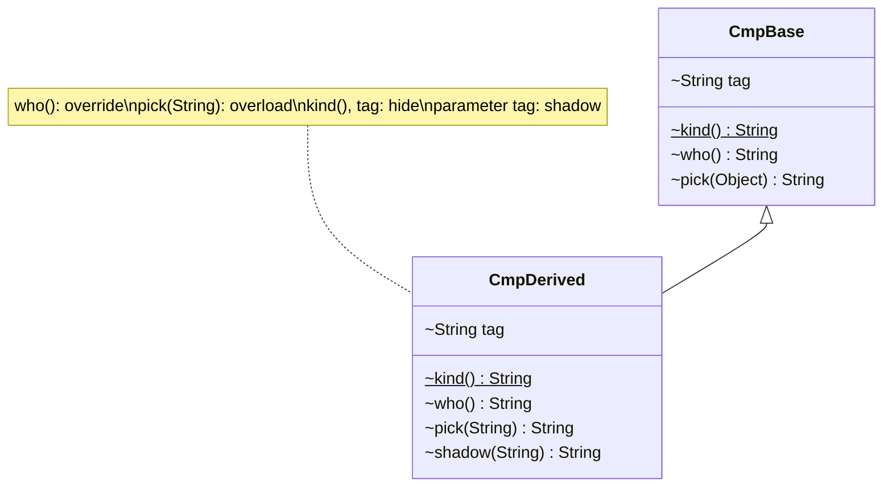

# Chapter 08 — Overload vs override vs hide vs shadow

## What and why

Four words, four mechanisms. Papers ask "which one is this?" and "what prints?". The answer always comes down to **what is chosen** (a signature or a declaration) and **when** (compile time by the reference type, or run time by the object).

## Exam flash rules

- **Overload** = same name, **different parameter list**. Chosen at **compile time** from the argument types.
- **Override** = same signature in a subclass, instance method. Chosen at **run time** from the object's class (dynamic dispatch).
- **Hide** = a `static` method or a **field** in a subclass with the same name as one in the superclass. Chosen at **compile time** from the **reference type**.
- **Shadow** = a nearer variable (local, parameter, inner-class member) with the same name as a farther one in scope. Resolved by scope rules at compile time.
- Only **instance-method overriding** is polymorphic. Fields, static methods, and overloads are not.
- `@Override` on a method that only overloads is a compile error.
- An instance method cannot override a static one, and a static method cannot hide an instance one — both are errors.
- A `static final` method cannot be hidden.
- A hiding **field** may have a different type; a hiding **method** may not change the return type incompatibly.
- `equals(Foo)` is an **overload** of `equals(Object)`, not an override. `HashSet` and `List.contains` call the `Object` version.
- A `private` method is not inherited, so a same-named subclass method is **not** an override.
- Reach the hidden/shadowed one with `super.m()`, `super.f`, `((Parent) x).f`, `Parent.m()`, `this.x`, `Outer.this.x`.
- Static methods called through an instance (even `null`) use the **reference's declared type**; no `NullPointerException`.
- There is no `super.super`.

## Comparison table

| | **Overload** | **Override** | **Hide** | **Shadow** |
|---|---|---|---|---|
| Applies to | methods, constructors | instance methods | `static` methods, fields | variables: local, parameter, member of inner scope |
| Where | same class or via inheritance | subclass | subclass | any nested scope |
| Name | same | same | same | same |
| Parameters | **different** | **same** | same (methods) / n.a. (fields) | n.a. |
| Chosen at | compile time (argument types) | **run time** (object's class) | compile time (reference type) | compile time (scope) |
| Polymorphic | no | **yes** | no | no |
| `@Override` | not allowed | allowed, recommended | not allowed | n.a. |
| Reach the other | call with a cast / other args | `super.m()` | `Parent.m()`, `super.f`, cast | `this.x`, `Outer.this.x` |
| Example in this chapter | `CmpDerived.pick(String)` | `CmpDerived.who()` | `CmpDerived.kind()`, `CmpDerived.tag` | parameter `tag` in `shadow` |

| Not allowed | Compiler message (`javac`, Java 21) |
|-------------|--------------------------------------|
| `@Override` on an overload | `method does not override or implement a method from a supertype` |
| `static` method vs inherited instance method | `… cannot override …` / `overriding method is static` |
| Instance method vs inherited static method | `… cannot override …` / `overridden method is static` |
| Hide a `static final` method | `… cannot override …` / `overridden method is static,final` |
| Same signature, incompatible return | `return type int is not compatible with String` |
| Local with the name of a parameter | `variable x is already defined in method f(int)` |
| `super.super.m()` | `<identifier> expected` |

## Walkthrough

### One demo, all four

```java
{{#include ../../code/part-01-oop/src/main/java/oop/compare/CompareAllFour.java:compare-all-four}}
```

Program output:

```text
override : Derived.who
hide stat: Base.kind / Derived.kind
hide fld : Base.tag / Derived.tag
overload : Base.pick(Object) / Derived.pick(String)
overload : Base.pick(Object)
shadow   : param | Derived.tag | Base.tag
```

| Output line | Mechanism | Why |
|-------------|-----------|-----|
| `override : Derived.who` | override | `b` is typed `CmpBase`, the object is `CmpDerived`: run time picks `CmpDerived.who`. |
| `Base.kind / Derived.kind` | hide | The reference type picks the static method. |
| `Base.tag / Derived.tag` | hide | Same for the field. Two fields exist in one object. |
| `Base.pick(Object) / Derived.pick(String)` | overload | `CmpBase` has only `pick(Object)`; `CmpDerived` has both and `String` is more specific. |
| `Base.pick(Object)` | overload | The `(Object)` cast selects the `Object` version even on a `CmpDerived` reference. |
| `param \| Derived.tag \| Base.tag` | shadow | The bare name is the parameter; `this.tag` and `super.tag` reach the fields. |

### The `equals` trap: an overload that looks like an override

```java
{{#include ../../code/part-01-oop/src/main/java/oop/compare/CompareOverloadTrap.java:compare-overload-trap}}
```

Program output:

```text
typed   : true
Object  : false
list    : false
fixed   : true
```

`CmpPoint.equals(CmpPoint)` is a new overload. `a.equals(b)` with `b` typed `CmpPoint` finds it; `a.equals(o)` and `List.contains` call `equals(Object)`, which is still `Object`'s identity check. Adding `@Override` would have turned the typo into a compile error.

### Fields are not virtual

```java
{{#include ../../code/part-01-oop/src/main/java/oop/compare/CompareFieldHide.java:compare-field-hide}}
```

Program output:

```text
animal cat animal
animal cat
animal cat
```

An object of `CmpCat` holds **two** `name` fields. Code in `CmpAnimal` always sees `CmpAnimal.name`; only the virtual `getName()` reaches the subclass value. Language rule: the field is chosen by the static type of the expression.

### Shadowing: locals, parameters, blocks

```java
{{#include ../../code/part-01-oop/src/main/java/oop/compare/CompareShadow.java:compare-shadow}}
```

Program output:

```text
11
510
32
```

`param(1)` is `1 + 10`. `local()` is `5 * 100 + 10`. In `blockScope`, the second `i` is legal because the first loop's `i` is out of scope; the result is `0 + 1 + 10 + 11 + 10`.

### Does not compile

<div class="compiler-error">

```java
{{#include ../../code/part-01-oop/broken/CompareOverrideAnnOverloadBroken.java}}
```

```text
part-01-oop/broken/CompareOverrideAnnOverloadBroken.java:9: error: method does not override or implement a method from a supertype
  @Override
  ^
1 error
```

```text
part-01-oop/broken/CompareStaticOverridesInstanceBroken.java:9: error: run() in CompareStaticOverridesInstanceBroken cannot override run() in SoParent
  static void run() {}
              ^
  overriding method is static
1 error
```

```text
part-01-oop/broken/CompareInstanceOverridesStaticBroken.java:9: error: run() in CompareInstanceOverridesStaticBroken cannot override run() in IsParent
  void run() {}
       ^
  overridden method is static
1 error
```

```text
part-01-oop/broken/CompareHideFinalStaticBroken.java:11: error: id() in CompareHideFinalStaticBroken cannot override id() in HfParent
  static String id() {
                ^
  overridden method is static,final
1 error
```

```text
part-01-oop/broken/CompareReturnOnlyOverrideBroken.java:11: error: name() in CompareReturnOnlyOverrideBroken cannot override name() in RoParent
  int name() {
      ^
  return type int is not compatible with String
1 error
```

```text
part-01-oop/broken/CompareDuplicateLocalBroken.java:6: error: variable x is already defined in method f(int)
    int x = 2;
        ^
1 error
```

```text
part-01-oop/broken/CompareSuperSuperBroken.java:20: error: <identifier> expected
    return super.super.who();
                 ^
1 error
```

</div>

Sources: `broken/CompareOverrideAnnOverloadBroken.java`, `CompareStaticOverridesInstanceBroken.java`, `CompareInstanceOverridesStaticBroken.java`, `CompareHideFinalStaticBroken.java`, `CompareReturnOnlyOverrideBroken.java`, `CompareDuplicateLocalBroken.java`, `CompareSuperSuperBroken.java`.

Note the wording: `javac` says "cannot override" even for the static/instance clashes that the JLS calls hiding.

## Predict the output

**P1.** What does each line print?

```java
{{#include ../../code/part-01-oop/src/main/java/oop/compare/exam/PredictRefTypeOverload.java:predict-ref-type-overload}}
```

<details>
<summary>Answer</summary>

```text
B.Object
B.String
B.Object
B.Object
```

`a.m("x")`: compile time sees only `m(Object)` on `P1A`; run time runs `P1B.m(Object)`. `b.m("x")`: `String` is most specific. `a.m(1)` boxes to `Object`, then dispatches to `B.Object`.

</details>

**P2.**

```java
{{#include ../../code/part-01-oop/src/main/java/oop/compare/exam/PredictStaticHide.java:predict-static-hide}}
```

<details>
<summary>Answer</summary>

```text
A.s
A.s
A.s
B.s
A.s
```

`x.s()` uses the declared type `P2A`. `i()` is compiled inside `P2A`, so `s()` means `P2A.s()`. `n.s()` does not dereference `n`: no `NullPointerException`.

</details>

**P3.**

```java
{{#include ../../code/part-01-oop/src/main/java/oop/compare/exam/PredictFieldHide.java:predict-field-hide}}
```

<details>
<summary>Answer</summary>

```text
1 2 1
```

`r.v` uses `P3A`; the cast uses `P3B`; `get()` is declared in `P3A` and reads `P3A.v`.

</details>

**P4.**

```java
{{#include ../../code/part-01-oop/src/main/java/oop/compare/exam/PredictPrivateNotOverridden.java:predict-private-not-overridden}}
```

<details>
<summary>Answer</summary>

```text
A.m
B.m
```

A `private` method is not inherited, so `P4B.m` does not override it. `call()` inside `P4A` binds to `P4A.m`.

</details>

**P5.**

```java
{{#include ../../code/part-01-oop/src/main/java/oop/compare/exam/PredictShadowAnon.java:predict-shadow-anon}}
```

<details>
<summary>Answer</summary>

```text
3 1 8
```

Members of the anonymous class shadow both the outer field `x` and the captured local `y`. `PredictShadowAnon.this.x` reaches the outer field.

</details>

**P6.** Mixed: overload + override + static hide + field hide.

```java
{{#include ../../code/part-01-oop/src/main/java/oop/compare/exam/PredictMixed.java:predict-mixed}}
```

<details>
<summary>Answer</summary>

```text
B.int,A.s,A
A.long
B.int
BA
```

Line 1: `m(1)` is virtual → `B.int`; `s()` and `f` are bound in `P6A`'s code. Line 2: `m(long)` is not overridden → `A.long`. Line 3: `char` widens to `int` → `m(int)` → `B.int`. Line 4: `((P6B) a).f` is `B`, `a.f` is `A`.

</details>

## Compile or not?

**C1.** `@Override void pick(String s)` where the parent has only `pick(Object)`.

<details><summary>Answer</summary>

**Fails** — `method does not override or implement a method from a supertype` (`broken/CompareOverrideAnnOverloadBroken.java`). It is an overload; drop `@Override`.

</details>

**C2.** Parent `void run()`, child `static void run()`.

<details><summary>Answer</summary>

**Fails** — `run() in … cannot override run() in SoParent` / `overriding method is static` (`broken/CompareStaticOverridesInstanceBroken.java`).

</details>

**C3.** Parent `static void run()`, child `void run()`.

<details><summary>Answer</summary>

**Fails** — `overridden method is static` (`broken/CompareInstanceOverridesStaticBroken.java`).

</details>

**C4.** Parent `static final String id()`, child `static String id()`.

<details><summary>Answer</summary>

**Fails** — `overridden method is static,final` (`broken/CompareHideFinalStaticBroken.java`).

</details>

**C5.** Parent `String name()`, child `int name()`.

<details><summary>Answer</summary>

**Fails** — `return type int is not compatible with String` (`broken/CompareReturnOnlyOverrideBroken.java`). Same parameter list means override rules apply, not overload rules.

</details>

**C6.** `int f(int x) { int x = 2; return x; }`

<details><summary>Answer</summary>

**Fails** — `variable x is already defined in method f(int)` (`broken/CompareDuplicateLocalBroken.java`). Shadowing a **field** is legal; shadowing a local or parameter is not.

</details>

**C7.** Child declares `int tag` hiding the parent's `String tag`, and overrides `Object make()` with `String make()`.

```java
{{#include ../../code/part-01-oop/src/main/java/oop/compare/exam/CompareFieldHideOk.java:compare-field-hide-ok}}
```

<details><summary>Answer</summary>

**Compiles.** Output:

```text
p 42 str
```

Field hiding ignores types; the covariant return is a legal override.

</details>

**C8.** `return super.super.who();`

<details><summary>Answer</summary>

**Fails** — `<identifier> expected` (`broken/CompareSuperSuperBroken.java`).

</details>

### MCQ traps

**M1.** `Parent p = new Child();` — which determines `p.staticMethod()`? (a) `Child` object (b) `Parent` type (c) runtime error (d) ambiguous.
**Answer: (b)** — static methods are hidden, not overridden.

**M2.** Which relationship is resolved at **run time**? (a) overload (b) override (c) hide (d) shadow.
**Answer: (b).** The others are compile-time.

**M3.** `class A { void f(int x) {} } class B extends A { void f(long x) {} }` — `f(long)` in `B` is: (a) override (b) overload (c) hide (d) error.
**Answer: (b)** — different parameter type.

**M4.** `class A { int x; } class B extends A { int x; }` — `B.x` is: (a) override (b) overload (c) hide (d) shadow of a local.
**Answer: (c).** Fields are hidden, never overridden.

## Gotchas

1. **`equals(Foo)` instead of `equals(Object)`** — compiles, silently never used by collections (`CompareOverloadTrap`, `SolutionEqualsOverride`).
2. **Static through an instance** — uses the declared type, works on `null` (`PredictStaticHide`).
3. **Field hiding** — two fields in one object; parent code sees the parent field (`CompareFieldHide`, `PredictFieldHide`).
4. **Same-named `private` method** — looks like an override, is not (`PredictPrivateNotOverridden`).
5. **Self-assigning setter** — `level = level` assigns the shadowing parameter to itself (`SolutionShadowSetter`).

## UML



## Interview Q&A

1. **Q:** Overload vs override in one line? **A:** Overload = different parameters, compile-time choice; override = same signature in a subclass, run-time choice (`CompareAllFour`).
2. **Q:** What is method hiding? **A:** A `static` method in a subclass with the same signature as a superclass static method; chosen by the reference type (`PredictStaticHide`).
3. **Q:** Can fields be overridden? **A:** No, only hidden (`CompareFieldHide`).
4. **Q:** Does dynamic dispatch apply to overloads? **A:** No; overloads are chosen at compile time, then the chosen signature may be dispatched if overridden (`PredictRefTypeOverload`).
5. **Q:** Why does `a.equals(o)` ignore `equals(CmpPoint)`? **A:** It is an overload; `Object` is the static type of the argument (`CompareOverloadTrap`).
6. **Q:** What does `@Override` check? **A:** That the method overrides or implements a supertype method (`CompareOverrideAnnOverloadBroken`).
7. **Q:** Can a static method override an instance method? **A:** No (`CompareStaticOverridesInstanceBroken`).
8. **Q:** Can a `static final` method be hidden? **A:** No (`CompareHideFinalStaticBroken`).
9. **Q:** What is shadowing? **A:** A nearer declaration hides a farther one of the same name; reach the field with `this.x` (`CompareShadow`).
10. **Q:** Can a local variable shadow a parameter? **A:** No, it is a redeclaration error (`CompareDuplicateLocalBroken`).
11. **Q:** Does a `null` reference calling a static method throw? **A:** No; the declared type is used (`PredictStaticHide`).
12. **Q:** Is a same-named subclass method an override of a `private` parent method? **A:** No (`PredictPrivateNotOverridden`).
13. **Q:** How do you reach a grandparent's method? **A:** Through the parent only; `super.super` does not exist (`CompareSuperSuperBroken`).
14. **Q:** Can a hiding field change type? **A:** Yes (`CompareFieldHideOk`).

## Exam writing prompts

1. (5 marks) Write classes `Parent` and `Child` that show, in one program: one override, one overload, one static hide, one field hide. Print what each call returns when invoked through a `Parent` reference.
2. (3 marks) The class below never matches in a `HashSet`. Fix it: `public boolean equals(Id o) { return o.n == n; }`.
3. (3 marks) Complete `void set(int level)` so the field `level` is assigned, and say what the line `level = level;` does.
4. (5 marks) Fill the table: for each of `override`, `overload`, `hide`, `shadow` give the binding time and an example signature.

## Exercises

1. Fix the `equals` overload so a `HashSet` finds the element — `solutions/ch08/SolutionEqualsOverride.java`.
2. Show a static method call through a parent reference versus the child class name — `solutions/ch08/SolutionStaticHide.java`.
3. Replace a hiding field with a private field and a getter — `solutions/ch08/SolutionFieldViaGetter.java`.
4. Predict, then run, a `Printer`/`Fancy` pair with one override and one overload — `solutions/ch08/SolutionPrinter.java`.
5. Fix a setter whose parameter shadows the field — `solutions/ch08/SolutionShadowSetter.java`.

Expected outputs: `true true` · `2` · `Fancy.Object Fancy.String Fancy.Object` · `0 5` · `Parent Child` / `Child Child`.

## Recap checklist

- [x] Comparison table (overload / override / hide / shadow)
- [x] One runnable demo covering all four — `CompareAllFour`
- [x] `@Override` and static/instance/final clashes with compiler messages
- [x] `equals` overload trap, field hiding, private not overridden
- [x] Exam flash, predict ≥5, compile ≥4, writing ≥3
