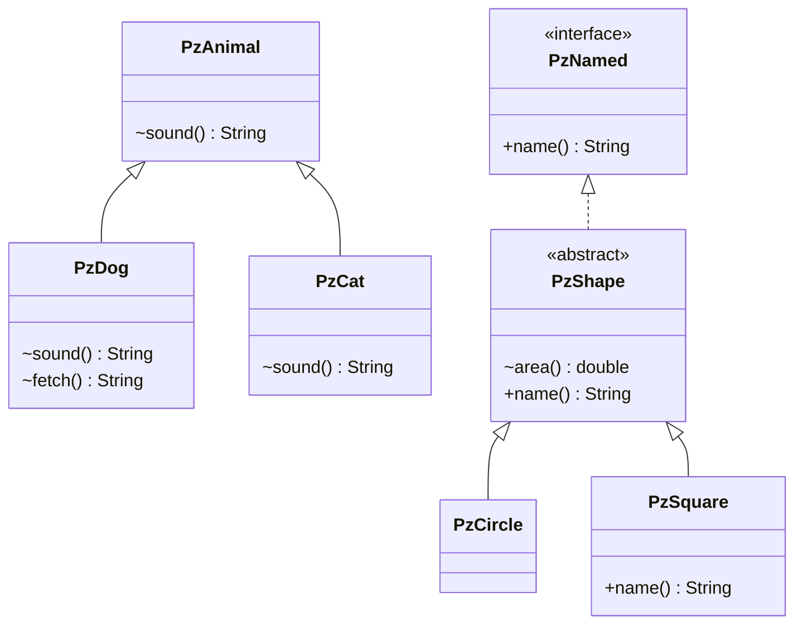

# Chapter 09 — Polymorphism

## What and why

Polymorphism = one reference type, many runtime types. Exams score three things: what the **compiler** allows (static type), what the **JVM** runs (runtime type), and where a cast or pattern fails.

## Exam flash rules

- Every object has one **runtime type** (`getClass()`) and every expression has one **static type** (its declared type).
- The compiler checks members against the **static** type; `a.fetch()` fails if `fetch` is not in `a`'s declared class.
- An **overridden instance method** runs by the **runtime** type (dynamic dispatch). Overloads, fields and static methods use the **static** type.
- **Upcast** (subtype → supertype) is implicit and always safe. **Downcast** needs an explicit cast and is checked at run time.
- A bad downcast throws `ClassCastException`; casting `null` always succeeds and gives `null`.
- The compiler rejects a cast between types that can never match (unrelated classes; a `final` class and an interface it does not implement).
- A cast from a non-final class to an unrelated **interface** compiles; it may fail at run time.
- `x instanceof T` is `false` when `x` is `null`.
- `instanceof` between unrelated class types is a compile error.
- Pattern matching (Java 16+): `o instanceof String s` declares `s` only where the match is definitely true; `&&` and early `return` extend the scope.
- Pattern `switch` (Java 21): cases are tested top to bottom; a general case before a specific one is a compile error; a missing `case null` means `null` throws `NullPointerException`.
- Arrays are **covariant**: `Object[] a = new String[1]` compiles; a wrong store throws `ArrayStoreException`. Generics are **invariant**: `List<Object> = new ArrayList<String>()` does not compile.
- `getClass() ==` and `instanceof` differ for subclasses: `instanceof` accepts subtypes, `getClass()` equality does not.
- Bytecode: `invokevirtual` (class method), `invokeinterface` (interface method), `invokespecial` (constructor, `super.m()`, private), `invokestatic` (static). The first two are dispatched at run time.

## Rules table

| Question | Decided by | Time |
|----------|-----------|------|
| Is `a.m()` legal? | static type of `a` | compile |
| Which overload of `m(x)`? | static types of arguments | compile |
| Which override of `m()` runs? | runtime class of the object | **run** |
| Which field `a.f`? | static type of `a` | compile |
| Which `static` method? | static type (or class name) | compile |
| Is `(T) a` accepted? | static types related? | compile |
| Does `(T) a` succeed? | runtime class is-a `T` (or `null`) | **run** |

| Not allowed / fails | Message (`javac`, Java 21) or exception |
|---------------------|------------------------------------------|
| `DnDog d = a;` (no cast) | `incompatible types: DnAnimal cannot be converted to DnDog` |
| `a.fetch()` via parent type | `cannot find symbol` / `symbol:   method fetch()` |
| `(String) dog` | `incompatible types: UcDog cannot be converted to String` |
| `dog instanceof String` | `incompatible types: IuDog cannot be converted to String` |
| Pattern variable used outside its scope | `cannot find symbol` / `symbol:   variable s` |
| General `case` before specific | `this case label is dominated by a preceding case label` |
| Pattern switch with no default/total case | `the switch expression does not cover all possible input values` |
| `(Runnable) finalClassObj` | `incompatible types: FcAnimal cannot be converted to Runnable` |
| `List<Object> = new ArrayList<String>()` | `incompatible types: ArrayList<String> cannot be converted to List<Object>` |
| Bad downcast, store into wrong array | run time: `ClassCastException`, `ArrayStoreException` |

## Walkthrough

The running types:

```java
{{#include ../../code/part-01-oop/src/main/java/oop/poly/PzTypes.java:pz-types}}
```

### Compile-time type vs runtime type

```java
{{#include ../../code/part-01-oop/src/main/java/oop/poly/PolyCompileVsRuntime.java:poly-compile-vs-runtime}}
```

Program output:

```text
animal
dog
woof
PzDog
woof meow animal 
```

`describe(a)` picks the overload from the **static** type `PzAnimal` (`animal`) even though the object is a `PzDog`. `a.sound()` runs `PzDog.sound` (`woof`). The array loop is the classic polymorphic call: one expression, three behaviours.

### Upcast and downcast

```java
{{#include ../../code/part-01-oop/src/main/java/oop/poly/PolyUpcastDowncast.java:poly-upcast-downcast}}
```

Program output:

```text
ball
true
CCE: class oop.poly.PzDog cannot be cast to class oop.poly.PzCat (oop.poly.PzDog and oop.poly.PzCat are in unnamed module of loader 'app')
true
false
```

The cast `(PzDog) a` succeeds and is the **same object** (`a == back`). `(PzCat) a` compiles, because `PzCat` is a subclass of `PzAnimal`, and fails at run time.

### `instanceof`, pattern matching, pattern `switch`

```java
{{#include ../../code/part-01-oop/src/main/java/oop/poly/PolyInstanceofPattern.java:poly-instanceof-pattern}}
```

Program output:

```text
old:3 old:other
long abcd
not int
int 6
not int
big 42, int 7, str x, null, other
false
```

Java 16+ pattern `instanceof` removes the cast. In `modern("ab")`, the first `if` is false (length 2) and the second `if` returns `not int`. In `modern(5)` the `!(… instanceof Integer n)` guard returns early, so `n` is in scope afterwards. Pattern `switch` (Java 21) needs `case null` to accept `null`; guards use `when`. Older papers (JDK 8/11) show only the cast form.

### `ClassCastException`

```java
{{#include ../../code/part-01-oop/src/main/java/oop/poly/PolyClassCast.java:poly-class-cast}}
```

Program output:

```text
1 class java.lang.String cannot be cast to class java.lang.Integer (java.lang.String and java.lang.Integer are in module java.base of loader 'bootstrap')
2 class oop.poly.PzCat cannot be cast to class oop.poly.PzDog (oop.poly.PzCat and oop.poly.PzDog are in unnamed module of loader 'app')
3 null
4 class java.lang.Integer cannot be cast to class java.lang.String (java.lang.Integer and java.lang.String are in module java.base of loader 'bootstrap')
```

Case 4 is a **heap-pollution** cast: the compiler inserts `(String)` at `strings.get(0)`, not at `raw.add(1)`. Uncaught, the exception ends `main`:

```java
{{#include ../../code/part-01-oop/src/main/java/oop/poly/PolyUncaught.java:poly-uncaught}}
```

```text
before
Exception in thread "main" java.lang.ClassCastException: class java.lang.Integer cannot be cast to class java.lang.String (java.lang.Integer and java.lang.String are in module java.base of loader 'bootstrap')
	at oop.poly.PolyUncaught.main(PolyUncaught.java:8)
```

`after` is never printed.

### Arrays are covariant, generics are not

```java
{{#include ../../code/part-01-oop/src/main/java/oop/poly/PolyArrayStore.java:poly-array-store}}
```

Program output:

```text
ASE: java.lang.Integer
String[] ok null
```

### Dynamic dispatch and `javap`

```java
{{#include ../../code/part-01-oop/src/main/java/oop/poly/PolyDispatchBytecode.java:poly-dispatch-bytecode}}
```

Program output:

```text
3.0 shape
4.0 sq:shape
1
```

Command: `javap -c -p -cp <classes> oop.poly.PolyDispatchBytecode` (JDK 21). Excerpt — `main` and the constructor are omitted:

```text
  static double viaClass(oop.poly.PzShape);
    Code:
       0: aload_0
       1: invokevirtual #7                  // Method oop/poly/PzShape.area:()D
       4: dreturn

  static java.lang.String viaInterface(oop.poly.PzNamed);
    Code:
       0: aload_0
       1: invokeinterface #13,  1           // InterfaceMethod oop/poly/PzNamed.name:()Ljava/lang/String;
       6: areturn

  static int viaStatic();
    Code:
       0: iconst_m1
       1: invokestatic  #19                 // Method java/lang/Math.abs:(I)I
       4: ireturn
```

And `javap -c -p -cp <classes> oop.poly.PzSquare`, the method that calls `super.name()`:

```text
  public java.lang.String name();
    Code:
       0: aload_0
       1: invokespecial #9                  // Method oop/poly/PzShape.name:()Ljava/lang/String;
       4: invokedynamic #13,  0             // InvokeDynamic #0:makeConcatWithConstants:(Ljava/lang/String;)Ljava/lang/String;
       9: areturn
```

| Source | Instruction | Dispatch |
|--------|-------------|----------|
| `s.area()` (class type) | `invokevirtual` | run time, by object's class |
| `n.name()` (interface type) | `invokeinterface` | run time |
| `Math.abs(-1)` | `invokestatic` | none: fixed at compile time |
| `super.name()` | `invokespecial` | none: exactly `PzShape.name` |

The call sites carry the **static** type's method reference (`PzShape.area`); the JVM then picks the override from the object at run time.

### Does not compile

<div class="compiler-error">

```java
{{#include ../../code/part-01-oop/broken/PolyDowncastNoCastBroken.java}}
```

```text
part-01-oop/broken/PolyDowncastNoCastBroken.java:11: error: incompatible types: DnAnimal cannot be converted to DnDog
    DnDog d = a;
              ^
1 error
```

```text
part-01-oop/broken/PolyMethodNotOnParentBroken.java:15: error: cannot find symbol
    System.out.println(a.fetch());
                        ^
  symbol:   method fetch()
  location: variable a of type MpAnimal
1 error
```

```text
part-01-oop/broken/PolyUnrelatedCastBroken.java:9: error: incompatible types: UcDog cannot be converted to String
    String s = (String) d;
                        ^
1 error
```

```text
part-01-oop/broken/PolyInstanceofUnrelatedBroken.java:9: error: incompatible types: IuDog cannot be converted to String
    System.out.println(d instanceof String);
                       ^
1 error
```

```text
part-01-oop/broken/PolyPatternScopeBroken.java:10: error: cannot find symbol
    System.out.println(s);
                       ^
  symbol:   variable s
  location: class PolyPatternScopeBroken
1 error
```

```text
part-01-oop/broken/PolySwitchDominatedBroken.java:8: error: this case label is dominated by a preceding case label
      case String s -> "string";
           ^
1 error
```

```text
part-01-oop/broken/PolySwitchNotExhaustiveBroken.java:6: error: the switch expression does not cover all possible input values
    return switch (o) {
           ^
1 error
```

```text
part-01-oop/broken/PolyFinalCastInterfaceBroken.java:9: error: incompatible types: FcAnimal cannot be converted to Runnable
    Runnable r = (Runnable) a;
                            ^
1 error
```

```text
part-01-oop/broken/PolyGenericInvariantBroken.java:9: error: incompatible types: ArrayList<String> cannot be converted to List<Object>
    List<Object> objs = new ArrayList<String>();
                        ^
1 error
```

</div>

Sources: `broken/PolyDowncastNoCastBroken.java`, `PolyMethodNotOnParentBroken.java`, `PolyUnrelatedCastBroken.java`, `PolyInstanceofUnrelatedBroken.java`, `PolyPatternScopeBroken.java`, `PolySwitchDominatedBroken.java`, `PolySwitchNotExhaustiveBroken.java`, `PolyFinalCastInterfaceBroken.java`, `PolyGenericInvariantBroken.java`.

## Predict the output

**P1.** Overload by static type, override by object.

```java
{{#include ../../code/part-01-oop/src/main/java/oop/poly/exam/PredictOverloadDispatch.java:predict-overload-dispatch}}
```

<details>
<summary>Answer</summary>

```text
A.String
B.Object
A.String
```

`a.f("x")`: the static type `Q1A` has `f(Object)` and `f(String)`; `String` is more specific. `Q1B` does not override `f(String)`, so `A.String`. `a.f(s)` has static argument type `Object` → `f(Object)` → overridden → `B.Object`. `null` also picks `f(String)`.

</details>

**P2.** Exception, `catch`, `finally`.

```java
{{#include ../../code/part-01-oop/src/main/java/oop/poly/exam/PredictCastFlow.java:predict-cast-flow}}
```

<details>
<summary>Answer</summary>

```text
1
3
4
5
```

Trace: `1` → cast throws (`List.of(1)` is not a `String`) → `2` skipped → `catch` prints `3` → `finally` prints `4` → `5`.

</details>

**P3.** Pattern scope.

```java
{{#include ../../code/part-01-oop/src/main/java/oop/poly/exam/PredictPatternScope.java:predict-pattern-scope}}
```

<details>
<summary>Answer</summary>

```text
4 -1 -1
empty no no
```

`instanceof` is `false` for `null`, so `len(null)` is `-1` and `empty(null)` is `no`.

</details>

**P4.** Array covariance.

```java
{{#include ../../code/part-01-oop/src/main/java/oop/poly/exam/PredictArrayStore.java:predict-array-store}}
```

<details>
<summary>Answer</summary>

```text
true
ASE java.lang.String
null
```

The array's runtime type is `Integer[]`; storing a `String` throws, and the slot stays `null`.

</details>

**P5.** `super` call inside an override.

```java
{{#include ../../code/part-01-oop/src/main/java/oop/poly/exam/PredictSuperDispatch.java:predict-super-dispatch}}
```

<details>
<summary>Answer</summary>

```text
hi B!
hi A
```

`super.hello()` runs `Q5A.hello`, but inside it `name()` is still a virtual call on the same object, so `B`.

</details>

**P6.** Pattern `switch`.

```java
{{#include ../../code/part-01-oop/src/main/java/oop/poly/exam/PredictSwitchPattern.java:predict-switch-pattern}}
```

<details>
<summary>Answer</summary>

```text
big int cs2 num
cs3 other
NPE
```

`f(9)` matches the guarded `Integer` case; `f(3)` the next. `StringBuilder` is a `CharSequence`. No `case null`, so `f(null)` throws `NullPointerException`.

</details>

**P7.** Fields are not polymorphic.

```java
{{#include ../../code/part-01-oop/src/main/java/oop/poly/exam/PredictFieldPoly.java:predict-field-poly}}
```

<details>
<summary>Answer</summary>

```text
1
2
2
2
```

`a.x` uses the static type (`1`). `get()` is overridden and reads `FieldB.x` (`2`). The casts change only the static type, not the object.

</details>

**P8.** `null` and `instanceof`.

```java
{{#include ../../code/part-01-oop/src/main/java/oop/poly/exam/PredictInstanceofNull.java:predict-instanceof-null}}
```

<details>
<summary>Answer</summary>

```text
false
false
null
no match
```

`instanceof` is never true for `null`; the cast of `null` is allowed; the negated pattern branch runs.

</details>

**P9.** `getClass()` vs `instanceof`.

```java
{{#include ../../code/part-01-oop/src/main/java/oop/poly/exam/PredictGetClass.java:predict-get-class}}
```

<details>
<summary>Answer</summary>

```text
true
false
false
true
```

`child instanceof GcBase` is true, but `getClass()` differs between `GcBase` and `GcChild`, so the two `equals` calls on mixed types are `false`.

</details>

## Compile or not?

**C1.** `DnAnimal a = new DnDog(); DnDog d = a;`

<details><summary>Answer</summary>

**Fails** — `incompatible types: DnAnimal cannot be converted to DnDog` (`broken/PolyDowncastNoCastBroken.java`). Add `(DnDog)`.

</details>

**C2.** `MpAnimal a = new MpDog(); a.fetch();`

<details><summary>Answer</summary>

**Fails** — `cannot find symbol` / `symbol:   method fetch()` (`broken/PolyMethodNotOnParentBroken.java`).

</details>

**C3.** `(String) dog` with unrelated classes; **C4.** `dog instanceof String`.

<details><summary>Answer</summary>

Both **fail** — `incompatible types: … cannot be converted to String` (`PolyUnrelatedCastBroken`, `PolyInstanceofUnrelatedBroken`).

</details>

**C5.** Use the pattern variable `s` after the `if` that declared it.

<details><summary>Answer</summary>

**Fails** — `cannot find symbol` / `symbol:   variable s` (`broken/PolyPatternScopeBroken.java`).

</details>

**C6.** `case CharSequence cs` before `case String s`.

<details><summary>Answer</summary>

**Fails** — `this case label is dominated by a preceding case label` (`broken/PolySwitchDominatedBroken.java`).

</details>

**C7.** Pattern `switch` over `Object` with only `String` and `Integer` cases.

<details><summary>Answer</summary>

**Fails** — `the switch expression does not cover all possible input values` (`broken/PolySwitchNotExhaustiveBroken.java`).

</details>

**C8.** `(Runnable) a` where `a` is a `final` class that does not implement `Runnable`.

<details><summary>Answer</summary>

**Fails** — `incompatible types: FcAnimal cannot be converted to Runnable` (`broken/PolyFinalCastInterfaceBroken.java`).

</details>

**C9.** `List<Object> objs = new ArrayList<String>();`

<details><summary>Answer</summary>

**Fails** — `incompatible types: ArrayList<String> cannot be converted to List<Object>` (`broken/PolyGenericInvariantBroken.java`).

</details>

**C10.** Same cast as C8, but the class is **not** final.

```java
{{#include ../../code/part-01-oop/src/main/java/oop/poly/exam/CompileCastInterfaceOk.java:compile-cast-interface-ok}}
```

<details><summary>Answer</summary>

**Compiles**, then fails at run time. Output:

```text
CCE at run time
```

A subclass of `OkAnimal` could implement `Runnable`, so the compiler cannot rule the cast out.

</details>

### MCQ traps

**M1.** `Animal a = new Dog();` — `a.speak()` runs: (a) `Animal`'s (b) `Dog`'s if overridden (c) compile error (d) depends on the field.
**Answer: (b).**

**M2.** `Object[] o = new Integer[1]; o[0] = "s";` — (a) compile error (b) `ClassCastException` (c) `ArrayStoreException` (d) stores it.
**Answer: (c).**

**M3.** `String s = null; s instanceof String` — (a) true (b) false (c) NPE (d) compile error.
**Answer: (b).**

**M4.** Which is decided at compile time? (a) override choice (b) overload choice (c) downcast success (d) array store check.
**Answer: (b).**

## Gotchas

1. **Overload by static type** — `describe(a)` ignores the object's real class (`PolyCompileVsRuntime`, `PredictOverloadDispatch`).
2. **Cast compiles, runs badly** — `(PzCat) a`, `(Runnable) nonFinal` (`PolyUpcastDowncast`, `CompileCastInterfaceOk`).
3. **Heap pollution** — the failing cast appears at `get`, not at `add` (`PolyClassCast`).
4. **Array covariance** — `ArrayStoreException` at run time; use `List` (`PolyArrayStore`, `SolutionNoArrayStore`).
5. **`getClass()` vs `instanceof` in `equals`** — subclass instances are not equal under `getClass()` (`PredictGetClass`).

## UML



## Interview Q&A

1. **Q:** Define polymorphism in Java. **A:** One reference type, many runtime types; overridden methods run by the object's class (`PolyCompileVsRuntime`).
2. **Q:** Compile-time vs run-time polymorphism? **A:** Overloading is compile-time; overriding is run-time (`PredictOverloadDispatch`).
3. **Q:** What is dynamic dispatch? **A:** The JVM selects the override from the receiver's class at `invokevirtual`/`invokeinterface` (`PolyDispatchBytecode`).
4. **Q:** Upcast vs downcast? **A:** Upcast is implicit and safe; downcast needs a cast and a run-time check (`PolyUpcastDowncast`).
5. **Q:** When is `ClassCastException` thrown? **A:** When the runtime class is not a subtype of the cast type (`PolyClassCast`, `PolyUncaught`).
6. **Q:** Can casting `null` fail? **A:** No (`PolyClassCast`, `PredictInstanceofNull`).
7. **Q:** What does `instanceof` return for `null`? **A:** `false` (`PredictInstanceofNull`).
8. **Q:** What is pattern matching for `instanceof`? **A:** Java 16+: `o instanceof String s` tests and binds in one step (`PolyInstanceofPattern`).
9. **Q:** Where is a pattern variable in scope? **A:** Where the match is definitely true: right of `&&`, the `then` branch, or after a negated guard that exits (`PredictPatternScope`, `PolyPatternScopeBroken`).
10. **Q:** Why must a pattern `switch` be exhaustive? **A:** So no input is unhandled; add a total case or `default` (`PolySwitchNotExhaustiveBroken`).
11. **Q:** Are fields polymorphic? **A:** No; the static type picks the field (`PredictFieldPoly`).
12. **Q:** Why does `Object[] a = new String[1]; a[0] = 1;` fail? **A:** Arrays are covariant and checked at run time (`PolyArrayStore`).
13. **Q:** Why is `List<Object> = new ArrayList<String>()` illegal? **A:** Generics are invariant (`PolyGenericInvariantBroken`).
14. **Q:** `getClass()` vs `instanceof` in `equals`? **A:** `getClass()` requires the exact class; `instanceof` accepts subclasses (`PredictGetClass`).
15. **Q:** Which instruction calls `super.m()`? **A:** `invokespecial`; no dispatch (`PzSquare.name` javap).

## Exam writing prompts

1. (5 marks) Write `Shape` with `area()`, two implementations, and a method `total(List<? extends Shape>)` that sums areas. State which line shows run-time polymorphism.
2. (5 marks) Write `describe(Object o)` returning `"int n"`, `"string of k"`, or `"unknown"` using pattern `instanceof` and no explicit casts.
3. (3 marks) Rewrite `size(Object o)` with a pattern `switch`: `"long text"` for strings longer than 3, `"short text"` otherwise, `"none"` for `null`.
4. (3 marks) Given `Animal a = new Dog();`, write the safest statement to call `Dog.fetch()` and explain why `a.fetch()` fails.

## Exercises

1. Sum areas through a `Shape` interface — `solutions/ch09/SolutionShapeSum.java`.
2. `describe(Object)` with pattern `instanceof` — `solutions/ch09/SolutionDescribe.java`.
3. Pattern `switch` with `when` guards and `case null` — `solutions/ch09/SolutionSwitchGuard.java`.
4. Downcast without `ClassCastException` (`isInstance` + `cast`) — `solutions/ch09/SolutionSafeDowncast.java`.
5. Show an array store failing at run time and a `List<Number>` accepting the same values — `solutions/ch09/SolutionNoArrayStore.java`.

Expected outputs: `11.0` · `negative int / int 4 / string of 3 / empty string / unknown` · `long text / short text / big number / number / none / other` · `4 / false / false` · `array: java.lang.Double` and `list: [1, 1.5]`.

## Recap checklist

- [x] Compile-time vs runtime — `PolyCompileVsRuntime`
- [x] Upcast/downcast, `instanceof` + pattern matching — `PolyUpcastDowncast`, `PolyInstanceofPattern`
- [x] `ClassCastException`, array store, generic invariance
- [x] Dynamic dispatch + `javap` — `PolyDispatchBytecode`
- [x] Exam flash, predict ≥5, compile ≥4, writing ≥3
