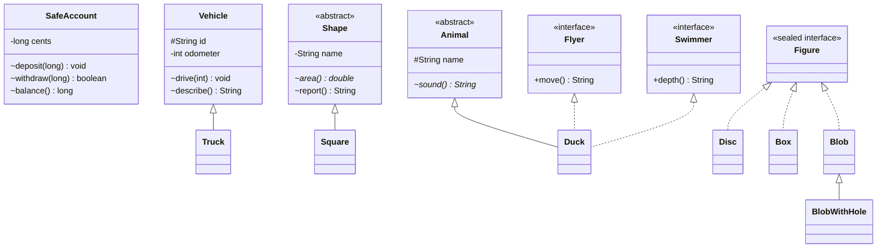

# Chapter 10 — Encapsulation, inheritance, abstraction

## What and why

Three pillars in one unit: **encapsulation** hides state behind methods that enforce invariants, **inheritance** reuses and specialises a class (`extends`), **abstraction** declares a contract without a full implementation (`abstract class`, `interface`, `sealed`). Exams score the legality rules (`abstract` combinations, interface member kinds, functional-interface test, `sealed`/`permits`) and "abstract class vs interface" comparisons.

## Exam flash rules

- Encapsulation = `private` state + methods that validate it; the invariant lives in one place.
- A subclass inherits non-`private` members; it does **not** get access to the parent's `private` members.
- A class extends **one** class (`extends`) but may implement **many** interfaces.
- An `abstract` class cannot be instantiated; it may have fields, constructors and concrete methods.
- An abstract class constructor still runs, via `super(...)`, when a subclass is created.
- An `abstract` method has no body; it cannot be `private`, `static` or `final`.
- A class with an `abstract` method must itself be declared `abstract`.
- `abstract` + `final` on a class is illegal: nothing could extend it.
- A concrete class must implement **every** inherited abstract method.
- Interface fields are implicitly `public static final`; interface methods are implicitly `public` (abstract unless `default`, `static` or `private`).
- Interfaces have no constructors and no instance state; `new Iface()` needs an anonymous class body.
- `default` methods are inherited and overridable; `static` interface methods are **not** inherited (call `Iface.m()`).
- `private` interface methods (Java 9+) are helpers for `default`/`static` methods.
- A functional interface has exactly **one** abstract method (`Object`'s public methods and `default`/`static` ones do not count); `@FunctionalInterface` makes the compiler check it.
- `sealed` (Java 17+): only classes in `permits` may extend it, and each must be `final`, `sealed` or `non-sealed`.
- A `switch` expression over a `sealed` type needs no `default` when every permitted subtype is covered.

## Rules table

| Rule | Allowed | Not allowed | Compiler message (verbatim) |
|------|---------|-------------|-----------------------------|
| Instantiate abstract type | Subclass / anonymous subclass | `new Abstract()` | `AibShape is abstract; cannot be instantiated` |
| Abstract method body | `abstract void m();` | `abstract void m() {...}` | `abstract methods cannot have a body` |
| Abstract method in concrete class | Declare the class `abstract` | Plain `class` | `... is not abstract and does not override abstract method run() in ...` |
| `abstract` + `final` class | — | `abstract final class` | `illegal combination of modifiers: abstract and final` |
| `abstract` + `private` method | — | `private abstract void m();` | `illegal combination of modifiers: abstract and private` |
| `abstract` + `static` method | — | `abstract static void m();` | `illegal combination of modifiers: abstract and static` |
| Missing implementation | Implement all methods | Skip one | `... is not abstract and does not override abstract method speed() in ImiRunner` |
| Interface constant | Read it | Assign it | `cannot assign a value to static final variable MAX` |
| `new` on interface | `new I() { ... }` | `new I()` | `IiTask is abstract; cannot be instantiated` |
| Interface constructor | — | `I() {}` | `<identifier> expected` |
| Static interface method via class | `Iface.m()` | `Impl.m()` | `cannot find symbol` / `symbol:   method tag()` |
| `@FunctionalInterface` | One abstract method | Two | `Unexpected @FunctionalInterface annotation` |
| Lambda target | Functional interface | Two abstract methods | `incompatible types: LnfTwo is not a functional interface` |
| `sealed` subtype not listed | Listed in `permits` | Unlisted class | `class is not allowed to extend sealed class: SnpFigure (as it is not listed in its 'permits' clause)` |
| `sealed` subtype modifier | `final` / `sealed` / `non-sealed` | None | `sealed, non-sealed or final modifiers expected` |
| Sealed switch | Cover every subtype | Miss one | `the switch expression does not cover all possible input values` |
| Private member | Same class | Other class / subclass | `cents has private access in EpAccount` |
| Two superclasses | One `extends` | `extends A, B` | see `broken/ComposeMultiExtendsBroken.java` (chapter 11) |

### Abstract class vs interface

| | Abstract class | Interface |
|-|----------------|-----------|
| Instantiable | No | No |
| Instance fields | Yes | No (only `public static final` constants) |
| Constructors | Yes | No |
| Method kinds | abstract, concrete, `static`, `private`, any access | abstract, `default`, `static`, `private` (public unless `private`) |
| Inherit from | One class | Many interfaces |
| A class may use | `extends` once | `implements` many |
| Typical use | Shared state + partial implementation | Capability / contract |
| Lambda target | No | Yes, if functional |

## Walkthrough

### Encapsulation — private state, validated mutation

```java
{{#include ../../code/part-01-oop/src/main/java/oop/abstracts/EncapsulationDemo.java:encapsulation-demo}}
```

```text
750
false
true
450
deposit must be > 0
```

The only way to change `cents` is through methods that refuse bad input, so the balance can never go negative. Direct access fails:

```java
{{#include ../../code/part-01-oop/broken/AbsEncapsulationPrivateBroken.java}}
```

<div class="compiler-error">

```text
part-01-oop/broken/AbsEncapsulationPrivateBroken.java:11: error: cents has private access in EpAccount
    System.out.println(a.cents);
                        ^
1 error
```

</div>

### Inheritance — `extends`, `super`, the `Object` root

```java
{{#include ../../code/part-01-oop/src/main/java/oop/abstracts/InheritanceDemo.java:inheritance-demo}}
```

```text
truck T1 load=900
40
truck T1 load=900
Truck
Vehicle
Object
```

`Truck` reuses `drive` and `odometer()` but cannot touch the private `odometer` field itself:

```java
{{#include ../../code/part-01-oop/broken/AbsInheritancePrivateBroken.java}}
```

<div class="compiler-error">

```text
part-01-oop/broken/AbsInheritancePrivateBroken.java:10: error: secret has private access in IfbParent
    return secret;
           ^
1 error
```

</div>

### Abstract class — state, constructor, partial implementation

```java
{{#include ../../code/part-01-oop/src/main/java/oop/abstracts/AbstractClassDemo.java:abstract-class-demo}}
```

```text
Shape ctor square
square area=9.0
Shape ctor unit
unit area=1.0
Shape
```

The abstract constructor runs for both the named and the anonymous subclass. `getSuperclass()` of the anonymous class is `Shape`.

```java
{{#include ../../code/part-01-oop/broken/AbstractInstantiateBroken.java}}
```

<div class="compiler-error">

```text
part-01-oop/broken/AbstractInstantiateBroken.java:10: error: AibShape is abstract; cannot be instantiated
    AibShape s = new AibShape();
                 ^
1 error
```

</div>

Illegal modifier combinations and bodies:

```java
{{#include ../../code/part-01-oop/broken/AbstractBodyBroken.java}}
```

<div class="compiler-error">

```text
part-01-oop/broken/AbstractBodyBroken.java:5: error: abstract methods cannot have a body
  abstract void run() {
                ^
1 error
```

</div>

```java
{{#include ../../code/part-01-oop/broken/AbstractInConcreteBroken.java}}
```

<div class="compiler-error">

```text
part-01-oop/broken/AbstractInConcreteBroken.java:4: error: AbstractInConcreteBroken is not abstract and does not override abstract method run() in AbstractInConcreteBroken
public class AbstractInConcreteBroken {
       ^
1 error
```

</div>

```java
{{#include ../../code/part-01-oop/broken/AbstractFinalBroken.java}}
```

<div class="compiler-error">

```text
part-01-oop/broken/AbstractFinalBroken.java:4: error: illegal combination of modifiers: abstract and final
public abstract final class AbstractFinalBroken {
                      ^
1 error
```

</div>

```java
{{#include ../../code/part-01-oop/broken/AbstractPrivateBroken.java}}
```

<div class="compiler-error">

```text
part-01-oop/broken/AbstractPrivateBroken.java:5: error: illegal combination of modifiers: abstract and private
  private abstract void run();
                        ^
1 error
```

</div>

```java
{{#include ../../code/part-01-oop/broken/AbstractStaticBroken.java}}
```

<div class="compiler-error">

```text
part-01-oop/broken/AbstractStaticBroken.java:5: error: illegal combination of modifiers: abstract and static
  abstract static void run();
                       ^
1 error
```

</div>

An `abstract` class may declare no abstract methods, and an interface may be empty (a marker):

```java
{{#include ../../code/part-01-oop/src/main/java/oop/abstracts/NoAbstractMethodsEdge.java:no-abstract-methods-edge}}
```

```text
concrete method in abstract class
true
true
```

### Interface members — constant, abstract, `default`, `static`, `private`

```java
{{#include ../../code/part-01-oop/src/main/java/oop/abstracts/InterfaceMembers.java:interface-members}}
```

```text
Hi Anna
8
Hi Bo
true
```

```java
{{#include ../../code/part-01-oop/broken/AbsInterfaceFieldAssignBroken.java}}
```

<div class="compiler-error">

```text
part-01-oop/broken/AbsInterfaceFieldAssignBroken.java:10: error: cannot assign a value to static final variable MAX
    IfaConst.MAX = 20;
            ^
1 error
```

</div>

```java
{{#include ../../code/part-01-oop/broken/AbsInterfaceInstantiateBroken.java}}
```

<div class="compiler-error">

```text
part-01-oop/broken/AbsInterfaceInstantiateBroken.java:10: error: IiTask is abstract; cannot be instantiated
    IiTask t = new IiTask();
               ^
1 error
```

</div>

```java
{{#include ../../code/part-01-oop/broken/AbsInterfaceCtorBroken.java}}
```

<div class="compiler-error">

```text
part-01-oop/broken/AbsInterfaceCtorBroken.java:5: error: <identifier> expected
  AbsInterfaceCtorBroken() {}
                     ^
1 error
```

</div>

A concrete implementor must cover every abstract method:

```java
{{#include ../../code/part-01-oop/broken/AbsInterfaceMissingImplBroken.java}}
```

<div class="compiler-error">

```text
part-01-oop/broken/AbsInterfaceMissingImplBroken.java:10: error: AbsInterfaceMissingImplBroken is not abstract and does not override abstract method speed() in ImiRunner
public class AbsInterfaceMissingImplBroken implements ImiRunner {
       ^
1 error
```

</div>

### Static interface methods are not inherited

```java
{{#include ../../code/part-01-oop/src/main/java/oop/abstracts/InterfaceStaticNotInherited.java:interface-static-not-inherited}}
```

```text
Util.tag
hello
```

```java
{{#include ../../code/part-01-oop/broken/AbsInterfaceStaticInheritedBroken.java}}
```

<div class="compiler-error">

```text
part-01-oop/broken/AbsInterfaceStaticInheritedBroken.java:14: error: cannot find symbol
    System.out.println(IsUtilImpl.tag());
                                 ^
  symbol:   method tag()
  location: class IsUtilImpl
1 error
```

</div>

### Abstract class + interfaces together

```java
{{#include ../../code/part-01-oop/src/main/java/oop/abstracts/AbstractVsInterface.java:abstract-vs-interface}}
```

```text
duck quack fly shallow
true true true
```

`Duck` extends one abstract class (state, constructor) and implements two capability interfaces. Any of the three types can refer to the same object.

### Multiple inheritance through interfaces

```java
{{#include ../../code/part-01-oop/src/main/java/oop/abstracts/MultipleInterfaces.java:multiple-interfaces}}
```

```text
readable+writable
readable+writable
true
2
```

Two unrelated defaults with the same signature force the nearest type to override and choose with `X.super.m()` (rule table in chapter 07; failing case `broken/OverrideDiamondBroken.java`).

### Functional interfaces

```java
{{#include ../../code/part-01-oop/src/main/java/oop/abstracts/FunctionalInterfaces.java:functional-interfaces}}
```

```text
5
8
3
2
12
11
true
supplied
abab
40
```

`Op` stays functional despite `equals(Object)`, a `default` and a `static` method. Common JDK shapes: `Function<T,R>` (`apply`), `Predicate<T>` (`test`), `Supplier<T>` (`get`), `Consumer<T>` (`accept`), `BiFunction`, `UnaryOperator`. `f.andThen(g)` = `g(f(x))`; `f.compose(g)` = `f(g(x))`.

```java
{{#include ../../code/part-01-oop/broken/AbsFunctionalTwoAbstractBroken.java}}
```

<div class="compiler-error">

```text
part-01-oop/broken/AbsFunctionalTwoAbstractBroken.java:4: error: Unexpected @FunctionalInterface annotation
@FunctionalInterface
^
  AbsFunctionalTwoAbstractBroken is not a functional interface
    multiple non-overriding abstract methods found in interface AbsFunctionalTwoAbstractBroken
1 error
```

</div>

```java
{{#include ../../code/part-01-oop/broken/AbsLambdaNotFunctionalBroken.java}}
```

<div class="compiler-error">

```text
part-01-oop/broken/AbsLambdaNotFunctionalBroken.java:12: error: incompatible types: LnfTwo is not a functional interface
    LnfTwo t = () -> System.out.println("x");
               ^
    multiple non-overriding abstract methods found in interface LnfTwo
1 error
```

</div>

### Sealed types (Java 17+)

```java
{{#include ../../code/part-01-oop/src/main/java/oop/abstracts/SealedShapes.java:sealed-shapes}}
```

```text
disc r=2.0
box 2.0x3.0
blob BlobWithHole
true
Disc
Box
Blob
```

`record`s are implicitly `final`; `Blob` is `non-sealed`, so `BlobWithHole` may extend it. The `switch` has no `default`.

```java
{{#include ../../code/part-01-oop/src/main/java/oop/abstracts/SealedClassDemo.java:sealed-class-demo}}
```

```text
Card fee=3
Cash fee=0
ExactCash fee=0
true
false
true
```

```java
{{#include ../../code/part-01-oop/broken/AbsSealedNotPermittedBroken.java}}
```

<div class="compiler-error">

```text
part-01-oop/broken/AbsSealedNotPermittedBroken.java:8: error: class is not allowed to extend sealed class: SnpFigure (as it is not listed in its 'permits' clause)
final class SnpTriangle implements SnpFigure {}
      ^
1 error
```

</div>

```java
{{#include ../../code/part-01-oop/broken/AbsSealedMissingModifierBroken.java}}
```

<div class="compiler-error">

```text
part-01-oop/broken/AbsSealedMissingModifierBroken.java:6: error: sealed, non-sealed or final modifiers expected
class SmmDisc implements SmmFigure {}
^
1 error
```

</div>

```java
{{#include ../../code/part-01-oop/broken/AbsSealedSwitchNotExhaustiveBroken.java}}
```

<div class="compiler-error">

```text
part-01-oop/broken/AbsSealedSwitchNotExhaustiveBroken.java:12: error: the switch expression does not cover all possible input values
    return switch (s) {
           ^
1 error
```

</div>

Language rule: a permitted subclass must be in the same module (or the same package in the unnamed module). Common exam simplification: "same file or package". Papers set for JDK 8/11 omit `sealed` entirely; it is 17+.

## Predict the output

**P1.** Abstract constructor calls an abstract method.

```java
{{#include ../../code/part-01-oop/src/main/java/oop/abstracts/exam/PredictAbstractCtor.java:predict-abstract-ctor}}
```

<details><summary>Answer</summary>

```text
base ctor null
child ctor child
```

Trace: `PacChild()` → `super()` → `PacBase` body calls `name()` (the child's override) while `label` is still `null` → child field initializer → child constructor body.

</details>

**P2.** Class vs interface `default`.

```java
{{#include ../../code/part-01-oop/src/main/java/oop/abstracts/exam/PredictClassBeatsDefault.java:predict-class-beats-default}}
```

<details><summary>Answer</summary>

```text
parent
parent
override+interface
```

Trace: an inherited **class** method beats an interface `default`; the `PcbSpeaker` reference still dispatches to the object's method; `PcbOverride` picks the default with `PcbSpeaker.super.speak()`.

</details>

**P3.** Switch over a sealed hierarchy.

```java
{{#include ../../code/part-01-oop/src/main/java/oop/abstracts/exam/PredictSealedSwitch.java:predict-sealed-switch}}
```

<details><summary>Answer</summary>

```text
6
PssPair[l=PssLeaf[v=1], r=PssPair[l=PssLeaf[v=2], r=PssLeaf[v=3]]]
```

Trace: `1 + (2 + 3)`; records print as `Name[component=value, ...]`.

</details>

**P4.** `andThen` vs `compose`.

```java
{{#include ../../code/part-01-oop/src/main/java/oop/abstracts/exam/PredictFunctionalCompose.java:predict-functional-compose}}
```

<details><summary>Answer</summary>

```text
9
5
2
```

Trace: `plus2.andThen(times3)` → `(1+2)*3 = 9`; `plus2.compose(times3)` → `1*3+2 = 5`; `identity().andThen(plus2)` on `0` → `2`.

</details>

**P5.** Interface constants and static methods.

```java
{{#include ../../code/part-01-oop/src/main/java/oop/abstracts/exam/PredictInterfaceStatic.java:predict-interface-static}}
```

<details><summary>Answer</summary>

```text
11
20
10
```

Trace: constants are inherited by implementors (`MAX + 1`); the static method is called on the interface; `PisUser.MAX` reads the inherited constant.

</details>

**P6.** Anonymous subclass of an abstract class with a constructor argument.

```java
{{#include ../../code/part-01-oop/src/main/java/oop/abstracts/exam/PredictAnonAbstract.java:predict-anon-abstract}}
```

<details><summary>Answer</summary>

```text
15
20
PaaCounter
true
```

Trace: `new PaaCounter(10) { ... }` passes `10` to the abstract class constructor; `next()` adds `step() = 5` each call.

</details>

**P7.** Interface diamond with a more specific default.

```java
{{#include ../../code/part-01-oop/src/main/java/oop/abstracts/exam/PredictDiamondSuper.java:predict-diamond-super}}
```

<details><summary>Answer</summary>

```text
BA
BA
```

Trace: `PdsB` overrides `PdsA.m`, so it is the most specific default (`PdsC` adds nothing); `PdsA.super.m()` inside `PdsB` supplies the trailing `A`.

</details>

**P8.** Reflection on a class hierarchy (from the walkthrough): what does `InheritanceDemo` print for the loop over `getSuperclass()`?

<details><summary>Answer</summary>

```text
Truck
Vehicle
Object
```

Trace: walks up from the runtime class until `Object.getSuperclass()` returns `null`.

</details>

**P9.** `this` inside a lambda versus inside an anonymous class.

```java
{{#include ../../code/part-01-oop/src/main/java/oop/abstracts/exam/PredictLambdaThis.java:predict-lambda-this}}
```

<details><summary>Answer</summary>

```text
outer anon
```

Trace: a lambda has no `this` of its own, so `this.name` is the enclosing `PredictLambdaThis` field; the anonymous class is a new object with its own `name`.

</details>

**P10.** Encapsulation leak through a stored array reference.

```java
{{#include ../../code/part-01-oop/src/main/java/oop/abstracts/exam/PredictEncapsulationAlias.java:predict-encapsulation-alias}}
```

<details><summary>Answer</summary>

```text
99 1
```

Trace: `R6Leaky` keeps the caller's array, so `a[0] = 99` is visible; `R6Safe` copied it in the constructor.

</details>

### MCQ-style traps

**M1.** Which is **legal**?
(a) `abstract final class A {}` (b) `abstract class A { abstract void m() {} }` (c) `abstract class A { abstract void m(); }` (d) `class A { abstract void m(); }`
**Answer: (c)** — (a) `abstract` + `final`; (b) abstract with body; (d) abstract method in a concrete class.

**M2.** `interface I { int X = 1; }` — which statement compiles?
(a) `I.X = 2;` (b) `int y = I.X;` (c) `new I();` (d) `I() {}` inside `I`
**Answer: (b)** — constants are `public static final`; (a) assigns a final, (c) instantiates an interface, (d) interfaces have no constructors.

**M3.** Which interface is functional?
(a) two abstract methods (b) one abstract + one `default` (c) zero abstract + one `default` (d) `void m(); void n();` plus `boolean equals(Object o);`
**Answer: (b)** — `default` does not count; (a) has two; (c) has none; (d) `equals(Object)` is ignored but `m` and `n` still make two.

**M4.** `sealed interface S permits A, B` and `class A implements S {}`. What happens?
(a) compiles (b) fails: `sealed, non-sealed or final modifiers expected` (c) fails: not permitted (d) fails at run time
**Answer: (b)** — `A` is listed, but needs `final`, `sealed` or `non-sealed`.

## Compile or not?

**C1.** `AibShape s = new AibShape();` where `AibShape` is abstract.
**Fails** — `AibShape is abstract; cannot be instantiated` (`AbstractInstantiateBroken`).

**C2.** `abstract void run() { ... }`
**Fails** — `abstract methods cannot have a body` (`AbstractBodyBroken`).

**C3.** `public abstract final class X { }`
**Fails** — `illegal combination of modifiers: abstract and final` (`AbstractFinalBroken`).

**C4.** `class C implements I {}` where `I` has an abstract `speed()` that `C` does not implement.
**Fails** — `... does not override abstract method speed() in ImiRunner` (`AbsInterfaceMissingImplBroken`).

**C5.** `IsUtilImpl.tag()` where `tag()` is a `static` method of the interface `IsUtil` that `IsUtilImpl` implements.
**Fails** — `cannot find symbol` — looks fine, but static interface methods are not inherited (`AbsInterfaceStaticInheritedBroken`).

**C6.** `IfaConst.MAX = 20;` for an interface constant.
**Fails** — `cannot assign a value to static final variable MAX` (`AbsInterfaceFieldAssignBroken`).

**C7.** Lambda assigned to an interface with two abstract methods.
**Fails** — `LnfTwo is not a functional interface` (`AbsLambdaNotFunctionalBroken`).

**C8.** Class outside `permits` implements a sealed interface.
**Fails** — `class is not allowed to extend sealed class` (`AbsSealedNotPermittedBroken`).

**C9.** `switch` expression on a sealed type missing one subtype, no `default`.
**Fails** — `the switch expression does not cover all possible input values` (`AbsSealedSwitchNotExhaustiveBroken`).

**C10.** An interface with `default` + `private` instance helper + `private static` helper.
**Compiles** — private interface methods are allowed since Java 9.

```java
{{#include ../../code/part-01-oop/src/main/java/oop/abstracts/exam/CompileInterfaceHelpersOk.java:compile-interface-helpers-ok}}
```

```text
false
true
```

**C11.** An `abstract` class with no abstract methods, extended by another `abstract` class that adds one.
**Compiles** — `abstract` does not require abstract methods; the first concrete subclass must implement all of them.

```java
{{#include ../../code/part-01-oop/src/main/java/oop/abstracts/exam/CompileAbstractNoMethodsOk.java:compile-abstract-no-methods-ok}}
```

```text
run
true
```

## Gotchas

1. **Abstract constructor calls an abstract method** — subclass fields are still default. `AbstractCtorOrder`, `PredictAbstractCtor`.
2. **Static interface methods are not inherited** — only `Iface.m()` works. `InterfaceStaticNotInherited`, `AbsInterfaceStaticInheritedBroken`.
3. **Class method beats interface `default`** — "class wins". `PredictClassBeatsDefault`.
4. **`abstract` does not mean "has abstract methods"** — `NoAbstractMethodsEdge`, `CompileAbstractNoMethodsOk`.
5. **Sealed subclasses must declare their own modifier** — `final`, `sealed` or `non-sealed`; omitting it fails. `AbsSealedMissingModifierBroken`, `SealedClassDemo`.

```java
{{#include ../../code/part-01-oop/src/main/java/oop/abstracts/AbstractCtorOrder.java:abstract-ctor-order}}
```

```text
T-ctor,init sees null,
init sees set
```

## UML



## Interview Q&A

1. **Q:** What is encapsulation? **A:** Private state reached only through methods that enforce invariants (`EncapsulationDemo`, `AbsEncapsulationPrivateBroken`).
2. **Q:** Does a subclass inherit `private` members? **A:** It holds them in the object but cannot access them by name (`AbsInheritancePrivateBroken`).
3. **Q:** Can a class extend two classes? **A:** No; one `extends`, many `implements` (`AbstractVsInterface`).
4. **Q:** Can an abstract class have a constructor? **A:** Yes; it runs through `super(...)` (`AbstractClassDemo`).
5. **Q:** Abstract class vs interface? **A:** Abstract class: state, constructors, one parent; interface: contract, many parents, no instance state (table above).
6. **Q:** Can an interface have method bodies? **A:** Yes: `default`, `static` and `private` methods (`InterfaceMembers`).
7. **Q:** Why are `abstract final` and `abstract private` illegal? **A:** Nothing could ever extend/implement them (`AbstractFinalBroken`, `AbstractPrivateBroken`).
8. **Q:** Are static interface methods inherited? **A:** No (`AbsInterfaceStaticInheritedBroken`).
9. **Q:** What makes an interface functional? **A:** Exactly one abstract method; `default`, `static` and `Object` methods are excluded (`FunctionalInterfaces`, `AbsFunctionalTwoAbstractBroken`).
10. **Q:** How is the diamond of defaults resolved? **A:** The class overrides and calls `X.super.m()`; a more specific interface wins (`MultipleInterfaces`, `PredictDiamondSuper`).
11. **Q:** What does `sealed` add? **A:** A closed set of subtypes (`permits`) and exhaustive `switch` without `default` (`SealedShapes`, `AbsSealedSwitchNotExhaustiveBroken`).
12. **Q:** What modifiers must a permitted subclass use? **A:** `final`, `sealed` or `non-sealed` (`AbsSealedMissingModifierBroken`).
13. **Q:** Can you instantiate an interface? **A:** Only through an anonymous class or lambda; `new I()` fails (`AbsInterfaceInstantiateBroken`).
14. **Q:** What is a marker interface? **A:** An interface with no methods used as a type tag (`NoAbstractMethodsEdge`).

## Exam writing prompts

1. (5) Write `abstract class Shape` with an `abstract double area()` and a `final String report()` that uses it, plus `Sq` and `Rc` subclasses. Show a `main` that prints both reports.
2. (5) Write `sealed interface Expr permits Num, Add, Mul` using records and an `eval` method with a `switch` and **no** `default`.
3. (5) Define `@FunctionalInterface TriFunction` with one `default` method, then use it as a lambda and a method reference.
4. (5) Two interfaces `Printer` and `Scanner2` both declare `default String run()`; write a class implementing both that returns `"print&scan"`.
5. (5) Make `Temperature` safe: private `celsius`, constructor and setter reject values below `-273.15`, and a derived `fahrenheit()` getter.
6. (3) State, with the compiler message, what is wrong with `abstract static void run();`.

## Exercises

1. Abstract `Shape` + template `report()` — `solutions/ch10/SolutionShape.java`.
2. Sealed expression evaluator — `solutions/ch10/SolutionSealedExpr.java`.
3. Custom functional interface — `solutions/ch10/SolutionFunctional.java`.
4. Resolve two conflicting defaults — `solutions/ch10/SolutionDiamondFix.java`.
5. Encapsulated temperature — `solutions/ch10/SolutionEncapsulatedTemp.java`.
6. Delete the `permits Disc, Box, Blob` clause from `Figure` in `SealedShapes` (all subtypes are in the same file) and confirm it still compiles and prints the same first three lines. Then add `final class Extra implements Figure {}` in a second file of the same package; real error: `class is not allowed to extend sealed class: Figure (as it is not listed in its 'permits' clause)`.

Solution outputs (real runs):

```text
SolutionShape            -> Sq:9.0 / Rc:10.0
SolutionSealedExpr       -> 14
SolutionFunctional       -> 9 / 7
SolutionDiamondFix       -> print&scan
SolutionEncapsulatedTemp -> 212.0 / below absolute zero / 212.0
```

## Recap checklist

- [x] Abstract classes vs interfaces (`default`/`static`/`private`)
- [x] Functional interfaces; multiple inheritance via interfaces
- [x] Sealed classes/interfaces + `permits`
- [x] Encapsulation (private state + invariant) and inheritance (`extends`, `super`, `private` not accessible)
- [x] Exam flash rules (16)
- [x] Predict the output (8) and MCQ traps (4)
- [x] Compile or not? (11)
- [x] Exam writing prompts (6)
- [x] Gotchas, UML, interview Q&A (14), exercises (5 + 1)
