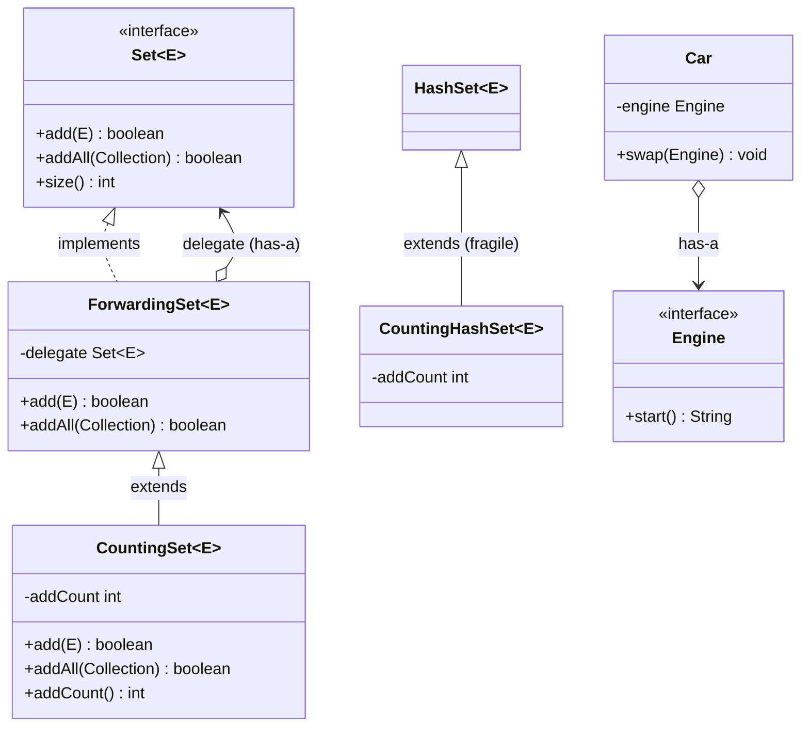

# Chapter 11 — Composition vs inheritance

## What and why

**Inheritance** (`extends`) couples a subclass to the *implementation* of its parent; **composition** (a field plus delegation) couples it only to the parent's *interface*. Exams ask for the fragile base class problem, the "is-a vs has-a" decision, and a short delegation fragment.

## Exam flash rules

- `extends` = **is-a**; a field of another type = **has-a**.
- A subclass depends on the parent's **implementation**, not just its public signatures — this is the **fragile base class** problem.
- *Self-use*: if a parent method calls another overridable method of the same object, a subclass override changes the parent's behaviour.
- `HashSet.addAll` calls `add` (via `AbstractCollection`); overriding both to count adds **double counts**.
- Changing a parent's private strategy (no signature change) can break every subclass — no recompile error warns you.
- **Delegation** = hold a reference, forward the call. A *forwarding class* implements the interface and forwards **every** method.
- A wrapper (`CountingSet`) built on a forwarding class counts correctly **whatever** the wrapped `addAll` does.
- Inheritance is fixed at **compile time**; composition can **swap** the part at run time.
- Java has **single class inheritance**: `class C extends A, B` is a syntax error.
- A `final` class (`String`, `Integer`) cannot be extended — composition is the only reuse.
- `private` members are not accessible in a subclass; the subclass reaches them only through non-private methods.
- If the parent has only a parameterised constructor, every subclass constructor must call `super(args)`.
- `java.util.Stack extends Vector` is the standard exam example of **inheritance misuse**: it exposes `remove(0)`, `insertElementAt`, … that break LIFO.
- Use inheritance only for a true is-a, a base *designed and documented* for extension, and when you control both classes. Otherwise: **favour composition**.
- A constructor that calls an overridable method sees subclass fields **before** they are initialised (`null` / `0`).

## Rules table

| Question | Inheritance | Composition |
|----------|-------------|-------------|
| Relationship | is-a | has-a |
| Coupling | parent **implementation** | other type's **interface** |
| Bound at | compile time | run time (swappable) |
| Access to parent internals | `protected` / package | public API only |
| Reuse a `final` class | impossible | possible |
| Multiple sources | one class only | any number of fields |
| Risk | fragile base class, broken invariants | boilerplate forwarding |

| Not allowed | Compiler message (`javac`, Java 21) |
|-------------|--------------------------------------|
| Extend a `final` class | `cannot inherit from final String` |
| `extends A, B` | `'{' expected` |
| Subclass touches parent's `private` field | `count has private access in Base` |
| Interface method not forwarded | `Wrapper is not abstract and does not override abstract method size() in Store` |
| Parent has no no-arg constructor, subclass declares none | `constructor Base in class Base cannot be applied to given types;` |

## Walkthrough

### Fragile base class — the base changes, the subclass breaks

`CountingV1` and `CountingV2` have **identical source**. Only the base differs: v1 `addAll` loops over `add`; v2 `addAll` bulk-copies.

```java
{{#include ../../code/part-01-oop/src/main/java/oop/compose/FragileVersions.java:fragile-versions}}
```

```text
v1 count=6 size=3
v2 count=3 size=3
```

The subclass was correct for v2 and wrong for v1. Nothing in the signatures tells you which one you have.

### Fragile base class in the JDK — `HashSet.addAll`

```java
{{#include ../../code/part-01-oop/src/main/java/oop/compose/CountingHashSet.java:counting-hashset}}
```

```text
addCount=6 size=3
```

`addAll` adds 3, then `super.addAll` calls the overridden `add` three more times.

### Delegation — forwarding class plus wrapper

```java
{{#include ../../code/part-01-oop/src/main/java/oop/compose/ForwardingSet.java:forwarding-set}}
```

```java
{{#include ../../code/part-01-oop/src/main/java/oop/compose/CountingSet.java:counting-set}}
```

```text
addCount=3 size=3
```

`ForwardingSet.addAll` calls `delegate.addAll`; whatever the delegate does internally is invisible to the wrapper. The counter is correct for any `Set`.

### Has-a is swappable at run time

```java
{{#include ../../code/part-01-oop/src/main/java/oop/compose/EngineSwap.java:engine-swap}}
```

```text
car:vroom
car:hum
```

A `Car extends PetrolCar` cannot become electric after construction.

### Inheritance misuse — `Stack extends Vector`

```java
{{#include ../../code/part-01-oop/src/main/java/oop/compose/StackLeak.java:stack-leak}}
```

```text
removed bottom=1
stack=[2, 3]
deque=[3, 2, 1]
```

A stack that lets you remove the *bottom* element is not a stack. `ArrayDeque` (has-a, `Deque` API) does not leak `Vector` methods.

### When inheritance is fine

```java
{{#include ../../code/part-01-oop/src/main/java/oop/compose/DesignedForExtension.java:designed-for-extension}}
```

```text
Square area=9.0
```

True is-a, one documented hook (`area()`), `describe()` is `final`.

### Does not compile

<div class="compiler-error">

```java
{{#include ../../code/part-01-oop/broken/ComposeFinalExtendBroken.java}}
```

```text
part-01-oop/broken/ComposeFinalExtendBroken.java:4: error: cannot inherit from final String
public final class ComposeFinalExtendBroken extends String {
                                                    ^
1 error
```

```java
{{#include ../../code/part-01-oop/broken/ComposeMultiExtendsBroken.java}}
```

```text
part-01-oop/broken/ComposeMultiExtendsBroken.java:9: error: '{' expected
  static class C extends A, B {}
                          ^
1 error
```

```java
{{#include ../../code/part-01-oop/broken/ComposePrivateFieldBroken.java}}
```

```text
part-01-oop/broken/ComposePrivateFieldBroken.java:11: error: count has private access in Base
      count++;
      ^
1 error
```

```java
{{#include ../../code/part-01-oop/broken/ComposeMissingForwardBroken.java}}
```

```text
part-01-oop/broken/ComposeMissingForwardBroken.java:11: error: Wrapper is not abstract and does not override abstract method size() in Store
  static final class Wrapper implements Store {
               ^
1 error
```

```java
{{#include ../../code/part-01-oop/broken/ComposeNoDefaultCtorBroken.java}}
```

```text
part-01-oop/broken/ComposeNoDefaultCtorBroken.java:9: error: constructor Base in class Base cannot be applied to given types;
  static class Sub extends Base {
         ^
  required: String
  found:    no arguments
  reason: actual and formal argument lists differ in length
1 error
```

</div>

## Predict the output

Answers are folded. Cover them and write the exact stdout first.

**P1.** `CountingHashSet` (shown above): one `add`, then `addAll` of two.

```java
{{#include ../../code/part-01-oop/src/main/java/oop/compose/exam/PredictAddAllCount.java:predict-addall-count}}
```

<details><summary>Answer</summary>

```text
5 3
```

`add` +1, `addAll` +2 up front, then `super.addAll` calls `add` twice more: 1 + 2 + 2 = 5. The set has 3 elements.

</details>

**P2.** Same operations on the delegating `CountingSet`.

```java
{{#include ../../code/part-01-oop/src/main/java/oop/compose/exam/PredictDelegateCount.java:predict-delegate-count}}
```

<details><summary>Answer</summary>

```text
3 3
```

Forwarding `addAll` goes straight to the delegate; the wrapper's `add` is not called again.

</details>

**P3.**

```java
{{#include ../../code/part-01-oop/src/main/java/oop/compose/exam/PredictSelfUse.java:predict-self-use}}
```

<details><summary>Answer</summary>

```text
hi sub
```

`hello()` calls `name()` on `this`; the runtime type is `Sub`, so the override runs.

</details>

**P4.**

```java
{{#include ../../code/part-01-oop/src/main/java/oop/compose/exam/PredictPrivateSelfUse.java:predict-private-self-use}}
```

<details><summary>Answer</summary>

```text
hi base
```

`private` methods are not overridden. `Sub.name()` is a new, unrelated method; `Base.hello()` binds to `Base.name()`.

</details>

**P5.**

```java
{{#include ../../code/part-01-oop/src/main/java/oop/compose/exam/PredictSwapEngine.java:predict-swap-engine}}
```

<details><summary>Answer</summary>

```text
auto manual
```

The part is per-object state; replacing it on `a` does not touch `b`.

</details>

**P6.**

```java
{{#include ../../code/part-01-oop/src/main/java/oop/compose/exam/PredictCtorHook.java:predict-ctor-hook}}
```

<details><summary>Answer</summary>

```text
tag=null
```

`Base()` runs first and calls the overridden `log()`; `Sub`'s field initialiser has not run yet.

</details>

**P7.**

```java
{{#include ../../code/part-01-oop/src/main/java/oop/compose/exam/PredictStackBottom.java:predict-stack-bottom}}
```

<details><summary>Answer</summary>

```text
cb
```

`remove(0)` (a `Vector` method) removes `"a"`. Then `pop()` → `c`, `pop()` → `b`.

</details>

## Compile or not?

| # | Source | Result |
|---|--------|--------|
| **C1** | `class X extends String {}` — `broken/ComposeFinalExtendBroken.java` | **fails** — `cannot inherit from final String` |
| **C2** | `class C extends A, B {}` — `broken/ComposeMultiExtendsBroken.java` | **fails** — `'{' expected` |
| **C3** | subclass does `count++` on parent's `private int count` — `broken/ComposePrivateFieldBroken.java` | **fails** — `count has private access in Base` |
| **C4** | wrapper implements `Store` but forwards only `put` — `broken/ComposeMissingForwardBroken.java` | **fails** — `... does not override abstract method size() in Store` |
| **C5** | parent has only `Base(String)`; `class Sub extends Base {}` — `broken/ComposeNoDefaultCtorBroken.java` | **fails** — `constructor Base ... cannot be applied to given types;` |
| **C6** | wrapper that implements and forwards both methods — below | **compiles** |

**C6** (compiles):

```java
{{#include ../../code/part-01-oop/src/main/java/oop/compose/exam/CompileOkDelegate.java:compile-ok-delegate}}
```

```text
put x
1
```

Looks-fine-but-fails: **C4** and **C5** read like ordinary code; the errors come from interface completeness and the implicit `super()` call.

## Gotchas

1. **Overriding `add` and `addAll` to count** — double count when the parent's `addAll` calls `add` (`CountingHashSet`).
2. **Invisible parent change** — same subclass, different parent version, different result (`FragileVersions`).
3. **Leaked parent API** — `Stack` exposes `Vector` methods that break LIFO (`StackLeak`).
4. **Overridable call in a constructor** — subclass field still `null` (`exam/PredictCtorHook`).
5. **Private "override"** — `private` parent method plus same-named subclass method is not an override (`exam/PredictPrivateSelfUse`).

## UML



## Interview Q&A

1. **Q:** What is the fragile base class problem? **A:** A parent's internal change (no signature change) breaks subclasses that depended on its implementation — `FragileVersions` prints `6` then `3` for identical subclass code.
2. **Q:** Why does `CountingHashSet` count 6 for 3 elements? **A:** `HashSet.addAll` calls the overridden `add`; counted once in `addAll` and once per `add`.
3. **Q:** How does delegation fix it? **A:** The wrapper only uses the delegate's public contract; `CountingSet` prints `3`.
4. **Q:** Is-a or has-a for `Car` / `Engine`? **A:** has-a; also lets you swap engines (`EngineSwap`).
5. **Q:** Can you extend `String`? **A:** No — `cannot inherit from final String`; wrap it (`solutions/ch11/SolutionNameWrapper.java`).
6. **Q:** Why is `Stack extends Vector` a mistake? **A:** It inherits index operations; `s.remove(0)` removes the bottom (`StackLeak`).
7. **Q:** When is inheritance acceptable? **A:** True is-a, base designed and documented for extension, same owner (`DesignedForExtension`).
8. **Q:** What does a forwarding class do? **A:** Implements the interface and forwards every method to a held instance (`ForwardingSet`).
9. **Q:** Does composition need an interface? **A:** Not strictly, but an interface type for the field is what makes the part swappable.
10. **Q:** What does `final` on a method or class contribute? **A:** `final` methods cannot be overridden (design the extension points), `final` classes cannot be subclassed.
11. **Q:** Why mark `describe()` as `final` in a template base? **A:** Prevents subclasses breaking the documented algorithm; only `area()` is the hook.
12. **Q:** What goes wrong when a constructor calls an overridable method? **A:** Subclass state is uninitialised: `tag=null` (`PredictCtorHook`).

## Exam writing prompts

1. **(5 marks)** Write `Car` with a `Gear` interface field and a `shift()` that delegates; show how to replace the gear at run time. Compare with a `Car extends ManualCar` design in two lines.
2. **(5 marks)** Given `class Names extends ArrayList<String>` that overrides `add` and `addAll` to log, explain the double-log and rewrite it with composition (forward to a `List<String>` field).
3. **(8 marks)** Write interface `Store { void put(String s); int size(); }`, a `ListStore`, and a `LoggingStore` that wraps any `Store`. Draw the UML (`LoggingStore o--> Store`).
4. **(2 marks)** State one situation where inheritance is the right choice and name the guard (`final` template method).

## Exercises

1. `IntStack` as has-a over `ArrayDeque` — `solutions/ch11/SolutionHasA.java`.
2. Logging wrapper over a `Store` interface — `solutions/ch11/SolutionLoggingStore.java`.
3. Rewrite the counting bag so its counter does not depend on the base's `addAll` — `solutions/ch11/SolutionRobustCounter.java`.
4. Replace a `Duck` subclass hierarchy with a swappable `FlyBehavior` — `solutions/ch11/SolutionStrategySwap.java`.
5. Wrap `String` in a `Name` class that forwards `length()` and `upper()` — `solutions/ch11/SolutionNameWrapper.java`.

## Recap checklist

- [x] Fragile base class demo — `FragileVersions.java`, `CountingHashSet.java`
- [x] Delegation — `ForwardingSet.java`, `CountingSet.java`, `EngineSwap.java`
- [x] Misuse and legit use — `StackLeak.java`, `DesignedForExtension.java`
- [x] Compile or not — 5 `broken/Compose*.java` stems + `exam/CompileOkDelegate.java`
- [x] Predict the output — 7 stems in `oop/compose/exam/`
- [x] Exam writing prompts + exercises (`solutions/ch11/`)
- [x] JUnit — `src/test/java/oop/compose/ComposeTest.java`
