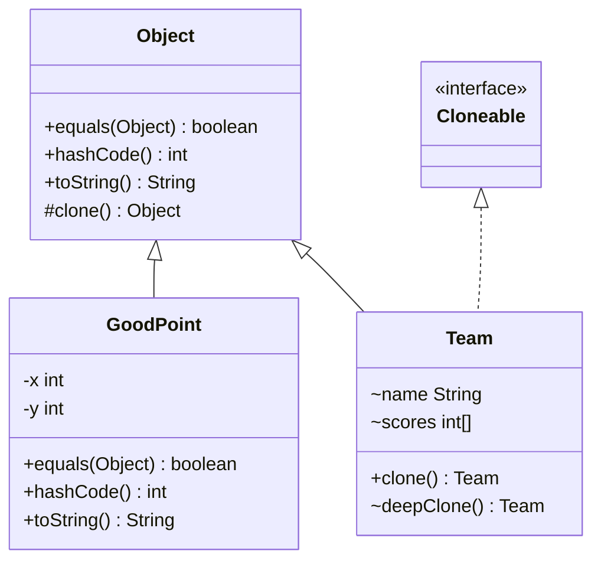

# Chapter 12 — Object contract

## What and why

Every class inherits `equals`, `hashCode`, `toString`, `clone` (and the deprecated `finalize`) from `Object`. Exams score the **contract** between `equals` and `hashCode`, what breaks `HashSet`/`HashMap`, shallow vs deep `clone`, and `==` vs `equals`.

## Exam flash rules

- Default `equals` is `==` (identity); default `hashCode` is identity-based; default `toString` is `ClassName@hex`.
- **Contract:** if `a.equals(b)` then `a.hashCode() == b.hashCode()`. The reverse is **not** required (collisions are legal).
- `equals` must be **reflexive**, **symmetric**, **transitive**, **consistent**, and `x.equals(null)` is `false`.
- Override `equals` ⇒ override `hashCode` **in the same change**. Equal objects with different hashes vanish in a `HashSet` lookup.
- Override `hashCode` alone ⇒ `equals` is still identity ⇒ duplicates stay in the set.
- The signature is `public boolean equals(Object o)`. `equals(Point p)` **overloads** and is not used by collections. `@Override` catches it.
- `hashCode()` returns `int`; `equals` returns `boolean`; `toString()` is `public String` — narrowing access or changing the return type does not compile.
- Do not use a **mutable** field in `hashCode` for an object stored in a hash collection: after mutation `contains` fails.
- `==` on references compares identity. `"a" == "a"` is `true` (pool); `new String("a") == "a"` is `false`.
- `Integer` caches −128…127: `==` is `true` there, `false` outside — use `equals`.
- Arrays inherit identity `equals`; use `Arrays.equals` / `Arrays.deepEquals`.
- `clone()` is `protected` in `Object`; `super.clone()` throws checked `CloneNotSupportedException` and needs `Cloneable`.
- `super.clone()` is **shallow**: primitive fields copied, references **shared**. Deep copy = clone the referenced objects too.
- Prefer a **copy constructor** or factory over `Cloneable`.
- `finalize()` is **deprecated for removal** (Java 18+); never rely on it running. Use try-with-resources (`AutoCloseable`).
- String concatenation and `println(Object)` call `toString()`; a `null` reference prints `null`, it does not throw.
- `instanceof`-based `equals` can break **symmetry** across subclasses; `getClass()`-based equals keeps it (and gives up substitutability).

## Rules table

| Method | Signature | Default | Contract |
|--------|-----------|---------|----------|
| `equals` | `public boolean equals(Object)` | identity | reflexive, symmetric, transitive, consistent, `null` → `false` |
| `hashCode` | `public int hashCode()` | identity hash | equal objects → equal hash; stable while fields in `equals` are unchanged |
| `toString` | `public String toString()` | `Class@hex` | informative; never `null` |
| `clone` | `protected Object clone() throws CloneNotSupportedException` | field-by-field shallow copy | `x.clone() != x`, same class, `equals` normally true |
| `finalize` | `protected void finalize()` | no-op | deprecated for removal |

| Not allowed / trap | Compiler message or behaviour |
|--------------------|-------------------------------|
| `@Override boolean equals(Pt)` | `method does not override or implement a method from a supertype` |
| `int equals(Object)` | `return type int is not compatible with boolean` |
| `long hashCode()` | `return type long is not compatible with int` |
| `String toString()` (package-private) | `attempting to assign weaker access privileges; was public` |
| `t.clone()` from another class | `clone() has protected access in Object` |
| `return (T) super.clone();` with no `try` | `unreported exception CloneNotSupportedException; must be caught or declared to be thrown` |
| `equals` without `hashCode` | compiles; `HashSet.contains` returns `false` (run time) |
| override `finalize()` | compiles with `warning: [removal] finalize() in Object has been deprecated and marked for removal` |

## Walkthrough

### Defaults

```java
{{#include ../../code/part-01-oop/src/main/java/oop/objectc/DefaultObjectDemo.java:default-object}}
```

```text
a.equals(a)=true
a.equals(b)=false
a.hashCode()==identityHashCode=true
toString prefix ok=true
```

The hex part of `Class@hex` varies per run, so the program prints a boolean instead of the string.

### A correct value class

```java
{{#include ../../code/part-01-oop/src/main/java/oop/objectc/GoodPoint.java:good-point}}
```

```java
{{#include ../../code/part-01-oop/src/main/java/oop/objectc/GoodPointDemo.java:good-point-demo}}
```

```text
p.equals(q)=true
p==q=false
p.equals(null)=false
hash equal=true value=994
contains(q)=true
println: GoodPoint[x=1, y=2]
concat: null
```

`Objects.hash(1, 2)` = `31 * (31 * 1 + 1) + 2` = `994`.

### Broken contract in a `HashSet` (compiles, fails at run time)

```java
{{#include ../../code/part-01-oop/src/main/java/oop/objectc/BrokenContracts.java:broken-contracts}}
```

```text
equal objects: true
set contains equal: false
same hash, no equals, size: 2
```

`HashSet` finds the bucket with `hashCode()` first; two `OnlyEquals(1)` objects get different identity hashes, so `equals` is never asked.

### Symmetry

```java
{{#include ../../code/part-01-oop/src/main/java/oop/objectc/SymmetryDemo.java:symmetry}}
```

```text
p.equals(c)=true
c.equals(p)=false
s.equals(t)=false
t.equals(s)=false
```

`p.equals(c)`: `c instanceof Pt` is true. `c.equals(p)`: `p instanceof ColorPt` is false. The `getClass()` form is symmetric.

### `clone` — shallow vs deep

```java
{{#include ../../code/part-01-oop/src/main/java/oop/objectc/CloneDemo.java:clone-demo}}
```

```text
original: changed [99, 2]
shallow : A [99, 2]
deep    : A [1, 2]
shared array: true
```

The `String` field is a separate reference after the copy, so `a.name = "changed"` does not show in the clone; the shared `int[]` does.

### Copy constructor (the usual alternative)

```java
{{#include ../../code/part-01-oop/src/main/java/oop/objectc/CopyConstructor.java:copy-ctor}}
```

```text
[x, y] [x]
```

### `finalize` deprecation

```java
{{#include ../../code/part-01-oop/src/main/java/oop/objectc/FinalizeWarned.java:finalize-warned}}
```

```text
part-01-oop/src/main/java/oop/objectc/FinalizeWarned.java:7: warning: [removal] finalize() in Object has been deprecated and marked for removal
  protected void finalize() {
                 ^
1 warning
```

Replace it with `AutoCloseable` and try-with-resources:

```java
{{#include ../../code/part-01-oop/src/main/java/oop/objectc/FinalizeDeprecated.java:finalize-deprecated}}
```

```text
using true
closed
```

### Does not compile

<div class="compiler-error">

```java
{{#include ../../code/part-01-oop/broken/ObjectcEqualsOverloadBroken.java}}
```

```text
part-01-oop/broken/ObjectcEqualsOverloadBroken.java:12: error: method does not override or implement a method from a supertype
    @Override
    ^
1 error
```

```java
{{#include ../../code/part-01-oop/broken/ObjectcEqualsReturnBroken.java}}
```

```text
part-01-oop/broken/ObjectcEqualsReturnBroken.java:6: error: equals(Object) in ObjectcEqualsReturnBroken cannot override equals(Object) in Object
  public int equals(Object o) {
             ^
  return type int is not compatible with boolean
part-01-oop/broken/ObjectcEqualsReturnBroken.java:5: error: method does not override or implement a method from a supertype
  @Override
  ^
2 errors
```

```java
{{#include ../../code/part-01-oop/broken/ObjectcHashCodeLongBroken.java}}
```

```text
part-01-oop/broken/ObjectcHashCodeLongBroken.java:6: error: hashCode() in ObjectcHashCodeLongBroken cannot override hashCode() in Object
  public long hashCode() {
              ^
  return type long is not compatible with int
part-01-oop/broken/ObjectcHashCodeLongBroken.java:5: error: method does not override or implement a method from a supertype
  @Override
  ^
2 errors
```

```java
{{#include ../../code/part-01-oop/broken/ObjectcToStringAccessBroken.java}}
```

```text
part-01-oop/broken/ObjectcToStringAccessBroken.java:6: error: toString() in ObjectcToStringAccessBroken cannot override toString() in Object
  String toString() {
         ^
  attempting to assign weaker access privileges; was public
1 error
```

```java
{{#include ../../code/part-01-oop/broken/ObjectcCloneUncheckedBroken.java}}
```

```text
part-01-oop/broken/ObjectcCloneUncheckedBroken.java:7: error: unreported exception CloneNotSupportedException; must be caught or declared to be thrown
    return (ObjectcCloneUncheckedBroken) super.clone();
                                                    ^
1 error
```

```java
{{#include ../../code/part-01-oop/broken/ObjectcCloneProtectedBroken.java}}
```

```text
part-01-oop/broken/ObjectcCloneProtectedBroken.java:9: error: clone() has protected access in Object
    Object copy = t.clone();
                   ^
1 error
```

</div>

## Predict the output

**P1.** String identity.

```java
{{#include ../../code/part-01-oop/src/main/java/oop/objectc/exam/PredictStringEq.java:predict-string-eq}}
```

<details><summary>Answer</summary>

```text
true false true true
```

`a == b` (same pooled literal), `a == c` (`new` makes a fresh object), `a == d` (`"h" + "i"` is a compile-time constant, pooled), `equals` compares characters.

</details>

**P2.** `equals` without `hashCode`.

```java
{{#include ../../code/part-01-oop/src/main/java/oop/objectc/exam/PredictHashSetNoHash.java:predict-hashset-no-hash}}
```

<details><summary>Answer</summary>

```text
2 false
```

Different identity hashes ⇒ different buckets; `equals` never runs. Both add and lookup miss.

</details>

**P3.** `equals(Pt)` is an overload.

```java
{{#include ../../code/part-01-oop/src/main/java/oop/objectc/exam/PredictEqualsOverload.java:predict-equals-overload}}
```

<details><summary>Answer</summary>

```text
true false
```

`a.equals(b)` has static type `Pt` → the overload. `a.equals(o)` has static type `Object` → `Object.equals`, identity.

</details>

**P4.** Shallow clone.

```java
{{#include ../../code/part-01-oop/src/main/java/oop/objectc/exam/PredictCloneShallow.java:predict-clone-shallow}}
```

<details><summary>Answer</summary>

```text
1 true false
```

Both boxes hold the same `List`; the boxes themselves differ.

</details>

**P5.** Mutable key.

```java
{{#include ../../code/part-01-oop/src/main/java/oop/objectc/exam/PredictMutableKey.java:predict-mutable-key}}
```

<details><summary>Answer</summary>

```text
null null 1
```

The entry sits in the bucket for hash `1`. `get(k)` looks in bucket `2` (empty); `get(new K(1))` finds the entry but `equals` now compares `1` with `2` → no match. The entry is still counted.

</details>

**P6.** `Integer` cache.

```java
{{#include ../../code/part-01-oop/src/main/java/oop/objectc/exam/PredictIntegerCache.java:predict-integer-cache}}
```

<details><summary>Answer</summary>

```text
true false true
```

`100` is cached (−128…127); `1000` boxes to two objects.

</details>

**P7.** Arrays.

```java
{{#include ../../code/part-01-oop/src/main/java/oop/objectc/exam/PredictArrayEquals.java:predict-array-equals}}
```

<details><summary>Answer</summary>

```text
false true false true
```

`a.equals(b)` is identity; `Arrays.equals` compares elements; on `int[][]` it compares the inner arrays by identity (`false`), `deepEquals` recurses (`true`).

</details>

**P8.** `null` and `toString`.

```java
{{#include ../../code/part-01-oop/src/main/java/oop/objectc/exam/PredictNullString.java:predict-null-string}}
```

<details><summary>Answer</summary>

```text
null!
null
4
NPE
```

Concatenation and `println(Object)` print `null`; `String.valueOf(o)` is `"null"` (length 4); `o.toString()` on a `null` reference throws.

</details>

**P9 (integration).** Mutable key trap from the walkthrough, `MutableKeyGotcha`:

```java
{{#include ../../code/part-01-oop/src/main/java/oop/objectc/MutableKeyGotcha.java:mutable-key}}
```

<details><summary>Answer</summary>

```text
contains(k)=false
size=1
iteration sees it=true
```

The element is in the set but unreachable by lookup; iteration still finds it.

</details>

## Compile or not?

| # | Source | Result |
|---|--------|--------|
| **C1** | `@Override public boolean equals(Pt other)` — `broken/ObjectcEqualsOverloadBroken.java` | **fails** — `method does not override or implement a method from a supertype` |
| **C2** | `public int equals(Object o)` — `broken/ObjectcEqualsReturnBroken.java` | **fails** — `return type int is not compatible with boolean` |
| **C3** | `public long hashCode()` — `broken/ObjectcHashCodeLongBroken.java` | **fails** — `return type long is not compatible with int` |
| **C4** | `String toString()` without `public` — `broken/ObjectcToStringAccessBroken.java` | **fails** — `attempting to assign weaker access privileges; was public` |
| **C5** | `(T) super.clone()` with no `try` — `broken/ObjectcCloneUncheckedBroken.java` | **fails** — `unreported exception CloneNotSupportedException` |
| **C6** | `t.clone()` called from another class — `broken/ObjectcCloneProtectedBroken.java` | **fails** — `clone() has protected access in Object` |
| **C7** | `equals(Pt)` **without** `@Override` — `exam/PredictEqualsOverload.java` | **compiles** (silent overload; see P3) |
| **C8** | `finalize()` override — `FinalizeWarned.java` | **compiles**, with a `[removal]` warning |

Looks-fine-but-fails: **C1** (the parameter type is the whole bug), **C4** (a missing `public`), **C6** (`clone` is public on arrays and in classes that widen it, not on `Object`).

## Gotchas

1. **`equals(Pt)` instead of `equals(Object)`** — silent overload; use `@Override` (`exam/PredictEqualsOverload`).
2. **`equals` without `hashCode`** — `HashSet` duplicates and failed lookups (`BrokenContracts`).
3. **Mutable key** — `contains` false for an element that is in the set (`MutableKeyGotcha`).
4. **Shallow `clone`** — shared array/list (`CloneDemo`, `exam/PredictCloneShallow`).
5. **`==` on `String`/`Integer`** — pool and cache hide the bug until the value changes (`EqualityPitfalls`).

`EqualityPitfalls` output for the last item:

```java
{{#include ../../code/part-01-oop/src/main/java/oop/objectc/EqualityPitfalls.java:equality-pitfalls}}
```

```text
a==b true
a==c false
a.equals(c) true
a==c.intern() true
x.equals(y) false
Arrays.equals true
127==127 true
128==128 false
128 equals true
```

## UML



## Interview Q&A

1. **Q:** State the `equals`/`hashCode` contract. **A:** Equal objects must have equal hash codes; unequal objects may share one.
2. **Q:** What happens if you override only `equals`? **A:** Hash-based collections miss equal objects: `set contains equal: false` (`BrokenContracts`).
3. **Q:** What happens if you override only `hashCode`? **A:** `equals` stays identity, so same-hash objects are still distinct: `size: 2`.
4. **Q:** Why does `equals(Pt)` not work in collections? **A:** It overloads; collections call `equals(Object)` (`PredictEqualsOverload` → `true false`).
5. **Q:** Name the five `equals` rules. **A:** Reflexive, symmetric, transitive, consistent, `null` → `false`.
6. **Q:** How can `instanceof` break symmetry? **A:** `Pt.equals(ColorPt)` is true but `ColorPt.equals(Pt)` is false (`SymmetryDemo`).
7. **Q:** Shallow vs deep `clone`? **A:** Shallow shares references; deep also clones referenced objects (`CloneDemo`: `shared array: true` for shallow).
8. **Q:** Why prefer a copy constructor? **A:** No `Cloneable`, no checked exception, works with `final` fields (`CopyConstructor`).
9. **Q:** Why is `finalize` discouraged? **A:** Unpredictable timing, may never run, deprecated for removal; use `AutoCloseable` (`FinalizeDeprecated`).
10. **Q:** Why must keys in a `HashMap` be effectively immutable? **A:** Their hash decides the bucket; mutation orphans the entry (`MutableKeyGotcha`).
11. **Q:** `new String("a") == "a"`? **A:** `false`; `equals` is `true` (`EqualityPitfalls`).
12. **Q:** Is `x.equals(y)` on `int[]` element comparison? **A:** No, identity; use `Arrays.equals` (`PredictArrayEquals`).
13. **Q:** What does `toString()` default to? **A:** `getClass().getName() + "@" + Integer.toHexString(hashCode())`.

## Exam writing prompts

1. **(5 marks)** Write class `Student(String id, int year)` with `equals`, `hashCode`, `toString` consistent with the contract. Show that `new Student("a", 1)` is found in a `HashSet` after `add(new Student("a", 1))`.
2. **(5 marks)** Given `class Order implements Cloneable { List<String> lines; }`, write `clone()` that returns an independent copy. State what the default `super.clone()` would have shared.
3. **(4 marks)** In `MutableKeyGotcha` (P9) the key is stored in a `HashSet` and `contains` returns `false` after `k.id = 2`. Explain why and fix the class (make `id` final and add a `withId` method).
4. **(3 marks)** Fix `public boolean equals(Student s)` so that it overrides `Object.equals`.

## Exercises

1. `Person(name, age)` with `equals`/`hashCode` — `solutions/ch12/SolutionEqualsHash.java`.
2. Readable `toString` for `Item` — `solutions/ch12/SolutionToString.java`.
3. Deep clone of a class that holds a `List` — `solutions/ch12/SolutionDeepClone.java`.
4. Copy constructor for `Range` — `solutions/ch12/SolutionCopyCtor.java`.
5. Make a mutable `Key` immutable so the set stays consistent — `solutions/ch12/SolutionFixMutableKey.java`.

## Recap checklist

- [x] `equals` / `hashCode` / `toString` contract — `GoodPoint.java`, `GoodPointDemo.java`, `DefaultObjectDemo.java`
- [x] Broken equals in `HashSet` — `BrokenContracts.java`, `exam/PredictHashSetNoHash.java`, `MutableKeyGotcha.java`
- [x] `clone` shallow vs deep — `CloneDemo.java`, `CopyConstructor.java`, `exam/PredictCloneShallow.java`
- [x] `finalize` deprecation — `FinalizeWarned.java`, `FinalizeDeprecated.java`
- [x] Compile or not — 6 `broken/Objectc*.java` stems + 2 compiles
- [x] Predict the output — 9 stems in `oop/objectc/exam/` and mains
- [x] Exam writing prompts + exercises (`solutions/ch12/`)
- [x] JUnit — `src/test/java/oop/objectc/ObjectcTest.java`
