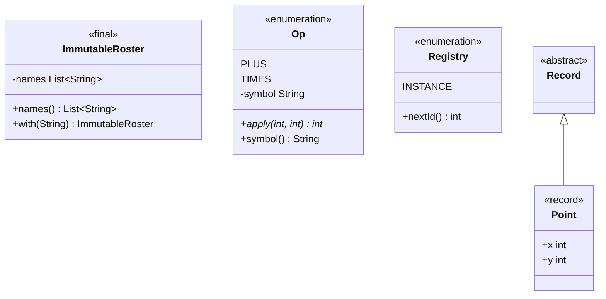

# Chapter 13 — Immutability, records, enums

## What and why

An **immutable** object cannot change after construction; **records** (Java 16+) and **enums** are the language's two built-in shapes for fixed data. Exams ask for the immutable-class recipe, defensive copies, record rules (compact constructor), and enum features (fields, abstract methods, `EnumMap`, singleton).

## Exam flash rules

**Immutability**

- Recipe: `final` class, `private final` fields, no setters, **copy in** (constructor), **copy out** (getters), no leaking `this`, mutating operations return a **new** object.
- `final` on a variable fixes the **reference**, not the object: a `final List` can still `add`.
- `String`, wrapper classes, `BigDecimal`, `LocalDate` are immutable; `Date`, arrays, `ArrayList` are not.
- Arrays are always mutable: `clone()` in the constructor and in the getter.
- `List.of` / `List.copyOf` → unmodifiable **and** independent. `Collections.unmodifiableList` is a **view**: it reflects later changes to the backing list.
- Immutable objects are thread-safe and safe as hash keys.

**Records** (Java 16+; older papers omit them)

- `record P(int x, int y) {}` ⇒ `private final` fields, canonical constructor, accessors `x()`/`y()`, `equals`, `hashCode`, `toString` — all generated.
- A record is implicitly `final`, **cannot extend** a class (it extends `java.lang.Record`), but **can implement** interfaces.
- No instance fields beyond the components; **static** fields and methods are allowed.
- **Compact constructor** (`Name { ... }`) has no parameter list; validate or reassign the **parameters**; fields are assigned automatically at the end. `this.x = …` there does not compile.
- Any other constructor must start with `this(...)`.
- A record is **shallowly** immutable: an array or list component can still be mutated; arrays use identity `equals`.
- Accessors return the stored reference — no copy.

**Enums**

- An enum is a class with a fixed set of instances; constants are `public static final`, created at class-load time.
- Constructors are implicitly `private`; `new Level()` does not compile; an enum cannot be extended.
- `values()` returns a new array each call; `valueOf(String)` throws `IllegalArgumentException` for unknown names; `ordinal()` is the declaration index (0-based); `compareTo` compares ordinals.
- Compare enums with `==`; `equals` is identical.
- Constant-specific class bodies implement an `abstract` method; then `getClass()` is an anonymous subclass — use `getDeclaringClass()`.
- `EnumMap` / `EnumSet` iterate in **ordinal** order and need no hashing.
- A single-constant enum is the safest singleton: reflection and serialization cannot create a second instance.

## Rules table

| Topic | Rule |
|-------|------|
| Immutable class | `final` class, `private final` fields, copies in and out |
| `final` field | assigned exactly once, in an initialiser or every constructor |
| Record header | `record Name(Type a, Type b) { ... }` |
| Record body | static members, methods, extra constructors (`this(...)`), nested types |
| Enum constructor | implicitly `private` |
| Enum switch (Java 21) | a `switch` expression over all constants needs no `default` |

| Not allowed | Compiler message (`javac`, Java 21) |
|-------------|--------------------------------------|
| Assign a final field in a setter | `cannot assign a value to final variable x` |
| Blank `final` never assigned | `variable x not initialized in the default constructor` |
| Record method assigns a component | `cannot assign a value to final variable x` |
| Record instance field | `field declaration must be static` |
| Record `extends` a class | `'{' expected` |
| Compact constructor assigns `this.value` | `cannot assign a value to final variable value` |
| `new Level()` for an enum | `enum classes may not be instantiated` |
| Class extends an enum | `cannot inherit from final Level` and `enum classes are not extensible` |
| `public` enum constructor | `modifier public not allowed here` |
| Enum constant without a body when a method is abstract | `Op is abstract; cannot be instantiated` |

## Walkthrough

### The recipe — copy in, copy out, `with` returns new

```java
{{#include ../../code/part-01-oop/src/main/java/oop/immut/ImmutableRoster.java:immutable-roster}}
```

```text
after source change: [ada, bob]
original: [ada, bob]
with:     [ada, bob, cy]
names().add -> UnsupportedOperationException
```

### Without copies it only *looks* immutable

```java
{{#include ../../code/part-01-oop/src/main/java/oop/immut/LeakyRoster.java:leaky-roster}}
```

```text
after source change: [ada, bob, eve]
after names().clear(): [] source=[]
```

### Arrays need `clone`

```java
{{#include ../../code/part-01-oop/src/main/java/oop/immut/DefensiveArray.java:defensive-array}}
```

```text
1 2 [1, 2, 3]
```

### `final` vs immutable; view vs copy

```java
{{#include ../../code/part-01-oop/src/main/java/oop/immut/FinalVsImmutable.java:final-vs-immutable}}
```

```text
final list: [a]
view: [x, y]
copy: [x]
List.of -> UnsupportedOperationException
string unchanged: abc
reassigned: ABC
```

### Records

```java
{{#include ../../code/part-01-oop/src/main/java/oop/immut/RecordBasics.java:record-basics}}
```

```text
Point[x=3, y=-4]
x()=3 y()=-4
equals=true
hash equal=true
manhattan=7
one-arg=Point[x=2, y=2]
ORIGIN=Point[x=0, y=0]
area=6.0
```

### Compact constructor — validate and normalise

```java
{{#include ../../code/part-01-oop/src/main/java/oop/immut/RecordCompact.java:record-compact}}
```

```text
Range[lo=1, hi=5]
rejected: lo > hi: 5 > 1
Name[value=ada]
equal after trim: true
Tags[items=[a]]
```

### Records are shallowly immutable

```java
{{#include ../../code/part-01-oop/src/main/java/oop/immut/RecordArrayGotcha.java:record-array-gotcha}}
```

```text
same contents equal: false
mutated via accessor: 99
safe equal: true first=1
```

### Enums — fields, constructor, `valueOf`

```java
{{#include ../../code/part-01-oop/src/main/java/oop/immut/EnumBasics.java:enum-basics}}
```

```text
LOW ordinal=0 weight=1 relax
MEDIUM ordinal=1 weight=5 watch
HIGH ordinal=2 weight=10 act
true
-2
true
No enum constant oop.immut.EnumBasics.Level.NOPE
```

### Enums — abstract method per constant

```java
{{#include ../../code/part-01-oop/src/main/java/oop/immut/EnumAbstract.java:enum-abstract}}
```

```text
6 + 7 = 13
6 * 7 = 42
getClass()==Op.class: false
getDeclaringClass()==Op.class: true
```

### `EnumMap` and `EnumSet`

```java
{{#include ../../code/part-01-oop/src/main/java/oop/immut/EnumMapDemo.java:enum-map}}
```

```text
{MON=work, WED=gym, FRI=party}
weekend  [SAT, SUN]
weekdays [MON, TUE, WED, THU, FRI]
range    [TUE, WED, THU]
none     []
```

Insertion order was `FRI`, `MON`, `WED`; output is ordinal order.

### Enum singleton

```java
{{#include ../../code/part-01-oop/src/main/java/oop/immut/EnumSingleton.java:enum-singleton}}
```

```text
same: true
1 2
Cannot reflectively create enum objects
```

### Does not compile

<div class="compiler-error">

```java
{{#include ../../code/part-01-oop/broken/ImmutFinalFieldSetterBroken.java}}
```

```text
part-01-oop/broken/ImmutFinalFieldSetterBroken.java:12: error: cannot assign a value to final variable x
    this.x = x;
        ^
1 error
```

```java
{{#include ../../code/part-01-oop/broken/ImmutFinalNotInitBroken.java}}
```

```text
part-01-oop/broken/ImmutFinalNotInitBroken.java:5: error: variable x not initialized in the default constructor
  private final int x;
                    ^
1 error
```

```java
{{#include ../../code/part-01-oop/broken/ImmutRecordSetterBroken.java}}
```

```text
part-01-oop/broken/ImmutRecordSetterBroken.java:7: error: cannot assign a value to final variable x
      this.x = nx;
          ^
1 error
```

```java
{{#include ../../code/part-01-oop/broken/ImmutRecordInstanceFieldBroken.java}}
```

```text
part-01-oop/broken/ImmutRecordInstanceFieldBroken.java:6: error: field declaration must be static
    int extra;
        ^
  (consider replacing field with record component)
1 error
```

```java
{{#include ../../code/part-01-oop/broken/ImmutRecordExtendsBroken.java}}
```

```text
part-01-oop/broken/ImmutRecordExtendsBroken.java:7: error: '{' expected
  record Point(int x, int y) extends Base {}
                            ^
1 error
```

```java
{{#include ../../code/part-01-oop/broken/ImmutCompactAssignBroken.java}}
```

```text
part-01-oop/broken/ImmutCompactAssignBroken.java:7: error: cannot assign a value to final variable value
      this.value = value.trim();
          ^
1 error
```

```java
{{#include ../../code/part-01-oop/broken/ImmutEnumNewBroken.java}}
```

```text
part-01-oop/broken/ImmutEnumNewBroken.java:8: error: enum classes may not be instantiated
    Level l = new Level();
              ^
1 error
```

```java
{{#include ../../code/part-01-oop/broken/ImmutEnumExtendBroken.java}}
```

```text
part-01-oop/broken/ImmutEnumExtendBroken.java:7: error: cannot inherit from final Level
  static class Custom extends Level {}
                              ^
part-01-oop/broken/ImmutEnumExtendBroken.java:7: error: enum classes are not extensible
  static class Custom extends Level {}
         ^
2 errors
```

```java
{{#include ../../code/part-01-oop/broken/ImmutEnumPublicCtorBroken.java}}
```

```text
part-01-oop/broken/ImmutEnumPublicCtorBroken.java:8: error: modifier public not allowed here
    public Level(int w) {}
           ^
1 error
```

```java
{{#include ../../code/part-01-oop/broken/ImmutEnumAbstractMissingBroken.java}}
```

```text
part-01-oop/broken/ImmutEnumAbstractMissingBroken.java:6: error: Op is abstract; cannot be instantiated
    PLUS,
    ^
1 error
```

</div>

## Predict the output

**P1.**

```java
{{#include ../../code/part-01-oop/src/main/java/oop/immut/exam/PredictFinalList.java:predict-final-list}}
```

<details><summary>Answer</summary>

```text
[a, b]
```

`final` stops reassigning `xs`, not `xs.add`.

</details>

**P2.**

```java
{{#include ../../code/part-01-oop/src/main/java/oop/immut/exam/PredictUnmodifiableView.java:predict-unmodifiable-view}}
```

<details><summary>Answer</summary>

```text
2 1
UOE
```

The view sees `base.add(2)`; `copyOf` is a snapshot. Writing through the view throws.

</details>

**P3.**

```java
{{#include ../../code/part-01-oop/src/main/java/oop/immut/exam/PredictCompactNormalize.java:predict-compact-normalize}}
```

<details><summary>Answer</summary>

```text
Temp[c=-273.15] true
```

The compact constructor reassigns the parameter `c`; that value becomes the field.

</details>

**P4.**

```java
{{#include ../../code/part-01-oop/src/main/java/oop/immut/exam/PredictEnumOrdinal.java:predict-enum-ordinal}}
```

<details><summary>Answer</summary>

```text
2 -2 M 3
true
```

`L.ordinal()` = 2; `S.compareTo(L)` = 0 − 2 = −2; `valueOf("M")` returns the constant `M`; three constants; same instance.

</details>

**P5.**

```java
{{#include ../../code/part-01-oop/src/main/java/oop/immut/exam/PredictEnumMapOrder.java:predict-enum-map-order}}
```

<details><summary>Answer</summary>

```text
[RED, GREEN, BLUE]
[1, 2, 3]
```

`EnumMap` iterates by ordinal, not insertion.

</details>

**P6.**

```java
{{#include ../../code/part-01-oop/src/main/java/oop/immut/exam/PredictRecordArray.java:predict-record-array}}
```

<details><summary>Answer</summary>

```text
true false
```

Record `equals` uses `equals` on each component; for `int[]` that is identity. `x` and `y` share the array.

</details>

**P7.**

```java
{{#include ../../code/part-01-oop/src/main/java/oop/immut/exam/PredictEnumSingleton.java:predict-enum-singleton}}
```

<details><summary>Answer</summary>

```text
2 true
```

`valueOf` returns the one instance; both increments hit the same field.

</details>

## Compile or not?

| # | Source | Result |
|---|--------|--------|
| **C1** | setter assigns a `final` field — `broken/ImmutFinalFieldSetterBroken.java` | **fails** — `cannot assign a value to final variable x` |
| **C2** | `private final int x;` and no constructor — `broken/ImmutFinalNotInitBroken.java` | **fails** — `variable x not initialized in the default constructor` |
| **C3** | record method `this.x = nx;` — `broken/ImmutRecordSetterBroken.java` | **fails** — `cannot assign a value to final variable x` |
| **C4** | record with `int extra;` — `broken/ImmutRecordInstanceFieldBroken.java` | **fails** — `field declaration must be static` |
| **C5** | `record P(...) extends Base` — `broken/ImmutRecordExtendsBroken.java` | **fails** — `'{' expected` |
| **C6** | compact constructor `this.value = ...` — `broken/ImmutCompactAssignBroken.java` | **fails** — `cannot assign a value to final variable value` |
| **C7** | `new Level()` — `broken/ImmutEnumNewBroken.java` | **fails** — `enum classes may not be instantiated` |
| **C8** | `class Custom extends Level` — `broken/ImmutEnumExtendBroken.java` | **fails** — `cannot inherit from final Level` |
| **C9** | `public Level(int w)` — `broken/ImmutEnumPublicCtorBroken.java` | **fails** — `modifier public not allowed here` |
| **C10** | abstract enum method, one constant without body — `broken/ImmutEnumAbstractMissingBroken.java` | **fails** — `Op is abstract; cannot be instantiated` |
| **C11** | record with static field, extra constructor, interface, method — below | **compiles** |

**C11** (compiles):

```java
{{#include ../../code/part-01-oop/src/main/java/oop/immut/exam/CompileOkRecordExtras.java:compile-ok-record-extras}}
```

```text
User[name=guest, age=0] false 1
```

Looks-fine-but-fails: **C3** (a record *looks* like it has mutable fields), **C6** (the compact form assigns for you), **C10** (one constant forgot its body).

## Gotchas

1. **`final` collection** is not an immutable collection (`FinalVsImmutable`, `exam/PredictFinalList`).
2. **`Collections.unmodifiableList` is a view** — later changes show through (`exam/PredictUnmodifiableView`).
3. **Record with an array/list component** — identity `equals`, mutable through the accessor (`RecordArrayGotcha`, `exam/PredictRecordArray`).
4. **Final fields, leaky class** — shared collection in or out (`LeakyRoster`).
5. **Enum constant bodies** — `getClass() != Op.class`; use `getDeclaringClass()` (`EnumAbstract`).

## UML



## Interview Q&A

1. **Q:** List the immutable-class recipe. **A:** `final` class, `private final` fields, no setters, copy in/out, new object per change (`ImmutableRoster`).
2. **Q:** Is a class with a `final List` field immutable? **A:** No; callers can mutate the list (`LeakyRoster`).
3. **Q:** `unmodifiableList` vs `List.copyOf`? **A:** View vs independent snapshot (`PredictUnmodifiableView` → `2 1`).
4. **Q:** What does a record generate? **A:** Fields, canonical constructor, accessors, `equals`, `hashCode`, `toString` (`RecordBasics`).
5. **Q:** What is a compact constructor? **A:** A constructor without a parameter list; assign to parameters, fields are set automatically (`RecordCompact`).
6. **Q:** Can a record extend a class or implement an interface? **A:** Not extend (`'{' expected`); implement yes (`Rect implements Shape`).
7. **Q:** Are records deeply immutable? **A:** No — array/list components stay mutable (`RecordArrayGotcha`).
8. **Q:** Can an enum have a constructor and fields? **A:** Yes; the constructor is implicitly `private` (`EnumBasics`).
9. **Q:** What does `valueOf("NOPE")` do? **A:** `IllegalArgumentException: No enum constant …` (`EnumBasics`).
10. **Q:** When use `EnumMap`? **A:** Enum keys — array-backed, ordinal order, faster than `HashMap` (`EnumMapDemo`).
11. **Q:** Why is an enum a good singleton? **A:** One instance guaranteed; reflection throws `Cannot reflectively create enum objects` (`EnumSingleton`).
12. **Q:** `==` or `equals` for enums? **A:** `==` — same semantics, null-safe on the left, compile-time type check.
13. **Q:** Why are immutable objects good map keys? **A:** The hash cannot change after insertion (chapter 12 `MutableKeyGotcha`).

## Exam writing prompts

1. **(5 marks)** Write an immutable class `Course(String code, List<String> students)` with copy-in and copy-out, plus `withStudent(String)` that returns a new `Course`.
2. **(4 marks)** Write `record Percent(int value)` whose compact constructor throws `IllegalArgumentException` outside 0–100.
3. **(5 marks)** Write `enum Shape` with an abstract method `double area(double d)` and two constants with bodies (`CIRCLE`, `SQUARE`).
4. **(3 marks)** Write a single-element enum singleton with a counter method and explain why `new` and reflection cannot make a second one.
5. **(3 marks)** Fix a record `Data(int[] values)` so that equals compares contents and the accessor does not leak the array.

## Exercises

1. Immutable `Money` with `plus` — `solutions/ch13/SolutionImmutableMoney.java`.
2. Record `Percent` with validation — `solutions/ch13/SolutionRecordRange.java`.
3. Enum with an abstract method per constant — `solutions/ch13/SolutionEnumOp.java`.
4. Count enum values with `EnumMap` — `solutions/ch13/SolutionEnumMapCount.java`.
5. Fix a leaky class with defensive copies — `solutions/ch13/SolutionDefensiveCopy.java`.

## Recap checklist

- [x] Immutable recipe, defensive copies — `ImmutableRoster.java`, `LeakyRoster.java`, `DefensiveArray.java`, `FinalVsImmutable.java`
- [x] Records, compact constructors — `RecordBasics.java`, `RecordCompact.java`, `RecordArrayGotcha.java`
- [x] Enums: fields, abstract, `EnumMap`, singleton — `EnumBasics.java`, `EnumAbstract.java`, `EnumMapDemo.java`, `EnumSingleton.java`
- [x] Compile or not — 10 `broken/Immut*.java` stems + `exam/CompileOkRecordExtras.java`
- [x] Predict the output — 7 stems in `oop/immut/exam/`
- [x] Exam writing prompts + exercises (`solutions/ch13/`)
- [x] JUnit — `src/test/java/oop/immut/ImmutTest.java`
