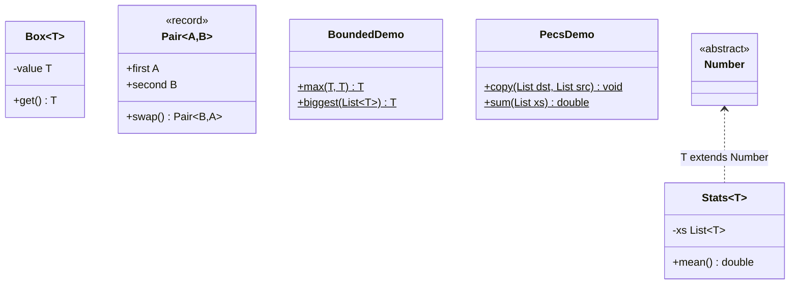

# Chapter 14 — Generics essentials

## What and why

**Generics** add compile-time type parameters to classes and methods, so collections and APIs are type-checked without casts. Exams ask for bounded types, wildcards (PECS), **type erasure** and what it forbids, and generic-method syntax.

## Exam flash rules

- Generics are a **compile-time** feature; the compiler checks types, inserts casts, and **erases** type arguments.
- `List<String>` and `List<Integer>` are the **same class** at run time: `ArrayList`.
- Type arguments must be **reference types**: `List<int>` is illegal; use `List<Integer>`.
- Generics are **invariant**: `List<String>` is **not** a `List<Object>`, even though `String` is an `Object`.
- Arrays are **covariant** and checked at run time: `Object[] a = new String[1]; a[0] = 1;` compiles and throws `ArrayStoreException`.
- `<T extends Comparable<T>>` gives `T` the methods of `Comparable`; an unbounded `T` has only `Object`'s methods.
- Multiple bounds: `<T extends Number & Comparable<T>>` — class first, then interfaces, joined with `&`.
- `T` is erased to its **leftmost bound** (`Object` if none).
- **PECS:** *Producer Extends, Consumer Super*. Read from `? extends T`; write to `? super T`.
- `List<? extends Number>` is **read-only** (only `null` can be added); `List<? super Integer>` can be **written** with `Integer`, and read only as `Object`.
- `List<?>` = `List<? extends Object>`: read as `Object`, add only `null`.
- **Cannot:** `new T()`, `new T[n]`, `x instanceof List<String>`, `static T field`, generic `extends Throwable`, overload `f(List<String>)`/`f(List<Integer>)` (same erasure).
- A **raw type** (`List`) switches off checking; a bad element surfaces later as a `ClassCastException` at the **read** site (heap pollution).
- A generic method declares its own parameter before the return type: `static <T> T first(List<T> xs)`; the type argument is normally **inferred**; explicit form `Cls.<String>first(...)`.
- All `Box<…>` instantiations share one set of **static** members.
- Wildcard capture: a helper `<T> void swap(List<T>)` lets code write to a `List<?>`.

## Rules table

| Syntax | Meaning | Read | Write |
|--------|---------|------|-------|
| `List<T>` | exactly `T` | `T` | `T` |
| `List<? extends N>` | some subtype of `N` | `N` | only `null` |
| `List<? super I>` | some supertype of `I` | `Object` | `I` and subtypes |
| `List<?>` | unknown | `Object` | only `null` |
| `List` (raw) | unchecked | `Object` | anything (warning) |

| Not allowed | Compiler message (`javac`, Java 21) |
|-------------|--------------------------------------|
| `List<Object> o = listOfString;` | `incompatible types: List<String> cannot be converted to List<Object>` |
| `List<int>` | `unexpected type` — `required: reference` / `found: int` |
| `new T()` | `unexpected type` — `required: class` / `found: type parameter T` |
| `new T[n]` | `generic array creation` |
| `o instanceof List<String>` | `Object cannot be safely cast to List<String>` |
| `xs.add(1)` on `List<? extends Number>` | `incompatible types: int cannot be converted to CAP#1` |
| `static T cache;` in `Gen<T>` | `non-static type variable T cannot be referenced from a static context` |
| `a.compareTo(b)` with unbounded `T` | `cannot find symbol` — `symbol: method compareTo(T)` |
| `class E<T> extends Exception` | `a generic class may not extend java.lang.Throwable` |

## Walkthrough

### Generic class, record, method

```java
{{#include ../../code/part-01-oop/src/main/java/oop/generics/GenericBasics.java:generic-basics}}
```

```text
hi
Pair[first=age, second=36] -> Pair[first=36, second=age]
7 explicit
Double
```

### Bounded types

```java
{{#include ../../code/part-01-oop/src/main/java/oop/generics/BoundedDemo.java:bounded-demo}}
```

```text
9
pear
11
2.5
```

### PECS wildcards

```java
{{#include ../../code/part-01-oop/src/main/java/oop/generics/PecsDemo.java:pecs-demo}}
```

```text
[1, 2, 3]
6.5
[1, 2] [1, 2, 3, 1, 2]
1 3
```

`copy(nums, ints)`: `ints` produces (`extends`), `nums` consumes (`super`).

### Wildcard capture

```java
{{#include ../../code/part-01-oop/src/main/java/oop/generics/WildcardCapture.java:wildcard-capture}}
```

```text
[b, a, c]
```

### Erasure

```java
{{#include ../../code/part-01-oop/src/main/java/oop/generics/ErasureDemo.java:erasure-demo}}
```

```text
same class: true
ArrayList<?> check: true
erased params: [Comparable, Comparable]
erased return: Comparable
add through raw type: ok, size=1
ClassCastException at get()
read as Object: 42
```

`T extends Comparable<T>` became `Comparable` in the class file; the `String` cast inserted at `strings.get(0)` is what fails.

### Arrays vs generics

```java
{{#include ../../code/part-01-oop/src/main/java/oop/generics/ArrayCovariance.java:array-covariance}}
```

```text
ArrayStoreException: java.lang.Integer
wildcard view ok: 0
```

### Working around "no `new T`"

```java
{{#include ../../code/part-01-oop/src/main/java/oop/generics/GenericArrayWorkaround.java:generic-array-workaround}}
```

```text
ba
built
String[] 2
```

### Static members are shared

```java
{{#include ../../code/part-01-oop/src/main/java/oop/generics/StaticSharedGotcha.java:static-shared}}
```

```text
3
true
```

### Does not compile

<div class="compiler-error">

```java
{{#include ../../code/part-01-oop/broken/GenInvariantBroken.java}}
```

```text
part-01-oop/broken/GenInvariantBroken.java:10: error: incompatible types: List<String> cannot be converted to List<Object>
    List<Object> objects = strings;
                           ^
1 error
```

```java
{{#include ../../code/part-01-oop/broken/GenPrimitiveBroken.java}}
```

```text
part-01-oop/broken/GenPrimitiveBroken.java:7: error: unexpected type
  List<int> xs;
       ^
  required: reference
  found:    int
1 error
```

```java
{{#include ../../code/part-01-oop/broken/GenNewTBroken.java}}
```

```text
part-01-oop/broken/GenNewTBroken.java:6: error: unexpected type
    return new T();
               ^
  required: class
  found:    type parameter T
  where T is a type-variable:
    T extends Object declared in method <T>make()
1 error
```

```java
{{#include ../../code/part-01-oop/broken/GenNewArrayBroken.java}}
```

```text
part-01-oop/broken/GenNewArrayBroken.java:6: error: generic array creation
    return new T[n];
           ^
1 error
```

```java
{{#include ../../code/part-01-oop/broken/GenInstanceofBroken.java}}
```

```text
part-01-oop/broken/GenInstanceofBroken.java:8: error: Object cannot be safely cast to List<String>
    return o instanceof List<String>;
           ^
1 error
```

```java
{{#include ../../code/part-01-oop/broken/GenWildcardAddBroken.java}}
```

```text
part-01-oop/broken/GenWildcardAddBroken.java:10: error: incompatible types: int cannot be converted to CAP#1
    xs.add(1);
           ^
  where CAP#1 is a fresh type-variable:
    CAP#1 extends Number from capture of ? extends Number
Note: Some messages have been simplified; recompile with -Xdiags:verbose to get full output
1 error
```

```java
{{#include ../../code/part-01-oop/broken/GenStaticTBroken.java}}
```

```text
part-01-oop/broken/GenStaticTBroken.java:5: error: non-static type variable T cannot be referenced from a static context
  static T cache;
         ^
1 error
```

```java
{{#include ../../code/part-01-oop/broken/GenBoundMissingBroken.java}}
```

```text
part-01-oop/broken/GenBoundMissingBroken.java:6: error: cannot find symbol
    return a.compareTo(b) > 0 ? a : b;
            ^
  symbol:   method compareTo(T)
  location: variable a of type T
  where T is a type-variable:
    T extends Object declared in method <T>max(T,T)
1 error
```

```java
{{#include ../../code/part-01-oop/broken/GenThrowableBroken.java}}
```

```text
part-01-oop/broken/GenThrowableBroken.java:5: error: a generic class may not extend java.lang.Throwable
  static class MyError<T> extends Exception {}
                                  ^
1 error
```

</div>

## Predict the output

**P1.**

```java
{{#include ../../code/part-01-oop/src/main/java/oop/generics/exam/PredictErasureClass.java:predict-erasure-class}}
```

<details><summary>Answer</summary>

```text
true
ArrayList
```

One runtime class, type arguments erased.

</details>

**P2.** Raw type and heap pollution. Does the program print `read`?

```java
{{#include ../../code/part-01-oop/src/main/java/oop/generics/exam/PredictRawPollution.java:predict-raw-pollution}}
```

<details><summary>Answer</summary>

```text
added
1
```

Then the program aborts (exit status 1) with, on stderr:

```text
Exception in thread "main" java.lang.ClassCastException: class java.lang.Integer cannot be cast to class java.lang.String (java.lang.Integer and java.lang.String are in module java.base of loader 'bootstrap')
	at oop.generics.exam.PredictRawPollution.main(PredictRawPollution.java:15)
```

`raw.add(7)` is unchecked and succeeds; the compiler-inserted cast at `String s = xs.get(0)` fails. `read` is never printed.

</details>

**P3.** Arrays.

```java
{{#include ../../code/part-01-oop/src/main/java/oop/generics/exam/PredictArrayStore.java:predict-array-store}}
```

<details><summary>Answer</summary>

```text
first
```

Then abort (exit status 1):

```text
Exception in thread "main" java.lang.ArrayStoreException: java.lang.Double
	at oop.generics.exam.PredictArrayStore.main(PredictArrayStore.java:9)
```

The array's real type is `Integer[]`; storing a `Double` fails at run time.

</details>

**P4.** PECS.

```java
{{#include ../../code/part-01-oop/src/main/java/oop/generics/exam/PredictPecsCopy.java:predict-pecs-copy}}
```

<details><summary>Answer</summary>

```text
[0.5, 2, 4]
```

`dst` is a `List<Number>`; the `Integer` values 2 and 4 are appended.

</details>

**P5.** Bounded `max`.

```java
{{#include ../../code/part-01-oop/src/main/java/oop/generics/exam/PredictBoundedMax.java:predict-bounded-max}}
```

<details><summary>Answer</summary>

```text
pear 10 b
```

`"pear"` > `"apple"`; `10` > `9`; `"b"` (98) > `"B"` (66).

</details>

**P6.** Inference.

```java
{{#include ../../code/part-01-oop/src/main/java/oop/generics/exam/PredictInference.java:predict-inference}}
```

<details><summary>Answer</summary>

```text
Integer Double
2
```

Elements keep their runtime types. In the second line the target type `List<Object>` makes `T` = `Object`, so mixing `String` and `Integer` compiles.

</details>

**P7.** Static members.

```java
{{#include ../../code/part-01-oop/src/main/java/oop/generics/exam/PredictStaticShared.java:predict-static-shared}}
```

<details><summary>Answer</summary>

```text
2
```

`Counter<String>` and `Counter<Integer>` share one static `n`.

</details>

## Compile or not?

| # | Source | Result |
|---|--------|--------|
| **C1** | `List<Object> o = listOfString;` — `broken/GenInvariantBroken.java` | **fails** — `List<String> cannot be converted to List<Object>` |
| **C2** | `List<int> xs;` — `broken/GenPrimitiveBroken.java` | **fails** — `unexpected type; required: reference; found: int` |
| **C3** | `return new T();` — `broken/GenNewTBroken.java` | **fails** — `unexpected type` |
| **C4** | `return new T[n];` — `broken/GenNewArrayBroken.java` | **fails** — `generic array creation` |
| **C5** | `o instanceof List<String>` (o is `Object`) — `broken/GenInstanceofBroken.java` | **fails** — `Object cannot be safely cast to List<String>` |
| **C6** | `xs.add(1)` on `List<? extends Number>` — `broken/GenWildcardAddBroken.java` | **fails** — `int cannot be converted to CAP#1` |
| **C7** | `static T cache;` — `broken/GenStaticTBroken.java` | **fails** — `non-static type variable T cannot be referenced from a static context` |
| **C8** | `a.compareTo(b)` with unbounded `T` — `broken/GenBoundMissingBroken.java` | **fails** — `cannot find symbol` |
| **C9** | `class MyError<T> extends Exception` — `broken/GenThrowableBroken.java` | **fails** — `a generic class may not extend java.lang.Throwable` |
| **C10** | read `? extends`, write `? super`, `null` into `?` — below | **compiles** |

**C10** (compiles):

```java
{{#include ../../code/part-01-oop/src/main/java/oop/generics/exam/CompileOkWildcardRead.java:compile-ok-wildcard-read}}
```

```text
1 5 3
```

Looks-fine-but-fails: **C1** (`String` is an `Object`, so it *looks* legal), **C6** (adding an `Integer` to a list of numbers looks legal), **C5** (`instanceof` with a type argument).

## Gotchas

1. **Invariance** — `List<String>` is not `List<Object>`; use `List<?>` or `List<? extends Object>` (`broken/GenInvariantBroken`, `CompileOkWildcardRead`).
2. **Raw type pollution** — the error shows up at the read, not the write (`exam/PredictRawPollution`, `ErasureDemo`).
3. **Array covariance** — compiles, fails at run time (`exam/PredictArrayStore`, `ArrayCovariance`).
4. **Shared statics** — one counter for every type argument (`exam/PredictStaticShared`, `StaticSharedGotcha`).
5. **Unbounded `T`** has only `Object` methods; add a bound to call `compareTo` (`broken/GenBoundMissingBroken`, `BoundedDemo`).

## UML



## Interview Q&A

1. **Q:** What is type erasure? **A:** The compiler removes type arguments, replaces `T` by its bound (or `Object`) and inserts casts (`ErasureDemo`: `erased params: [Comparable, Comparable]`).
2. **Q:** Why can't you write `new T()`? **A:** `T` does not exist at run time; pass a `Supplier<T>` or `Class<T>` (`GenericArrayWorkaround`).
3. **Q:** Why is `List<String>` not a `List<Object>`? **A:** If it were, you could add an `Integer` through the `List<Object>` view (invariance).
4. **Q:** Arrays vs generics variance? **A:** Arrays are covariant and checked at run time (`ArrayStoreException`); generics are invariant and checked at compile time.
5. **Q:** What is PECS? **A:** Producer Extends, Consumer Super (`PecsDemo.copy`).
6. **Q:** Why can't you add to `List<? extends Number>`? **A:** The actual element type is unknown; only `null` is safe (`broken/GenWildcardAddBroken`).
7. **Q:** What does `List<?>` allow? **A:** Reading as `Object`, adding `null`.
8. **Q:** Bounded vs wildcard type? **A:** A bounded `<T extends X>` names the type so you can reuse it in the signature; `?` does not.
9. **Q:** What is heap pollution? **A:** A variable of a parameterised type holding an incompatible object, usually through a raw type; the `ClassCastException` appears at the read (`exam/PredictRawPollution`).
10. **Q:** Can two overloads differ only by `List<String>` vs `List<Integer>`? **A:** No — same erasure (chapter 06 `OverloadErasureBroken`).
11. **Q:** Why are statics shared across `Box<String>` and `Box<Integer>`? **A:** One runtime class (`StaticSharedGotcha` → `3`, `true`).
12. **Q:** What is wildcard capture? **A:** The compiler names `?` as a fresh type so a generic helper can write to it (`WildcardCapture`).
13. **Q:** Multiple bounds syntax? **A:** `<T extends Number & Comparable<T>>` — class first (`BoundedDemo.biggest`).

## Exam writing prompts

1. **(5 marks)** Write `static <T extends Comparable<T>> T max(List<T> xs)` and call it with a `List<Integer>` and a `List<String>`.
2. **(5 marks)** Write `static <T> void copyAll(List<? super T> dst, List<? extends T> src)` and explain each wildcard using PECS.
3. **(4 marks)** Explain why `List<Object> o = new ArrayList<String>();` fails, and rewrite a method `printAll(List<Object>)` so it accepts `List<String>`.
4. **(4 marks)** Write a generic class `Pair<A, B>` with a static factory `of` and an instance method `swap()` returning `Pair<B, A>`.
5. **(3 marks)** Implement a generic `Stack<T>` without `new T[]` (use a `List<T>`).

## Exercises

1. `max` of a list with a flexible bound — `solutions/ch14/SolutionMaxList.java`.
2. PECS copy — `solutions/ch14/SolutionPecsCopy.java`.
3. Reverse any list via wildcard capture — `solutions/ch14/SolutionSwapCapture.java`.
4. Generic `Pair` with a static factory — `solutions/ch14/SolutionPair.java`.
5. Typed stack without generic array creation — `solutions/ch14/SolutionTypedStack.java`.

## Recap checklist

- [x] Bounded types — `BoundedDemo.java`, `broken/GenBoundMissingBroken.java`
- [x] Wildcards and PECS — `PecsDemo.java`, `WildcardCapture.java`, `broken/GenWildcardAddBroken.java`
- [x] Erasure — `ErasureDemo.java`, `ArrayCovariance.java`, `exam/PredictRawPollution.java`
- [x] Generic methods and workarounds — `GenericBasics.java`, `GenericArrayWorkaround.java`, `StaticSharedGotcha.java`
- [x] Compile or not — 9 `broken/Gen*.java` stems + `exam/CompileOkWildcardRead.java`
- [x] Predict the output — 7 stems in `oop/generics/exam/`
- [x] Exam writing prompts + exercises (`solutions/ch14/`)
- [x] JUnit — `src/test/java/oop/generics/GenericsTest.java`
