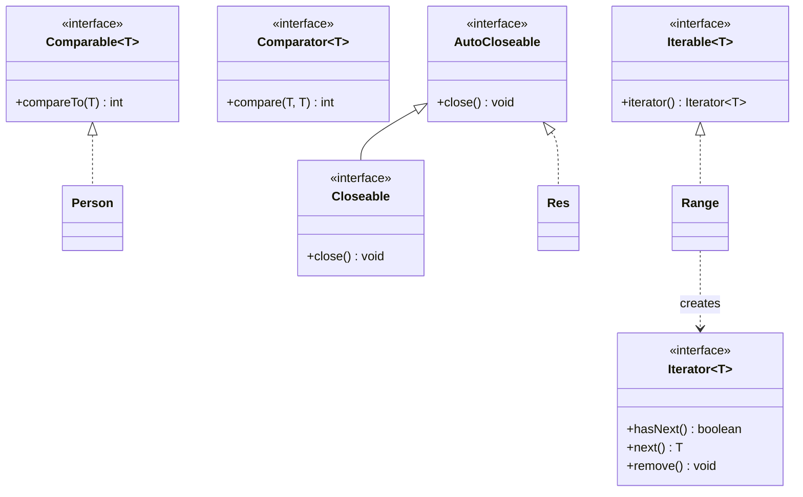

# Chapter 15 — Comparable, Iterable, AutoCloseable

## What and why

Three small interfaces that the language itself knows about: `Comparable` drives sorting and `TreeSet`/`TreeMap`, `Iterable` drives the for-each loop, `AutoCloseable` drives try-with-resources. Exams ask which method to implement, what the compiler rejects, and what order things run in.

Package: `oop.contracts`. Run from `java-book/code` with Java 21.

## Exam flash rules

- `Comparable<T>` has one method: `int compareTo(T other)`. It defines the **natural order** of a class.
- `compareTo` returns negative / zero / positive for less / equal / greater. Only the sign matters.
- Never write `a - b` in `compareTo` for `int`; it overflows. Use `Integer.compare(a, b)`.
- `Comparator<T>` is a **separate** object with `int compare(T a, T b)`. Use it for a second order or a class you cannot edit.
- `Collections.sort(list)` and `TreeSet`/`TreeMap` without a comparator need `Comparable`; otherwise `ClassCastException` at run time.
- `TreeSet`/`TreeMap` decide equality with `compareTo`/`compare` returning `0`, **not** `equals`.
- Keep `compareTo` consistent with `equals`. `BigDecimal("1.0")` vs `("1.00")` is the classic break.
- `list.sort(null)` means natural order. `Comparator.nullsFirst(...)` is how `null` elements are handled.
- `Iterable<T>` has one abstract method: `Iterator<T> iterator()`. Anything `Iterable` (or an array) works in for-each.
- `Iterator` has `hasNext()` and `next()`; `remove()` is a default method that throws `UnsupportedOperationException`. `next()` past the end throws `NoSuchElementException`; `hasNext()` must not advance.
- Removing from a collection inside for-each throws `ConcurrentModificationException` (fail-fast). Use `Iterator.remove()` or `removeIf`.
- `AutoCloseable.close()` may throw `Exception`; `Closeable.close()` throws only `IOException` and is meant to be idempotent.
- try-with-resources closes in **reverse** order of declaration, **before** `catch`/`finally` run.
- If the body and `close()` both throw, the body's exception wins; the other is **suppressed** (`getSuppressed()`).
- A resource variable is implicitly `final`. A `null` resource is allowed and simply not closed.

## Comparable vs Comparator

| | `Comparable<T>` | `Comparator<T>` |
|---|---|---|
| Package | `java.lang` | `java.util` |
| Method | `compareTo(T o)` | `compare(T a, T b)` |
| Who implements it | The class being sorted | Any separate class, lambda, or method reference |
| Number of orders | One (natural) | Many |
| Used by | `Collections.sort(list)`, `TreeSet()`, `Arrays.sort(Object[])` | `list.sort(c)`, `new TreeSet<>(c)`, `Collections.sort(list, c)` |
| Can edit the class? | Needed | Not needed |
| Chaining | No | `thenComparing`, `reversed`, `nullsFirst` |

## Rules table

| Disallowed | Compiler message (`javac`, Java 21) |
|------------|-------------------------------------|
| `compareTo(Object)` when you declared `Comparable<X>` | `name clash: compareTo(Object) in … and compareTo(…) in Comparable have the same erasure, yet neither overrides the other` |
| `compareTo` returning `boolean` | `return type boolean is not compatible with int` |
| `implements Iterable<T>` without `iterator()` | `… is not abstract and does not override abstract method iterator() in Iterable` |
| for-each over a type that is not an array or `Iterable` | `for-each not applicable to expression type` |
| try-with-resources on a type that is not `AutoCloseable` | `incompatible types: try-with-resources not applicable to variable type` |
| `close() throws Exception` used without catch/throws | `unreported exception Exception; must be caught or declared to be thrown` |
| Assigning to the resource variable | `auto-closeable resource r may not be assigned` |
| `Closeable.close()` overridden with `throws Exception` | `overridden method does not throw Exception` |
| Using the resource after the `try` block | `cannot find symbol` |

## Walkthrough

### `Comparable` — natural order

```java
{{#include ../../code/part-01-oop/src/main/java/oop/contracts/ComparableBasics.java:comparable-basics}}
```

```text
[Ann:25, Bo:31, Cy:40]
-1
1
0
```

### `Comparator` — chains, reversed, nulls

```java
{{#include ../../code/part-01-oop/src/main/java/oop/contracts/ComparatorDemo.java:comparator-demo}}
```

```text
[Amy, Bob, Eve, Zed]
[Zed, Amy, Bob, Eve]
[null, fig, pear, apple]
[A, D, b, c]
[A, b, c, D]
[c, b, D, A]
```

Natural `String` order is by UTF-16 code unit, so uppercase sorts before lowercase.

### `Iterable` and `Iterator`

```java
{{#include ../../code/part-01-oop/src/main/java/oop/contracts/IterableDemo.java:iterable-demo}}
```

```text
1 2 3 
1;2;3;
1,4,9,
NoSuchElementException
remove: remove
```

For-each on an `Iterable` is rewritten by the compiler to `iterator()` + `hasNext()`/`next()`. `forEach` is a default method on `Iterable`.

### Removing during iteration

```java
{{#include ../../code/part-01-oop/src/main/java/oop/contracts/IteratorRemoveDemo.java:iterator-remove}}
```

```text
CME [1, 3, 4, 5, 6]
[1, 3, 5]
[1, 3, 5]
IllegalStateException
```

`Iterator.remove()` must follow a call to `next()`; calling it first throws `IllegalStateException`.

### `AutoCloseable` — order of open and close

```java
{{#include ../../code/part-01-oop/src/main/java/oop/contracts/AutoCloseableDemo.java:autocloseable-demo}}
```

```text
open A
open B
use A
use B
close B
close A
---
open A
open B
use A
close B
close A
caught boom
finally
```

Resources close (reverse order) **before** `catch`, then `finally` runs.

### `Closeable`, suppressed exceptions, `null` resources

```java
{{#include ../../code/part-01-oop/src/main/java/oop/contracts/CloseableEdge.java:closeable-edge}}
```

```text
closed
already closed
body
1
close failed
body ok
from close: close failed
```

```java
{{#include ../../code/part-01-oop/src/main/java/oop/contracts/NullResourceEdge.java:null-resource}}
```

```text
body runs
done
java 9 form
closed existing
```

`try (existing)` with an effectively final variable is **Java 9+**; older papers require a declaration inside the parentheses.

### Does not compile — Comparable

```java
{{#include ../../code/part-01-oop/broken/ContComparableWrongTypeBroken.java}}
```

<div class="compiler-error">

```text
part-01-oop/broken/ContComparableWrongTypeBroken.java:3: error: ContComparableWrongTypeBroken is not abstract and does not override abstract method compareTo(ContComparableWrongTypeBroken) in Comparable
public final class ContComparableWrongTypeBroken implements Comparable<ContComparableWrongTypeBroken> {
             ^
part-01-oop/broken/ContComparableWrongTypeBroken.java:6: error: name clash: compareTo(Object) in ContComparableWrongTypeBroken and compareTo(ContComparableWrongTypeBroken) in Comparable have the same erasure, yet neither overrides the other
  public int compareTo(Object other) {
             ^
2 errors
```

</div>

```java
{{#include ../../code/part-01-oop/broken/ContCompareToReturnBroken.java}}
```

<div class="compiler-error">

```text
part-01-oop/broken/ContCompareToReturnBroken.java:3: error: ContCompareToReturnBroken is not abstract and does not override abstract method compareTo(ContCompareToReturnBroken) in Comparable
public final class ContCompareToReturnBroken implements Comparable<ContCompareToReturnBroken> {
             ^
part-01-oop/broken/ContCompareToReturnBroken.java:7: error: compareTo(ContCompareToReturnBroken) in ContCompareToReturnBroken cannot implement compareTo(T) in Comparable
  public boolean compareTo(ContCompareToReturnBroken other) {
                 ^
  return type boolean is not compatible with int
  where T is a type-variable:
    T extends Object declared in interface Comparable
part-01-oop/broken/ContCompareToReturnBroken.java:6: error: method does not override or implement a method from a supertype
  @Override
  ^
3 errors
```

</div>

### Does not compile — Iterable

```java
{{#include ../../code/part-01-oop/broken/ContIterableNoMethodBroken.java}}
```

<div class="compiler-error">

```text
part-01-oop/broken/ContIterableNoMethodBroken.java:3: error: ContIterableNoMethodBroken is not abstract and does not override abstract method iterator() in Iterable
public final class ContIterableNoMethodBroken implements Iterable<Integer> {
             ^
1 error
```

</div>

```java
{{#include ../../code/part-01-oop/broken/ContForEachNotIterableBroken.java}}
```

<div class="compiler-error">

```text
part-01-oop/broken/ContForEachNotIterableBroken.java:10: error: for-each not applicable to expression type
    for (int x : bag) {
                 ^
  required: array or java.lang.Iterable
  found:    Bag
1 error
```

</div>

### Does not compile — try-with-resources

```java
{{#include ../../code/part-01-oop/broken/ContTwrNotAutoCloseableBroken.java}}
```

<div class="compiler-error">

```text
part-01-oop/broken/ContTwrNotAutoCloseableBroken.java:9: error: incompatible types: try-with-resources not applicable to variable type
    try (Plain p = new Plain()) {
               ^
    (Plain cannot be converted to AutoCloseable)
1 error
```

</div>

```java
{{#include ../../code/part-01-oop/broken/ContCloseCheckedBroken.java}}
```

<div class="compiler-error">

```text
part-01-oop/broken/ContCloseCheckedBroken.java:12: error: unreported exception Exception; must be caught or declared to be thrown
    try (R r = new R()) {
           ^
  exception thrown from implicit call to close() on resource variable 'r'
1 error
```

</div>

```java
{{#include ../../code/part-01-oop/broken/ContTwrReassignBroken.java}}
```

<div class="compiler-error">

```text
part-01-oop/broken/ContTwrReassignBroken.java:11: error: auto-closeable resource r may not be assigned
      r = new R();
      ^
1 error
```

</div>

```java
{{#include ../../code/part-01-oop/broken/ContCloseWiderThrowsBroken.java}}
```

<div class="compiler-error">

```text
part-01-oop/broken/ContCloseWiderThrowsBroken.java:7: error: close() in ContCloseWiderThrowsBroken cannot implement close() in Closeable
  public void close() throws Exception {}
              ^
  overridden method does not throw Exception
1 error
```

</div>

```java
{{#include ../../code/part-01-oop/broken/ContTwrScopeBroken.java}}
```

<div class="compiler-error">

```text
part-01-oop/broken/ContTwrScopeBroken.java:13: error: cannot find symbol
    System.out.println(r);
                       ^
  symbol:   variable r
  location: class ContTwrScopeBroken
1 error
```

</div>

## Predict the output

**P1.** Sort by length with a stable sort.

```java
{{#include ../../code/part-01-oop/src/main/java/oop/contracts/exam/PredictCompareSort.java:predict-compare-sort}}
```

<details><summary>Answer</summary>

```text
[a, e, bb, dd, ccc]
```

`Collections.sort` is stable: equal-length elements keep input order (`a` before `e`, `bb` before `dd`).

</details>

**P2.** `TreeSet` with a `compareTo` that ignores the name.

```java
{{#include ../../code/part-01-oop/src/main/java/oop/contracts/exam/PredictTreeSetBigDecimal.java:predict-treeset}}
```

<details><summary>Answer</summary>

```text
2
[P[name=c, rank=0], P[name=a, rank=1]]
true
```

`b` compares equal to `a` (rank 1), so `add` is a no-op; `contains(zzz, 1)` is `true` for the same reason.

</details>

**P3.** Chained comparator.

```java
{{#include ../../code/part-01-oop/src/main/java/oop/contracts/exam/PredictComparatorChain.java:predict-comparator-chain}}
```

<details><summary>Answer</summary>

```text
[ccc, aa, bb, a, b]
```

Length descending, then natural order inside equal lengths.

</details>

**P4.** Removing inside for-each.

```java
{{#include ../../code/part-01-oop/src/main/java/oop/contracts/exam/PredictCme.java:predict-cme}}
```

<details><summary>Answer</summary>

```text
[a, c]
CME
[b, c]
```

Removing the second-to-last element leaves `hasNext()` false (cursor equals new size), so no exception. Removing any earlier element makes the next `next()` throw.

</details>

**P5.** Iterator calls.

```java
{{#include ../../code/part-01-oop/src/main/java/oop/contracts/exam/PredictIterator.java:predict-iterator}}
```

<details><summary>Answer</summary>

```text
true
true
10
50
false
UnsupportedOperationException
```

`hasNext()` does not advance. `it.next() + it.next()` is `20 + 30`. `List.of` iterators do not support `remove`.

</details>

**P6.** Close order with `finally`.

```java
{{#include ../../code/part-01-oop/src/main/java/oop/contracts/exam/PredictCloseOrder.java:predict-close-order}}
```

<details><summary>Answer</summary>

```text
new x
new y
body
close y
close x
finally
```

</details>

**P7.** Exception in both body and `close()`.

```java
{{#include ../../code/part-01-oop/src/main/java/oop/contracts/exam/PredictCloseThrows.java:predict-close-throws}}
```

<details><summary>Answer</summary>

```text
body 1
```

The body's exception is thrown; the `close()` exception is attached as suppressed.

</details>

**P8.** Overflow in a subtraction comparator.

```java
{{#include ../../code/part-01-oop/src/main/java/oop/contracts/CompareOverflowGotcha.java:compare-overflow}}
```

<details><summary>Answer</summary>

```text
-2147483647
1
```

`MAX_VALUE - (-2)` wraps to a negative number, so the "bad" comparator says `MAX_VALUE` is **smaller**.

</details>

## Compile or not?

| Stem | Answer | Proof |
|------|--------|-------|
| **C1.** `class X implements Comparable<X> { public int compareTo(Object o) {…} }` | **Fails** — same erasure, neither overrides | `broken/ContComparableWrongTypeBroken.java` |
| **C2.** `compareTo` declared as `boolean` | **Fails** — return type not compatible with `int` | `broken/ContCompareToReturnBroken.java` |
| **C3.** `implements Iterable<Integer>` with no `iterator()` | **Fails** — not abstract and does not override | `broken/ContIterableNoMethodBroken.java` |
| **C4.** `for (int x : bag)` where `Bag` only has an array field | **Fails** — for-each not applicable | `broken/ContForEachNotIterableBroken.java` |
| **C5.** `try (Plain p = …)` with no `AutoCloseable` | **Fails** — try-with-resources not applicable | `broken/ContTwrNotAutoCloseableBroken.java` |
| **C6.** `close() throws Exception`, caller has no catch | **Fails** — unreported exception from implicit `close()` | `broken/ContCloseCheckedBroken.java` |
| **C7.** `r = new R();` inside try-with-resources body | **Fails** — resource may not be assigned | `broken/ContTwrReassignBroken.java` |
| **C8.** `Closeable.close()` overridden with `throws Exception` | **Fails** — overridden method does not throw | `broken/ContCloseWiderThrowsBroken.java` |
| **C9.** Use `r` after the try block | **Fails** — cannot find symbol | `broken/ContTwrScopeBroken.java` |
| **C10.** `close()` with **no** `throws`, no catch | **Compiles** | `exam/CompileTwrOk.java` below |

```java
{{#include ../../code/part-01-oop/src/main/java/oop/contracts/exam/CompileTwrOk.java:compile-twr-ok}}
```

```text
body
closed
```

An override may **narrow** the `throws` clause (even to nothing), so the caller needs no `catch`.

## Gotchas

**G1.** **Subtraction comparator overflows** — `CompareOverflowGotcha`.

```java
{{#include ../../code/part-01-oop/src/main/java/oop/contracts/CompareOverflowGotcha.java:compare-overflow}}
```

**G2.** **`compareTo` inconsistent with `equals`** — `HashSet` keeps both, `TreeSet` keeps one.

```java
{{#include ../../code/part-01-oop/src/main/java/oop/contracts/CompareToEqualsGotcha.java:compare-equals}}
```

```text
false
0
2
1
```

**G3.** **`TreeSet` of a non-`Comparable` fails at run time, not compile time.**

```java
{{#include ../../code/part-01-oop/src/main/java/oop/contracts/NotComparableGotcha.java:not-comparable}}
```

```text
ClassCastException
true
```

**G4.** **Fail-fast removal** — `IteratorRemoveDemo`; the "second-to-last" exception — `PredictCme`.
**G5.** **Hidden exceptions in `close()`** — body wins, `close()` is suppressed — `CloseableEdge`, `PredictCloseThrows`.

## UML



## Interview Q&A

1. **Q:** `Comparable` vs `Comparator`? **A:** `Comparable` is the class's single natural order (`compareTo`); `Comparator` is an external, swappable order (`compare`). See the table above.
2. **Q:** Why is `a - b` a bad `compareTo`? **A:** Integer overflow flips the sign — `CompareOverflowGotcha`.
3. **Q:** What does a `TreeSet` use to detect duplicates? **A:** `compareTo`/`compare` returning `0`, not `equals` — `PredictTreeSetBigDecimal`, `CompareToEqualsGotcha`.
4. **Q:** What if the element type is not `Comparable` and no comparator is given? **A:** `ClassCastException` on first `add` — `NotComparableGotcha`.
5. **Q:** What must a type provide to work in for-each? **A:** Be an array or implement `Iterable<T>` (`iterator()`) — `ContForEachNotIterableBroken`.
6. **Q:** Why does removing in for-each throw? **A:** `ArrayList`'s iterator is fail-fast (`modCount` check) — `IteratorRemoveDemo`.
7. **Q:** Safe ways to remove while iterating? **A:** `Iterator.remove()`, `removeIf`, or iterate over a copy — `IteratorRemoveDemo`.
8. **Q:** Can `hasNext()` be called many times? **A:** Yes, it must be side-effect free — `PredictIterator`.
9. **Q:** In what order does try-with-resources close? **A:** Reverse of declaration, before `catch`/`finally` — `AutoCloseableDemo`, `PredictCloseOrder`.
10. **Q:** If body and `close()` both throw? **A:** Body's exception propagates; `close()`'s is suppressed — `CloseableEdge`.
11. **Q:** `AutoCloseable` vs `Closeable`? **A:** `Closeable` extends `AutoCloseable`, throws `IOException` only, and `close()` must be safe to call twice — `CloseableEdge`.
12. **Q:** Can a `null` be a resource? **A:** Yes; `close()` is skipped — `NullResourceEdge`.
13. **Q:** Does an override of `close()` need `throws Exception`? **A:** No; narrowing is allowed and removes the caller's catch — `CompileTwrOk`.
14. **Q:** Are `String`'s natural order and case-insensitive order the same? **A:** No — `ComparatorDemo` (`[A, D, b, c]` vs `[A, b, c, D]`).

## Exam writing prompts

1. (5) Write `class Book implements Comparable<Book>` ordering by `year` ascending (use `Integer.compare`), and a `Comparator<Book>` ordering by `title` then `year`. Sort a `List<Book>` both ways. — see `solutions/ch15/SolutionSortStudents.java`.
2. (5) Write a class `Countdown` that is `Iterable<Integer>` and yields `n, n-1, …, 1`. Show a for-each over `new Countdown(3)`. — `solutions/ch15/SolutionCountdown.java`.
3. (5) Write an `AutoCloseable` called `Timer` printing `enter`/`exit` and use two of them in one try-with-resources. State the output order. — `solutions/ch15/SolutionTimer.java`.
4. (3) A `TreeSet<P>` drops an element where `P.rank` ties. Fix the comparator without changing `P`. — `solutions/ch15/SolutionTieBreak.java`.

## Exercises

1. Sort students by id (`Comparable`) then by name (`Comparator`) — `solutions/ch15/SolutionSortStudents.java`.
2. Countdown `Iterable` — `solutions/ch15/SolutionCountdown.java`.
3. Two nested resources and print order — `solutions/ch15/SolutionTimer.java`.
4. Comparator consistent with `equals` — `solutions/ch15/SolutionTieBreak.java`.
5. Iterator wrapper with `peek()` — `solutions/ch15/SolutionPeekingIterator.java`.
6. Make `Range` support `remove()` on a backing list and show `IllegalStateException` when `remove()` is called twice in a row.

## Recap checklist

- [x] `Comparable` vs `Comparator`, overflow, consistency with `equals` — `ComparableBasics`, `ComparatorDemo`, `CompareOverflowGotcha`, `CompareToEqualsGotcha`
- [x] `Iterable` / `Iterator`, fail-fast removal — `IterableDemo`, `IteratorRemoveDemo`
- [x] `AutoCloseable` / `Closeable`, close order, suppressed, `null` resource — `AutoCloseableDemo`, `CloseableEdge`, `NullResourceEdge`
- [x] Compile-or-not bank (9 fail + 1 pass) — `broken/Cont*Broken.java`, `exam/CompileTwrOk`
- [x] Predict bank (8) — `oop/contracts/exam/Predict*.java`
- [x] Exam writing prompts, exercises — `solutions/ch15/`
