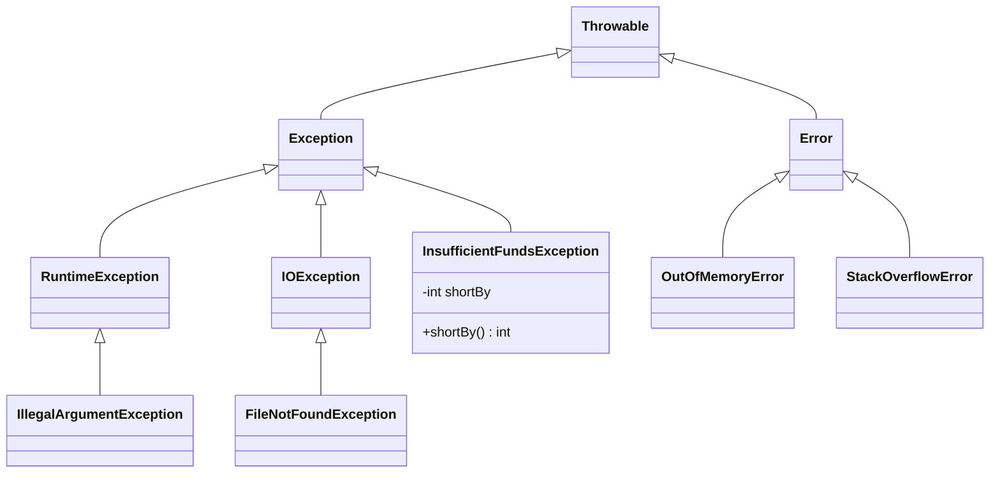

# Chapter 16 — Exceptions

## What and why

Exceptions are the largest single source of predict-output and compile-or-not marks in a Java paper: the hierarchy, checked vs unchecked, `finally` vs `return`, overriding rules, and what happens when a constructor or static initializer fails.

Package: `oop.ex`. Messages below are the exact Java 21 text; wording can differ in older JDKs.

## Exam flash rules

- Hierarchy: `Throwable` → `Error` and `Exception`; `RuntimeException` extends `Exception`.
- **Checked** = `Throwable` and its subclasses **except** `RuntimeException`, `Error` and their subclasses. Only checked exceptions are enforced by the compiler.
- A checked exception must be caught **or** declared with `throws`; otherwise `unreported exception`.
- Catching a checked exception the `try` body cannot throw is a compile error (`never thrown`). `Exception`, `Throwable` and unchecked types are always allowed.
- Order `catch` blocks **subclass first**; a superclass `catch` before a subclass is `has already been caught`.
- Multi-catch alternatives cannot be related by subclassing, and the multi-catch parameter is implicitly `final`.
- `finally` runs after `try`/`catch` even when they `return` or `throw`; it does **not** run if the JVM exits (`System.exit`) or the thread dies.
- A `return` (or `throw`) inside `finally` **replaces** the pending return value or exception.
- `finally` cannot change a returned **primitive** or reference value already computed, but it can mutate an **object** the reference points to.
- try-with-resources closes in reverse order, before `catch`/`finally`; exceptions from `close()` are **suppressed** if the body threw.
- An overriding method may throw the same checked exceptions, **narrower** ones, or none; never new or broader checked exceptions. Unchecked ones are unrestricted.
- A constructor may declare `throws`; a subclass constructor must declare (or catch) the checked exceptions of the implicit/explicit `super(...)` call.
- An exception in a static initializer becomes `ExceptionInInitializerError`; later uses of the class throw `NoClassDefFoundError`.
- `throw` is a statement that throws an instance; `throws` is a clause on a method or constructor signature.
- `StackOverflowError` and `OutOfMemoryError` are `Error`s: do not catch them to "recover".

## Hierarchy

```text
Object
 └─ Throwable
     ├─ Error                    unchecked   OutOfMemoryError, StackOverflowError, AssertionError
     └─ Exception                checked
         ├─ IOException, SQLException, InterruptedException, ...  checked
         └─ RuntimeException     unchecked   NullPointerException, IllegalArgumentException, ...
```

```java
{{#include ../../code/part-01-oop/src/main/java/oop/ex/HierarchyDemo.java:hierarchy}}
```

```text
NullPointerException -> RuntimeException (unchecked)
IOException -> checked
StackOverflowError -> Error (unchecked)
Exception -> checked
NullPointerException > RuntimeException > Exception > Throwable > Object
FileNotFoundException > IOException > Exception > Throwable > Object
OutOfMemoryError > VirtualMachineError > Error > Throwable > Object
```

## Checked vs unchecked

| | Checked | Unchecked (`RuntimeException`, `Error`) |
|---|---|---|
| Compiler enforces catch/declare | Yes | No |
| Typical cause | Recoverable outside condition (I/O, SQL) | Programming bug or JVM failure |
| Examples | `IOException`, `SQLException`, `Exception` | `NullPointerException`, `ClassCastException`, `StackOverflowError` |
| In an overriding `throws` | Restricted | Free |

```java
{{#include ../../code/part-01-oop/src/main/java/oop/ex/CheckedVsUncheckedDemo.java:checked-unchecked}}
```

```text
unchecked: bad arg
checked: disk
```

## Rules table

| Disallowed | Compiler message (`javac`, Java 21) |
|------------|-------------------------------------|
| Call a `throws IOException` method with no catch/throws | `unreported exception IOException; must be caught or declared to be thrown` |
| `catch (IOException)` before `catch (FileNotFoundException)` | `exception FileNotFoundException has already been caught` |
| `catch (FileNotFoundException \| IOException e)` | `Alternatives in a multi-catch statement cannot be related by subclassing` |
| Assign to a multi-catch parameter | `multi-catch parameter e may not be assigned` |
| `catch (IOException)` when the body cannot throw it | `exception IOException is never thrown in body of corresponding try statement` |
| Override with broader checked exception | `overridden method does not throw Exception` |
| Override adding a checked exception to a method with none | `overridden method does not throw IOException` |
| `throw "text";` | `incompatible types: String cannot be converted to Throwable` |
| Statement after `throw` | `unreachable statement` |
| Subclass constructor without handling `super()`'s checked exception | `unreported exception IOException; must be caught or declared to be thrown` |
| Implicit default constructor over a throwing `super()` | `unreported exception IOException in default constructor` |
| `try (ByteArrayOutputStream o = …)` with no catch | `exception thrown from implicit call to close()` |
| `e instanceof Exception` where `e` is `StackOverflowError` | `incompatible types: StackOverflowError cannot be converted to Exception` |

## Walkthrough

### `try` / `catch` / `finally` and `return`

```java
{{#include ../../code/part-01-oop/src/main/java/oop/ex/FinallyReturnDemo.java:finally-return}}
```

```text
2
1
[try, finally]
3
catch
finally
10
```

| Method | Result | Why |
|--------|--------|-----|
| `finallyOverrides` | `2` | `return` in `finally` replaces `return 1` |
| `finallyCannotChangeLocal` | `1` | return value was copied before `finally` ran |
| `finallyChangesObject` | `[try, finally]` | same list object, mutated afterwards |
| `finallySwallowsException` | `3` | `return` in `finally` discards the exception |
| `catchReturnThenFinally` | `catch`, `finally`, `10` | `finally` runs before the method actually returns |

### `finally` with `continue` and `System.exit`

```java
{{#include ../../code/part-01-oop/src/main/java/oop/ex/FinallyExitDemo.java:finally-exit}}
```

```text
23
before exit
```

`finally` ran on every iteration, including the one that used `continue` (`i=0`: 10+1, `i=1`: +1, `i=2`: 10+1 → `23`), but not after `System.exit(0)`.

### Multi-catch and precise rethrow

```java
{{#include ../../code/part-01-oop/src/main/java/oop/ex/MultiCatchDemo.java:multi-catch}}
```

```text
multi IOException
multi IllegalArgumentException
runtime ArithmeticException
ok
log IOException
rethrown io
```

`preciseRethrow` catches `Exception` but declares only `throws IOException`: since Java 7 the compiler sees that `e` (effectively final) can only be an `IOException` or unchecked.

### try-with-resources and suppressed exceptions

```java
{{#include ../../code/part-01-oop/src/main/java/oop/ex/TwrSuppressedDemo.java:twr-suppressed}}
```

```text
body
  suppressed close-b
  suppressed close-a
body ok
close-b
  suppressed close-a
```

Body threw: its exception wins, both `close()` failures are suppressed (closed `b` first). Body did not throw: the **first** `close()` failure is thrown and the later ones are suppressed.

### Custom exceptions and chaining

```java
{{#include ../../code/part-01-oop/src/main/java/oop/ex/InsufficientFundsException.java:custom-exception}}
```

```java
{{#include ../../code/part-01-oop/src/main/java/oop/ex/CustomExceptionDemo.java:custom-demo}}
```

```text
need 100 have 30
70
oop.ex.InsufficientFundsException: need 100 have 30
```

```java
{{#include ../../code/part-01-oop/src/main/java/oop/ex/ChainDemo.java:chain}}
```

```text
java.io.IOException: cannot load user
java.sql.SQLException: connection refused
connection refused
inner
initCause twice: IllegalStateException
java.io.IOException: x
```

`new RuntimeException(cause)` sets the message to `cause.toString()`. `initCause` can be called only once and only if no cause was set in the constructor.

### Stack traces; `throw` vs `throws`

```java
{{#include ../../code/part-01-oop/src/main/java/oop/ex/StackTraceDemo.java:stack-trace}}
```

```text
java.lang.RuntimeException: wrapped
	at oop.ex.StackTraceDemo.b(StackTraceDemo.java:13)
	at oop.ex.StackTraceDemo.a(StackTraceDemo.java:18)
	at oop.ex.StackTraceDemo.main(StackTraceDemo.java:23)
Caused by: java.lang.IllegalStateException: deep
	at oop.ex.StackTraceDemo.c(StackTraceDemo.java:6)
	at oop.ex.StackTraceDemo.b(StackTraceDemo.java:11)
	... 2 more
b 13
4
```

The trace is captured where the exception is **created** (`new`), not where it is caught. `... 2 more` hides frames shared with the enclosing trace.

```java
{{#include ../../code/part-01-oop/src/main/java/oop/ex/ThrowVsThrowsDemo.java:throw-vs-throws}}
```

```text
declares: no throw executed
no throws clause needed
throw null -> NullPointerException
```

| | `throw` | `throws` |
|---|---|---|
| What | Statement | Clause in a signature |
| Operand | One `Throwable` instance | Comma-separated list of types |
| Effect | Raises the exception now | Warns callers (checked only) |

### Overriding and exceptions

```java
{{#include ../../code/part-01-oop/src/main/java/oop/ex/OverrideExceptionsOk.java:override-ex-ok}}
```

```text
FileReader2.read
SilentReader.read
Weird.read
```

```java
{{#include ../../code/part-01-oop/broken/ExOverrideBroadenBroken.java}}
```

<div class="compiler-error">

```text
part-01-oop/broken/ExOverrideBroadenBroken.java:12: error: read() in Child cannot override read() in Parent
    void read() throws Exception {}
         ^
  overridden method does not throw Exception
1 error
```

</div>

```java
{{#include ../../code/part-01-oop/broken/ExOverrideNewCheckedBroken.java}}
```

<div class="compiler-error">

```text
part-01-oop/broken/ExOverrideNewCheckedBroken.java:12: error: run() in Child cannot override run() in Parent
    void run() throws IOException {}
         ^
  overridden method does not throw IOException
1 error
```

</div>

### Anti-patterns

```java
{{#include ../../code/part-01-oop/src/main/java/oop/ex/AntiPatternsDemo.java:anti-patterns}}
```

```text
0
0
not a number: zero / cause NumberFormatException
3 3
```

| Anti-pattern | Why it hurts | Fix |
|--------------|--------------|-----|
| Empty `catch` / return a default | Caller cannot tell failure from success | Rethrow with cause, or return a type that models absence |
| `catch (Exception e)` for everything | Hides bugs (`NullPointerException`) | Catch the specific type you can handle |
| `catch (Throwable t)` | Also catches `Error`s | Only at a top-level boundary |
| Exceptions for control flow | Slow and unclear | Use `length`, `hasNext`, `Optional` |
| Lose the cause | No root cause in logs | `new X("msg", e)` |

```java
{{#include ../../code/part-01-oop/src/main/java/oop/ex/CatchTooBroadGotcha.java:catch-too-broad}}
```

```text
caught NullPointerException (a bug, not an expected failure)
Throwable catches Error: simulated
```

### Exceptions in constructors and static initializers

```java
{{#include ../../code/part-01-oop/src/main/java/oop/ex/CtorThrowsDemo.java:ctor-throws}}
```

```text
name required
null
1
Base ctor
Derived ctor
```

The failed constructor still ran its first statement (`live++`), but `new` produced no object: `w` stays `null`.

```java
{{#include ../../code/part-01-oop/src/main/java/oop/ex/StaticInitFailureDemo.java:static-init}}
```

```text
first: ExceptionInInitializerError
cause: java.lang.IllegalStateException: config missing
second: NoClassDefFoundError
```

### Resource lifecycle and half-built objects

```java
{{#include ../../code/part-01-oop/src/main/java/oop/ex/ExRes.java:ex-res}}
```

```java
{{#include ../../code/part-01-oop/src/main/java/oop/ex/ExTwrOrder.java:ex-twr-order}}
```

```text
== second resource fails to open
open A
close A
caught cannot open B
finally after resources closed
== existing effectively-final variable (Java 9+)
open S
body
close S
== catch and finally run after close
open R
close R
catch in body
finally
```

- If opening resource *n* fails, resources *1…n−1* are already closed before `catch` runs.
- `try (shared)` (Java 9+) reuses an effectively-final variable.
- `catch` and `finally` of a try-with-resources run **after** every resource is closed.

```java
{{#include ../../code/part-01-oop/src/main/java/oop/ex/ExCtorFailure.java:ex-ctor-failure}}
```

```text
ExBase0 ctor
ExChild0 start
caught child failed
c = null
good.value = 42
leaked.value = 0
```

The superclass constructor ran fully before the subclass constructor threw. Assigning `last = this` before the constructor finishes leaks a half-built object: `leaked.value` is `0`, although the `final` field was never assigned.

### `StackOverflowError`, `OutOfMemoryError`, common runtime messages

```java
{{#include ../../code/part-01-oop/src/main/java/oop/ex/ErrorsDemo.java:errors}}
```

```text
StackOverflowError, depth > 1000: true
is Error: true
is Exception: false
OutOfMemoryError: Requested array size exceeds VM limit
NegativeArraySizeException: -1
```

```java
{{#include ../../code/part-01-oop/src/main/java/oop/ex/RuntimeMessagesDemo.java:runtime-messages}}
```

```text
NullPointerException: Cannot invoke "String.length()" because "s" is null
ArrayIndexOutOfBoundsException: Index 2 out of bounds for length 2
ArithmeticException: / by zero
ClassCastException: class java.lang.String cannot be cast to class java.lang.Integer (java.lang.String and java.lang.Integer are in module java.base of loader 'bootstrap')
NumberFormatException: For input string: "12x"
StringIndexOutOfBoundsException: Range [5, 3) out of bounds for length 3
UnsupportedOperationException: null
IndexOutOfBoundsException: Index: 5 Size: 2
NullPointerException: id must not be null
```

Helpful `NullPointerException` text names the null expression (Java 15+ by default; absent in older JDKs).

### Does not compile — catch and throw rules

```java
{{#include ../../code/part-01-oop/broken/ExUnreportedBroken.java}}
```

<div class="compiler-error">

```text
part-01-oop/broken/ExUnreportedBroken.java:11: error: unreported exception IOException; must be caught or declared to be thrown
    load();
        ^
1 error
```

</div>

```java
{{#include ../../code/part-01-oop/broken/ExCatchOrderBroken.java}}
```

<div class="compiler-error">

```text
part-01-oop/broken/ExCatchOrderBroken.java:16: error: exception FileNotFoundException has already been caught
    } catch (FileNotFoundException e) {
      ^
1 error
```

</div>

```java
{{#include ../../code/part-01-oop/broken/ExMultiCatchRelatedBroken.java}}
```

<div class="compiler-error">

```text
part-01-oop/broken/ExMultiCatchRelatedBroken.java:14: error: Alternatives in a multi-catch statement cannot be related by subclassing
    } catch (FileNotFoundException | IOException e) {
                                     ^
  Alternative FileNotFoundException is a subclass of alternative IOException
1 error
```

</div>

```java
{{#include ../../code/part-01-oop/broken/ExMultiCatchAssignBroken.java}}
```

<div class="compiler-error">

```text
part-01-oop/broken/ExMultiCatchAssignBroken.java:16: error: multi-catch parameter e may not be assigned
      e = new IOException("replaced");
      ^
1 error
```

</div>

```java
{{#include ../../code/part-01-oop/broken/ExNeverThrownBroken.java}}
```

<div class="compiler-error">

```text
part-01-oop/broken/ExNeverThrownBroken.java:9: error: exception IOException is never thrown in body of corresponding try statement
    } catch (IOException e) {
      ^
1 error
```

</div>

```java
{{#include ../../code/part-01-oop/broken/ExCatchSubclassOfUnthrownBroken.java}}
```

<div class="compiler-error">

```text
part-01-oop/broken/ExCatchSubclassOfUnthrownBroken.java:11: error: exception FileNotFoundException is never thrown in body of corresponding try statement
    } catch (FileNotFoundException e) {
      ^
1 error
```

</div>

```java
{{#include ../../code/part-01-oop/broken/ExThrowNonThrowableBroken.java}}
```

<div class="compiler-error">

```text
part-01-oop/broken/ExThrowNonThrowableBroken.java:5: error: incompatible types: String cannot be converted to Throwable
    throw "error";
    ^
1 error
```

</div>

```java
{{#include ../../code/part-01-oop/broken/ExUnreachableAfterThrowBroken.java}}
```

<div class="compiler-error">

```text
part-01-oop/broken/ExUnreachableAfterThrowBroken.java:6: error: unreachable statement
    return 1;
    ^
1 error
```

</div>

### Does not compile — constructors, resources, `instanceof`

```java
{{#include ../../code/part-01-oop/broken/ExCtorImplicitSuperBroken.java}}
```

<div class="compiler-error">

```text
part-01-oop/broken/ExCtorImplicitSuperBroken.java:11: error: unreported exception IOException; must be caught or declared to be thrown
    Derived() {}
              ^
1 error
```

</div>

```java
{{#include ../../code/part-01-oop/broken/ExDefaultCtorBroken.java}}
```

<div class="compiler-error">

```text
part-01-oop/broken/ExDefaultCtorBroken.java:10: error: unreported exception IOException in default constructor
  static class Derived extends Base {}
         ^
1 error
```

</div>

```java
{{#include ../../code/part-01-oop/broken/ExTwrCatchMissingBroken.java}}
```

<div class="compiler-error">

```text
part-01-oop/broken/ExTwrCatchMissingBroken.java:7: error: unreported exception IOException; must be caught or declared to be thrown
    try (ByteArrayOutputStream out = new ByteArrayOutputStream()) {
                               ^
  exception thrown from implicit call to close() on resource variable 'out'
1 error
```

</div>

`ByteArrayOutputStream.close()` still declares `throws IOException`, although it does nothing.

```java
{{#include ../../code/part-01-oop/broken/ExInstanceofUnrelatedBroken.java}}
```

<div class="compiler-error">

```text
part-01-oop/broken/ExInstanceofUnrelatedBroken.java:6: error: incompatible types: StackOverflowError cannot be converted to Exception
    System.out.println(e instanceof Exception);
                       ^
1 error
```

</div>

## Predict the output

**P1.** `return` and `finally` on a local.

```java
{{#include ../../code/part-01-oop/src/main/java/oop/ex/exam/PredictFinallyReturn.java:predict-finally-return}}
```

<details><summary>Answer</summary>

```text
finally x=3
2
```

`return x` copies `2` first; assigning `3` in `finally` does not change the returned value.

</details>

**P2.** `return` in `catch` and in `finally`.

```java
{{#include ../../code/part-01-oop/src/main/java/oop/ex/exam/PredictFinallyOverride.java:predict-finally-override}}
```

<details><summary>Answer</summary>

```text
finally
```

</details>

**P3.** `finally` and a mutable reference.

```java
{{#include ../../code/part-01-oop/src/main/java/oop/ex/exam/PredictFinallyRef.java:predict-finally-ref}}
```

<details><summary>Answer</summary>

```text
ab
```

The returned reference is the original builder; `append` mutates it, reassigning the local variable does not matter.

</details>

**P4.** Nested `try` with a non-matching `catch`.

```java
{{#include ../../code/part-01-oop/src/main/java/oop/ex/exam/PredictNestedTry.java:predict-nested-try}}
```

<details><summary>Answer</summary>

```text
1
3
5 x
6
7
```

Inner `catch` does not match, inner `finally` runs (`3`), `4` is skipped, outer `catch` prints `5 x`.

</details>

**P5.** Exception thrown from `finally`.

```java
{{#include ../../code/part-01-oop/src/main/java/oop/ex/exam/PredictFinallyThrows.java:predict-finally-throws}}
```

<details><summary>Answer</summary>

```text
from finally
0
```

The `try` exception is **lost** (not suppressed): only try-with-resources records suppressed exceptions.

</details>

**P6.** First matching `catch`.

```java
{{#include ../../code/part-01-oop/src/main/java/oop/ex/exam/PredictCatchOrder.java:predict-catch-order}}
```

<details><summary>Answer</summary>

```text
3
cce
npe
```

</details>

**P7.** Failing constructor with an overridable call.

```java
{{#include ../../code/part-01-oop/src/main/java/oop/ex/exam/PredictCtorThrows.java:predict-ctor-throws}}
```

<details><summary>Answer</summary>

```text
A
init s=set
B
caught fail
null
```

`s` is a compile-time constant (`final` + literal), so it reads `"set"` even before `B`'s field initializers run; a non-constant `final` field would print `null` there. `b` stays `null`.

</details>

**P8.** Rethrow with a new exception.

```java
{{#include ../../code/part-01-oop/src/main/java/oop/ex/exam/PredictRethrow.java:predict-rethrow}}
```

<details><summary>Answer</summary>

```text
catch first
finally
second <- first
```

</details>

**P9.** `finally` with `continue`, then `System.exit` — see `FinallyExitDemo` above.

<details><summary>Answer</summary>

```text
23
before exit
```

`finally skipped` is never printed.

</details>

**P10.** Order of suppressed exceptions — see `TwrSuppressedDemo` above.

<details><summary>Answer</summary>

Body threw: `body`, then `close-b`, `close-a` as suppressed. Body ok: `close-b` is thrown, `close-a` is suppressed.

</details>

**P11.** Three handlers, one `finally` each.

```java
{{#include ../../code/part-01-oop/src/main/java/oop/ex/exam/PredictNestedOrder.java:predict-nested-order}}
```

<details><summary>Answer</summary>

```text
1
2
3
4 b
5
6
```

Trace: inner `try` (1) → inner `catch` (2) throws `IllegalStateException` → inner `finally` (3) → outer `catch` (4 b) → outer `finally` (5) → statement after the outer `try` (6).

</details>

**P12.** try-with-resources: order, `catch`, `finally`, suppressed count.

```java
{{#include ../../code/part-01-oop/src/main/java/oop/ex/exam/PredictTwr.java:predict-twr}}
```

<details><summary>Answer</summary>

```text
open A
open B
body
close B
close A
catch body-ex suppressed=1
finally
```

`B` closes first (reverse order); `A.close()` throws `close-A`, which is added to `body-ex` as a suppressed exception.

</details>

**P13.** `continue` and `break` inside `try` with `finally`.

```java
{{#include ../../code/part-01-oop/src/main/java/oop/ex/exam/PredictLoopFinally.java:predict-loop-finally}}
```

<details><summary>Answer</summary>

```text
body 0
fin 0
fin 1
fin 2
done
```

`finally` runs on `continue` (i=1) and on `break` (i=2) before the jump takes effect.

</details>

**P14.** Static initializer that throws.

```java
{{#include ../../code/part-01-oop/src/main/java/oop/ex/exam/PredictStaticInit.java:predict-static-init}}
```

<details><summary>Answer</summary>

```text
compute
ExceptionInInitializerError
NoClassDefFoundError
```

The first access runs the initializer (`compute` prints once) and wraps the `NumberFormatException` in `ExceptionInInitializerError`. The class is now erroneous: the second access fails without running `compute` again.

</details>

**P15.** Uncaught exception: what reaches stdout, what reaches stderr, what runs?

```java
{{#include ../../code/part-01-oop/src/main/java/oop/ex/exam/PredictUncaughtAborts.java:predict-uncaught-aborts}}
```

<details><summary>Answer</summary>

stdout:

```text
start
2
finally
```

stderr (exit status 1):

```text
Exception in thread "main" java.lang.ArithmeticException: / by zero
	at oop.ex.exam.PredictUncaughtAborts.divide(PredictUncaughtAborts.java:6)
	at oop.ex.exam.PredictUncaughtAborts.main(PredictUncaughtAborts.java:13)
```

`finally` runs while the exception unwinds; `"not printed"` and `"after"` never run.

</details>

## Compile or not?

| Stem | Answer | Proof |
|------|--------|-------|
| **C1.** Call `load() throws IOException` from `main` with no catch/throws | **Fails** — unreported exception | `broken/ExUnreportedBroken.java` |
| **C2.** `catch (IOException)` then `catch (FileNotFoundException)` | **Fails** — already caught | `broken/ExCatchOrderBroken.java` |
| **C3.** `catch (FileNotFoundException \| IOException e)` | **Fails** — related by subclassing | `broken/ExMultiCatchRelatedBroken.java` |
| **C4.** Assign to `e` in a multi-catch | **Fails** — multi-catch parameter may not be assigned | `broken/ExMultiCatchAssignBroken.java` |
| **C5.** `catch (IOException)` around code that throws nothing | **Fails** — never thrown | `broken/ExNeverThrownBroken.java` |
| **C6.** `catch (FileNotFoundException)` around a call that declares nothing | **Fails** — never thrown | `broken/ExCatchSubclassOfUnthrownBroken.java` |
| **C7.** Override `read() throws IOException` with `throws Exception` | **Fails** — overridden method does not throw | `broken/ExOverrideBroadenBroken.java` |
| **C8.** Override `run()` (no `throws`) with `throws IOException` | **Fails** | `broken/ExOverrideNewCheckedBroken.java` |
| **C9.** `throw "error";` | **Fails** — String is not Throwable | `broken/ExThrowNonThrowableBroken.java` |
| **C10.** `return 1;` after `throw` | **Fails** — unreachable | `broken/ExUnreachableAfterThrowBroken.java` |
| **C11.** `Derived() {}` over `Base() throws IOException` | **Fails** | `broken/ExCtorImplicitSuperBroken.java` |
| **C12.** No constructor in `Derived` over a throwing `Base()` | **Fails** — in default constructor | `broken/ExDefaultCtorBroken.java` |
| **C13.** try-with-resources on `ByteArrayOutputStream`, no catch | **Fails** — implicit `close()` | `broken/ExTwrCatchMissingBroken.java` |
| **C14.** `stackOverflowError instanceof Exception` | **Fails** — unrelated types | `broken/ExInstanceofUnrelatedBroken.java` |
| **C15.** `catch (RuntimeException)`, `catch (Exception)`, `catch (Error)` around code that throws nothing checked | **Compiles** | `exam/CompileCatchUncheckedOk.java` below |

```java
{{#include ../../code/part-01-oop/src/main/java/oop/ex/exam/CompileCatchUncheckedOk.java:compile-catch-ok}}
```

```text
no checked exception here
```

**More stems — static initializers, generics, resources**

<div class="compiler-error">

**C16.** `static { throw new IllegalStateException(); }` as the only content of the block.

```java
{{#include ../../code/part-01-oop/broken/ExStaticInitNoCompleteBroken.java}}
```

```text
part-01-oop/broken/ExStaticInitNoCompleteBroken.java:4: error: initializer must be able to complete normally
  static {
  ^
1 error
```

**C17.** A static block that may `throw new Exception(...)`.

```java
{{#include ../../code/part-01-oop/broken/ExStaticInitCheckedBroken.java}}
```

```text
part-01-oop/broken/ExStaticInitCheckedBroken.java:8: error: unreported exception Exception; must be caught or declared to be thrown
      throw new Exception("bad config");
      ^
1 error
```

**C18.** try-with-resources on a resource whose `close() throws Exception`, no `catch`.

```java
{{#include ../../code/part-01-oop/broken/ExTwrCloseCheckedBroken.java}}
```

```text
part-01-oop/broken/ExTwrCloseCheckedBroken.java:10: error: unreported exception Exception; must be caught or declared to be thrown
    try (Res r = new Res()) {
             ^
  exception thrown from implicit call to close() on resource variable 'r'
1 error
```

**C19.** `class G<T> extends Exception`.

```java
{{#include ../../code/part-01-oop/broken/ExGenericThrowableBroken.java}}
```

```text
part-01-oop/broken/ExGenericThrowableBroken.java:3: error: a generic class may not extend java.lang.Throwable
public class ExGenericThrowableBroken<T> extends Exception {
                                                 ^
1 error
```

**C20.** `catch (String s)`.

```java
{{#include ../../code/part-01-oop/broken/ExCatchNonThrowableBroken.java}}
```

```text
part-01-oop/broken/ExCatchNonThrowableBroken.java:7: error: incompatible types: String cannot be converted to Throwable
    } catch (String s) {
             ^
1 error
```

</div>

**C21.** `catch (Exception e)` and `catch (Throwable t)` around code that throws nothing, plus a precise rethrow with `throws IOException`.

```java
{{#include ../../code/part-01-oop/src/main/java/oop/ex/exam/CompileCatchExceptionOk.java:compile-catch-exception-ok}}
```

<details><summary>Answer</summary>

**Compiles.** Output:

```text
nothing throws
nothing throws
c threw io
```

`Exception` and `Throwable` include unchecked exceptions, so the compiler cannot call the handler unreachable.

</details>

## Gotchas

1. **`return` in `finally` swallows exceptions** — `FinallyReturnDemo.finallySwallowsException`, `PredictFinallyOverride`.
2. **`finally` mutates a returned object but not a returned primitive** — `PredictFinallyReturn`, `PredictFinallyRef`.
3. **Exception from `finally` hides the one from `try`** (no suppression outside try-with-resources) — `PredictFinallyThrows`.
4. **Failed constructors leave `null`; failed static init poisons the class** — `CtorThrowsDemo`, `StaticInitFailureDemo`.
5. **`catch (Exception e)` hides bugs; `catch (Throwable)` catches `Error`s** — `CatchTooBroadGotcha`, `AntiPatternsDemo`.

## UML



## Interview Q&A

1. **Q:** Checked vs unchecked? **A:** Checked (`Exception` but not `RuntimeException`) must be caught or declared; unchecked (`RuntimeException`, `Error`) need not — `CheckedVsUncheckedDemo`, `ExUnreportedBroken`.
2. **Q:** `Error` vs `Exception`? **A:** `Error` signals JVM-level failure (`OutOfMemoryError`, `StackOverflowError`) that code should not normally catch — `ErrorsDemo`.
3. **Q:** Does `finally` always run? **A:** Except for `System.exit`, JVM crash, or an infinite loop/dead thread in `try` — `FinallyExitDemo`.
4. **Q:** What does `return` in `finally` do? **A:** Overrides the pending return or exception — `FinallyReturnDemo`.
5. **Q:** `throw` vs `throws`? **A:** Statement raising one instance vs signature clause listing types — `ThrowVsThrowsDemo`.
6. **Q:** What does an overriding method's `throws` clause allow? **A:** Same, narrower, or none for checked types — `OverrideExceptionsOk`, `ExOverrideBroadenBroken`.
7. **Q:** How do you chain exceptions? **A:** `new X("msg", cause)` or `initCause` once; read with `getCause()` — `ChainDemo`.
8. **Q:** What are suppressed exceptions? **A:** Exceptions from `close()` recorded on the primary exception in try-with-resources — `TwrSuppressedDemo`.
9. **Q:** Multi-catch restrictions? **A:** Alternatives not related by inheritance; parameter implicitly `final` — `ExMultiCatchRelatedBroken`, `ExMultiCatchAssignBroken`.
10. **Q:** What is precise rethrow? **A:** Rethrowing an effectively-final `catch (Exception e)` parameter is checked against what the `try` can actually throw — `MultiCatchDemo`.
11. **Q:** What happens if a static initializer throws? **A:** `ExceptionInInitializerError` first, `NoClassDefFoundError` afterwards — `StaticInitFailureDemo`.
12. **Q:** Can a constructor throw? **A:** Yes; no object is produced — `CtorThrowsDemo`, `PredictCtorThrows`.
13. **Q:** Why is catching `Exception` an anti-pattern? **A:** Hides bugs and unexpected failures — `AntiPatternsDemo`, `CatchTooBroadGotcha`.
14. **Q:** Can you catch `StackOverflowError`? **A:** Syntactically yes; it is an `Error` and recovery is unreliable — `ErrorsDemo`.
15. **Q:** Why does a try-with-resources on `ByteArrayOutputStream` need a `catch`? **A:** Its `close()` declares `IOException` — `ExTwrCatchMissingBroken`.

## Exam writing prompts

1. (5) Write `class AppException extends Exception` with an `int code` and a constructor taking `(String, int, Throwable)`. Throw it from `load()`, catching `NumberFormatException` and keeping it as the cause. — `solutions/ch16/SolutionAppException.java`.
2. (5) Replace `catch (Exception e) { return 0; }` with a version that does not hide bad input. — `solutions/ch16/SolutionSafeParse.java`.
3. (5) Show a method whose `finally` block does not discard the exception, and prove with output that cleanup still ran. — `solutions/ch16/SolutionFinallyTrace.java`.
4. (5) Write a try-with-resources with two resources whose `close()` both fail; print the primary and suppressed exceptions. — `solutions/ch16/SolutionCloseBoth.java`.
5. (8) Write a retry helper that calls a flaky `throws IOException` method up to three times and rethrows the last failure with earlier ones attached. — `solutions/ch16/SolutionRetry.java`.

## Exercises

1. Custom checked exception with code and cause — `solutions/ch16/SolutionAppException.java`.
2. Safe integer parse without swallowing — `solutions/ch16/SolutionSafeParse.java`.
3. `finally` that does not hide exceptions — `solutions/ch16/SolutionFinallyTrace.java`.
4. Suppressed exceptions from two resources — `solutions/ch16/SolutionCloseBoth.java`.
5. Retry with `addSuppressed` — `solutions/ch16/SolutionRetry.java`.
6. Predict (then run) a method with `try { return 1; } finally { System.out.println("f"); }` called twice.

## Recap checklist

- [x] Hierarchy, checked vs unchecked — `HierarchyDemo`, `CheckedVsUncheckedDemo`
- [x] `try`/`catch`/`finally`, finally-vs-return traps — `FinallyReturnDemo`, `FinallyExitDemo`, `exam/PredictFinally*`, `PredictNestedTry`, `PredictCatchOrder`
- [x] Multi-catch, rethrow, try-with-resources + suppressed — `MultiCatchDemo`, `TwrSuppressedDemo`, `ExMultiCatch*Broken`
- [x] Custom exceptions, chaining — `InsufficientFundsException`, `CustomExceptionDemo`, `ChainDemo`, `PredictRethrow`
- [x] Overriding + exceptions — `OverrideExceptionsOk`, `ExOverrideBroadenBroken`, `ExOverrideNewCheckedBroken`
- [x] Stack traces, `throw` vs `throws` — `StackTraceDemo`, `ThrowVsThrowsDemo`
- [x] Anti-patterns — `AntiPatternsDemo`, `CatchTooBroadGotcha`
- [x] Exceptions in constructors / static init — `CtorThrowsDemo`, `StaticInitFailureDemo`, `ExCtorImplicitSuperBroken`, `ExDefaultCtorBroken`, `PredictCtorThrows`
- [x] `StackOverflowError` / `OutOfMemoryError` — `ErrorsDemo`
- [x] Exam banks (10 predict, 14 fail + 1 pass) and writing prompts — `exam/`, `broken/Ex*Broken.java`, `solutions/ch16/`
