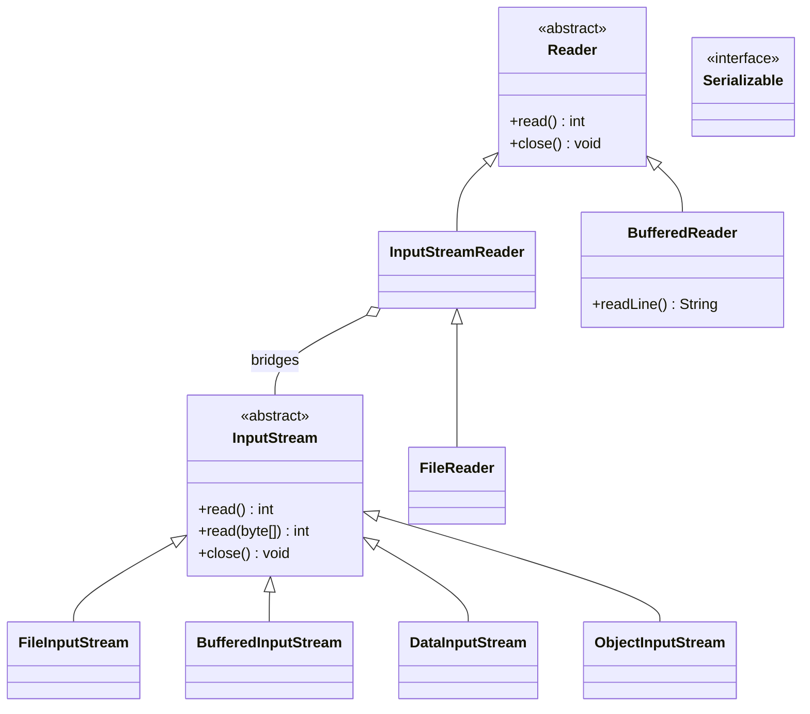

# Chapter 17 — I/O

## What and why

I/O questions in papers are about picking the right class (`File` vs `Path`, byte vs character stream), reading loops (`read()` return values, `readLine()` returning `null`), `Scanner` quirks, serialization rules (`transient`, `serialVersionUID`, parent constructors), and resource handling (flush/close).

Package: `oop.io`. Every demo uses a temp directory created at run time (`IoTemp`) so output is repeatable.

## Exam flash rules

- `java.io.File` is a **path name** (legacy API); it may not exist. NIO.2 `Path` + `Files` is the current API and throws descriptive exceptions.
- `File.delete()` and `File.mkdir()` return `false` on failure; `Files.delete(...)` throws (`NoSuchFileException`, `DirectoryNotEmptyException`).
- `Path` is an **interface**: build it with `Path.of(...)`, never `new Path(...)`. `Path` has no `exists()`; use `Files.exists(path)`.
- `resolve(other)` appends; an **absolute** argument replaces the base. `relativize` goes from one path to another. `normalize` removes `.` and `..`.
- **Byte streams** (`InputStream`/`OutputStream`) move raw bytes; **character streams** (`Reader`/`Writer`) decode/encode text with a charset.
- `InputStream.read()` returns an `int` `0..255`, or `-1` at end of stream; it is **not** a `byte` and **not** a `char`.
- `read(byte[])` returns the number of bytes actually read; write only that many (`write(buf, 0, n)`).
- `BufferedReader.readLine()` returns `null` at end of input and strips the line terminator.
- Always name the charset: `StandardCharsets.UTF_8`. The default charset is UTF-8 since **Java 18**; older JDKs use the platform default.
- A `BufferedWriter`/`PrintWriter` over a file may hold data in memory: `flush()` or `close()` before relying on file contents. Try-with-resources closes (and flushes) for you.
- `Scanner.nextInt()` does **not** consume the end of line; a following `nextLine()` returns `""`.
- `System.in` is an `InputStream`; `System.out`/`System.err` are `PrintStream`s; all three can be replaced with `System.setIn/setOut/setErr`.
- A class is serializable only if it (or a superclass) implements `Serializable`; every **non-transient, non-static** field must be serializable too, else `NotSerializableException`.
- `transient` and `static` fields are **not** serialized; after reading, `transient` fields hold their default value. The constructor of the first **non-serializable** superclass runs; constructors of serializable classes do not.
- `Files.walk`, `Files.list`, `Files.lines` return streams that hold file handles: close them with try-with-resources.

## Choosing a class

| Need | Use |
|------|-----|
| File name / path manipulation | `Path.of(...)`, `resolve`, `normalize`, `relativize` |
| Read whole small text file | `Files.readString(path)` / `Files.readAllLines(path)` |
| Read big text file line by line | `Files.lines(path)` in try-with-resources, or `BufferedReader` |
| Raw bytes | `FileInputStream`/`Files.newInputStream` + `BufferedInputStream` |
| Text with explicit encoding | `InputStreamReader(in, UTF_8)` / `Files.newBufferedReader(path, UTF_8)` |
| Primitive binary format | `DataOutputStream` / `DataInputStream` |
| Object graph | `ObjectOutputStream` / `ObjectInputStream` |
| Parse tokens from text | `Scanner` |
| Directory tree | `Files.walk` / `Files.list` / `Files.walkFileTree` |

| | `File` | `Path` + `Files` |
|---|---|---|
| Package | `java.io` | `java.nio.file` |
| Failure reporting | `boolean` / `0` / `null` | Exceptions with a reason |
| Directory traversal | `list()` arrays | `Stream<Path>`, `walkFileTree` |
| Copy/move | Not provided | `Files.copy`, `Files.move` |
| Bridge | `file.toPath()` | `path.toFile()` |

## Rules table

| Disallowed | Compiler message (`javac`, Java 21) |
|------------|-------------------------------------|
| `new FileReader("x")` without catch/throws | `unreported exception FileNotFoundException; must be caught or declared to be thrown` |
| `char c = in.read();` | `incompatible types: possible lossy conversion from int to char` |
| `new Path("a/b")` | `Path is abstract; cannot be instantiated` |
| `path.exists()` | `cannot find symbol` … `symbol: method exists()` |
| try-with-resources on `StringWriter` with no catch | `exception thrown from implicit call to close() on resource variable 'w'` |
| `new String(bytes, "UTF-8")` with no catch | `unreported exception UnsupportedEncodingException` |
| `new ObjectOutputStream(...)` / `writeObject` with no catch | `unreported exception IOException` |
| `new BufferedReader(new FileInputStream(...))` | `incompatible types: FileInputStream cannot be converted to Reader` |

## Walkthrough

### `File` vs `Path` / `Files`

```java
{{#include ../../code/part-01-oop/src/main/java/oop/io/FileVsPathDemo.java:file-vs-path}}
```

```text
File.exists: false
File.delete on missing: false
File.getName: legacy.txt
File.length of missing: 0
Files.exists: true
Files.size: 5
Path.getFileName: nio.txt
round trip: true
Files.delete on missing: NoSuchFileException
deleteIfExists missing: false
deleteIfExists present: true
```

### Path operations (no file system access)

```java
{{#include ../../code/part-01-oop/src/main/java/oop/io/PathOpsDemo.java:path-ops}}
```

```text
project/src
project/src/Main.java
/abs/Main.java
a/c
../c/d
x/y | z.txt | 3
true true false
false
x/y/w.txt
a
```

`startsWith`/`endsWith` compare **whole name elements**: `endsWith("txt")` is `false` for `z.txt`.

### Byte streams

```java
{{#include ../../code/part-01-oop/src/main/java/oop/io/ByteStreamsDemo.java:byte-streams}}
```

```text
65 255 1 2 3
[65, -1, 1, 2, 3]
9 [0, 0, 1, 2, 0, 2, 104, 105, 1]
258 hi true
```

`read()` shows byte `255` as `255`; `readAllBytes()` shows the same byte as signed `-1`. `writeInt(258)` is four bytes (`0 0 1 2`); `writeUTF` is a 2-byte length plus the text.

```java
{{#include ../../code/part-01-oop/src/main/java/oop/io/ReadCountGotcha.java:read-count}}
```

```text
abcdefghijgh
abcdefghij
```

The buggy copy writes the full buffer on the last (short) read and repeats stale bytes.

### Character streams and charsets

```java
{{#include ../../code/part-01-oop/src/main/java/oop/io/CharsetDemo.java:charset}}
```

```text
4
5
4
10
[-61, -87]
5 false
true
default charset is UTF-8 since Java 18: true
readString UTF-8 of Latin-1 bytes: MalformedInputException
true
```

`é` is 1 `char`, 2 bytes in UTF-8, 1 byte in ISO-8859-1. `UTF_16` adds a 2-byte byte-order mark (`2 + 4×2 = 10`). Decoding UTF-8 bytes as Latin-1 gives 5 characters (mojibake) and no error; `Files.readString` is stricter and throws on invalid input.

```java
{{#include ../../code/part-01-oop/src/main/java/oop/io/CharStreamsDemo.java:char-streams}}
```

```text
line: one
line: two
[one, two, three]
7-x
bridge
```

### `Scanner` and `System.in/out/err`

```java
{{#include ../../code/part-01-oop/src/main/java/oop/io/ScannerDemo.java:scanner}}
```

```text
sum=30
token=abc
rest of line=[]
line=[second line]
12
false
InputMismatchException
```

```java
{{#include ../../code/part-01-oop/src/main/java/oop/io/StdStreamsDemo.java:std-streams}}
```

```text
captured out: n=42
captured err: warn:hello
same object again: true
```

### Serialization

```java
{{#include ../../code/part-01-oop/src/main/java/oop/io/SerialBasics.java:serial-basics}}
```

```text
ann 100 null
false
1
```

The copy is a **different object** (`b == a` is `false`); `transient` `password` is `null`; no constructor ran for the copy (`created` is still `1`).

`serialVersionUID` identifies the class version. If it is missing, the JVM computes one from the class shape, so a small edit can make old data unreadable. Declare it explicitly.

```java
{{#include ../../code/part-01-oop/src/main/java/oop/io/SerialCustom.java:serial-custom}}
```

```text
bo abc123
```

The private `writeObject`/`readObject` hooks run `defaultWriteObject`/`defaultReadObject` first, then add or restore extra data (here a transient field).

```java
{{#include ../../code/part-01-oop/src/main/java/oop/io/SerialParentGotcha.java:serial-parent}}
```

```text
Base() runs
before: 99 7
Base() runs
after: 5 7
```

`Base` is not `Serializable`, so its fields are **not** restored and its no-arg constructor runs again (it must exist and be accessible).

```java
{{#include ../../code/part-01-oop/src/main/java/oop/io/SerialNotSerializableGotcha.java:serial-not}}
```

```text
NotSerializableException: oop.io.SerialNotSerializableGotcha$Engine
transient field after read: null
```

Never deserialize data from an untrusted source: reading an object graph can run class code. Use an `ObjectInputFilter` or avoid Java serialization for external input.

### try-with-resources, walking directories, large files

```java
{{#include ../../code/part-01-oop/src/main/java/oop/io/TwrFilesDemo.java:twr-files}}
```

```text
ALPHA
BETA
1
```

```java
{{#include ../../code/part-01-oop/src/main/java/oop/io/WalkDirDemo.java:walk-dir}}
```

```text
[, README.md, src, src/Main.java, src/pkg, src/pkg/Util.java]
[README.md, src]
3
[Main.java, Util.java]
bytes=31
```

The empty first entry is the root itself (`relativize` of the root against itself). `Files.walk(root, 1)` counts the root and its two direct children.

```java
{{#include ../../code/part-01-oop/src/main/java/oop/io/LargeFileDemo.java:large-file}}
```

```text
size > 1MB: true
lines (stream): 100000
even lines: 50000
chunked total equals size: true
copy equal size: true
mismatch: -1
```

| Approach | Memory | Use when |
|----------|--------|----------|
| `Files.readAllLines` / `readString` | Whole file | Small files |
| `Files.lines` / `BufferedReader.readLine` | One line at a time | Large text files |
| `read(byte[])` loop | One buffer | Binary or very large files |
| `Files.copy` | OS-assisted | Plain copy |

### Common bugs: flush, close, append, closed stream

```java
{{#include ../../code/part-01-oop/src/main/java/oop/io/FlushCloseGotcha.java:flush-close}}
```

```text
not flushed: 0
after flush: 5
after try-with-resources: 2
append mode: hi++
default truncates: x
write after close: Stream closed
```

### Does not compile

```java
{{#include ../../code/part-01-oop/broken/IoUnreportedFileReaderBroken.java}}
```

<div class="compiler-error">

```text
part-01-oop/broken/IoUnreportedFileReaderBroken.java:7: error: unreported exception FileNotFoundException; must be caught or declared to be thrown
    FileReader r = new FileReader("data.txt");
                   ^
1 error
```

</div>

```java
{{#include ../../code/part-01-oop/broken/IoReadIntToCharBroken.java}}
```

<div class="compiler-error">

```text
part-01-oop/broken/IoReadIntToCharBroken.java:10: error: incompatible types: possible lossy conversion from int to char
    char c = in.read();
                    ^
1 error
```

</div>

```java
{{#include ../../code/part-01-oop/broken/IoPathNewBroken.java}}
```

<div class="compiler-error">

```text
part-01-oop/broken/IoPathNewBroken.java:7: error: Path is abstract; cannot be instantiated
    Path p = new Path("a/b");
             ^
1 error
```

</div>

```java
{{#include ../../code/part-01-oop/broken/IoPathExistsBroken.java}}
```

<div class="compiler-error">

```text
part-01-oop/broken/IoPathExistsBroken.java:8: error: cannot find symbol
    System.out.println(p.exists());
                        ^
  symbol:   method exists()
  location: variable p of type Path
1 error
```

</div>

```java
{{#include ../../code/part-01-oop/broken/IoStringWriterCloseBroken.java}}
```

<div class="compiler-error">

```text
part-01-oop/broken/IoStringWriterCloseBroken.java:7: error: unreported exception IOException; must be caught or declared to be thrown
    try (StringWriter w = new StringWriter()) {
                      ^
  exception thrown from implicit call to close() on resource variable 'w'
1 error
```

</div>

```java
{{#include ../../code/part-01-oop/broken/IoStringCharsetNameBroken.java}}
```

<div class="compiler-error">

```text
part-01-oop/broken/IoStringCharsetNameBroken.java:6: error: unreported exception UnsupportedEncodingException; must be caught or declared to be thrown
    String s = new String(data, "UTF-8");
               ^
1 error
```

</div>

The `Charset` overload (`StandardCharsets.UTF_8`) declares no checked exception: prefer it.

```java
{{#include ../../code/part-01-oop/broken/IoWriteObjectBroken.java}}
```

<div class="compiler-error">

```text
part-01-oop/broken/IoWriteObjectBroken.java:8: error: unreported exception IOException; must be caught or declared to be thrown
    ObjectOutputStream out = new ObjectOutputStream(new ByteArrayOutputStream());
                             ^
part-01-oop/broken/IoWriteObjectBroken.java:9: error: unreported exception IOException; must be caught or declared to be thrown
    out.writeObject("x");
                   ^
2 errors
```

</div>

```java
{{#include ../../code/part-01-oop/broken/IoReaderBufferedWrongTypeBroken.java}}
```

<div class="compiler-error">

```text
part-01-oop/broken/IoReaderBufferedWrongTypeBroken.java:9: error: incompatible types: FileInputStream cannot be converted to Reader
    BufferedReader r = new BufferedReader(new FileInputStream("a.txt"));
                                          ^
Note: Some messages have been simplified; recompile with -Xdiags:verbose to get full output
1 error
```

</div>

A `Reader` needs a bridge: `new InputStreamReader(new FileInputStream(...), UTF_8)`.

## Predict the output

**P1.** `Scanner` mixing `nextInt` and `nextLine`.

```java
{{#include ../../code/part-01-oop/src/main/java/oop/io/exam/PredictScannerNextLine.java:predict-scanner}}
```

<details><summary>Answer</summary>

```text
7||hello|
```

`nextInt()` leaves `\n`; the first `nextLine()` returns the rest of line 1 (empty).

</details>

**P2.** `read()` and signed bytes.

```java
{{#include ../../code/part-01-oop/src/main/java/oop/io/exam/PredictReadByte.java:predict-read-byte}}
```

<details><summary>Answer</summary>

```text
-1
255
0
A
-1
-1
```

`data[0]` is the signed byte `-1`; `read()` returns it as `255`. After the end, `read()` keeps returning `-1`.

</details>

**P3.** `transient` and `static`.

```java
{{#include ../../code/part-01-oop/src/main/java/oop/io/exam/PredictTransient.java:predict-transient}}
```

<details><summary>Answer</summary>

```text
11 0 y 2
```

`cache` (transient) resets to `0`. `shared` is a static: not serialized, and the same JVM still holds `2`.

</details>

**P4.** Characters vs bytes.

```java
{{#include ../../code/part-01-oop/src/main/java/oop/io/exam/PredictCharsetLength.java:predict-charset}}
```

<details><summary>Answer</summary>

```text
3
6
3
[65, -23, 63]
```

`é` is 2 bytes and `€` is 3 bytes in UTF-8 (`1+2+3 = 6`). ISO-8859-1 cannot represent `€`, so it is encoded as `?` (63).

</details>

**P5.** Missing flush.

```java
{{#include ../../code/part-01-oop/src/main/java/oop/io/exam/PredictFlushMissing.java:predict-flush}}
```

<details><summary>Answer</summary>

```text
0
4
```

</details>

**P6.** Constructors during deserialization.

```java
{{#include ../../code/part-01-oop/src/main/java/oop/io/exam/PredictSerialParentCtor.java:predict-serial-ctor}}
```

<details><summary>Answer</summary>

```text
P()
C()
P()
P-default
```

The copy runs `P()` (first non-serializable ancestor) but not `C()`; `tag` belongs to `P`, so it is the default again.

</details>

**P7.** Path arithmetic.

```java
{{#include ../../code/part-01-oop/src/main/java/oop/io/exam/PredictPathResolve.java:predict-path}}
```

<details><summary>Answer</summary>

```text
data/x.txt
/etc/x.txt
a/c
c/d
b
```

(on a system with `/` as separator)

</details>

**P8.** `File.mkdir` / `delete` return values.

```java
{{#include ../../code/part-01-oop/src/main/java/oop/io/exam/PredictFileDelete.java:predict-file-delete}}
```

<details><summary>Answer</summary>

```text
true
false
false
true
DirectoryNotEmptyException
```

Second `mkdir` returns `false` (already exists); `delete` of a non-empty directory returns `false` silently; `Files.delete` reports why.

</details>

**P9.** Short read copy bug — see `ReadCountGotcha` above (`abcdefghijgh`).

## Compile or not?

| Stem | Answer | Proof |
|------|--------|-------|
| **C1.** `new FileReader("data.txt")` in `main` with no `throws` | **Fails** — unreported `FileNotFoundException` | `broken/IoUnreportedFileReaderBroken.java` |
| **C2.** `char c = in.read();` | **Fails** — lossy `int` to `char` | `broken/IoReadIntToCharBroken.java` |
| **C3.** `Path p = new Path("a/b");` | **Fails** — abstract | `broken/IoPathNewBroken.java` |
| **C4.** `p.exists()` on a `Path` | **Fails** — cannot find symbol | `broken/IoPathExistsBroken.java` |
| **C5.** try-with-resources on `StringWriter`, no catch | **Fails** — implicit `close()` | `broken/IoStringWriterCloseBroken.java` |
| **C6.** `new String(bytes, "UTF-8")` with no catch | **Fails** — `UnsupportedEncodingException` | `broken/IoStringCharsetNameBroken.java` |
| **C7.** `writeObject` without catch | **Fails** — unreported `IOException` | `broken/IoWriteObjectBroken.java` |
| **C8.** `new BufferedReader(new FileInputStream(..))` | **Fails** — needs a `Reader` | `broken/IoReaderBufferedWrongTypeBroken.java` |
| **C9.** try-with-resources on `Scanner` and `PrintWriter(StringWriter)`, no catch | **Compiles** | `exam/CompileScannerPrintOk.java` below |

```java
{{#include ../../code/part-01-oop/src/main/java/oop/io/exam/CompileScannerPrintOk.java:compile-scanner-ok}}
```

```text
11
ok
```

`Scanner.close()` and `PrintWriter.close()` declare no checked exception (`PrintWriter` swallows I/O errors; check `checkError()`).

## Gotchas

1. **Data stuck in a buffer** — `FlushCloseGotcha`, `PredictFlushMissing`.
2. **Using `buf.length` instead of the count returned by `read`** — `ReadCountGotcha`.
3. **`nextInt()` then `nextLine()`** — `ScannerDemo`, `PredictScannerNextLine`.
4. **Wrong or default charset** — Latin-1 bytes read as UTF-8 (`CharsetDemo`).
5. **Serialization surprises**: transient/static, parent constructors, non-serializable fields — `SerialBasics`, `SerialParentGotcha`, `SerialNotSerializableGotcha`.

## UML



## Interview Q&A

1. **Q:** `File` vs `Path`? **A:** `File` is legacy and reports failure with `boolean`; `Path`/`Files` is NIO.2 and throws descriptive exceptions — `FileVsPathDemo`.
2. **Q:** What does `InputStream.read()` return? **A:** `0..255` or `-1` at EOF — `PredictReadByte`.
3. **Q:** Byte vs character streams? **A:** Bytes vs decoded text with a charset — `CharsetDemo`.
4. **Q:** Why name the charset? **A:** Defaults differ by JDK/platform (UTF-8 default only from Java 18) — `CharsetDemo`.
5. **Q:** Why is my file empty after writing? **A:** The buffer was never flushed/closed — `FlushCloseGotcha`.
6. **Q:** What does try-with-resources do for streams? **A:** Closes (and flushes) in reverse order even on exceptions — `TwrFilesDemo`.
7. **Q:** Why does `nextLine()` after `nextInt()` return an empty string? **A:** `nextInt()` leaves the newline — `PredictScannerNextLine`.
8. **Q:** What is not serialized? **A:** `transient` and `static` fields, and fields of non-serializable superclasses — `SerialBasics`, `SerialParentGotcha`.
9. **Q:** What is `serialVersionUID` for? **A:** Class-version check on deserialization; declare it explicitly — `SerialBasics`.
10. **Q:** Does deserialization call the constructor? **A:** Only the first non-serializable superclass's no-arg constructor — `PredictSerialParentCtor`.
11. **Q:** How do you customize serialization? **A:** Private `writeObject`/`readObject` with `defaultWriteObject`/`defaultReadObject` — `SerialCustom`.
12. **Q:** How do you read a huge text file? **A:** `Files.lines` / `BufferedReader.readLine`, not `readAllLines` — `LargeFileDemo`.
13. **Q:** Why close the stream from `Files.walk`? **A:** It holds directory handles — `WalkDirDemo`.
14. **Q:** `File.delete()` fails — how do you find out why? **A:** Use `Files.delete`, which throws — `PredictFileDelete`.
15. **Q:** Why is `Path.of("a").resolve("/b")` `/b`? **A:** An absolute argument replaces the base — `PredictPathResolve`.

## Exam writing prompts

1. (5) Write a method `long copy(Path from, Path to)` using byte streams and a buffer; return the number of bytes copied. — `solutions/ch17/SolutionCopyFile.java`.
2. (5) Write a method that returns word frequencies of a text file in alphabetical order. — `solutions/ch17/SolutionWordCount.java`.
3. (5) Make a `Rect` class serializable with a transient derived field and show what the copy contains. — `solutions/ch17/SolutionSerialRoundTrip.java`.
4. (3) Using `Scanner`, sum integers until the first non-integer token. — `solutions/ch17/SolutionSumNumbers.java`.
5. (3) Count non-blank lines of a large file without loading it into memory. — `solutions/ch17/SolutionLineCount.java`.

## Exercises

1. Copy file with buffer — `solutions/ch17/SolutionCopyFile.java`.
2. Word frequency — `solutions/ch17/SolutionWordCount.java`.
3. Serialization with transient — `solutions/ch17/SolutionSerialRoundTrip.java`.
4. Scanner sum — `solutions/ch17/SolutionSumNumbers.java`.
5. Streaming line count — `solutions/ch17/SolutionLineCount.java`.
6. Add `readObject` validation to `SerialCustom.User` that rejects an empty name with `InvalidObjectException`.

## Recap checklist

- [x] `File` vs NIO.2 `Path`/`Files` — `FileVsPathDemo`, `PathOpsDemo`
- [x] Byte streams; character streams + charsets — `ByteStreamsDemo`, `ReadCountGotcha`, `CharsetDemo`, `CharStreamsDemo`
- [x] `Scanner`; `System.in/out/err` — `ScannerDemo`, `StdStreamsDemo`
- [x] Serialization (`Serializable`, `transient`, `serialVersionUID`, custom `readObject`) — `SerialBasics`, `SerialCustom`, `SerialParentGotcha`, `SerialNotSerializableGotcha`
- [x] Try-with-resources; walk directories; large files — `TwrFilesDemo`, `WalkDirDemo`, `LargeFileDemo`
- [x] Common bugs (flush/close, encoding) — `FlushCloseGotcha`, `CharsetDemo`
- [x] Exam banks (8 predict, 8 fail + 1 pass) and writing prompts — `exam/`, `broken/Io*Broken.java`, `solutions/ch17/`
