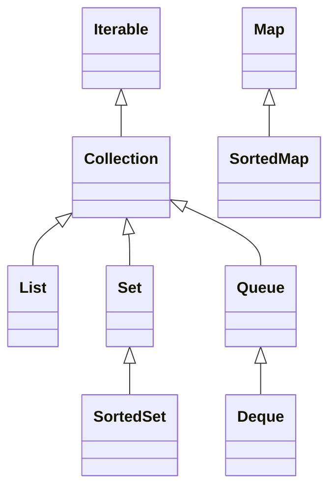
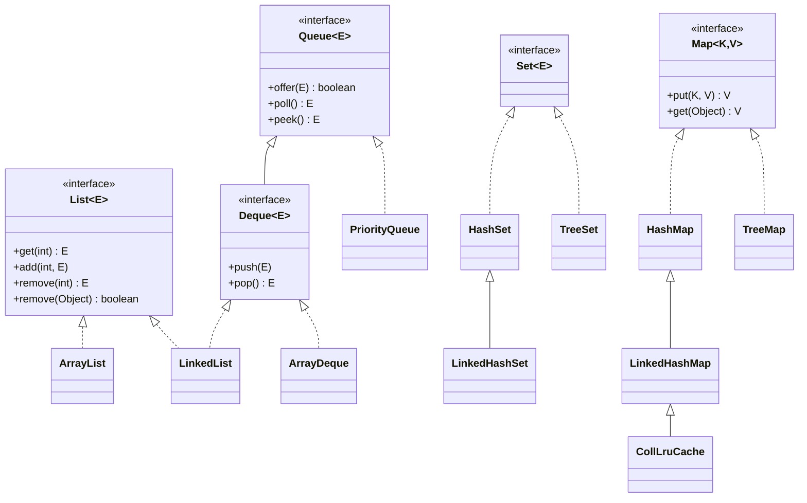

# Chapter 18 — Collections and streams

## What and why

Collections and streams supply most of the "which type?", "what prints?" and "does it compile?" marks outside the language core. The payoff: pick the right `List` / `Set` / `Map` / `Queue` / `Deque` / `PriorityQueue` from its complexity and ordering contract, and trace stream pipelines (laziness, single use) and `Optional` without running them.

Package: `oop.coll`. All output below is real Java 21 output. Where a result is **implementation-dependent** (for example `HashSet` iteration order), the program prints only what is guaranteed.

## Exam flash rules

- `List` = ordered, duplicates allowed, index access. `Set` = no duplicates. `Map` = key → value, unique keys. `Queue` = FIFO. `Deque` = both ends.
- `ArrayList.get(i)` is O(1); `add(i, x)` and `remove(i)` are O(n); `contains` is O(n).
- `LinkedList.get(i)` is O(n); `addFirst` / `addLast` / `removeFirst` are O(1).
- `HashSet` / `HashMap`: O(1) average, **no order guarantee**. `LinkedHashSet` / `LinkedHashMap`: insertion order. `TreeSet` / `TreeMap`: sorted, O(log n), no `null` key.
- `HashSet` uses `hashCode` + `equals`; `TreeSet` uses `compareTo` / `Comparator` only. Two values with `compare == 0` are duplicates in a `TreeSet`.
- `list.remove(int)` removes by **index**, `list.remove(Object)` by **value**. `List<Integer>.remove(1)` is the index form.
- `Arrays.asList` is fixed-size and writes through to the array; `List.of` / `Set.of` / `Map.of` are immutable and reject `null`; `Stream.toList()` is unmodifiable.
- Removing from a collection inside a for-each throws `ConcurrentModificationException` (fail-fast, best effort). Use `Iterator.remove()` or `removeIf`.
- `PriorityQueue.toString()` / iteration shows the heap array, **not** sorted order. Only `poll()` / `peek()` honour priority. `offer` / `poll` are O(log n), `peek` is O(1).
- `Queue.poll()` / `peek()` return `null` when empty; `remove()` / `element()` throw `NoSuchElementException`. `ArrayDeque` rejects `null`.
- Use `ArrayDeque` for a stack or queue; `Stack` is a legacy `Vector` subclass.
- A mutable key whose `hashCode` changes after insertion is lost in a `HashMap`.
- Streams are **lazy**: nothing runs without a terminal operation. A stream can be consumed **once**; a second terminal operation throws `IllegalStateException`.
- Intermediate operations return a stream; terminal operations (`collect`, `forEach`, `count`, `sum`, `reduce`, `findFirst`) end it.
- `Optional.orElse(x)` evaluates `x` **always**; `orElseGet(supplier)` only when empty. `Optional.of(null)` throws; `ofNullable` does not.

## Type map and complexity table



`Map` is **not** a `Collection`.

| Type | Backed by | `get` / `contains` | add | remove | Order | `null` | Pick it for |
|------|-----------|--------------------|-----|--------|-------|--------|-------------|
| `ArrayList` | array | get O(1), contains O(n) | end O(1) amortised, middle O(n) | O(n) | insertion | yes | default list |
| `LinkedList` | doubly linked | get(i) O(n) | ends O(1) | ends O(1), by index O(n) | insertion | yes | queue/deque use; rarely a list |
| `HashSet` | hash table | O(1) avg | O(1) avg | O(1) avg | none | one | uniqueness, membership |
| `LinkedHashSet` | hash + links | O(1) avg | O(1) avg | O(1) avg | insertion | one | unique, keep order |
| `TreeSet` | red-black tree | O(log n) | O(log n) | O(log n) | sorted | no | sorted unique, range queries |
| `HashMap` | hash table | O(1) avg | O(1) avg | O(1) avg | none | one key, many values | default map |
| `LinkedHashMap` | hash + links | O(1) avg | O(1) avg | O(1) avg | insertion or access | one key | LRU cache |
| `TreeMap` | red-black tree | O(log n) | O(log n) | O(log n) | sorted by key | no key | sorted map, `floorKey` |
| `ArrayDeque` | circular array | peek O(1) | ends O(1) amortised | ends O(1) | insertion | **no** | stack and queue |
| `PriorityQueue` | binary heap | peek O(1), contains O(n) | O(log n) | poll O(log n), remove(Object) O(n) | priority (poll only) | no | "next smallest/largest" |

Worst cases: a `HashMap` with poor `hashCode`s degrades toward O(n) (O(log n) for `Comparable` keys since Java 8). `ArrayList.add` at capacity copies the array (that copy is why the end insert is *amortised* O(1)).

## Walkthrough

### List: index operations, views, fixed-size lists

```java
{{#include ../../code/part-01-oop/src/main/java/oop/coll/CollListDemo.java:coll-list}}
```

```text
[11, 15, 20, 30, 40, 50] size=6 indexOf(30)=3
[20, 30, 40, 50]
[a, b, c, d] first=a last=d
after subList.set: [99, 30, 40, 50]
[9, 2, 3]
Arrays.asList.add -> UnsupportedOperationException
List.of.set -> UnsupportedOperationException
List.of(null) -> NullPointerException
write-through from array: 100
```

| Factory | Add/remove | `set` | `null` elements | Backed by |
|---------|-----------|-------|-----------------|-----------|
| `new ArrayList<>(...)` | yes | yes | yes | own array |
| `Arrays.asList(arr)` | **no** | yes | yes | the array (write-through) |
| `List.of(...)` | no | no | **no** | immutable |
| `list.subList(a, b)` | through the parent | yes | as parent | the parent list (a view) |

### Fail-fast iteration

```java
{{#include ../../code/part-01-oop/src/main/java/oop/coll/CollFailFast.java:coll-fail-fast}}
```

```text
remove "a": ConcurrentModificationException
remove "b": no exception, list = [a, c]
Iterator.remove: [b, c]
removeIf: [a, b]
ListIterator backwards: cba
```

Removing `"b"` (the second-to-last element) leaves `hasNext()` false, so the loop ends before the modification check runs. Fail-fast is **best effort**, not a guarantee.

### Set: uniqueness and ordering

```java
{{#include ../../code/part-01-oop/src/main/java/oop/coll/CollSetDemo.java:coll-set}}
```

```text
HashSet size=3 (order unspecified)
LinkedHashSet: [pear, apple, fig]
TreeSet      : [apple, fig, pear]
add new: true, add duplicate: false
first=10 last=40
floor(25)=20 ceiling(25)=30
lower(10)=null higher(40)=null
headSet(30)=[10, 20] tailSet(30)=[30, 40]
add "JAVA" to case-insensitive TreeSet: false, set=[Java]
by length (aa, bb tie): [c, aa]
HashSet size=2 TreeSet size=1
```

`TreeSet` keeps only the **first** of two values the comparator calls equal (`"aa"` kept, `"bb"` dropped). `BigDecimal("1.0")` and `("1.00")` are different under `equals` (scale differs) but equal under `compareTo`: `HashSet` keeps both, `TreeSet` keeps one.

### Map: update patterns and views

```java
{{#include ../../code/part-01-oop/src/main/java/oop/coll/CollMapDemo.java:coll-map}}
```

```text
put new -> null
put again -> 1
get missing -> null, getOrDefault -> 0
putIfAbsent(a) -> 2, map={a=2, b=5}
counts   : {be=2, not=1, or=1, to=2}
multimap : {2=[hi, yo], 3=[hey]}
be=2;not=1;or=1;to=2;
HashMap null key -> 1
TreeMap null key -> NullPointerException
Map.of duplicate key -> IllegalArgumentException
after keySet().remove: {}
```

| Call | Returns |
|------|---------|
| `put(k, v)` | the **previous** value, or `null` |
| `putIfAbsent(k, v)` | the existing value, or `null` if it inserted |
| `get(k)` | the value, or `null` (also `null` for a stored `null`) |
| `merge(k, v, f)` | the new value after combining |
| `computeIfAbsent(k, f)` | the existing or newly computed value |
| `remove(k)` | the removed value, or `null` |

### Mutable keys

```java
{{#include ../../code/part-01-oop/src/main/java/oop/coll/CollMutableKey.java:coll-mutable-key}}
```

```text
before: value
after mutate, same object : null
after mutate, fresh id=1  : null
size=1, containsKey(key)=false
```

The entry still sits in the bucket for the **old** hash. Lookup by the mutated key searches the new bucket; lookup by an equal key with the old id finds the bucket but `equals` fails. The entry is unreachable but still counted in `size()`.

### Queue and Deque

```java
{{#include ../../code/part-01-oop/src/main/java/oop/coll/CollQueueDeque.java:coll-queue-deque}}
```

```text
empty: peek=null poll=null
empty: remove() -> NoSuchElementException
empty: element() -> NoSuchElementException
FIFO: abc
Deque as stack: [3, 2, 1] peek=3 pop=3
legacy Stack  : [1, 2, 3] peek=3
both ends: [a, m, z] pollFirst=a pollLast=z
ArrayDeque.add(null) -> NullPointerException
```

| Operation | Throws on failure | Returns special value |
|-----------|-------------------|-----------------------|
| Insert | `add(e)`, `addFirst`, `addLast` | `offer(e)`, `offerFirst`, `offerLast` |
| Remove | `remove()`, `removeFirst`, `pop()` | `poll()`, `pollFirst`, `pollLast` |
| Examine | `element()`, `getFirst` | `peek()`, `peekFirst` |

`push` = `addFirst`; `pop` = `removeFirst`. A `Deque` used as a stack prints the **top first**; the legacy `Stack` prints the **bottom first**.

### PriorityQueue

```java
{{#include ../../code/part-01-oop/src/main/java/oop/coll/CollPriorityQueue.java:coll-priority-queue}}
```

```text
toString (heap array, NOT sorted): [1, 2, 4, 5, 3]
peek=1 size=5
poll order: [1, 2, 3, 4, 5]
max-heap poll order: [5, 4, 3, 2, 1]
tasks: [fix:1, write:3, deploy:5]
by length: [a, bb, ccc]
non-Comparable element, no comparator -> ClassCastException
```

The array form `[1, 2, 4, 5, 3]` satisfies the heap rule (each parent ≤ its children); only `poll()` yields a sorted sequence. For equal priorities the order is **not** stable.

### Complexity proof by counting calls

```java
{{#include ../../code/part-01-oop/src/main/java/oop/coll/CollComplexityProof.java:coll-complexity-proof}}
```

```text
ArrayList.contains(last): equals calls = 1000  (O(n))
HashSet.contains(last)  : equals calls = 1, hashCode calls = 1  (O(1) average)
same hashCode for all keys: 1000 gets cost more than 1000 equals calls: true  (degrades toward O(n))
TreeSet: 1024 inserts used <= 1024 * 20 comparisons: true  (O(log n) each)
binarySearch in 1024 sorted items: <= 11 comparisons: true
```

Counting calls is machine-independent; timing is not. `1024 = 2^10`, so a balanced search needs about 10–11 comparisons.

### Sorting and comparators

```java
{{#include ../../code/part-01-oop/src/main/java/oop/coll/CollSorting.java:coll-sorting}}
```

```text
natural        : [Apple, apple, fig, pear]
ignore case    : [Apple, apple, fig, pear]  (sort is stable: Apple stays before apple)
length, natural: [fig, pear, Apple, apple]
length desc    : [Apple, apple, pear, fig]
marks desc, name:
  Asha 92
  Meena 80
  Ravi 80
  Dev 75
Arrays.sort(int[]): [1, 3, 5, 9]
Arrays.sort(Integer[], reverseOrder): [9, 5, 3, 1]
reverse: [2, 1, 3]  max=3 min=1 frequency(1)=1
```

Natural `String` order is by UTF-16 value: uppercase letters sort before lowercase. `List.sort` and `Collections.sort` are **stable** (equal elements keep their relative order). `Arrays.sort(int[])` takes no comparator; the comparator form needs `Integer[]`.

### Views and immutability

```java
{{#include ../../code/part-01-oop/src/main/java/oop/coll/CollViews.java:coll-views}}
```

```text
view sees later change : [a, b, c]
snapshot does not      : [a, b]
view.add -> UnsupportedOperationException
defensive getter that wraps still leaks changes: true
```

`Collections.unmodifiableList` is a **read-only view**, not a copy: changes to the original show through. `List.copyOf` is an independent immutable snapshot.

### Choosing the type: LRU cache

```java
{{#include ../../code/part-01-oop/src/main/java/oop/coll/CollLru.java:coll-lru}}
```

```text
[a, c]
```

`LinkedHashMap(…, accessOrder = true)` plus `removeEldestEntry` gives an LRU cache in a dozen lines.

### Streams: pipeline operations

```java
{{#include ../../code/part-01-oop/src/main/java/oop/coll/CollStreamBasics.java:coll-stream-basics}}
```

```text
filter even      : [2, 8, 2, 4]
map square       : [25, 4, 64, 4, 81, 16]
distinct, sorted : [2, 4, 5, 8, 9]
skip 1, limit 3  : [2, 8, 2]
count / sum / max: 6 / 30 / 9
reduce           : 30, reduce(no identity) = Optional[30]
average          : OptionalDouble[2.5]
range(1,5) sum   : 10, rangeClosed(1,5): 15
flatMap          : [1, 2, 3]
anyMatch/allMatch: true/false
takeWhile        : [1, 2, 3]
iterate+limit    : [1, 2, 4, 8, 16, 32]
Stream.toList().add -> UnsupportedOperationException
toCollection(ArrayList::new).add works: 7
second terminal op -> stream has already been operated upon or closed
source list unchanged: [5, 2, 8, 2, 9, 4]
```

| Kind | Operations | Returns |
|------|-----------|---------|
| Source | `collection.stream()`, `Stream.of`, `IntStream.range`, `Stream.iterate` | `Stream` |
| Intermediate (lazy) | `filter`, `map`, `flatMap`, `distinct`, `sorted`, `peek`, `skip`, `limit`, `takeWhile` | `Stream` |
| Terminal (runs the pipeline) | `forEach`, `collect`, `toList`, `count`, `sum`, `reduce`, `min`, `max`, `findFirst`, `anyMatch` | value / `Optional` / nothing |

`sum()` and `average()` exist only on primitive streams (`IntStream`, `LongStream`, `DoubleStream`); use `mapToInt` first. `reduce` without an identity returns an `Optional`.

### Streams: laziness, order, short-circuit

```java
{{#include ../../code/part-01-oop/src/main/java/oop/coll/CollStreamLazy.java:coll-stream-lazy}}
```

```text
== no terminal operation: nothing runs
== element-at-a-time, not stage-at-a-time
peek   a
peek   bb
filter bb
each   BB
peek   ccc
filter ccc
each   CCC
== short-circuit: findFirst stops early
visit x
visit yy
found yy
== sorted is a barrier: it needs every element first
before sort 3
before sort 1
before sort 2
after sort  1
after sort  2
after sort  3
```

Each element travels through the **whole pipeline** before the next one starts, except at stateful barriers such as `sorted`. `findFirst`, `anyMatch`, `limit` and `takeWhile` short-circuit.

### Collectors

```java
{{#include ../../code/part-01-oop/src/main/java/oop/coll/CollCollectors.java:coll-collectors}}
```

```text
joining       : [apple, bob, cat, avocado, bee, cow]
groupingBy 1st: {a=[apple, avocado], b=[bob, bee], c=[cat, cow]}
counting      : {3=4, 5=1, 7=1}
partitioningBy: {false=[bob, cat, bee, cow], true=[apple, avocado]}
mapping       : {a=APPLE/AVOCADO, b=BOB/BEE, c=CAT/COW}
summingInt    : 24
averagingInt  : 4.0
toMap         : {apple=5, avocado=7, bee=3, bob=3, cat=3, cow=3}
toMap duplicate: Duplicate key a (attempted merging values 1 and 1)
```

`groupingBy` returns a `Map<K, List<T>>`; its default map type gives no order guarantee, so the demo passes `TreeMap::new`. `partitioningBy` always has both `false` and `true` keys. `toMap` without a merge function throws on a duplicate key.

### Optional

```java
{{#include ../../code/part-01-oop/src/main/java/oop/coll/CollOptional.java:coll-optional}}
```

```text
of/empty       : Optional[x] Optional.empty
ofNullable(null): false
Optional.of(null) -> NullPointerException
empty.get() -> No value present
map/filter     : Optional[VALUE]
flatMap        : Optional[5]
orElse (present value, argument still evaluated):
  fallback evaluated (orElse)
orElseGet (present value, supplier not called):
  fallback evaluated (empty)
orElseGet on empty -> default
present value
absent
orElseThrow -> missing
or(...)        : alt
isEmpty (11+)  : true
```

`Optional` is for **return types**. Do not use it as a field, a parameter, or an element of a collection; never call `get()` without a check — prefer `orElse`, `orElseGet`, `orElseThrow`, `ifPresentOrElse`.

### Does not compile

<div class="compiler-error">

```java
{{#include ../../code/part-01-oop/broken/CollPrimitiveGenericBroken.java}}
```

```text
part-01-oop/broken/CollPrimitiveGenericBroken.java:8: error: unexpected type
    List<int> numbers = new ArrayList<>();
         ^
  required: reference
  found:    int
1 error
```

```text
part-01-oop/broken/CollListCovarianceBroken.java:8: error: incompatible types: ArrayList<String> cannot be converted to List<Object>
    List<Object> objects = new ArrayList<String>();
                           ^
1 error
```

```text
part-01-oop/broken/CollMapPutWrongTypeBroken.java:9: error: incompatible types: String cannot be converted to Integer
    ages.put("asha", "twelve");
                     ^
Note: Some messages have been simplified; recompile with -Xdiags:verbose to get full output
1 error
```

```text
part-01-oop/broken/CollSetGetBroken.java:10: error: cannot find symbol
    String first = names.get(0);
                        ^
  symbol:   method get(int)
  location: variable names of type Set<String>
1 error
```

```text
part-01-oop/broken/CollQueueIndexBroken.java:10: error: cannot find symbol
    q.push("b");
     ^
  symbol:   method push(String)
  location: variable q of type Queue<String>
part-01-oop/broken/CollQueueIndexBroken.java:11: error: cannot find symbol
    System.out.println(q.get(0));
                        ^
  symbol:   method get(int)
  location: variable q of type Queue<String>
2 errors
```

```text
part-01-oop/broken/CollLambdaCaptureBroken.java:8: error: local variables referenced from a lambda expression must be final or effectively final
    List.of(1, 2, 3).forEach(n -> sum += n);
                                  ^
1 error
```

```text
part-01-oop/broken/CollStreamToListBroken.java:8: error: incompatible types: no instance(s) of type variable(s) R exist so that Stream<R> conforms to List<Integer>
    List<Integer> lengths = names.stream().map(String::length);
                                              ^
  where R,T are type-variables:
    R extends Object declared in method <R>map(Function<? super T,? extends R>)
    T extends Object declared in interface Stream
1 error
```

```text
part-01-oop/broken/CollOptionalAssignBroken.java:11: error: incompatible types: Optional<String> cannot be converted to String
    String s = find();
                   ^
1 error
```

```text
part-01-oop/broken/CollCheckedInLambdaBroken.java:12: error: unreported exception IOException; must be caught or declared to be thrown
    List<Integer> sizes = List.of("a", "bb").stream().map(n -> load(n)).toList();
                                                                   ^
1 error
```

```text
part-01-oop/broken/CollSortNonComparableBroken.java:14: error: no suitable method found for sort(List<Plain>)
    Collections.sort(items);
               ^
    method Collections.<T#1>sort(List<T#1>) is not applicable
      (inference variable T#1 has incompatible bounds
        equality constraints: Plain
        upper bounds: Comparable<? super T#1>)
    method Collections.<T#2>sort(List<T#2>,Comparator<? super T#2>) is not applicable
      (cannot infer type-variable(s) T#2
        (actual and formal argument lists differ in length))
  where T#1,T#2 are type-variables:
    T#1 extends Comparable<? super T#1> declared in method <T#1>sort(List<T#1>)
    T#2 extends Object declared in method <T#2>sort(List<T#2>,Comparator<? super T#2>)
1 error
```

```text
part-01-oop/broken/CollStreamSumBroken.java:7: error: cannot find symbol
    int total = Stream.of(1, 2, 3).sum();
                                  ^
  symbol:   method sum()
  location: interface Stream<Integer>
1 error
```

</div>

Sources: `broken/CollPrimitiveGenericBroken.java`, `CollListCovarianceBroken.java`, `CollMapPutWrongTypeBroken.java`, `CollSetGetBroken.java`, `CollQueueIndexBroken.java`, `CollLambdaCaptureBroken.java`, `CollStreamToListBroken.java`, `CollOptionalAssignBroken.java`, `CollCheckedInLambdaBroken.java`, `CollSortNonComparableBroken.java`, `CollStreamSumBroken.java`.

## Predict the output

**P1.** `remove(int)` vs `remove(Object)`; a `Set<Short>` trap.

```java
{{#include ../../code/part-01-oop/src/main/java/oop/coll/exam/PredictRemoveIndexVsObject.java:predict-remove-index-vs-object}}
```

<details>
<summary>Answer</summary>

```text
[1, 3]
[3]
5
```

`remove(1)` on a `List<Integer>` picks `remove(int)` → index 1 (value `2`). `Integer.valueOf(1)` picks `remove(Object)`. In the set, `i - 1` is an `int`, boxed to `Integer`; the set holds `Short`s, so nothing is ever removed: size 5.

</details>

**P2.** `Arrays.asList`.

```java
{{#include ../../code/part-01-oop/src/main/java/oop/coll/exam/PredictAsList.java:predict-as-list}}
```

<details>
<summary>Answer</summary>

```text
1
3
[99, 77, 3] [99, 77, 3]
UOE
```

`Arrays.asList(int[])` has one element (the array object). With `Integer[]` the list is a write-through window onto the array in both directions; `add` is unsupported.

</details>

**P3.** Removing inside for-each.

```java
{{#include ../../code/part-01-oop/src/main/java/oop/coll/exam/PredictForEachRemove.java:predict-for-each-remove}}
```

<details>
<summary>Answer</summary>

```text
removed a -> ConcurrentModificationException
removed b -> [a, c]
removed c -> ConcurrentModificationException
```

After removing `"b"` the cursor equals the new size, so `hasNext()` is false and the check never runs. Removing `"a"` or `"c"` leaves `hasNext()` true and `next()` detects the change.

</details>

**P4.** `PriorityQueue`.

```java
{{#include ../../code/part-01-oop/src/main/java/oop/coll/exam/PredictPriorityQueue.java:predict-priority-queue}}
```

<details>
<summary>Answer</summary>

```text
[1, 2, 3, 4]
1 4
1 2 [3, 4]
4 3
```

Inserting `4, 1, 3, 2` gives the heap array `[1, 2, 3, 4]` (it happens to be sorted here; `toString` is still not a sorted-order promise). `poll()` returns the smallest each time. The reversed comparator gives a max-heap.

</details>

**P5.** `HashSet` vs `TreeSet` equality.

```java
{{#include ../../code/part-01-oop/src/main/java/oop/coll/exam/PredictTreeSetEquality.java:predict-tree-set-equality}}
```

<details>
<summary>Answer</summary>

```text
2 1
false
0
false [Java]
```

`BigDecimal.equals` compares value **and** scale; `compareTo` compares value only. `HashSet` uses `equals`/`hashCode`; `TreeSet` uses `compareTo`. The case-insensitive comparator treats `"JAVA"` as a duplicate and keeps `"Java"`.

</details>

**P6.** Stream evaluation order.

```java
{{#include ../../code/part-01-oop/src/main/java/oop/coll/exam/PredictStreamOrder.java:predict-stream-order}}
```

<details>
<summary>Answer</summary>

```text
P a
P bb
E BB
P cc
E CC
end
```

Elements flow one at a time through `peek → filter → map → forEach`. `"a"` is filtered out after its `peek`. The second pipeline has no terminal operation, so `never` is not printed.

</details>

**P7.** Reusing a stream.

```java
{{#include ../../code/part-01-oop/src/main/java/oop/coll/exam/PredictStreamReuse.java:predict-stream-reuse}}
```

<details>
<summary>Answer</summary>

```text
[10, 20, 30]
stream has already been operated upon or closed
3
[1, 2, 3]
```

A stream is single-use. A **new** stream from the same source works, and the source list is never modified.

</details>

**P8.** `Collectors.toMap`.

```java
{{#include ../../code/part-01-oop/src/main/java/oop/coll/exam/PredictToMap.java:predict-to-map}}
```

<details>
<summary>Answer</summary>

```text
{3=fig, 4=kiwi+plum+pear}
Duplicate key 4 (attempted merging values kiwi and plum)
```

Three words have length 4. With a merge function they are joined; without one, `toMap` throws `IllegalStateException` naming the key and the first two values.

</details>

**P9.** `orElse` vs `orElseGet`.

```java
{{#include ../../code/part-01-oop/src/main/java/oop/coll/exam/PredictOptionalOrElse.java:predict-optional-or-else}}
```

<details>
<summary>Answer</summary>

```text
have 1
have 1
made 2
4
-1
```

`orElse(make())` calls `make()` even though the `Optional` has a value (`calls` becomes 1). `orElseGet` calls the supplier only when empty (line 3 → `calls` 2). Line 4: `"have".length()`. Line 5: `ofNullable(null)` → empty → `-1`.

</details>

**P10.** Map return values.

```java
{{#include ../../code/part-01-oop/src/main/java/oop/coll/exam/PredictMapCalls.java:predict-map-calls}}
```

<details>
<summary>Answer</summary>

```text
null
1
2
null
12
10
null
4 null
{a=12, c=10}
```

`put` returns the old value; `putIfAbsent` returns the existing value (or `null` when it inserted); `merge` returns the combined value (`2 + 10 = 12`; absent key → the given value `10`); `remove` returns the removed value, then `null`.

</details>

**P11.** `Deque` and `Queue` method names.

```java
{{#include ../../code/part-01-oop/src/main/java/oop/coll/exam/PredictDequeStack.java:predict-deque-stack}}
```

<details>
<summary>Answer</summary>

```text
[4, 2, 1, 3]
4 3 2 [2, 1]
1 1 2 null
```

`push` adds at the **front**: `[2,1]`, then `addLast(3)` → `[2,1,3]`, then `offerFirst(4)` → `[4,2,1,3]`. `pop()` removes `4`; `pollLast()` removes `3`; `peekFirst()` is `2`. The queue is `[1,2]`; the third `poll()` on an empty queue returns `null`.

</details>

**P12.** Hash lookup after mutating the key — see `CollMutableKey` above.

<details>
<summary>Answer</summary>

```text
before: value
after mutate, same object : null
after mutate, fresh id=1  : null
size=1, containsKey(key)=false
```

</details>

## Compile or not?

**C1.** `List<int> numbers = new ArrayList<>();`

<details><summary>Answer</summary>

**Fails** — `unexpected type` / `required: reference` / `found: int` (`broken/CollPrimitiveGenericBroken.java`). Use `List<Integer>`.

</details>

**C2.** `List<Object> objects = new ArrayList<String>();`

<details><summary>Answer</summary>

**Fails** — `ArrayList<String> cannot be converted to List<Object>` (`broken/CollListCovarianceBroken.java`). Generics are invariant; use `List<? extends Object>` for read-only access.

</details>

**C3.** `Map<String,Integer> m; m.put("asha", "twelve");`

<details><summary>Answer</summary>

**Fails** — `String cannot be converted to Integer` (`broken/CollMapPutWrongTypeBroken.java`).

</details>

**C4.** `String first = set.get(0);`

<details><summary>Answer</summary>

**Fails** — `cannot find symbol … method get(int) … Set<String>` (`broken/CollSetGetBroken.java`). A `Set` has no index.

</details>

**C5.** `Queue<String> q = new ArrayDeque<>(); q.push("b"); q.get(0);`

<details><summary>Answer</summary>

**Fails**, two errors — `push` and `get` are not members of `Queue` (`broken/CollQueueIndexBroken.java`). `push` belongs to `Deque`; `get(int)` only to `List`. The **declared** type decides.

</details>

**C6.** `int sum = 0; list.forEach(n -> sum += n);`

<details><summary>Answer</summary>

**Fails** — `local variables referenced from a lambda expression must be final or effectively final` (`broken/CollLambdaCaptureBroken.java`). Use `mapToInt(...).sum()` or a one-element array.

</details>

**C7.** `List<Integer> lengths = names.stream().map(String::length);`

<details><summary>Answer</summary>

**Fails** — `map` returns a `Stream`, not a `List` (`broken/CollStreamToListBroken.java`). Add `.toList()`.

</details>

**C8.** `String s = find();` where `find()` returns `Optional<String>`.

<details><summary>Answer</summary>

**Fails** — `Optional<String> cannot be converted to String` (`broken/CollOptionalAssignBroken.java`). Unwrap with `orElse`, `orElseThrow`, …

</details>

**C9.** `stream.map(n -> load(n))` where `load` declares `throws IOException`.

<details><summary>Answer</summary>

**Fails** — `unreported exception IOException` (`broken/CollCheckedInLambdaBroken.java`). `Function.apply` declares no checked exceptions; catch inside the lambda.

</details>

**C10.** `Collections.sort(listOfPlain)` where `Plain` does not implement `Comparable`.

<details><summary>Answer</summary>

**Fails** — `no suitable method found for sort(List<Plain>)` (`broken/CollSortNonComparableBroken.java`). Implement `Comparable<Plain>` or pass a `Comparator`. (The same mistake with `PriorityQueue` or `TreeSet` compiles and fails at run time with `ClassCastException`.)

</details>

**C11.** `int total = Stream.of(1, 2, 3).sum();`

<details><summary>Answer</summary>

**Fails** — `cannot find symbol … method sum() … Stream<Integer>` (`broken/CollStreamSumBroken.java`). Use `mapToInt(Integer::intValue).sum()` or `IntStream.of`.

</details>

**C12.** Diamond, `var`, capturing an effectively-final local, `sum()` on `IntStream`, reading from `List<? extends Number>`.

```java
{{#include ../../code/part-01-oop/src/main/java/oop/coll/exam/CompileDiamondOk.java:compile-diamond-ok}}
```

<details><summary>Answer</summary>

**Compiles.** Output:

```text
[x] a=[1] 36 1
```

</details>

### MCQ traps

**M1.** Which collection rejects `null` elements? (a) `ArrayList` (b) `HashSet` (c) `ArrayDeque` (d) `LinkedList`.
**Answer: (c).** `ArrayDeque` uses `null` as the "empty" signal of `poll`/`peek`.

**M2.** `Set<Integer> s = new TreeSet<>(List.of(3, 1, 2)); System.out.println(s);` prints (a) `[3, 1, 2]` (b) `[1, 2, 3]` (c) unspecified (d) error.
**Answer: (b).** `TreeSet` is sorted.

**M3.** Which `Queue` method throws on an empty queue? (a) `poll` (b) `peek` (c) `element` (d) `offer`.
**Answer: (c).** `poll` and `peek` return `null`.

**M4.** `Map<K,V>` extends `Collection`? (a) yes (b) no, but `values()` is a `Collection` (c) only `TreeMap` (d) only in Java 8+.
**Answer: (b).**

**M5.** Time for `HashMap.get` with all keys sharing one `hashCode` and non-`Comparable` keys: (a) O(1) (b) O(log n) (c) O(n) (d) O(n log n).
**Answer: (c)** — see `CollComplexityProof`.

## Gotchas

1. **`remove(int)` vs `remove(Object)`** on `List<Integer>` and the `Set<Short>` boxing trap — `PredictRemoveIndexVsObject`.
2. **Removing inside for-each** — sometimes no exception (`"b"` case), sometimes `ConcurrentModificationException` — `CollFailFast`, `PredictForEachRemove`.
3. **`Arrays.asList(int[])` has one element**; `Arrays.asList` / `List.of` / `subList` / `unmodifiableList` are fixed-size, immutable or views — `PredictAsList`, `CollViews`.
4. **`TreeSet` / `TreeMap` ignore `equals`**; `HashSet` ignores `compareTo` — `PredictTreeSetEquality`.
5. **`orElse` is eager; streams are lazy and single-use; `toMap` rejects duplicates** — `PredictOptionalOrElse`, `PredictStreamOrder`, `PredictStreamReuse`, `PredictToMap`.

## UML



## Interview Q&A

1. **Q:** `ArrayList` vs `LinkedList`? **A:** `ArrayList` has O(1) index access and amortised O(1) append; `LinkedList` has O(1) at the ends but O(n) `get(i)`. Use `ArrayList` unless you need deque behaviour — `CollListDemo`, `CollQueueDeque`.
2. **Q:** `HashMap` vs `TreeMap` vs `LinkedHashMap`? **A:** unordered O(1) / sorted O(log n) / insertion-ordered O(1) — `CollMapDemo`, `CollSetDemo`.
3. **Q:** How does `HashSet` detect duplicates? **A:** same `hashCode` bucket, then `equals` — `CollComplexityProof`, `CollMutableKey`.
4. **Q:** What breaks if a `HashMap` key is mutated? **A:** the entry is lost in its old bucket — `CollMutableKey`.
5. **Q:** Why does `PriorityQueue.toString()` look unsorted? **A:** it prints the heap array; only `poll` is ordered — `CollPriorityQueue`, `PredictPriorityQueue`.
6. **Q:** `poll` vs `remove` on a `Queue`? **A:** `poll` returns `null` when empty; `remove` throws — `CollQueueDeque`.
7. **Q:** Why prefer `ArrayDeque` over `Stack`? **A:** `Stack` extends `Vector` (synchronized, legacy index API); `ArrayDeque` is faster and has a clean API — `CollQueueDeque`.
8. **Q:** What is fail-fast? **A:** iterators detect structural change via a modification count and throw `ConcurrentModificationException`; best effort only — `CollFailFast`.
9. **Q:** `Arrays.asList` vs `List.of`? **A:** fixed-size and write-through vs fully immutable and null-hostile — `CollListDemo`, `PredictAsList`.
10. **Q:** `Comparable` vs `Comparator`? **A:** natural order inside the class vs an external order passed in; `TreeSet`, `PriorityQueue` and `sort` accept either — `CollSorting`.
11. **Q:** Intermediate vs terminal operations? **A:** intermediate ones are lazy and return a stream; the terminal one triggers the run — `CollStreamLazy`.
12. **Q:** Can a stream be reused? **A:** No; `IllegalStateException` — `PredictStreamReuse`.
13. **Q:** `map` vs `flatMap`? **A:** `map` is 1→1; `flatMap` is 1→0..n and flattens nested streams — `CollStreamBasics`.
14. **Q:** `orElse` vs `orElseGet`? **A:** `orElse` always evaluates its argument — `PredictOptionalOrElse`.
15. **Q:** `toList()` vs `collect(Collectors.toList())`? **A:** `Stream.toList()` (Java 16) returns an unmodifiable list; `Collectors.toList()` returns a mutable `ArrayList` in practice but promises nothing — `CollStreamBasics`.
16. **Q:** How do you build an LRU cache? **A:** `LinkedHashMap` with access order and `removeEldestEntry` — `CollLru`.

## Exam writing prompts

1. (5 marks) Count word frequencies in a sentence, case-insensitively, and print them in alphabetical order. — `solutions/ch18/SolutionWordFreq.java`.
2. (5 marks) Write a bounded cache that evicts the least recently used entry. — `solutions/ch18/SolutionLru.java`.
3. (5 marks) Group a `List<String>` by length using streams; keep each group sorted. — `solutions/ch18/SolutionGroupByLength.java`.
4. (5 marks) Return the `k` largest numbers of an array using a `PriorityQueue` of size `k`; state the complexity. — `solutions/ch18/SolutionTopK.java`.
5. (5 marks) Check bracket balance with a `Deque`. — `solutions/ch18/SolutionBalancedBrackets.java`.
6. (3 marks) State, for each requirement, the collection you would pick: unique + insertion order; key→value sorted by key; FIFO work queue; "next smallest task"; undo stack. (Answers: `LinkedHashSet`; `TreeMap`; `ArrayDeque` as `Queue`; `PriorityQueue`; `ArrayDeque` as `Deque`.)

## Exercises

1. Word frequency in a `TreeMap` with `merge` — `solutions/ch18/SolutionWordFreq.java`.
2. LRU cache via `LinkedHashMap` — `solutions/ch18/SolutionLru.java`.
3. `groupingBy(length, TreeMap::new, toList())` — `solutions/ch18/SolutionGroupByLength.java`.
4. Top-k with a size-k min-heap — `solutions/ch18/SolutionTopK.java`.
5. Bracket matching with `Deque` — `solutions/ch18/SolutionBalancedBrackets.java`.
6. Optional chain instead of nested `null` checks — `solutions/ch18/SolutionOptionalChain.java`.
7. Remove duplicates keeping first-seen order — `solutions/ch18/SolutionDedupeOrder.java`.

Expected outputs: `{and=2, bat=1, cat=1, hat=1, the=3}` · `[3, 1, 4]` · `{3=[fig, yam], 4=[kiwi, pear, plum], 5=[apple]}` · `[11, 9, 9]` · `true false false true` · `example.com unknown` · `[3, 1, 2, 4]`.

## Recap checklist

- [x] List / Set / Map / Queue / Deque / `PriorityQueue` demos — `CollListDemo`, `CollSetDemo`, `CollMapDemo`, `CollQueueDeque`, `CollPriorityQueue`
- [x] Complexity table, with proof by counting calls — `CollComplexityProof`
- [x] Fail-fast, views, immutability — `CollFailFast`, `CollViews`
- [x] Streams basics, laziness, collectors — `CollStreamBasics`, `CollStreamLazy`, `CollCollectors`
- [x] `Optional` — `CollOptional`
- [x] Exam flash, predict ≥5 (12), compile ≥4 (11 fail + 1 pass), writing ≥3 (6)
