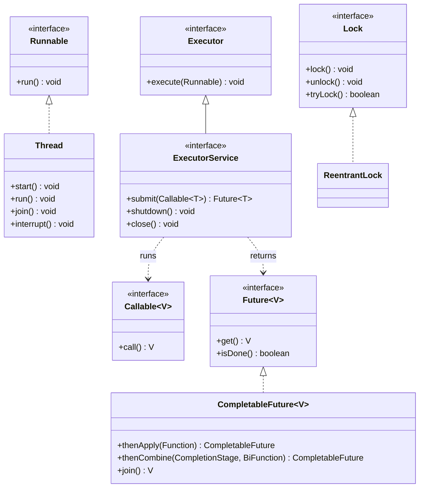

# Chapter 19 — Concurrency essentials

## What and why

Concurrency = several threads sharing objects. Exams score four things: the `start()` vs `run()` split, what `synchronized` / `volatile` / locks guarantee (and what they do not), the `java.util.concurrent` tools (`ExecutorService`, `Future`, `CompletableFuture`, `ConcurrentHashMap`), and the thread-safe singleton variants.

Package: `oop.conc`. Run from `java-book/code` with Java 21. Demos that race print **booleans** (`<=`, `==`), never a raw lost-update count, because that number differs on every run.

## Exam flash rules

- `start()` creates a new thread that runs `run()`; calling `run()` directly is an ordinary method call on the **caller's** thread.
- A thread can be started **once**; a second `start()` throws `IllegalThreadStateException`.
- `Thread.run()` is `public`, so an override cannot be package-private; `Runnable.run()` cannot throw a checked exception, `Callable.call()` can.
- `join()` waits for a thread to end; without it the order of output lines is not defined.
- `count++` is read, add, write; two unsynchronized threads **lose updates**.
- `synchronized` gives **mutual exclusion and visibility**; an instance method locks `this`, a `static` method locks `Class.class`, a block locks the object in the parentheses.
- Two threads exclude each other only if they use the **same lock object**.
- `synchronized` is not part of the signature: an override without it does **not** lock. It is illegal on constructors and on `abstract` methods.
- Intrinsic locks and `ReentrantLock` are **reentrant**: the owner can lock again without blocking itself.
- `volatile` gives visibility and ordering for **one variable**; it does **not** make `count++` atomic (use `AtomicInteger`, `synchronized`, or a lock).
- `wait()`, `notify()`, `notifyAll()` must be called while holding that object's monitor, else `IllegalMonitorStateException`; test the condition in a `while` loop.
- `lock.unlock()` goes in `finally`; `tryLock(timeout)` turns a possible deadlock into a result.
- Deadlock needs a cycle of waits; a fixed global lock order removes the cycle.
- `Thread.interrupted()` returns the flag and **clears** it; `isInterrupted()` only reads it; blocking calls throw `InterruptedException` and clear it.
- `ConcurrentHashMap` rejects `null` keys and values; `merge`, `putIfAbsent`, `computeIfAbsent` are atomic, `get` then `put` is **not**.
- An exception inside `submit(...)` is stored in the `Future`; `get()` rethrows it wrapped in `ExecutionException`.
- Lazy thread-safe singleton: holder idiom, enum, or double-checked locking **with `volatile`**.

## Rules table

| Rule | Allowed | Not allowed | Compiler message (verbatim) |
|------|---------|-------------|-----------------------------|
| `abstract` + `synchronized` | `synchronized` on a concrete method | `abstract synchronized` | `illegal combination of modifiers: abstract and synchronized` |
| `final` + `volatile` | `volatile` on a mutable field | `final volatile` | `illegal combination of modifiers: final and volatile` |
| Constructor | plain constructor, `synchronized` block inside | `synchronized` constructor | `modifier synchronized not allowed here` |
| Monitor expression | any object reference | `synchronized (intValue)` | `unexpected type` / `required: reference` / `found:    int` |
| `Runnable` body | unchecked exceptions, `try/catch` | uncaught checked exception | `unreported exception InterruptedException; must be caught or declared to be thrown` |
| `Future.get()` | in `try/catch` or `throws` | bare call | `unreported exception InterruptedException; must be caught or declared to be thrown` |
| `Callable` body | return a value | fall off the end | `incompatible types: bad return type in lambda expression` / `missing return value` |
| Lambda capture | effectively final local | modified local | `local variables referenced from a lambda expression must be final or effectively final` |
| `run()` override in `Thread` | `public void run()` | package-private | `attempting to assign weaker access privileges; was public` |
| `submit` result type | `Future<Integer>` | `Future<String>` for an `int` task | `incompatible types: inference variable T has incompatible bounds` |

### `Runnable` vs `Callable` vs `Thread`

| | `Runnable` | `Callable<V>` | `Thread` |
|-|------------|---------------|----------|
| Method | `void run()` | `V call() throws Exception` | `run()` (+ `start()`) |
| Returns a value | no | yes (via `Future`) | no |
| Checked exceptions | no | yes | no |
| Used with | `new Thread(r)`, `execute`, `submit` | `submit`, `invokeAll` | itself |

### `synchronized` vs `volatile` vs `ReentrantLock` vs atomic

| | `synchronized` | `volatile` | `ReentrantLock` | `AtomicInteger` |
|-|----------------|-----------|-----------------|-----------------|
| Mutual exclusion | yes | no | yes | single operations only |
| Visibility | yes | yes | yes | yes |
| Makes `count++` safe | yes (if all access locks) | **no** | yes | `incrementAndGet()` |
| Try / timeout | no | n.a. | `tryLock`, `tryLock(t, unit)` | n.a. |
| Release | automatic at `}` | n.a. | **manual** `unlock()` in `finally` | n.a. |
| Conditions | `wait`/`notify` | n.a. | `Condition.await`/`signal` | n.a. |

## Walkthrough

### Two ways to give a thread work

```java
{{#include ../../code/part-01-oop/src/main/java/oop/conc/ThreadBasics.java:thread-basics}}
```

```text
Worker.run on t-extends
lambda on t-runnable
main continues after join
```

### `start()` vs `run()`

```java
{{#include ../../code/part-01-oop/src/main/java/oop/conc/StartVsRun.java:start-vs-run}}
```

```text
body on main
state after run(): NEW
body on worker
state after join: TERMINATED
second start: IllegalThreadStateException
```

`t.run()` printed `main`: no thread was created, and the state is still `NEW`. `start()` ran the body on `worker`.

### Thread states

```java
{{#include ../../code/part-01-oop/src/main/java/oop/conc/ThreadStates.java:thread-states}}
```

```text
before start:  NEW
in wait():     WAITING
in sleep():    TIMED_WAITING
after join:    TERMINATED
```

The other states are `RUNNABLE` (running or ready) and `BLOCKED` (waiting to enter a `synchronized` block).

### Daemon threads

```java
{{#include ../../code/part-01-oop/src/main/java/oop/conc/DaemonDemo.java:daemon-demo}}
```

```text
default daemon: false
after setDaemon: true
setDaemon after start: IllegalThreadStateException
main thread daemon: false
```

The JVM exits when only daemon threads remain; `setDaemon` must come **before** `start()`.

### Interrupt

```java
{{#include ../../code/part-01-oop/src/main/java/oop/conc/InterruptDemo.java:interrupt-demo}}
```

```text
woken; flag now: false
restored; flag now: true
Thread.interrupted(): true
Thread.interrupted(): false
```

### Race: `count++` is three steps

```java
{{#include ../../code/part-01-oop/src/main/java/oop/conc/RaceCounter.java:race-counter}}
```

```text
plain <= expected: true
atomic == expected: true
```

The plain counter can only be `<=` the expected value (updates are lost, never invented); the typical run is smaller. The atomic counter is always exact.

### `synchronized` — what is the lock?

```java
{{#include ../../code/part-01-oop/src/main/java/oop/conc/SyncCounter.java:sync-counter}}
```

```text
n=200000
total=1
holds this: true, holds guard: false
now holds guard: true
```

`inc()` locks `this`; `incBlock()` locks `guard`. Mixing them on one counter would **not** exclude each other: `probe()` holds `this` but not `guard`.

### Reentrancy

```java
{{#include ../../code/part-01-oop/src/main/java/oop/conc/Reentrancy.java:reentrancy}}
```

```text
outer holds this: true
inner holds this: true
hold count: 2
locked after both unlocks: false
main holds Reentrancy.class: false
```

### `volatile` — visibility yes, atomicity no

```java
{{#include ../../code/part-01-oop/src/main/java/oop/conc/VolatileDemo.java:volatile-demo}}
```

```text
spinner saw running=false, spun>0: true
volatile <= 200000: true
atomic   == 200000: true
```

The `running` flag works because a `volatile` write is seen by the reader. `vcount++` on a `volatile` int still loses updates, so the exam answer is `<= 200000`, not `== 200000`.

### `wait` / `notify`

```java
{{#include ../../code/part-01-oop/src/main/java/oop/conc/WaitNotifyDemo.java:wait-notify}}
```

```text
got hello
```

`wait()` releases the monitor while it waits; the `while (message == null)` guard re-checks the condition after every wake-up.

### `ReentrantLock` and `Condition`

```java
{{#include ../../code/part-01-oop/src/main/java/oop/conc/LockDemo.java:lock-demo}}
```

```text
tryLock while held: false
tryLock(10ms) while held: false
tryLock after release: true
flag seen
```

### Deadlock and the two cures

```java
{{#include ../../code/part-01-oop/src/main/java/oop/conc/DeadlockDemo.java:deadlock-demo}}
```

```text
t1 timed out on second lock
t2 got both
```

Both threads hold one lock and want the other (circular wait). `tryLock` with a timeout lets `t1` give up and release; `t2` (willing to wait longer) then proceeds. The second cure is a global lock order:

```java
{{#include ../../code/part-01-oop/src/main/java/oop/conc/LockOrdering.java:lock-ordering}}
```

```text
a=1000 b=1000 sum=2000
```

### `ConcurrentHashMap`

```java
{{#include ../../code/part-01-oop/src/main/java/oop/conc/ConcurrentMapDemo.java:concurrent-map}}
```

```text
merge total: 40000
putIfAbsent first: null
putIfAbsent again: 1
computeIfAbsent: 26
HashMap null ok: true
ConcurrentHashMap null value: NullPointerException
```

### `ExecutorService`, `Callable`, `Future`

```java
{{#include ../../code/part-01-oop/src/main/java/oop/conc/ExecutorDemo.java:executor-demo}}
```

```text
result 55
result 5050
result 500500
a b c 
terminated: true
```

### Executor lifecycle (Java 19+: `ExecutorService` is `AutoCloseable`)

```java
{{#include ../../code/part-01-oop/src/main/java/oop/conc/ExecutorLifecycle.java:executor-lifecycle}}
```

```text
task 1 on single thread
task 2 after task 1
rejected after shutdown
isShutdown: true
runs inside try-with-resources
after close
```

### An exception in a task surfaces at `get()`

```java
{{#include ../../code/part-01-oop/src/main/java/oop/conc/FutureExceptionDemo.java:future-exception}}
```

```text
wrapper: ExecutionException
cause:   NumberFormatException
isDone: true
```

### `CompletableFuture`

```java
{{#include ../../code/part-01-oop/src/main/java/oop/conc/CompletableDemo.java:completable-demo}}
```

```text
thenApply:   200
thenCombine: 118
thenCompose: total=118
exceptionally: -1
handle: CompletionException
join threw CompletionException cause boom
allOf: [x, y]
```

`join()` throws the unchecked `CompletionException`; `get()` throws the checked `ExecutionException`. Inside `handle` / `exceptionally` the throwable of a failed `supplyAsync` is already wrapped in `CompletionException`.

### Thread-safe singleton variants

| Variant | Lazy | Thread-safe | Cost / note |
|---------|------|-------------|-------------|
| Eager `static final` | no | yes (class init is serialized) | created even if unused |
| Lazy, no sync (`LazyUnsafe`) | yes | **no** | two threads can both see `null` |
| `synchronized getInstance()` | yes | yes | lock on every call |
| Double-checked locking | yes | yes **only with `volatile`** | fast path without lock |
| Holder idiom | yes | yes | no lock; holder loads on first call |
| `enum` | no (loaded on first use) | yes | serialization/reflection safe; cannot extend a class |

```java
{{#include ../../code/part-01-oop/src/main/java/oop/conc/SingletonVariants.java:singleton-eager}}
```

```java
{{#include ../../code/part-01-oop/src/main/java/oop/conc/SingletonVariants.java:singleton-lazy-unsafe}}
```

```java
{{#include ../../code/part-01-oop/src/main/java/oop/conc/SingletonVariants.java:singleton-sync-method}}
```

```java
{{#include ../../code/part-01-oop/src/main/java/oop/conc/SingletonVariants.java:singleton-dcl}}
```

```java
{{#include ../../code/part-01-oop/src/main/java/oop/conc/SingletonVariants.java:singleton-holder}}
```

```java
{{#include ../../code/part-01-oop/src/main/java/oop/conc/SingletonVariants.java:singleton-enum}}
```

Driver (16 threads released together by a barrier, counting distinct instances):

```java
{{#include ../../code/part-01-oop/src/main/java/oop/conc/SingletonVariants.java:singleton-demo}}
```

```text
log before any access: []
after Eager.getInstance: [Eager created]
after Holder.getInstance: [Eager created, Holder created]
same Holder: true
SyncMethod distinct: 1
Dcl distinct:        1
Holder distinct:     1
Enum distinct:       1
Enum next: 1,2
```

`LazyUnsafe` is left out of the driver on purpose: its failure is a race, so a captured run would prove nothing either way. The code shows the race window (`check` then `act`).

### Does not compile — illegal modifier combinations

```java
{{#include ../../code/part-01-oop/broken/ConcAbstractSyncBroken.java}}
```

<div class="compiler-error">

```text
part-01-oop/broken/ConcAbstractSyncBroken.java:5: error: illegal combination of modifiers: abstract and synchronized
  abstract synchronized void work();
                             ^
```

</div>

```java
{{#include ../../code/part-01-oop/broken/ConcFinalVolatileBroken.java}}
```

<div class="compiler-error">

```text
part-01-oop/broken/ConcFinalVolatileBroken.java:5: error: illegal combination of modifiers: final and volatile
  private final volatile int ready = 0;
                             ^
```

</div>

```java
{{#include ../../code/part-01-oop/broken/ConcSyncCtorBroken.java}}
```

<div class="compiler-error">

```text
part-01-oop/broken/ConcSyncCtorBroken.java:5: error: modifier synchronized not allowed here
  synchronized ConcSyncCtorBroken() {}
               ^
```

</div>

### Does not compile — checked exception in `Runnable`

```java
{{#include ../../code/part-01-oop/broken/ConcRunnableCheckedBroken.java}}
```

<div class="compiler-error">

```text
part-01-oop/broken/ConcRunnableCheckedBroken.java:7: error: unreported exception InterruptedException; must be caught or declared to be thrown
      Thread.sleep(10);
                  ^
```

</div>

Fix: catch it (and restore the flag) or use a `Callable`:

```java
{{#include ../../code/part-01-oop/src/main/java/oop/conc/exam/CompileOkCallableChecked.java:compile-ok-callable-checked}}
```

```text
7
```

## Predict the output

**P1.** `run()` vs `start()`.

```java
{{#include ../../code/part-01-oop/src/main/java/oop/conc/exam/PredictRunVsStart.java:predict-run-vs-start}}
```

<details><summary>Answer</summary>

```text
main
worker
done
```

Trace: `t.run()` executes on `main`; `t.start()` executes on `worker`; `join()` then `done`.

</details>

**P2.** Which lock does each method hold?

```java
{{#include ../../code/part-01-oop/src/main/java/oop/conc/exam/PredictHoldsLock.java:predict-holds-lock}}
```

<details><summary>Answer</summary>

```text
true false
true
false
```

Trace: instance method locks `this`, not the class; static method locks `PredictHoldsLock.class`; outside both, nothing is held.

</details>

**P3.** Interrupt flag.

```java
{{#include ../../code/part-01-oop/src/main/java/oop/conc/exam/PredictInterruptFlag.java:predict-interrupt-flag}}
```

<details><summary>Answer</summary>

```text
true
true
true
false
sleep threw; flag=false
```

Trace: `isInterrupted()` reads only (true, true); `Thread.interrupted()` returns true and clears; the next call is false; `sleep` with the flag set throws at once and clears the flag again.

</details>

**P4.** Null in a map.

```java
{{#include ../../code/part-01-oop/src/main/java/oop/conc/exam/PredictMapNulls.java:predict-map-nulls}}
```

<details><summary>Answer</summary>

```text
null true
NPE
false
```

Trace: `HashMap` stores a `null` value (`get` is `null`, `containsKey` is true); `ConcurrentHashMap.put` rejects it with `NullPointerException`, so the key is absent.

</details>

**P5.** Exception hidden in a task.

```java
{{#include ../../code/part-01-oop/src/main/java/oop/conc/exam/PredictExecutionException.java:predict-execution-exception}}
```

<details><summary>Answer</summary>

```text
submitted
java.lang.IllegalArgumentException: bad
```

Trace: the task's exception is stored in the `Future`; nothing prints until `get()` throws `ExecutionException`, whose **cause** is the `IllegalArgumentException`.

</details>

**P6.** Single-thread executor.

```java
{{#include ../../code/part-01-oop/src/main/java/oop/conc/exam/PredictSingleThreadOrder.java:predict-single-thread-order}}
```

<details><summary>Answer</summary>

```text
task 1
task 2
task 3
end
```

Trace: one worker thread runs queued tasks in submission order; `awaitTermination` returns after they finish, so `end` is last.

</details>

**P7.** `notify` without the monitor.

```java
{{#include ../../code/part-01-oop/src/main/java/oop/conc/exam/PredictWaitNoLock.java:predict-wait-no-lock}}
```

<details><summary>Answer</summary>

```text
IMSE: current thread is not owner
notified inside synchronized
```

Trace: `notify()` outside `synchronized (o)` throws `IllegalMonitorStateException`; inside it, it succeeds.

</details>

**P8.** `CompletableFuture` chain with a failure.

```java
{{#include ../../code/part-01-oop/src/main/java/oop/conc/exam/PredictCompletableChain.java:predict-completable-chain}}
```

<details><summary>Answer</summary>

```text
abc
CompletionException/IllegalStateException
```

Trace: `a` → `ab` → `abc`; in the second chain the `thenApply` is skipped and `exceptionally` receives a `CompletionException` wrapping the `IllegalStateException`.

</details>

**P9.** Holder idiom timing.

```java
{{#include ../../code/part-01-oop/src/main/java/oop/conc/exam/PredictHolderOrder.java:predict-holder-order}}
```

<details><summary>Answer</summary>

```text
main start
get called
Holder loaded
Holder constructed
get called
main end
```

Trace: `Holder` initializes on the first `Holder.INSTANCE` access (static block, then the constructor via the field initializer); the second `get()` reuses it.

</details>

### MCQ-style traps

**M1.** Which statement starts a new thread running `run()`?
(a) `t.run()` (b) `t.start()` (c) `new Thread(t)` (d) `t.join()`
**Answer: (b)** — `run()` is a plain call (P1); `new Thread(t)` only creates; `join()` waits.

**M2.** `static int n;` and two threads each do `n++` 100 000 times inside `synchronized (this)` blocks of **different** objects. The final `n` is:
(a) always 200 000 (b) at most 200 000, often less (c) compile error (d) more than 200 000
**Answer: (b)** — different locks do not exclude each other (`SyncCounter`). (d) is impossible; updates are only lost.

**M3.** `volatile int c; c++;` from two threads is:
(a) atomic (b) visible but not atomic (c) illegal (d) synchronized
**Answer: (b)** — `VolatileDemo`.

**M4.** `Future<String> f = pool.submit(() -> 42);`
(a) runs and `f.get()` is `"42"` (b) `ClassCastException` (c) compile error (d) `ExecutionException`
**Answer: (c)** — `ConcFutureTypeBroken`.

## Compile or not?

**C1.** `abstract synchronized void work();`
**Fails** — `illegal combination of modifiers: abstract and synchronized` (`ConcAbstractSyncBroken`).

**C2.** `private final volatile int ready = 0;`
**Fails** — `illegal combination of modifiers: final and volatile` (`ConcFinalVolatileBroken`).

**C3.** `synchronized ConcSyncCtorBroken() {}`
**Fails** — `modifier synchronized not allowed here` (`ConcSyncCtorBroken`). Use `synchronized (this) { … }` inside the constructor.

**C4.** `synchronized (lock)` where `lock` is an `int`.
**Fails** — `unexpected type` / `required: reference` / `found:    int` (`ConcSynchronizedPrimitiveBroken`).

**C5.** `new Thread(() -> { Thread.sleep(10); })`
**Fails** — `unreported exception InterruptedException; must be caught or declared to be thrown` (`ConcRunnableCheckedBroken`). Looks fine; `Runnable.run()` declares no checked exception.

**C6.** `System.out.println(future.get());` in a `main` with no `throws`.
**Fails** — `unreported exception InterruptedException; must be caught or declared to be thrown` (`ConcGetUncheckedBroken`). `get()` also throws `ExecutionException`; `join()` would not need a `catch`.

**C7.** `Callable<Integer> c = () -> { System.out.println("no return"); };`
**Fails** — `incompatible types: bad return type in lambda expression` / `missing return value` (`ConcVoidLambdaCallableBroken`).

**C8.** `int counter = 0; new Thread(() -> { counter++; });`
**Fails** — `local variables referenced from a lambda expression must be final or effectively final` (`ConcLambdaCaptureBroken`). Use an `AtomicInteger` or a field.

**C9.** `class Job extends Thread { void run() { … } }`
**Fails** — `attempting to assign weaker access privileges; was public` (`ConcRunWeakerAccessBroken`).

**C10.** `Future<String> f = pool.submit(() -> 42);`
**Fails** — `incompatible types: inference variable T has incompatible bounds` (`ConcFutureTypeBroken`).

**C11.** A `Callable` whose body calls `Thread.sleep(1)` with no `catch`.
**Compiles** — `call()` is declared `throws Exception` (`CompileOkCallableChecked`, output `7`).

**C12.** `Derived.work()` overrides `synchronized void work()` without the keyword.
**Compiles** — but no longer locks.

```java
{{#include ../../code/part-01-oop/src/main/java/oop/conc/exam/CompileOkSyncNotInherited.java:compile-ok-sync-not-inherited}}
```

```text
Base holds lock: true
Derived holds lock: false
```

## Gotchas

1. **`run()` instead of `start()`** — no new thread, no concurrency. `StartVsRun`, `PredictRunVsStart`.
2. **`volatile` `count++`** — visibility is not atomicity. `VolatileDemo`, `RaceCounter`; fix: `AtomicInteger` / lock.
3. **Different locks on the same data** — no exclusion. `SyncCounter` (`probe`), M2.
4. **`get` then `put` on a `ConcurrentHashMap`** — two threads can both pass the check; use `putIfAbsent` / `merge` / `computeIfAbsent`; also no `null`. `ConcurrentMapDemo`, `PredictMapNulls`.
5. **Silent task failures** — the exception waits inside the `Future`. `FutureExceptionDemo`, `PredictExecutionException`.
6. **`synchronized` is not inherited** — an override without it does not lock. `CompileOkSyncNotInherited`.
7. **Double-checked locking without `volatile`** — a half-built object can be published. `SingletonVariants` (`singleton-dcl`).

## UML



## Interview Q&A

1. **Q:** `start()` vs `run()`? **A:** `start()` creates a thread that calls `run()`; `run()` called directly runs on the caller's thread (`StartVsRun`).
2. **Q:** Can a thread be restarted? **A:** No; `IllegalThreadStateException` (`StartVsRun`).
3. **Q:** Why is `count++` unsafe? **A:** Read-modify-write is three steps; updates are lost (`RaceCounter`).
4. **Q:** What does `synchronized` guarantee? **A:** Mutual exclusion and visibility on the same lock (`SyncCounter`, `SolutionSafeCounter`).
5. **Q:** What is locked by a `static synchronized` method? **A:** The `Class` object (`PredictHoldsLock`).
6. **Q:** `volatile` vs `synchronized`? **A:** `volatile` gives visibility/ordering for one variable, no atomic compound actions (`VolatileDemo`).
7. **Q:** Why a `while` around `wait()`? **A:** The condition may be false after wake-up; re-test it (`WaitNotifyDemo`, `WritingSyncStack`).
8. **Q:** How do you avoid deadlock? **A:** Fixed lock order, or `tryLock` with a timeout (`LockOrdering`, `DeadlockDemo`).
9. **Q:** What does `Thread.interrupted()` do that `isInterrupted()` does not? **A:** It clears the flag (`PredictInterruptFlag`, `InterruptDemo`).
10. **Q:** `Runnable` vs `Callable`? **A:** `Callable` returns a value and may throw a checked exception (`CompileOkCallableChecked`, `ConcRunnableCheckedBroken`).
11. **Q:** What happens to an exception inside `submit(...)`? **A:** Wrapped in `ExecutionException` at `get()` (`FutureExceptionDemo`).
12. **Q:** `HashMap` vs `ConcurrentHashMap`? **A:** The latter is safe for concurrent use, has atomic `merge`/`putIfAbsent`, and rejects `null` (`ConcurrentMapDemo`, `PredictMapNulls`).
13. **Q:** `join()` vs `get()` on a `CompletableFuture`? **A:** `join()` throws unchecked `CompletionException`; `get()` throws checked `ExecutionException` (`CompletableDemo`, `ConcGetUncheckedBroken`).
14. **Q:** Best lazy thread-safe singleton? **A:** Holder idiom or `enum`; DCL needs `volatile` (`SingletonVariants`, `PredictHolderOrder`).
15. **Q:** What does `shutdown()` do? **A:** Stops accepting tasks, lets queued tasks finish; later `submit` is rejected (`ExecutorLifecycle`).

## Exam writing prompts

1. (5) Write a thread-safe stack `push(x)` / blocking `pop()` using `synchronized`, `wait`, `notifyAll`. — `solutions/ch19/WritingSyncStack.java`.
2. (5) Write a double-checked-locking singleton from memory; state why the field is `volatile`. — `solutions/ch19/WritingDclSingleton.java`.
3. (5) Run a slow task through an `ExecutorService`, wait at most 50 ms, and cancel it on timeout. — `solutions/ch19/WritingTimeout.java`.
4. (3) Fix `static int n; Runnable r = () -> { for (...) n++; };` two ways: `AtomicInteger` and `synchronized`.
5. (3) Write two methods that can deadlock, then rewrite them with a fixed lock order.

## Exercises

1. Four threads × 100 000 increments, exact total, no `synchronized` — `solutions/ch19/SolutionSafeCounter.java`.
2. Two threads print `ping`/`pong` in strict alternation — `solutions/ch19/SolutionPingPong.java`.
3. Sum 1..1 000 000 over four tasks — `solutions/ch19/SolutionParallelSum.java`.
4. Lazy lock-free singleton holding a computed value — `solutions/ch19/SolutionLazyHolder.java`.
5. Combine two async lookups and fall back on failure — `solutions/ch19/SolutionCompletablePipeline.java`.
6. Add `synchronized` to `Base.work()`'s override in `CompileOkSyncNotInherited` and re-run.

Solution outputs (real runs):

```text
SolutionSafeCounter         -> total=400000
SolutionPingPong            -> ping pong ping pong ping pong (one per line)
SolutionParallelSum         -> sum=500000500000
SolutionLazyHolder          -> before first get / loading config / prod / true
SolutionCompletablePipeline -> user3 has 6 orders / unavailable
WritingSyncStack            -> popped x
WritingDclSingleton         -> true
WritingTimeout              -> timed out, cancelled=true, isCancelled=true
```

## Recap checklist

- [x] Threads: `start` vs `run`, states, daemon, interrupt — `ThreadBasics`, `StartVsRun`, `ThreadStates`, `DaemonDemo`, `InterruptDemo`
- [x] `synchronized`, reentrancy, `volatile`, `wait`/`notify` — `SyncCounter`, `Reentrancy`, `VolatileDemo`, `WaitNotifyDemo`, `RaceCounter`
- [x] `ReentrantLock`, `Condition`, deadlock and lock ordering — `LockDemo`, `DeadlockDemo`, `LockOrdering`
- [x] `ConcurrentHashMap`, `ExecutorService`, `Future`, `CompletableFuture` — `ConcurrentMapDemo`, `ExecutorDemo`, `ExecutorLifecycle`, `FutureExceptionDemo`, `CompletableDemo`
- [x] Thread-safe singleton variants — `SingletonVariants`
- [x] Compile-or-not bank (10 fail + 2 pass) — `broken/Conc*Broken.java`, `exam/CompileOk*`
- [x] Predict bank (9) — `oop/conc/exam/Predict*.java`
- [x] Exam writing prompts, exercises — `solutions/ch19/`
