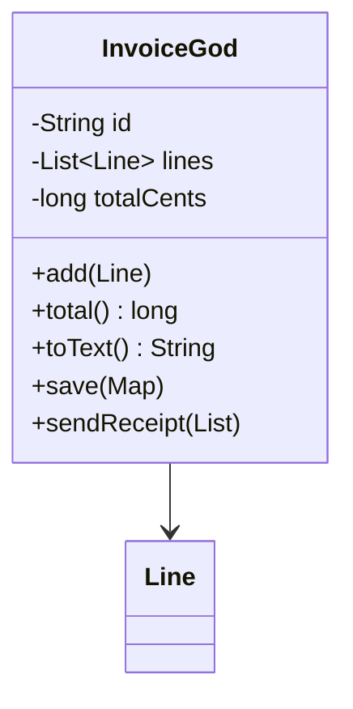
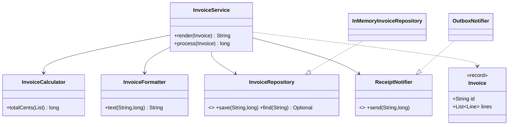

# Chapter 21 — Single Responsibility Principle

## What and why

**SRP:** a class should have one reason to change. Papers ask for the definition (2 marks), a violating class with a refactor (5–10 marks), and "which code is broken by this change?" stems.

A *reason to change* is a source of change requests: pricing rules, print layout, storage, notification channel. One class serving several of them means an edit for one can break another.

## Exam flash rules

- SRP = one class, **one reason to change** (one actor / one axis of change).
- "One reason to change" is **not** "one method".
- Symptoms: unrelated fields, methods that use disjoint field groups, imports from unrelated layers, `Utils` classes.
- A shared mutable field between two responsibilities is the usual way a change leaks.
- Refactor recipe: name each responsibility, extract it behind a small type, delegate, keep behaviour identical.
- Extracted collaborators are injected, so tests can replace them.
- A data carrier (`record`) plus a service that orchestrates is the common end state.
- Over-splitting (a class per line) is also a violation of good sense: split along reasons to change only.
- SRP applies at method, class, and package level.
- SRP does not forbid a class from collaborating; it forbids it from *owning* several concerns.
- Cohesion is the measurable twin: do all methods use most of the fields?
- A `static` helper bag still has several reasons to change and cannot be faked in a test.

## Rules table

| Question | Answer | Proof |
|----------|--------|-------|
| How many reasons to change in `InvoiceGod`? | 4 (pricing, layout, persistence, notification) | `before/InvoiceGod.java` |
| Which edit breaks stored data? | print-layout rounding writes the shared field | `GodFailureDemo` |
| After the split, can `Invoice` save itself? | No — it is data only | `SrpSaveRemovedBroken` below |
| After the split, can a class implement half a repository? | No | `SrpRepoIncompleteBroken` below |

## Violating code

```java
{{#include ../../code/part-02-solid/src/main/java/solid/srp/model/Line.java:line}}
```

```java
{{#include ../../code/part-02-solid/src/main/java/solid/srp/before/InvoiceGod.java:invoice-god}}
```

Four reasons to change live in one class: pricing, print layout, persistence, notification. They also share `totalCents`.

## Real-world failure

A print layout was changed to show whole currency units, and the author rounded the total "to keep columns aligned". The rounding wrote the shared field. Any invoice printed before it was saved was stored rounded. The ledger was off by up to 99 cents per invoice, and the fault depended on the order of two unrelated calls.

```java
{{#include ../../code/part-02-solid/src/main/java/solid/srp/before/GodFailureDemo.java:god-failure}}
```

```text
{{#include ../../code/part-02-solid/out/run/GodFailureDemo.txt}}
```

The correct total is `11999`; the second save stored `12000`.

## Stepwise refactor

Each step is one file and keeps the public behaviour. Collaborators appear in `solid.srp.parts` as they are extracted.

### Step 1 — extract pricing

```java
{{#include ../../code/part-02-solid/src/main/java/solid/srp/parts/InvoiceCalculator.java:calculator}}
```

```java
{{#include ../../code/part-02-solid/src/main/java/solid/srp/step1/InvoiceStep1.java:step1}}
```

The `totalCents` field is gone: the total is derived from `lines` only, so printing can no longer change what is stored.

### Step 2 — extract print layout

```java
{{#include ../../code/part-02-solid/src/main/java/solid/srp/parts/InvoiceFormatter.java:formatter}}
```

```java
{{#include ../../code/part-02-solid/src/main/java/solid/srp/step2/InvoiceStep2.java:step2}}
```

### Step 3 — extract persistence behind an interface

```java
{{#include ../../code/part-02-solid/src/main/java/solid/srp/parts/InvoiceRepository.java:repository}}
```

```java
{{#include ../../code/part-02-solid/src/main/java/solid/srp/parts/InMemoryInvoiceRepository.java:in-memory-repository}}
```

```java
{{#include ../../code/part-02-solid/src/main/java/solid/srp/step3/InvoiceStep3.java:step3}}
```

### Step 4 — extract notification behind an interface

```java
{{#include ../../code/part-02-solid/src/main/java/solid/srp/parts/ReceiptNotifier.java:notifier}}
```

```java
{{#include ../../code/part-02-solid/src/main/java/solid/srp/parts/OutboxNotifier.java:outbox-notifier}}
```

```java
{{#include ../../code/part-02-solid/src/main/java/solid/srp/step4/InvoiceStep4.java:step4}}
```

### Final — data plus a service

```java
{{#include ../../code/part-02-solid/src/main/java/solid/srp/after/Invoice.java:invoice}}
```

```java
{{#include ../../code/part-02-solid/src/main/java/solid/srp/after/InvoiceService.java:service}}
```

### Behaviour check across steps

```java
{{#include ../../code/part-02-solid/src/main/java/solid/srp/steps/StepsDemo.java:steps-demo}}
```

```text
{{#include ../../code/part-02-solid/out/run/StepsDemo.txt}}
```

```java
{{#include ../../code/part-02-solid/src/main/java/solid/srp/after/AfterDemo.java:after-demo}}
```

```text
{{#include ../../code/part-02-solid/out/run/AfterDemo.txt}}
```

## Tests that prove the benefit

```java
{{#include ../../code/part-02-solid/src/test/java/solid/srp/SrpTest.java}}
```

| Test | What it proves |
|------|----------------|
| `godClassCorruptsStoredTotalWhenPrintedFirst` | the failure is real (stored `12000`) |
| `calculatorNeedsNoIoToTest` | pricing is testable with no store, no output |
| `renderingDoesNotChangeWhatIsStored` | layout and storage no longer interact |
| `notifierCanBeFakedWithALambda` | one-method interface replaced by a lambda |
| `repositoryIsIndependentOfPricing` | storage tested alone |

## Predict the output

**P1.** `PredictGodSaveAfterPrint` — God class, `toText()` then `save()`.

```java
{{#include ../../code/part-02-solid/src/main/java/solid/srp/exam/PredictGodSaveAfterPrint.java:predict-god-save}}
```

<details><summary>Answer</summary>

```text
{{#include ../../code/part-02-solid/out/run/PredictGodSaveAfterPrint.txt}}
```

`3 × 3333 = 9999`; layout rounds the field to `10000`; save stores the rounded field.

</details>

**P2.** `PredictGodHalfUp`

```java
{{#include ../../code/part-02-solid/src/main/java/solid/srp/exam/PredictGodHalfUp.java:predict-god-half-up}}
```

<details><summary>Answer</summary>

```text
{{#include ../../code/part-02-solid/out/run/PredictGodHalfUp.txt}}
```

`Math.round(2.5)` is `3` (half up). `total()` recomputes from the lines, so it returns `250` again.

</details>

**P3.** `PredictServiceStored`

```java
{{#include ../../code/part-02-solid/src/main/java/solid/srp/exam/PredictServiceStored.java:predict-service-stored}}
```

<details><summary>Answer</summary>

```text
{{#include ../../code/part-02-solid/out/run/PredictServiceStored.txt}}
```

`render` only formats; the repository holds the exact `9999`.

</details>

**P4.** `PredictFormatterRounding`

```java
{{#include ../../code/part-02-solid/src/main/java/solid/srp/exam/PredictFormatterRounding.java:predict-rounding}}
```

<details><summary>Answer</summary>

```text
{{#include ../../code/part-02-solid/out/run/PredictFormatterRounding.txt}}
```

`1.49→1`, `1.5→2`, `2.5→3`, `3.5→4`: always half up, not banker's rounding.

</details>

**P5.** `PredictRecordCopy`

```java
{{#include ../../code/part-02-solid/src/main/java/solid/srp/exam/PredictRecordCopy.java:predict-record-copy}}
```

<details><summary>Answer</summary>

```text
{{#include ../../code/part-02-solid/out/run/PredictRecordCopy.txt}}
```

The compact constructor copies the list: later changes to the caller's list are not seen, and `List.copyOf` is unmodifiable.

</details>

## Compile or not?

**C1.** Call `inv.save(db)` on the data-only `Invoice`. Fails.

```java
{{#include ../../code/part-02-solid/broken/SrpSaveRemovedBroken.java}}
```

```text
{{#include ../../code/part-02-solid/out/broken/SrpSaveRemovedBroken.txt}}
```

**C2.** Assign `inv.id = "Y"` from outside the record. Fails.

```java
{{#include ../../code/part-02-solid/broken/SrpRecordFieldBroken.java}}
```

```text
{{#include ../../code/part-02-solid/out/broken/SrpRecordFieldBroken.txt}}
```

**C3.** Build `InvoiceService` with one of four collaborators. Fails.

```java
{{#include ../../code/part-02-solid/broken/SrpMissingCtorArgBroken.java}}
```

```text
{{#include ../../code/part-02-solid/out/broken/SrpMissingCtorArgBroken.txt}}
```

**C4.** Implement `InvoiceRepository` with only `save`. Fails.

```java
{{#include ../../code/part-02-solid/broken/SrpRepoIncompleteBroken.java}}
```

```text
{{#include ../../code/part-02-solid/out/broken/SrpRepoIncompleteBroken.txt}}
```

**C5.** `InvoiceFormatter.text(...)` called like a static method. Fails.

```java
{{#include ../../code/part-02-solid/broken/SrpFormatterStaticBroken.java}}
```

```text
{{#include ../../code/part-02-solid/out/broken/SrpFormatterStaticBroken.txt}}
```

**C6.** Looks odd, compiles: a lambda for the one-method `ReceiptNotifier`.

```java
{{#include ../../code/part-02-solid/src/main/java/solid/srp/exam/CompileSrpLambdaOk.java:compile-ok-lambda}}
```

```text
{{#include ../../code/part-02-solid/out/run/CompileSrpLambdaOk.txt}}
```

## Gotchas

```java
{{#include ../../code/part-02-solid/src/main/java/solid/srp/gotchas/SrpGotchas.java:g1-cohesive}}
```

```java
{{#include ../../code/part-02-solid/src/main/java/solid/srp/gotchas/SrpGotchas.java:g2-util}}
```

```java
{{#include ../../code/part-02-solid/src/main/java/solid/srp/gotchas/SrpGotchas.java:g3-oversplit}}
```

```java
{{#include ../../code/part-02-solid/src/main/java/solid/srp/gotchas/SrpGotchas.java:g-main}}
```

```text
{{#include ../../code/part-02-solid/out/run/SrpGotchas.txt}}
```

1. **G1** — SRP is not "one method per class": `Money` has three methods and one reason to change.
2. **G2** — A static `InvoiceUtils` still mixes pricing, layout and storage and cannot be replaced in a test.
3. **G3** — Three one-line classes always called together (`Add`, `Tax`, `Round`) is over-splitting.
4. **G4** — Temporal coupling: `save` before `total()` stores `0`.
5. **G5** — A hidden second responsibility: using `toString()` as a storage or wire format ties the record's debug text to its readers.

## UML

Before:



After:



## Short answers (marks trail)

| Marks | Prompt | Answer |
|-------|--------|--------|
| 2 | Define SRP | A class should have only one reason to change. |
| 2 | Name two symptoms of a violation | Unrelated field groups; changes to one feature break another; hard to unit-test without I/O. |
| 5 | Why is a shared field dangerous here? | Layout code wrote `totalCents`; save read it (`GodFailureDemo`). |
| 5 | Give the four extracted responsibilities | Calculator, formatter, repository, notifier. |
| 10 | Refactor `InvoiceGod` | Steps 1–4 and the final service, with UML. |

## Interview Q&A

1. **Q:** What is a "reason to change"? **A:** A source of change requests, such as pricing rules or print layout (`InvoiceGod` has four).
2. **Q:** Is SRP "one method per class"? **A:** No. `Money` in `SrpGotchas` has three methods and one reason to change.
3. **Q:** What bug did the God class show? **A:** Printing rounded the shared field, so a later `save` stored `12000` instead of `11999` (`GodFailureDemo`).
4. **Q:** Which refactor removed the bug? **A:** Step 1: no stored total field; derive it from the lines.
5. **Q:** Why inject `InvoiceRepository` rather than call a static store? **A:** The interface lets a test substitute `InMemoryInvoiceRepository` (`SrpTest`).
6. **Q:** How do you test pricing alone? **A:** `InvoiceCalculator` takes a list and returns a number; no I/O (`calculatorNeedsNoIoToTest`).
7. **Q:** Why is `Invoice` a record? **A:** It carries data only; the compact constructor copies the list (`PredictRecordCopy`).
8. **Q:** Can over-applying SRP hurt? **A:** Yes: `Add`/`Tax`/`Round` classes called together add indirection without isolating any change.
9. **Q:** How does SRP relate to cohesion? **A:** High cohesion means a class's methods use most of its fields; a violation shows as disjoint field groups.
10. **Q:** Does a `Utils` class satisfy SRP? **A:** Usually no; it collects unrelated reasons to change and is not replaceable in tests (`InvoiceUtils`).
11. **Q:** What changes if the notification channel changes? **A:** Only a `ReceiptNotifier` implementation; the service and calculator are untouched.
12. **Q:** How is SRP different from ISP? **A:** SRP splits an implementation by reason to change; ISP splits an interface by client need (chapter 24).

## Exam writing prompts

1. (5) Given `class Report { String format(); void saveToFile(); long compute(); }`, list the responsibilities and write the extracted types' signatures.
2. (5) Rewrite `save` so it cannot store a rounded value. State which field you removed and why.
3. (10) Draw the before and after class diagram for `InvoiceGod` and write the final `InvoiceService.process` method.

## Exercises

Solutions are in `code/part-02-solid/solutions/ch21/` and are compiled and run by `capture.sh`.

1. Split a class that formats and stores a report into two — `SolutionReportSplit.java`.
2. Write a fake `InvoiceRepository` that records every call — `SolutionFakeRepository.java`.
3. Add a CSV formatter without touching pricing or storage — `SolutionCsvFormatter.java`.
4. Replace the notifier with a counting lambda — `SolutionNotifierLambda.java`.
5. Add lines to an immutable `Invoice` by returning a new one — `SolutionImmutableInvoice.java`.

## Recap checklist

- [x] Violating code with four reasons to change — `before/InvoiceGod.java`
- [x] Real failure with captured output — `GodFailureDemo`
- [x] Stepwise refactor, one file per step — `step1`–`step4`, `after/`
- [x] Tests proving benefit — `SrpTest`
- [x] UML before/after
- [x] Exam banks: predict (5), compile (5 fail + 1 pass), writing (3), exercises (5)
