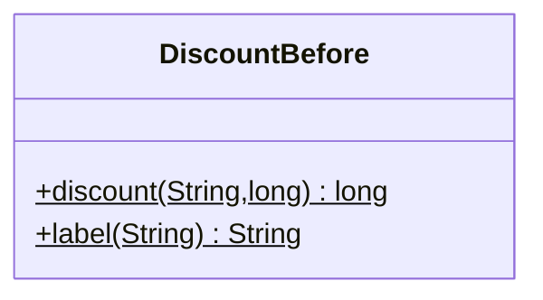
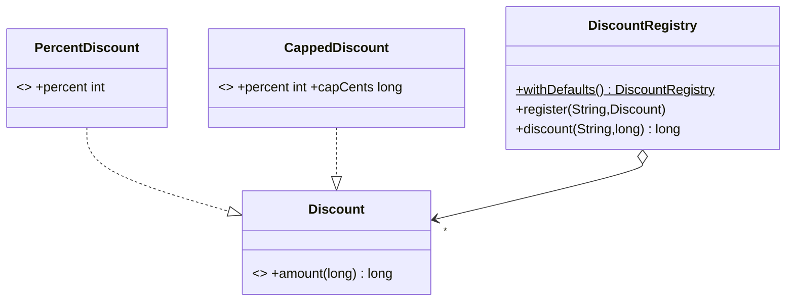
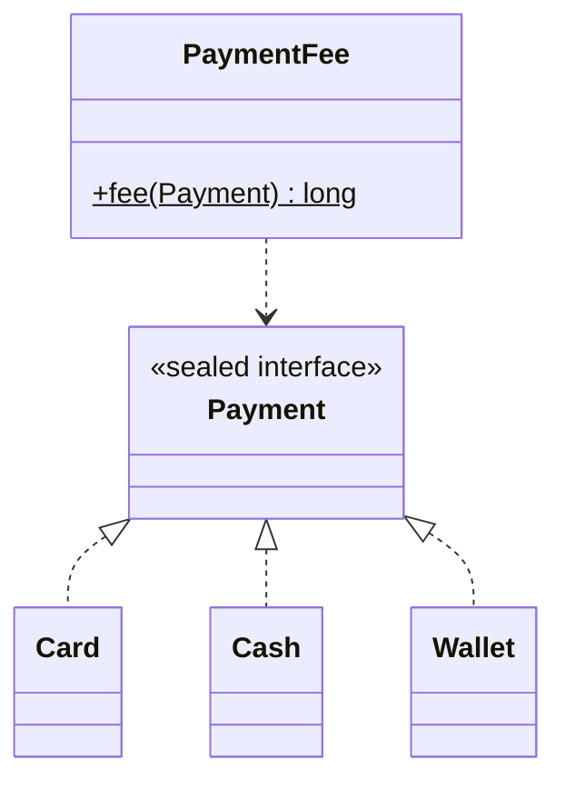

# Chapter 22 — Open/Closed Principle

## What and why

**OCP:** software entities should be **open for extension, closed for modification**. Adding a behaviour should mean adding code, not editing tested code. Papers ask for the definition (2 marks), "refactor this `if`/`else` chain" (5–10 marks), and sealed-switch compile stems.

## Exam flash rules

- OCP = open for extension, closed for modification.
- Typical violation: an `if`/`else if` or `switch` chain over a *type tag* (string, enum, `instanceof`) that grows with every new case.
- Typical fix: an abstraction (`interface`) plus one implementation per case, chosen by lookup or injection.
- Closed does not mean frozen: it means a new case does not require editing the old classes.
- Two chains over the same tag are a worse smell: one gets updated, the other forgotten.
- A `default`/final `return 0` in a chain swallows unknown cases silently; fail loudly instead.
- `final` classes and records cannot be extended by inheritance; extend by implementing the interface.
- A functional interface (one abstract method) can be extended with a lambda.
- A `sealed` hierarchy is the opposite choice: **closed set**, new subtype *should* force edits, and an exhaustive `switch` without `default` makes the compiler list them (Java 17+; pattern `switch` is Java 21).
- Adding a `default` branch to a switch over a sealed type switches that safety off.
- Choose open (interface + registry) when new variants arrive often; choose sealed when the set is fixed and operations grow.
- Do not abstract before the second variant appears (see chapter 26, YAGNI).

## Rules table

| Case | Result | Compiler message |
|------|--------|------------------|
| `switch` over a sealed type missing a subtype | fails | `the switch expression does not cover all possible input values` |
| New file implements a sealed interface not in `permits` | fails | `class is not allowed to extend sealed class: Payment (as it is not listed in its 'permits' clause)` |
| `extends` a record | fails | `cannot inherit from final PercentDiscount` |
| Lambda for an interface with two abstract methods | fails | `LabelledDiscount is not a functional interface` |
| Class omits the abstract method | fails | `is not abstract and does not override abstract method amount(long)` |
| Lambda for `Discount` | compiles | — |

## Violating code

```java
{{#include ../../code/part-02-solid/src/main/java/solid/ocp/before/DiscountBefore.java:discount-before}}
```

Two chains over the same type tag. A new customer type `EMPLOYEE` needs edits in both.

## Real-world failure

A new customer type was announced with a 30% employee discount. The label chain was edited, so the UI showed "staff". The discount chain was not, so staff were charged full price. Nothing failed: the unknown type fell through to `return 0`.

```java
{{#include ../../code/part-02-solid/src/main/java/solid/ocp/before/OcpFailureDemo.java:ocp-failure}}
```

```text
{{#include ../../code/part-02-solid/out/run/OcpFailureDemo.txt}}
```

## Stepwise refactor

### Step 1 — turn each branch into a rule object

```java
{{#include ../../code/part-02-solid/src/main/java/solid/ocp/rules/Discount.java:discount}}
```

```java
{{#include ../../code/part-02-solid/src/main/java/solid/ocp/rules/PercentDiscount.java:percent-discount}}
```

```java
{{#include ../../code/part-02-solid/src/main/java/solid/ocp/step1/DiscountStep1.java:step1}}
```

The chain remains, so the class is still closed to extension. This step only proves the rule objects match the old numbers.

### Step 2 — replace the chain with a lookup

```java
{{#include ../../code/part-02-solid/src/main/java/solid/ocp/step2/DiscountStep2.java:step2}}
```

An unknown type now throws. Rules are still hard-wired in the constructor, so adding one still edits this class.

### Step 3 — register rules from outside

```java
{{#include ../../code/part-02-solid/src/main/java/solid/ocp/step3/DiscountRegistry.java:step3}}
```

### Extension without editing any file above

```java
{{#include ../../code/part-02-solid/src/main/java/solid/ocp/rules/CappedDiscount.java:capped-discount}}
```

```java
{{#include ../../code/part-02-solid/src/main/java/solid/ocp/after/OcpAfterDemo.java:after-demo}}
```

```text
{{#include ../../code/part-02-solid/out/run/OcpAfterDemo.txt}}
```

`EMPLOYEE` is 30% of 20 000 = 6 000, capped at 5 000. `PARTNER` is a lambda. An unknown type fails with a message.

### The other direction — a closed set with `sealed` (Java 17+, pattern switch Java 21)

```java
{{#include ../../code/part-02-solid/src/main/java/solid/ocp/sealed/Payment.java:payment}}
```

```java
{{#include ../../code/part-02-solid/src/main/java/solid/ocp/sealed/PaymentFee.java:payment-fee}}
```

| Situation | Choose |
|-----------|--------|
| New *variants* keep arriving (discount rules, plugins) | interface + registry (open) |
| Variants are fixed, new *operations* keep arriving (fee, print, serialize) | `sealed` + exhaustive `switch` |

## Tests that prove the benefit

```java
{{#include ../../code/part-02-solid/src/test/java/solid/ocp/OcpTest.java}}
```

| Test | What it proves |
|------|----------------|
| `beforeSilentlyGivesEmployeesNothing` | the failure is real |
| `everyStepKeepsTheExistingNumbers` | refactor preserved VIP / STUDENT / REGULAR |
| `unknownTypeFailsLoudly` | silent `0` replaced by an exception |
| `newRuleNeedsNoEditToExistingCode` | `EMPLOYEE` and `PARTNER` added from outside |
| `sealedSwitchCoversEverySubtype` | exhaustive switch over the closed set |

## Predict the output

**P1.** `PredictChainTypo`

```java
{{#include ../../code/part-02-solid/src/main/java/solid/ocp/exam/PredictChainTypo.java:predict-chain-typo}}
```

<details><summary>Answer</summary>

```text
{{#include ../../code/part-02-solid/out/run/PredictChainTypo.txt}}
```

`"vip"` is not equal to `"VIP"`, so the chain returns `0`. `null.equals(...)` throws NPE.

</details>

**P2.** `PredictRegistryUnknown`

```java
{{#include ../../code/part-02-solid/src/main/java/solid/ocp/exam/PredictRegistryUnknown.java:predict-registry-unknown}}
```

<details><summary>Answer</summary>

```text
{{#include ../../code/part-02-solid/out/run/PredictRegistryUnknown.txt}}
```

`99 * 10 / 100` is integer division: `9`. Lookup is case-sensitive and fails loudly.

</details>

**P3.** `PredictRegistryOverride`

```java
{{#include ../../code/part-02-solid/src/main/java/solid/ocp/exam/PredictRegistryOverride.java:predict-registry-override}}
```

<details><summary>Answer</summary>

```text
{{#include ../../code/part-02-solid/out/run/PredictRegistryOverride.txt}}
```

`put` replaces the old `VIP` rule (size stays `3`); `GOLD` adds a fourth.

</details>

**P4.** `PredictCapped`

```java
{{#include ../../code/part-02-solid/src/main/java/solid/ocp/exam/PredictCapped.java:predict-capped}}
```

<details><summary>Answer</summary>

```text
{{#include ../../code/part-02-solid/out/run/PredictCapped.txt}}
```

`min(6000, 5000)`, then `min(3000, 5000)`; records print `Name[component=value, ...]`.

</details>

**P5.** `PredictSealedFee`

```java
{{#include ../../code/part-02-solid/src/main/java/solid/ocp/exam/PredictSealedFee.java:predict-sealed-fee}}
```

<details><summary>Answer</summary>

```text
{{#include ../../code/part-02-solid/out/run/PredictSealedFee.txt}}
```

Card 2%, Cash 0, Wallet 1%.

</details>

**P6.** `PredictIntegerDivision`

```java
{{#include ../../code/part-02-solid/src/main/java/solid/ocp/exam/PredictIntegerDivision.java:predict-int-division}}
```

<details><summary>Answer</summary>

```text
{{#include ../../code/part-02-solid/out/run/PredictIntegerDivision.txt}}
```

`19 * 5 / 100 = 0` (truncation); records have value-based `equals`.

</details>

## Compile or not?

**C1.** `switch` over `Payment` without `Wallet`. Fails.

```java
{{#include ../../code/part-02-solid/broken/OcpSealedMissingCaseBroken.java}}
```

```text
{{#include ../../code/part-02-solid/out/broken/OcpSealedMissingCaseBroken.txt}}
```

**C2.** A new record in another file implements `Payment`. Fails.

```java
{{#include ../../code/part-02-solid/broken/OcpNotPermittedBroken.java}}
```

```text
{{#include ../../code/part-02-solid/out/broken/OcpNotPermittedBroken.txt}}
```

**C3.** Extend `PercentDiscount`. Fails.

```java
{{#include ../../code/part-02-solid/broken/OcpFinalExtendBroken.java}}
```

```text
{{#include ../../code/part-02-solid/out/broken/OcpFinalExtendBroken.txt}}
```

**C4.** Lambda for a two-method interface. Fails.

```java
{{#include ../../code/part-02-solid/broken/OcpNotFunctionalBroken.java}}
```

```text
{{#include ../../code/part-02-solid/out/broken/OcpNotFunctionalBroken.txt}}
```

**C5.** Implement `Discount` with a differently named method. Fails.

```java
{{#include ../../code/part-02-solid/broken/OcpMissingMethodBroken.java}}
```

```text
{{#include ../../code/part-02-solid/out/broken/OcpMissingMethodBroken.txt}}
```

**C6.** Compiles: a lambda registered as a rule.

```java
{{#include ../../code/part-02-solid/src/main/java/solid/ocp/exam/CompileLambdaDiscountOk.java:compile-ok-lambda}}
```

```text
{{#include ../../code/part-02-solid/out/run/CompileLambdaDiscountOk.txt}}
```

## Gotchas

```java
{{#include ../../code/part-02-solid/src/main/java/solid/ocp/gotchas/OcpGotchas.java:g2-instanceof}}
```

```java
{{#include ../../code/part-02-solid/src/main/java/solid/ocp/gotchas/OcpGotchas.java:g3-static-registry}}
```

```java
{{#include ../../code/part-02-solid/src/main/java/solid/ocp/gotchas/OcpGotchas.java:g4-single-impl}}
```

```java
{{#include ../../code/part-02-solid/src/main/java/solid/ocp/gotchas/OcpGotchas.java:g5-default}}
```

```java
{{#include ../../code/part-02-solid/src/main/java/solid/ocp/gotchas/OcpGotchas.java:g-main}}
```

```text
{{#include ../../code/part-02-solid/out/run/OcpGotchas.txt}}
```

1. **G1** — String tags: `"Vip"` is not `"VIP"`, so the discount is silently `0`.
2. **G2** — An `instanceof` chain is the same violation; a `Triangle` returns area `0.0`.
3. **G3** — A `static` registry is shared by all callers and tests: "test two" sees `[A]` from "test one".
4. **G4** — An interface with one implementation and no expected variation (`Rounding`) is speculative.
5. **G5** — `default ->` on a sealed switch hides new subtypes: `Wallet` pays fee `0` instead of `100`.

## UML

Before:



After:



Sealed variant:



## Short answers (marks trail)

| Marks | Prompt | Answer |
|-------|--------|--------|
| 2 | State OCP | Open for extension, closed for modification. |
| 2 | Name the smell that signals an OCP breach | A type-tag `if`/`switch` chain that grows with each variant. |
| 5 | Why did the `EMPLOYEE` bug happen? | Two chains over one tag; one edited, one forgotten; unknown fell to `return 0`. |
| 5 | When is `sealed` better than a registry? | Closed variant set, operations that grow; compiler enforces coverage. |
| 10 | Refactor `DiscountBefore` | Steps 1–3, then add `CappedDiscount` without editing old files. |

## Interview Q&A

1. **Q:** State OCP in one line. **A:** Extend behaviour by adding code, not by editing tested code.
2. **Q:** What smell points to a violation? **A:** A growing `if`/`switch` over a type tag (`DiscountBefore`).
3. **Q:** What made the `EMPLOYEE` bug silent? **A:** The trailing `return 0` accepted unknown types (`OcpFailureDemo`).
4. **Q:** What does Step 2 change besides the structure? **A:** Unknown types throw (`PredictRegistryUnknown`).
5. **Q:** Why can't I subclass `PercentDiscount`? **A:** Records are implicitly `final` (`OcpFinalExtendBroken`); implement `Discount` instead.
6. **Q:** How do lambdas help OCP? **A:** A one-method interface takes a lambda as a new rule (`PARTNER`).
7. **Q:** What does `sealed` buy you? **A:** The compiler knows all subtypes; a missing `case` is an error (`OcpSealedMissingCaseBroken`).
8. **Q:** Why avoid `default` on a sealed switch? **A:** New subtypes then compile silently (`feeWithDefault`).
9. **Q:** Is OCP only about inheritance? **A:** No. Composition and lookup (`DiscountRegistry`) are the usual tools.
10. **Q:** Does OCP mean never edit a class? **A:** No. Bug fixes edit classes; new variants should not.
11. **Q:** What is the risk of a static registry? **A:** Shared mutable state across callers and tests (`G3`).
12. **Q:** How does OCP relate to YAGNI? **A:** Introduce the abstraction at the second variant, not before (chapter 26).

## Exam writing prompts

1. (5) Rewrite `double shipping(String region, double kg)` with an `if`/`else if` over three regions so a fourth region needs no edit to `shipping`.
2. (5) Write a `sealed interface Shape` with `Circle` and `Rect` records and an exhaustive `area` switch without `default`.
3. (2) State the compile error when you add `Triangle` to the sealed interface but not to the switch.

## Exercises

Solutions are in `code/part-02-solid/solutions/ch22/`.

1. Add `SENIOR` (15%) with no edits to existing classes — `SolutionSeniorDiscount.java`.
2. Write a rule that combines two rules and takes the larger discount — `SolutionCombinedDiscount.java`.
3. Apply the pattern to shipping fees by region — `SolutionShippingRules.java`.
4. Write a sealed `Shape` with an exhaustive switch — `SolutionSealedShape.java`.
5. Return `Optional` for unknown types instead of throwing — `SolutionOptionalLookup.java`.

## Recap checklist

- [x] Violating code — `before/DiscountBefore.java`
- [x] Real failure with output — `OcpFailureDemo`
- [x] Stepwise refactor — `step1`, `step2`, `step3`, `rules/CappedDiscount`
- [x] Sealed alternative — `sealed/Payment`, `PaymentFee`
- [x] Tests — `OcpTest`
- [x] UML before/after
- [x] Exam banks: predict (6), compile (5 fail + 1 pass), writing (3), exercises (5)
