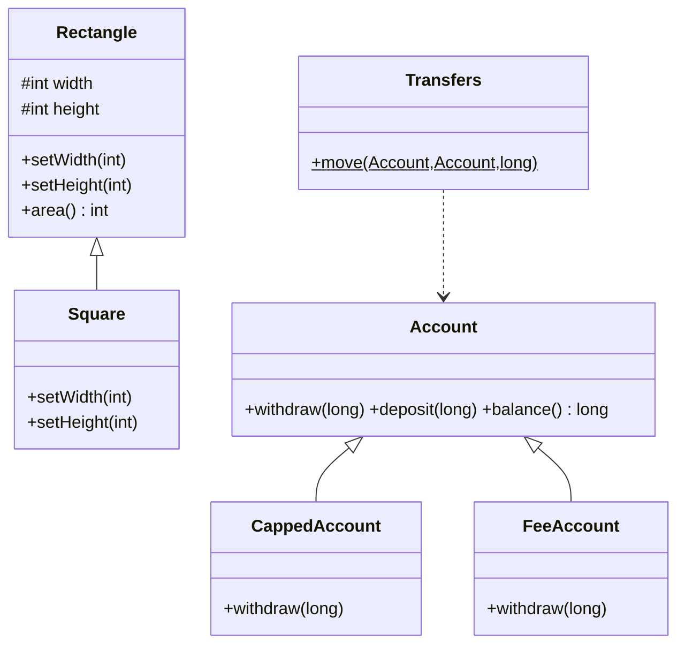
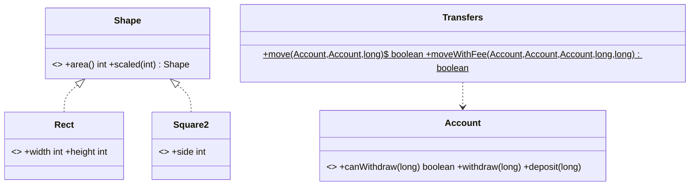

# Chapter 23 — Liskov Substitution Principle

## What and why

**LSP:** code written against a type must keep working when given any subtype. Papers ask for the definition (2 marks), Square/Rectangle (5 marks), "which override breaks the contract?" (5 marks), and override compile rules (access, exceptions, return type).

Substitutability is about **behaviour** (the contract), not just matching method signatures. The compiler checks part of it (signatures); the rest is on you and your tests.

## Exam flash rules

- LSP: wherever a `T` is expected, any subtype of `T` must work without the caller knowing.
- A subtype may **weaken** preconditions (accept more) and **strengthen** postconditions (promise more); never the reverse.
- A subtype must preserve the parent's **invariants** and its **history constraint** (no new way to mutate what the parent froze).
- Return types: **covariant** (narrower) is allowed; wider is a compile error.
- Parameter types: Java has no contravariant overriding; a wider parameter is an **overload**, so `@Override` fails.
- Access: an override may widen access, never narrow it.
- Checked exceptions: an override may throw fewer or narrower checked exceptions, never broader.
- A new unchecked exception (`UnsupportedOperationException`) compiles but breaks LSP unless the parent's contract allows it.
- Overriding `equals` in a subclass with extra state easily breaks symmetry.
- "is-a" in speech is not "is-substitutable-for" in code: Square is not a Rectangle when both are mutable.
- Fixes: separate hierarchies, immutable values, smaller interfaces, or composition.
- A client that uses `instanceof` to treat a subtype specially has found an LSP violation.
- `assert` is off by default: it is not a contract that always runs.

## Contract rules

| Rule | Allowed in subtype | Compiler checks it? |
|------|--------------------|---------------------|
| Precondition | weaker (accept more) | no — tests/review |
| Postcondition | stronger (promise more) | partly: return type covariance |
| Invariant | preserved | no |
| History constraint | preserved | no |
| Return type | narrower (covariant) | **yes** |
| Parameter type | same (wider = overload) | **yes**, via `@Override` |
| Access | same or wider | **yes** |
| Checked exceptions | fewer or narrower | **yes** |
| Unchecked exceptions | none new for callers' normal inputs | no |

```java
{{#include ../../code/part-02-solid/src/main/java/solid/lsp/contracts/ContractRulesDemo.java:covariant}}
```

```java
{{#include ../../code/part-02-solid/src/main/java/solid/lsp/contracts/ContractRulesDemo.java:weaker-pre}}
```

```java
{{#include ../../code/part-02-solid/src/main/java/solid/lsp/contracts/ContractRulesDemo.java:bag}}
```

```java
{{#include ../../code/part-02-solid/src/main/java/solid/lsp/contracts/ContractRulesDemo.java:contracts-main}}
```

```text
{{#include ../../code/part-02-solid/out/run/ContractRulesDemo.txt}}
```

`List.of(1).add(2)` throws too, but `List.add` is documented as an *optional* operation, so callers are warned by the parent contract. `FrozenBag.add` has no such warning.

## Example 1 — Square and Rectangle

### Violating code

```java
{{#include ../../code/part-02-solid/src/main/java/solid/lsp/shapes/before/Rectangle.java:rectangle}}
```

```java
{{#include ../../code/part-02-solid/src/main/java/solid/lsp/shapes/before/Square.java:square}}
```

```java
{{#include ../../code/part-02-solid/src/main/java/solid/lsp/shapes/before/StretchClient.java:stretch-client}}
```

### Real-world failure

A layout routine was written for rectangles: set width, set height, expect `width × height`. When a `Square` was passed in, setting the height silently changed the width, and the computed area was wrong. The routine had no `instanceof` and no bug of its own.

```java
{{#include ../../code/part-02-solid/src/main/java/solid/lsp/shapes/before/ShapesFailureDemo.java:shapes-failure}}
```

```text
{{#include ../../code/part-02-solid/out/run/ShapesFailureDemo.txt}}
```

`Square` keeps its own invariant (equal sides) but breaks `Rectangle`'s postcondition for `setHeight`: "width is unchanged".

### Stepwise refactor

**Step 1 — remove the inheritance.** The only promise they share is `area()`.

```java
{{#include ../../code/part-02-solid/src/main/java/solid/lsp/shapes/step1/Step1Shapes.java:step1}}
```

**Step 2 — immutable values.** "Set one side" becomes "make a new shape", so no setter can break an invariant.

```java
{{#include ../../code/part-02-solid/src/main/java/solid/lsp/shapes/step2/Step2Shapes.java:step2}}
```

**Final — a sealed `Shape` contract that every subtype keeps.**

```java
{{#include ../../code/part-02-solid/src/main/java/solid/lsp/shapes/after/Shape.java:shape}}
```

```java
{{#include ../../code/part-02-solid/src/main/java/solid/lsp/shapes/after/ShapesAfterDemo.java:shapes-after}}
```

```text
{{#include ../../code/part-02-solid/out/run/ShapesAfterDemo.txt}}
```

## Example 2 — Accounts: precondition and postcondition

### Violating code

```java
{{#include ../../code/part-02-solid/src/main/java/solid/lsp/accounts/before/Account.java:account}}
```

```java
{{#include ../../code/part-02-solid/src/main/java/solid/lsp/accounts/before/CappedAccount.java:capped-account}}
```

```java
{{#include ../../code/part-02-solid/src/main/java/solid/lsp/accounts/before/FeeAccount.java:fee-account}}
```

```java
{{#include ../../code/part-02-solid/src/main/java/solid/lsp/accounts/before/Transfers.java:transfers}}
```

### Real-world failure

`Transfers.move` is correct for `Account`: total money is unchanged. A "premium" subclass took a 1-unit fee inside `withdraw`, so each transfer destroyed a unit. A "capped" subclass rejected amounts that `Account` accepts, so a nightly batch that was safe for `Account` started throwing.

```java
{{#include ../../code/part-02-solid/src/main/java/solid/lsp/accounts/before/AccountsFailureDemo.java:accounts-failure}}
```

```text
{{#include ../../code/part-02-solid/out/run/AccountsFailureDemo.txt}}
```

| Subclass | Contract broken | Direction |
|----------|-----------------|-----------|
| `CappedAccount` | precondition `amount <= balance` became `amount <= 500` | **strengthened** (not allowed) |
| `FeeAccount` | postcondition "decreases by exactly amount" became "by amount + 1" | **weakened** (not allowed) |

### Stepwise refactor

**Step 1 — enforce the contract in the base class.** `withdraw` is `final`; variation goes in a hook; the postcondition is checked.

```java
{{#include ../../code/part-02-solid/src/main/java/solid/lsp/accounts/step1/AccountStep1.java:step1}}
```

**Step 2 — variation as data, precondition as a query.** No subclasses; callers can ask `canWithdraw` first.

```java
{{#include ../../code/part-02-solid/src/main/java/solid/lsp/accounts/after/Account.java:account}}
```

**Step 3 — fees as visible movements.** Money is conserved.

```java
{{#include ../../code/part-02-solid/src/main/java/solid/lsp/accounts/after/Transfers.java:transfers}}
```

```java
{{#include ../../code/part-02-solid/src/main/java/solid/lsp/accounts/after/AccountsAfterDemo.java:accounts-after}}
```

```text
{{#include ../../code/part-02-solid/out/run/AccountsAfterDemo.txt}}
```

## Tests that prove the benefit

```java
{{#include ../../code/part-02-solid/src/test/java/solid/lsp/LspTest.java}}
```

| Test | What it proves |
|------|----------------|
| `squareBreaksTheRectangleContract` | `Rectangle` gives `20`, `Square` gives `16` |
| `everyShapeKeepsTheShapeContract` | one contract check passes for every `Shape` subtype |
| `plainAccountPassesTheContractAndTheSubclassesDoNot` | the same check fails for `FeeAccount` and `CappedAccount` |
| `afterAccountsKeepTheContractIncludingTheLimit` | the limit is queryable, not a surprise |
| `transfersConserveMoneyEvenWithFees` | fee is a visible movement |
| `stepOneCatchesAPostconditionViolation` | the base class detects a bad subclass |

## Predict the output

**P1.** `PredictRectSquare`

```java
{{#include ../../code/part-02-solid/src/main/java/solid/lsp/exam/PredictRectSquare.java:predict-rect-square}}
```

<details><summary>Answer</summary>

```text
{{#include ../../code/part-02-solid/out/run/PredictRectSquare.txt}}
```

`Square(2)` area `4`; `setWidth(3)` also sets height, so `9`. Stretch gives `5×4=20` for a rectangle and `4×4=16` for a square.

</details>

**P2.** `PredictCappedTransfer`

```java
{{#include ../../code/part-02-solid/src/main/java/solid/lsp/exam/PredictCappedTransfer.java:predict-capped-transfer}}
```

<details><summary>Answer</summary>

```text
{{#include ../../code/part-02-solid/out/run/PredictCappedTransfer.txt}}
```

The rejected `withdraw` throws before `deposit` runs, so balances stay `500 500`.

</details>

**P3.** `PredictFeeTransfer`

```java
{{#include ../../code/part-02-solid/src/main/java/solid/lsp/exam/PredictFeeTransfer.java:predict-fee-transfer}}
```

<details><summary>Answer</summary>

```text
{{#include ../../code/part-02-solid/out/run/PredictFeeTransfer.txt}}
```

Each move costs `10 + 1`; three moves: `100 − 33 = 67`; `to` gets `30`; `3` units vanished.

</details>

**P4.** `PredictFrozenBag`

```java
{{#include ../../code/part-02-solid/src/main/java/solid/lsp/exam/PredictFrozenBag.java:predict-frozen-bag}}
```

<details><summary>Answer</summary>

```text
{{#include ../../code/part-02-solid/out/run/PredictFrozenBag.txt}}
```

The first `add` throws; nothing is stored.

</details>

**P5.** `PredictCovariantDispatch`

```java
{{#include ../../code/part-02-solid/src/main/java/solid/lsp/exam/PredictCovariantDispatch.java:predict-covariant}}
```

<details><summary>Answer</summary>

```text
{{#include ../../code/part-02-solid/out/run/PredictCovariantDispatch.txt}}
```

`a.mate()` runs `Dog.mate()` (runtime type), returning a `Dog`. The overload `describe(...)` is chosen by the **static** type: `Animal` for `a.mate()`, `Dog` for `new Dog().mate()`.

</details>

**P6.** `PredictPostcondition`

```java
{{#include ../../code/part-02-solid/src/main/java/solid/lsp/exam/PredictPostcondition.java:predict-postcondition}}
```

<details><summary>Answer</summary>

```text
{{#include ../../code/part-02-solid/out/run/PredictPostcondition.txt}}
```

The check runs after `doWithdraw`, so the bad state (`899`) is already in the object when the exception is thrown.

</details>

**P7.** `PredictShapeScale`

```java
{{#include ../../code/part-02-solid/src/main/java/solid/lsp/exam/PredictShapeScale.java:predict-shape-scale}}
```

<details><summary>Answer</summary>

```text
{{#include ../../code/part-02-solid/out/run/PredictShapeScale.txt}}
```

`6 + 4 = 10`; scaling by 3 multiplies area by 9: `54 + 36 = 90`.

</details>

## Compile or not?

**C1.** Override with `throws Exception` where the parent throws `IOException`. Fails.

```java
{{#include ../../code/part-02-solid/broken/LspCheckedBroadenBroken.java}}
```

```text
{{#include ../../code/part-02-solid/out/broken/LspCheckedBroadenBroken.txt}}
```

**C2.** Override a `public` method with package-private access. Fails.

```java
{{#include ../../code/part-02-solid/broken/LspNarrowAccessBroken.java}}
```

```text
{{#include ../../code/part-02-solid/out/broken/LspNarrowAccessBroken.txt}}
```

**C3.** Override `Number size()` with `Object size()`. Fails.

```java
{{#include ../../code/part-02-solid/broken/LspReturnTypeBroken.java}}
```

```text
{{#include ../../code/part-02-solid/out/broken/LspReturnTypeBroken.txt}}
```

**C4.** Override a `final` method. Fails.

```java
{{#include ../../code/part-02-solid/broken/LspFinalWithdrawBroken.java}}
```

```text
{{#include ../../code/part-02-solid/out/broken/LspFinalWithdrawBroken.txt}}
```

**C5.** `@Override` with a *wider* parameter type. Fails: Java treats it as an overload.

```java
{{#include ../../code/part-02-solid/broken/LspParamContravarianceBroken.java}}
```

```text
{{#include ../../code/part-02-solid/out/broken/LspParamContravarianceBroken.txt}}
```

**C6.** Looks wrong, compiles: wider access, narrower return, fewer checked exceptions.

```java
{{#include ../../code/part-02-solid/src/main/java/solid/lsp/exam/CompileCovariantOk.java:compile-covariant-ok}}
```

```text
{{#include ../../code/part-02-solid/out/run/CompileCovariantOk.txt}}
```

## Gotchas

```java
{{#include ../../code/part-02-solid/src/main/java/solid/lsp/gotchas/LspGotchas.java:g1-bird}}
```

```java
{{#include ../../code/part-02-solid/src/main/java/solid/lsp/gotchas/LspGotchas.java:g2-instanceof}}
```

```java
{{#include ../../code/part-02-solid/src/main/java/solid/lsp/gotchas/LspGotchas.java:g3-equals}}
```

```java
{{#include ../../code/part-02-solid/src/main/java/solid/lsp/gotchas/LspGotchas.java:g4-mutable-sub}}
```

```java
{{#include ../../code/part-02-solid/src/main/java/solid/lsp/gotchas/LspGotchas.java:g5-assert}}
```

```java
{{#include ../../code/part-02-solid/src/main/java/solid/lsp/gotchas/LspGotchas.java:g-main}}
```

```text
{{#include ../../code/part-02-solid/out/run/LspGotchas.txt}}
```

1. **G1** — `Penguin extends Bird` and throws from `fly()`: it compiles; callers fail at runtime.
2. **G2** — `instanceof FeeAccount` in client code is a workaround that proves the subtype is not substitutable (and breaks OCP).
3. **G3** — `Point`/`ColorPoint` `equals`: `p.equals(c)` is `true` but `c.equals(p)` is `false` (symmetry broken).
4. **G4** — A subclass that changes `hashCode` after mutation loses its map entry (`null`).
5. **G5** — `assert` is disabled by default; the "contract" never ran (`balance=105`).

## UML

Before:



After:



## Short answers (marks trail)

| Marks | Prompt | Answer |
|-------|--------|--------|
| 2 | State LSP | Subtypes must be usable wherever their supertype is expected, without changing correctness. |
| 2 | Pre/post rule | Preconditions may only be weakened, postconditions only strengthened. |
| 5 | Why does `Square extends Rectangle` fail? | `setHeight` also changes width, breaking the "width is unchanged" postcondition (`20` vs `16`). |
| 5 | Name the compile-time checks that support LSP | Covariant return, no narrower access, no broader checked exceptions, `@Override` signature match. |
| 10 | Refactor Square/Rectangle | Steps 1–2 and the sealed `Shape`, with UML and a contract test. |

## Interview Q&A

1. **Q:** State LSP precisely. **A:** If `S` is a subtype of `T`, a program correct for `T` stays correct when given `S`.
2. **Q:** Why does Square/Rectangle fail? **A:** Mutable setters; `Square` changes both sides (`ShapesFailureDemo`).
3. **Q:** Which direction may preconditions move in a subtype? **A:** Weaker only (`LenientParser`).
4. **Q:** Which direction may postconditions move? **A:** Stronger only (covariant `Dog.mate()`).
5. **Q:** Which LSP rules does `javac` enforce? **A:** Access, checked exceptions, return type, final (C1–C5).
6. **Q:** Does `UnsupportedOperationException` always break LSP? **A:** Only if the parent contract does not allow it; `List.add` documents it as optional, `Bag.add` does not.
7. **Q:** How did `FeeAccount` break the contract? **A:** Postcondition changed to "decreases by amount + 1"; `fee total=999`.
8. **Q:** How did `CappedAccount` break it? **A:** It strengthened the precondition to `amount <= 500`.
9. **Q:** How do you fix a precondition that varies by type? **A:** Make it data plus a query: `canWithdraw` (`after/Account`).
10. **Q:** How do you test LSP? **A:** Run one contract test against every implementation (`LspTest`).
11. **Q:** Why is `instanceof` in a client a smell here? **A:** It special-cases a subtype that failed substitution (`safeMove`).
12. **Q:** Why do `equals` overrides in subclasses cause LSP trouble? **A:** Adding state makes `equals` asymmetric (`G3`).

## Exam writing prompts

1. (5) Write `Rectangle` and `Square` so a client that sets width then height always gets `width × height`. Say which design you used.
2. (5) For `class Base { Number f() }`, write an override that is legal and one that is not, and the compiler message for the illegal one.
3. (10) A `ReadOnlyList extends ArrayList` throws on `add`. Explain the LSP violation and give a redesign with two interfaces.

## Exercises

Solutions are in `code/part-02-solid/solutions/ch23/`.

1. Fix `Bird`/`Penguin` so only flying birds promise `fly()` — `SolutionBirdFix.java`.
2. Split a bag into read and write roles so a frozen bag never throws — `SolutionReadOnlyBag.java`.
3. Write a reusable postcondition check that works without `-ea` — `SolutionContractCheck.java`.
4. Write a subtype that weakens a precondition — `SolutionLenientParser.java`.
5. Test a candidate `Triangle` against the `Shape` scaling law and find the counter-example — `SolutionTriangleContract.java`.

## Recap checklist

- [x] Contract rules table and demo — `contracts/ContractRulesDemo.java`
- [x] Square/Rectangle: violation, failure, refactor — `shapes/`
- [x] Second example (accounts: pre/post) — `accounts/`
- [x] Tests incl. contract check across implementations — `LspTest`
- [x] UML before/after
- [x] Exam banks: predict (7), compile (5 fail + 1 pass), writing (3), exercises (5)
