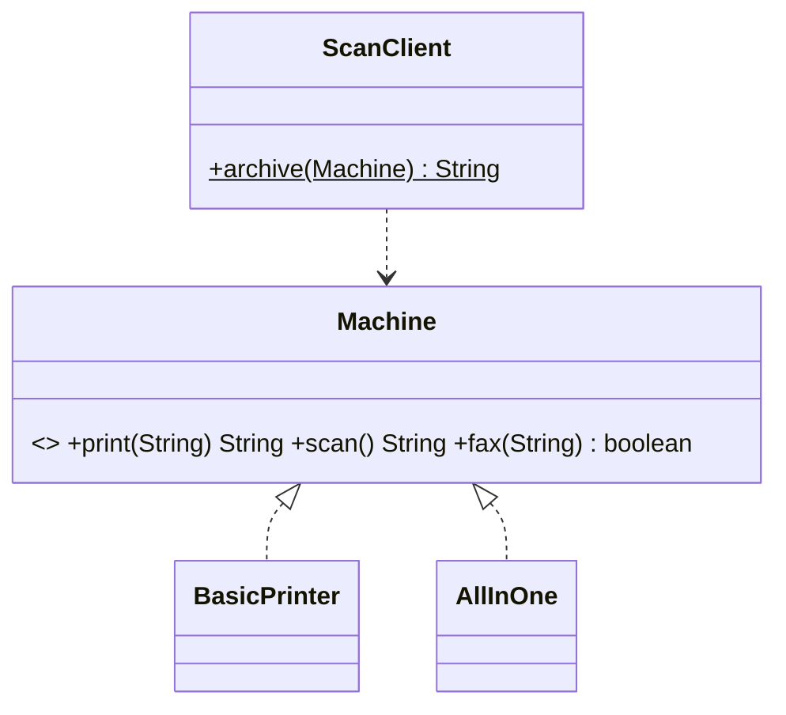
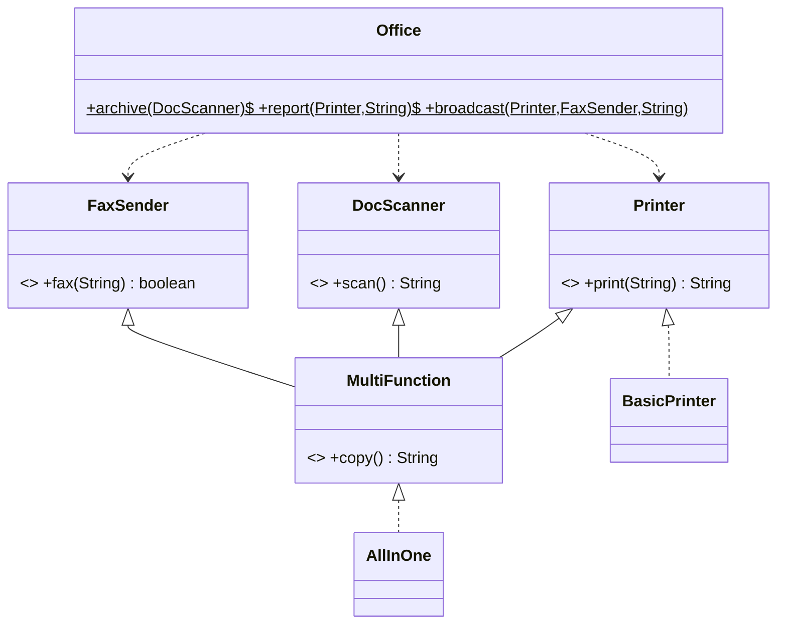

# Chapter 24 — Interface Segregation Principle

## What and why

**ISP:** no client should be forced to depend on methods it does not use. Prefer several small, role-based interfaces to one wide interface. Papers ask for the definition (2 marks), "split this interface" (5 marks), and the compile errors that appear when an implementer lacks a method (3–5 marks).

## Exam flash rules

- ISP: clients should not depend on methods they do not use.
- A "fat" interface forces every implementer to supply every method.
- Symptoms: `throw new UnsupportedOperationException()`, empty method bodies, methods returning dummy values.
- A silent no-op (`return false`) is worse than an exception: nobody learns the call did nothing.
- Fix: split by **client role**, not by implementer; combine roles with `extends` or an intersection bound `<T extends A & B>`.
- Client code names the narrowest role it uses; passing the wrong device then fails at **compile time**.
- Adding a method to a wide interface breaks every implementer at compile time.
- A one-method interface is a functional interface: a lambda can implement it, which makes tests short.
- A class may implement many interfaces; it may extend only one class.
- Default methods do not fix a fat interface: they hide the unsupported operation inside the interface.
- Two interfaces with the same default method force the class to override and choose with `X.super.m()`.
- ISP is about the *interface a client sees*; SRP is about the *reasons a class changes*.
- Do not split further than clients differ: one interface per method is rarely useful.

## Rules table

| Case | Result | Compiler message |
|------|--------|------------------|
| `Office.archive(new BasicPrinter())` after the split | fails | `BasicPrinter cannot be converted to DocScanner` |
| Class omits a method of a fat interface | fails | `is not abstract and does not override abstract method fax(String)` |
| Implementation with package-private access | fails | `attempting to assign weaker access privileges; was public` |
| Two unrelated defaults with the same signature | fails | `class Both inherits unrelated defaults for hi() from types Left and Right` |
| Lambda for a multi-method interface | fails | `Machine is not a functional interface` |
| `AllInOne` passed where `Printer`, `DocScanner` or `FaxSender` is expected | compiles | — |

## Violating code

```java
{{#include ../../code/part-02-solid/src/main/java/solid/isp/before/Machine.java:machine}}
```

```java
{{#include ../../code/part-02-solid/src/main/java/solid/isp/before/BasicPrinter.java:basic-printer}}
```

```java
{{#include ../../code/part-02-solid/src/main/java/solid/isp/before/AllInOne.java:all-in-one}}
```

```java
{{#include ../../code/part-02-solid/src/main/java/solid/isp/before/ScanClient.java:scan-client}}
```

## Real-world failure

A basic printer was added to a system built around a three-function `Machine` interface. It stubbed `scan()` with an exception and `fax()` with `false`. The nightly "archive" job accepted any `Machine`, so it compiled for the printer and failed at 2 a.m. The fax stub never failed at all: callers saw `false` and moved on.

```java
{{#include ../../code/part-02-solid/src/main/java/solid/isp/before/IspFailureDemo.java:isp-failure}}
```

```text
{{#include ../../code/part-02-solid/out/run/IspFailureDemo.txt}}
```

## Stepwise refactor

### Step 1 — one interface per role

```java
{{#include ../../code/part-02-solid/src/main/java/solid/isp/step1/Step1Roles.java:step1}}
```

### Step 2 — clients name the narrowest role

```java
{{#include ../../code/part-02-solid/src/main/java/solid/isp/step2/Step2Clients.java:step2}}
```

```java
{{#include ../../code/part-02-solid/src/main/java/solid/isp/step2/IspStepsDemo.java:isp-steps}}
```

```text
{{#include ../../code/part-02-solid/out/run/IspStepsDemo.txt}}
```

The commented-out call is the point: the 2 a.m. failure is now a compile error (see C1 below).

### Step 3 — top-level roles and a combined role

```java
{{#include ../../code/part-02-solid/src/main/java/solid/isp/after/Printer.java:printer}}
```

```java
{{#include ../../code/part-02-solid/src/main/java/solid/isp/after/DocScanner.java:doc-scanner}}
```

```java
{{#include ../../code/part-02-solid/src/main/java/solid/isp/after/FaxSender.java:fax-sender}}
```

```java
{{#include ../../code/part-02-solid/src/main/java/solid/isp/after/MultiFunction.java:multi-function}}
```

```java
{{#include ../../code/part-02-solid/src/main/java/solid/isp/after/BasicPrinter.java:basic-printer}}
```

```java
{{#include ../../code/part-02-solid/src/main/java/solid/isp/after/AllInOne.java:all-in-one}}
```

```java
{{#include ../../code/part-02-solid/src/main/java/solid/isp/after/Office.java:office}}
```

```java
{{#include ../../code/part-02-solid/src/main/java/solid/isp/after/IspAfterDemo.java:isp-after}}
```

```text
{{#include ../../code/part-02-solid/out/run/IspAfterDemo.txt}}
```

## Tests that prove the benefit

```java
{{#include ../../code/part-02-solid/src/test/java/solid/isp/IspTest.java}}
```

| Test | What it proves |
|------|----------------|
| `fatInterfaceMakesAPrinterFailAtRuntime` | the old design fails late and silently |
| `roleInterfacesDocumentWhatADeviceCanDo` | the type says what a device can do |
| `aClientTestNeedsOnlyALambda` | a one-method role needs no fake class |
| `combinedRoleKeepsTheSmallOnes` | `MultiFunction` is built from the small roles |

## Predict the output

**P1.** `PredictBasicPrinterBefore`

```java
{{#include ../../code/part-02-solid/src/main/java/solid/isp/exam/PredictBasicPrinterBefore.java:predict-basic-printer}}
```

<details><summary>Answer</summary>

```text
{{#include ../../code/part-02-solid/out/run/PredictBasicPrinterBefore.txt}}
```

`fax` returns `false` without complaint; `scan` throws and is caught; execution continues.

</details>

**P2.** `PredictLambdaScanner`

```java
{{#include ../../code/part-02-solid/src/main/java/solid/isp/exam/PredictLambdaScanner.java:predict-lambda-scanner}}
```

<details><summary>Answer</summary>

```text
{{#include ../../code/part-02-solid/out/run/PredictLambdaScanner.txt}}
```

The lambda `s` is invoked twice (counter `2`); the second lambda is a different object.

</details>

**P3.** `PredictRoleProbe`

```java
{{#include ../../code/part-02-solid/src/main/java/solid/isp/exam/PredictRoleProbe.java:predict-role-probe}}
```

<details><summary>Answer</summary>

```text
{{#include ../../code/part-02-solid/out/run/PredictRoleProbe.txt}}
```

`MultiFunction` directly extends three interfaces.

</details>

**P4.** `PredictDefaultCopy`

```java
{{#include ../../code/part-02-solid/src/main/java/solid/isp/exam/PredictDefaultCopy.java:predict-default-copy}}
```

<details><summary>Answer</summary>

```text
{{#include ../../code/part-02-solid/out/run/PredictDefaultCopy.txt}}
```

`copy()` is `print(scan())` = `[scan]`. `fax("")` is `true`; `fax("[scan]")` is `false`.

</details>

**P5.** `PredictDiamondDefault`

```java
{{#include ../../code/part-02-solid/src/main/java/solid/isp/exam/PredictDiamondDefault.java:predict-diamond}}
```

<details><summary>Answer</summary>

```text
{{#include ../../code/part-02-solid/out/run/PredictDiamondDefault.txt}}
```

`Left.super.hi() + Right.super.hi()` is `"LR"`. The call through a `Right` reference still runs `Both.hi()`.

</details>

**P6.** `PredictIntersection`

```java
{{#include ../../code/part-02-solid/src/main/java/solid/isp/exam/PredictIntersection.java:predict-intersection}}
```

<details><summary>Answer</summary>

```text
{{#include ../../code/part-02-solid/out/run/PredictIntersection.txt}}
```

</details>

## Compile or not?

**C1.** Pass a `BasicPrinter` to the scanning client. Fails.

```java
{{#include ../../code/part-02-solid/broken/IspPassPrinterBroken.java}}
```

```text
{{#include ../../code/part-02-solid/out/broken/IspPassPrinterBroken.txt}}
```

**C2.** Implement `Machine` with only `print` and `scan`. Fails.

```java
{{#include ../../code/part-02-solid/broken/IspWideInterfaceBroken.java}}
```

```text
{{#include ../../code/part-02-solid/out/broken/IspWideInterfaceBroken.txt}}
```

**C3.** Implement `Printer.print` without `public`. Fails.

```java
{{#include ../../code/part-02-solid/broken/IspWeakerAccessBroken.java}}
```

```text
{{#include ../../code/part-02-solid/out/broken/IspWeakerAccessBroken.txt}}
```

**C4.** Implement two interfaces with the same default method, no override. Fails.

```java
{{#include ../../code/part-02-solid/broken/IspDefaultConflictBroken.java}}
```

```text
{{#include ../../code/part-02-solid/out/broken/IspDefaultConflictBroken.txt}}
```

**C5.** Lambda for the three-method `Machine`. Fails.

```java
{{#include ../../code/part-02-solid/broken/IspLambdaFatBroken.java}}
```

```text
{{#include ../../code/part-02-solid/out/broken/IspLambdaFatBroken.txt}}
```

**C6.** Compiles: one object assigned to three role types.

```java
{{#include ../../code/part-02-solid/src/main/java/solid/isp/exam/CompileAllInOneAnyRoleOk.java:compile-ok-roles}}
```

```text
{{#include ../../code/part-02-solid/out/run/CompileAllInOneAnyRoleOk.txt}}
```

## Gotchas

```java
{{#include ../../code/part-02-solid/src/main/java/solid/isp/gotchas/IspGotchas.java:g2-default}}
```

```java
{{#include ../../code/part-02-solid/src/main/java/solid/isp/gotchas/IspGotchas.java:g3-too-fine}}
```

```java
{{#include ../../code/part-02-solid/src/main/java/solid/isp/gotchas/IspGotchas.java:g4-probe}}
```

```java
{{#include ../../code/part-02-solid/src/main/java/solid/isp/gotchas/IspGotchas.java:g5-intersection}}
```

```java
{{#include ../../code/part-02-solid/src/main/java/solid/isp/gotchas/IspGotchas.java:g-main}}
```

```text
{{#include ../../code/part-02-solid/out/run/IspGotchas.txt}}
```

1. **G1** — A stub that returns `false` hides the problem: the old `BasicPrinter.fax` "succeeds".
2. **G2** — A default method that throws does not segregate anything; callers still fail at runtime.
3. **G3** — Splitting too finely (`HasId`, `HasName`) forces intersection types in every client that needs both.
4. **G4** — Probing roles with `instanceof` inside a method that takes `Object` removes the type's documentation value.
5. **G5** — Require several roles at once with `<T extends Printer & DocScanner>`, not a new fat interface.

## UML

Before:



After:



## Short answers (marks trail)

| Marks | Prompt | Answer |
|-------|--------|--------|
| 2 | State ISP | Clients should not be forced to depend on methods they do not use. |
| 2 | Name two symptoms | `UnsupportedOperationException` stubs; empty or dummy-returning method bodies. |
| 5 | Why is the silent `fax` stub worse than the throwing `scan` stub? | The caller gets a normal-looking result for an operation that did nothing. |
| 5 | How does the split change the failure mode? | Runtime exception becomes a compile error (`IspPassPrinterBroken`). |
| 10 | Split `Machine` | Three role interfaces, a combined role, narrowest client parameters, UML. |

## Interview Q&A

1. **Q:** State ISP. **A:** Many small client-specific interfaces beat one general-purpose interface.
2. **Q:** What smell shows a violation? **A:** Stubs that throw or do nothing (`BasicPrinter`).
3. **Q:** Why is `return false` in a stub dangerous? **A:** It looks like a legitimate "failed" result and is ignored (`IspFailureDemo`).
4. **Q:** What changes when a method is added to a fat interface? **A:** Every implementer fails to compile (`IspWideInterfaceBroken`).
5. **Q:** How do roles help tests? **A:** A one-method role is implemented by a lambda (`aClientTestNeedsOnlyALambda`).
6. **Q:** How do you require two roles in one parameter? **A:** An intersection bound `<T extends Printer & DocScanner>` (`PredictIntersection`).
7. **Q:** What does `MultiFunction` add? **A:** A combined role with a default `copy()` built from the small roles.
8. **Q:** Do default methods solve a fat interface? **A:** No; a throwing default only moves the stub (`G2`).
9. **Q:** What happens if two interfaces give the same default? **A:** The class must override and may call `Left.super.hi()` (`PredictDiamondDefault`).
10. **Q:** Is ISP about classes or interfaces? **A:** The interface a client sees; implementers just implement what they have.
11. **Q:** How is ISP linked to LSP? **A:** A stub that throws breaks substitutability; ISP removes the need for the stub.
12. **Q:** Name a JDK example of small role interfaces. **A:** `Runnable`, `Comparable`, `Closeable`, `Iterable`: one capability each.

## Exam writing prompts

1. (5) Split `interface Worker { void work(); void eat(); }` so a `Robot` implements only what it does.
2. (5) Rewrite `void report(Machine m)` to accept the narrowest type and give the call that now fails to compile.
3. (2) Write a lambda that implements a one-method `DocScanner` returning `"page"`.

## Exercises

Solutions are in `code/part-02-solid/solutions/ch24/`.

1. Split `Worker { work(); eat(); }` — `SolutionSplitWorker.java`.
2. Give a reporting job the read role of a repository only — `SolutionReadWriteRepo.java`.
3. Require two roles with an intersection bound — `SolutionCombinedRole.java`.
4. Test a client with a counting lambda — `SolutionLambdaRole.java`.
5. Write a combined role with a default method built from small roles — `SolutionDefaultComposition.java`.

## Recap checklist

- [x] Violating fat interface — `before/Machine.java`
- [x] Real failure with output — `IspFailureDemo`
- [x] Stepwise refactor — `step1`, `step2`, `after/`
- [x] Tests — `IspTest`
- [x] UML before/after
- [x] Exam banks: predict (6), compile (5 fail + 1 pass), writing (3), exercises (5)
