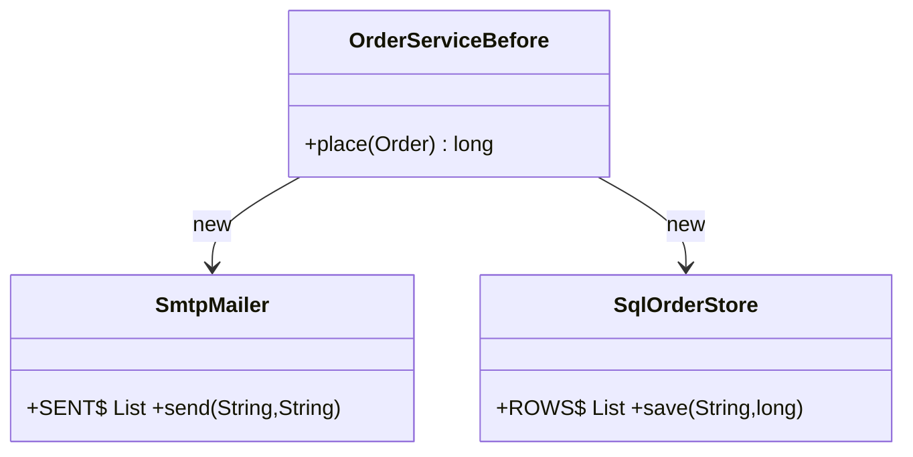
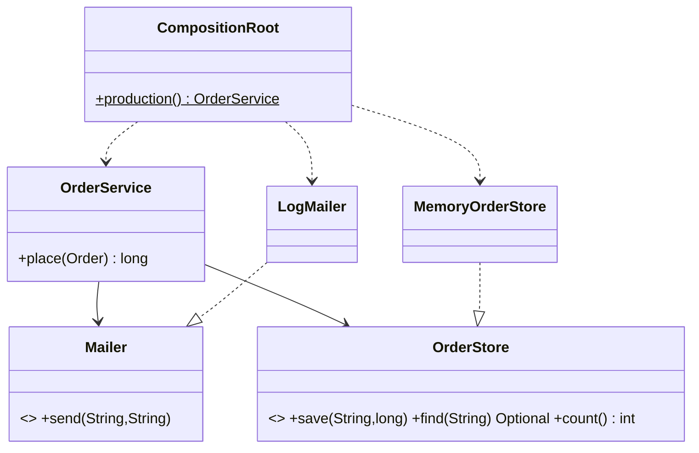

# Chapter 25 — Dependency Inversion Principle

## What and why

**DIP:** high-level policy must not depend on low-level detail; **both depend on abstractions**. Abstractions must not depend on details; details depend on abstractions. Papers ask for the definition (2 marks), "refactor this class that calls `new`" (5–10 marks), and DIP vs DI vs IoC (3 marks).

## Exam flash rules

- DIP: high-level modules do not depend on low-level modules; both depend on abstractions.
- Abstractions are owned by the **high-level** side (the interface lives with the policy, not with the library).
- `new ConcreteClass()` inside business logic is the usual violation.
- **DIP** is a design principle. **Dependency injection (DI)** is a technique (pass collaborators in). **IoC container** is a tool that automates DI. DI without an abstraction is not DIP.
- Constructor injection makes dependencies visible and lets `final` fields be set once.
- Hidden dependencies: `new`, `static` singletons, `LocalDate.now()`, `System.currentTimeMillis()`, service locators.
- Inject `java.time.Clock` instead of calling `now()`.
- The **composition root** is the one place that builds the object graph with `new`.
- Code typed against an interface cannot use members that only an implementation has.
- A lambda can implement a one-method interface, which makes fakes one line long.
- Do not create an interface for every class: invert at boundaries that vary (I/O, time, network, storage).
- Global/static state shared by "independent" instances makes tests order-dependent.

## Rules table

| Case | Result | Compiler message |
|------|--------|------------------|
| `new Mailer()` on an interface | fails | `Mailer is abstract; cannot be instantiated` |
| Using an implementation-only member through the interface | fails | `cannot find symbol` |
| Passing collaborators in the wrong order | fails | `MemoryOrderStore cannot be converted to Mailer` |
| `final` collaborator not assigned in the constructor | fails | `variable mailer might not have been initialized` |
| Lambda with the wrong number of parameters | fails | `incompatible parameter types in lambda expression` |
| Lambda with `(to, body)` for `Mailer` | compiles | — |

## Violating code

```java
{{#include ../../code/part-02-solid/src/main/java/solid/dip/model/Order.java:order}}
```

```java
{{#include ../../code/part-02-solid/src/main/java/solid/dip/before/SmtpMailer.java:smtp-mailer}}
```

```java
{{#include ../../code/part-02-solid/src/main/java/solid/dip/before/SqlOrderStore.java:sql-store}}
```

```java
{{#include ../../code/part-02-solid/src/main/java/solid/dip/before/OrderServiceBefore.java:order-service-before}}
```

The policy (weekend surcharge, store, notify) constructs its own store and mailer and reads the real clock.

## Real-world failure

Order tests created a fresh service per test, yet every test saw mails and rows from earlier tests, because the "mailer" and "store" were JVM-wide. The weekend surcharge depended on the day the suite ran, so the same test passed Tuesday and failed Saturday. Tests could not run in parallel or in any order.

```java
{{#include ../../code/part-02-solid/src/main/java/solid/dip/before/DipFailureDemo.java:dip-failure}}
```

```text
{{#include ../../code/part-02-solid/out/run/DipFailureDemo.txt}}
```

"Test two" built a new `OrderServiceBefore` and still saw `mails=2`.

## Stepwise refactor

### Step 1 — depend on abstractions (the domain owns them)

```java
{{#include ../../code/part-02-solid/src/main/java/solid/dip/after/domain/Mailer.java:mailer}}
```

```java
{{#include ../../code/part-02-solid/src/main/java/solid/dip/after/domain/OrderStore.java:order-store}}
```

```java
{{#include ../../code/part-02-solid/src/main/java/solid/dip/step1/OrderServiceStep1.java:step1}}
```

The fields are abstractions, but the class still picks the implementations: a test cannot replace them.

### Step 2 — constructor injection

```java
{{#include ../../code/part-02-solid/src/main/java/solid/dip/step2/OrderServiceStep2.java:step2}}
```

### Step 3 — details depend on the domain; a composition root wires them

```java
{{#include ../../code/part-02-solid/src/main/java/solid/dip/after/domain/OrderService.java:order-service}}
```

```java
{{#include ../../code/part-02-solid/src/main/java/solid/dip/after/infra/LogMailer.java:log-mailer}}
```

```java
{{#include ../../code/part-02-solid/src/main/java/solid/dip/after/infra/MemoryOrderStore.java:memory-store}}
```

```java
{{#include ../../code/part-02-solid/src/main/java/solid/dip/after/CompositionRoot.java:composition-root}}
```

```java
{{#include ../../code/part-02-solid/src/main/java/solid/dip/after/DipAfterDemo.java:dip-after}}
```

```text
{{#include ../../code/part-02-solid/out/run/DipAfterDemo.txt}}
```

Saturday and Monday are now both testable on any day: `10 500` and `10 000`.

| Term | Meaning | In this chapter |
|------|---------|-----------------|
| DIP | policy and detail both depend on an abstraction owned by the policy | `Mailer`, `OrderStore` in `domain` |
| DI | collaborators are passed in | `OrderService` constructor |
| IoC container | a framework that does the passing | not used; `CompositionRoot` does it by hand |

## Tests that prove the benefit

```java
{{#include ../../code/part-02-solid/src/test/java/solid/dip/DipTest.java}}
```

| Test | What it proves |
|------|----------------|
| `beforeLeaksSideEffectsAcrossInstances` | static collaborators leak between instances |
| `clockMakesTheWeekendSurchargeDeterministic` | injected `Clock` pins the day |
| `fakesIsolateEveryTest` | a fresh fake per test |
| `failurePathIsTestableWithALambda` | an outage is simulated with a one-line lambda |
| `highLevelClassOnlyHoldsAbstractions` | reflection check: every field type is abstract |

## Predict the output

**P1.** `PredictGlobalLeak`

```java
{{#include ../../code/part-02-solid/src/main/java/solid/dip/exam/PredictGlobalLeak.java:predict-global-leak}}
```

<details><summary>Answer</summary>

```text
{{#include ../../code/part-02-solid/out/run/PredictGlobalLeak.txt}}
```

The list is `static`: three `place` calls from two different instances add up to `3`.

</details>

**P2.** `PredictSeparateStores`

```java
{{#include ../../code/part-02-solid/src/main/java/solid/dip/exam/PredictSeparateStores.java:predict-separate-stores}}
```

<details><summary>Answer</summary>

```text
{{#include ../../code/part-02-solid/out/run/PredictSeparateStores.txt}}
```

Each service has its own mailer and store. `s2` never saw order `B`.

</details>

**P3.** `PredictFixedClock`

```java
{{#include ../../code/part-02-solid/src/main/java/solid/dip/exam/PredictFixedClock.java:predict-fixed-clock}}
```

<details><summary>Answer</summary>

```text
{{#include ../../code/part-02-solid/out/run/PredictFixedClock.txt}}
```

Weekend adds 5% with integer division: `10000×105/100 = 10500`; `999×105/100 = 1048`. Monday: no surcharge.

</details>

**P4.** `PredictCallOrder`

```java
{{#include ../../code/part-02-solid/src/main/java/solid/dip/exam/PredictCallOrder.java:predict-call-order}}
```

<details><summary>Answer</summary>

```text
{{#include ../../code/part-02-solid/out/run/PredictCallOrder.txt}}
```

`place` saves first, then mails.

</details>

**P5.** `PredictFailingMailer`

```java
{{#include ../../code/part-02-solid/src/main/java/solid/dip/exam/PredictFailingMailer.java:predict-failing-mailer}}
```

<details><summary>Answer</summary>

```text
{{#include ../../code/part-02-solid/out/run/PredictFailingMailer.txt}}
```

The order was stored before the mailer threw. A design question surfaced by a one-line fake.

</details>

## Compile or not?

**C1.** `new Mailer()`. Fails.

```java
{{#include ../../code/part-02-solid/broken/DipNewInterfaceBroken.java}}
```

```text
{{#include ../../code/part-02-solid/out/broken/DipNewInterfaceBroken.txt}}
```

**C2.** Use `sent` through a `Mailer` reference. Fails.

```java
{{#include ../../code/part-02-solid/broken/DipLeakyAbstractionBroken.java}}
```

```text
{{#include ../../code/part-02-solid/out/broken/DipLeakyAbstractionBroken.txt}}
```

**C3.** Swap the first two constructor arguments. Fails.

```java
{{#include ../../code/part-02-solid/broken/DipArgOrderBroken.java}}
```

```text
{{#include ../../code/part-02-solid/out/broken/DipArgOrderBroken.txt}}
```

**C4.** Forget to assign the `final` collaborator. Fails.

```java
{{#include ../../code/part-02-solid/broken/DipFinalFieldBroken.java}}
```

```text
{{#include ../../code/part-02-solid/out/broken/DipFinalFieldBroken.txt}}
```

**C5.** One-parameter lambda for a two-parameter method. Fails.

```java
{{#include ../../code/part-02-solid/broken/DipLambdaArityBroken.java}}
```

```text
{{#include ../../code/part-02-solid/out/broken/DipLambdaArityBroken.txt}}
```

**C6.** Compiles: a lambda as the mailer.

```java
{{#include ../../code/part-02-solid/src/main/java/solid/dip/exam/CompileLambdaMailerOk.java:compile-ok-lambda}}
```

```text
{{#include ../../code/part-02-solid/out/run/CompileLambdaMailerOk.txt}}
```

## Gotchas

```java
{{#include ../../code/part-02-solid/src/main/java/solid/dip/gotchas/DipGotchas.java:g1-di-without-dip}}
```

```java
{{#include ../../code/part-02-solid/src/main/java/solid/dip/gotchas/DipGotchas.java:g2-single-impl}}
```

```java
{{#include ../../code/part-02-solid/src/main/java/solid/dip/gotchas/DipGotchas.java:g3-locator}}
```

```java
{{#include ../../code/part-02-solid/src/main/java/solid/dip/gotchas/DipGotchas.java:g4-default-ctor}}
```

```java
{{#include ../../code/part-02-solid/src/main/java/solid/dip/gotchas/DipGotchas.java:g5-clock}}
```

```java
{{#include ../../code/part-02-solid/src/main/java/solid/dip/gotchas/DipGotchas.java:g-main}}
```

```text
{{#include ../../code/part-02-solid/out/run/DipGotchas.txt}}
```

1. **G1** — Injection without inversion: the parameter type is `LogMailer`, so only that class fits.
2. **G2** — `Calculator`/`CalculatorImpl`: an interface with one implementation and nothing that varies adds nothing.
3. **G3** — A service locator: the constructor has `0` parameters, and a missing registration fails late with `NullPointerException`.
4. **G4** — A convenience constructor `this(new LogMailer())` puts the hard-wiring back for everyone who uses it.
5. **G5** — `LocalDate.now()` reads the world; pass a `Clock` (`30` days with the fixed clock).

## UML

Before:



After:



The arrows from `LogMailer` and `MemoryOrderStore` point **at** the domain interfaces: the dependency has been inverted.

## Short answers (marks trail)

| Marks | Prompt | Answer |
|-------|--------|--------|
| 2 | State DIP | High-level and low-level modules should both depend on abstractions, not on each other. |
| 3 | DIP vs DI vs IoC | Principle; technique of passing collaborators; framework that automates it. |
| 5 | Name three hidden dependencies | `new` of a concrete class, `static` global state, the system clock. |
| 5 | Why did the weekday break a test? | `LocalDate.now()` was read inside the policy. |
| 10 | Refactor `OrderServiceBefore` | Steps 1–3 with UML, plus a fake-based test. |

## Interview Q&A

1. **Q:** State DIP. **A:** Policy depends on an abstraction it owns; details implement it.
2. **Q:** Is DI the same as DIP? **A:** No. DI is a technique; `ConcreteInjected` injects but does not invert.
3. **Q:** Who should own the interface? **A:** The high-level module (`Mailer` is in `domain`, `LogMailer` in `infra`).
4. **Q:** Why inject a `Clock`? **A:** To make time deterministic (`PredictFixedClock`).
5. **Q:** What does constructor injection give over setters? **A:** Required collaborators, `final` fields, no half-built objects.
6. **Q:** What is a composition root? **A:** The single place that constructs the object graph (`CompositionRoot`).
7. **Q:** Why is a service locator a smell? **A:** Dependencies are invisible (`0` constructor parameters) and failures are late.
8. **Q:** Do you need an interface for every class? **A:** No; invert at boundaries that vary or are slow or impure.
9. **Q:** How do you fake a one-method interface? **A:** A lambda (`PredictFailingMailer`).
10. **Q:** What did `PredictGlobalLeak` show? **A:** `static` collaborators leak side effects between instances.
11. **Q:** How does DIP relate to OCP? **A:** Depending on abstractions is what lets you add implementations without editing the policy.
12. **Q:** Does DIP require a framework? **A:** No. Plain constructors and one root are enough.

## Exam writing prompts

1. (5) Rewrite `class Report { void run() { new FileStore().save(...); } }` so `Report` depends on an interface; write the interface, the constructor, and the one `new` line.
2. (5) Write a lambda-based fake `Mailer` that records the last body and a statement that asserts it.
3. (2) Difference between DIP and DI in one sentence each.

## Exercises

Solutions are in `code/part-02-solid/solutions/ch25/`.

1. Make a greeting deterministic by injecting a `Clock` — `SolutionInjectClock.java`.
2. Write a store that always fails to test the error path — `SolutionFailingStore.java`.
3. Write one composition root that wires "prod" and "test" differently — `SolutionRootByMode.java`.
4. Let the domain own the interface it needs — `SolutionOwnedInterface.java`.
5. Inject a `Supplier` when a fresh collaborator is needed per call — `SolutionSupplierInjection.java`.

## Recap checklist

- [x] Violating code — `before/OrderServiceBefore.java`
- [x] Real failure with output — `DipFailureDemo`
- [x] Stepwise refactor — `step1`, `step2`, `after/`
- [x] Tests — `DipTest`
- [x] UML before/after
- [x] Exam banks: predict (5), compile (5 fail + 1 pass), writing (3), exercises (5)
