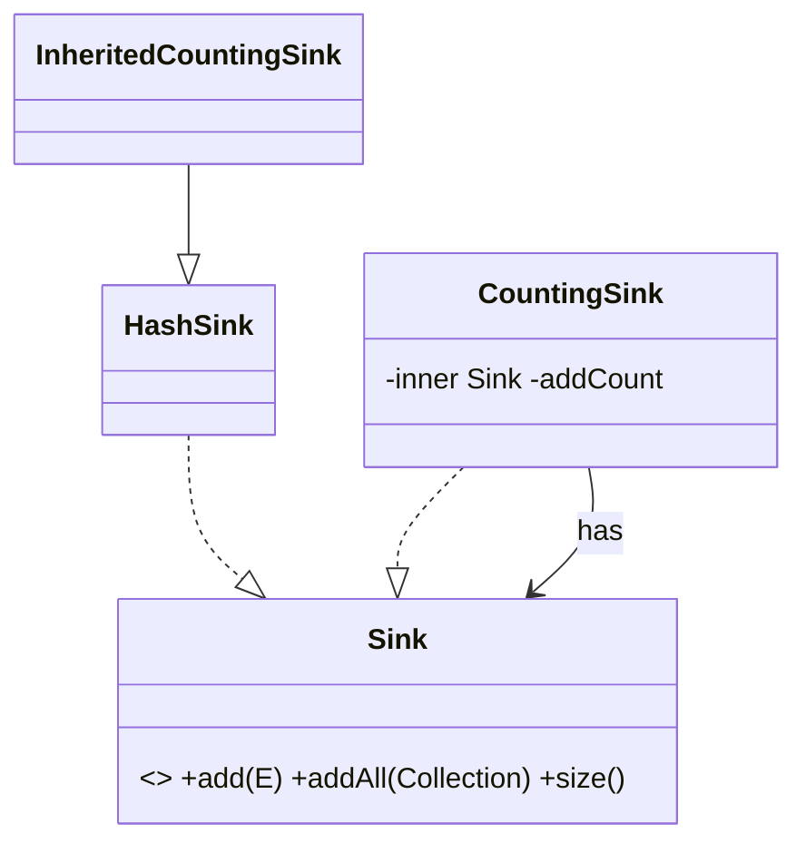

# Chapter 26 — Other principles

## What and why

SOLID is not the whole design vocabulary. Papers still ask for **DRY**, **KISS**, **YAGNI**, the **Law of Demeter**, **composition over inheritance**, **Tell, Don't Ask**, and **cohesion vs coupling**. They also ask when *not* to apply SOLID. This chapter is that strip: definitions, traps with real output, and predict/compile banks.

## Exam flash rules

- **DRY:** every piece of knowledge has a single, authoritative representation. Copy-paste that later diverges is the usual failure (`PredictDryDivergence`).
- Coincidence is not duplication: two constants that happen to be `100` today may change for different reasons — do not merge them.
- **KISS:** prefer the straightforward design that a teammate can change. Clever one-liners that hide grade bands fail the oral.
- **YAGNI:** do not build the speculative feature (plug-in leap-year calendars, multi-currency before day one).
- **Law of Demeter:** talk only to friends (self, fields, parameters, objects you create) — not `a.b().c().d()`.
- Demeter fixes often hide nulls: push the navigation into the friend (`shippingCity()`) so clients cannot NPE on a missing address.
- **Composition over inheritance:** inherit for *is-a* and shared contracts; compose for *has-a* and reusable behaviour.
- Extending `HashSet` / `Stack`/`Vector` breaks counting and stack contracts (`PredictInheritedCount`, `PredictStackIsAVector`).
- **Tell, Don't Ask:** tell the object to do the work; do not pull fields out and decide outside (`Wallet.withdraw` vs reading `balance`).
- **Cohesion:** a module's parts belong together. **Coupling:** how much one module knows about another. Prefer high cohesion, low coupling.
- Over-applying SOLID produces factories of factories for a greeting that never changed (`NotSolidDemo`).
- Wrong DRY merges two rules that change for different reasons into one flag-driven method.

## Rules table

| Case | Result | Compiler message |
|------|--------|------------------|
| Two methods with the same erasure `valid(String)` | fails | `method valid(String) is already defined in class …` |
| Reading `Order.customer` when the field is private | fails | `customer has private access in Order` |
| `class X extends String` | fails | `cannot inherit from final String` |
| Parameter typed `ArrayList` but caller passes `List.of(…)` | fails | `no instance(s) of type variable(s) E exist so that List<E> conforms to ArrayList<Integer>` |
| Implement `Sink` without `size()` | fails | `… is not abstract and does not override abstract method size() in Sink` |
| Assign `wallet.balance` from outside | fails | `balance has private access in Wallet` |
| Delegation wrapper that implements `Sink` | compiles | — (`CompileDelegationOk`) |

## Walkthrough

### DRY — one rule, one place

```java
{{#include ../../code/part-02-solid/src/main/java/solid/principles/dry/DryDemo.java:dry-before}}
```

```java
{{#include ../../code/part-02-solid/src/main/java/solid/principles/dry/DryDemo.java:dry-after}}
```

```java
{{#include ../../code/part-02-solid/src/main/java/solid/principles/dry/DryDemo.java:dry-main}}
```

```text
{{#include ../../code/part-02-solid/out/run/DryDemo.txt}}
```

`a@b` is valid for registration in `Before` and rejected after the shared rule requires a dot.

### KISS and YAGNI

```java
{{#include ../../code/part-02-solid/src/main/java/solid/principles/kiss/KissDemo.java:kiss-main}}
```

```text
{{#include ../../code/part-02-solid/out/run/KissDemo.txt}}
```

```java
{{#include ../../code/part-02-solid/src/main/java/solid/principles/yagni/YagniDemo.java:yagni-main}}
```

```text
{{#include ../../code/part-02-solid/out/run/YagniDemo.txt}}
```

### Law of Demeter

```java
{{#include ../../code/part-02-solid/src/main/java/solid/principles/demeter/DemeterDemo.java:demeter-before}}
```

```java
{{#include ../../code/part-02-solid/src/main/java/solid/principles/demeter/DemeterDemo.java:demeter-after}}
```

```text
{{#include ../../code/part-02-solid/out/run/DemeterDemo.txt}}
```

`labelBefore` NPEs when `address` is null; `labelAfter` returns a safe default from `Order`.

### Composition over inheritance

```java
{{#include ../../code/part-02-solid/src/main/java/solid/principles/composition/CompositionDemo.java:composition-demo}}
```

```text
{{#include ../../code/part-02-solid/out/run/CompositionDemo.txt}}
```

`addAll` on an inheriting counter double-counts (`6`); a wrapper that forwards once counts `3`.

### Tell, Don't Ask

```java
{{#include ../../code/part-02-solid/src/main/java/solid/principles/tda/TellDontAskDemo.java:tda-main}}
```

```text
{{#include ../../code/part-02-solid/out/run/TellDontAskDemo.txt}}
```

### Cohesion / coupling and when not to apply SOLID

```java
{{#include ../../code/part-02-solid/src/main/java/solid/principles/cohesion/CohesionDemo.java:cohesion-main}}
```

```text
{{#include ../../code/part-02-solid/out/run/CohesionDemo.txt}}
```

```java
{{#include ../../code/part-02-solid/src/main/java/solid/principles/notsolid/NotSolidDemo.java:over-engineered}}
```

```java
{{#include ../../code/part-02-solid/src/main/java/solid/principles/notsolid/NotSolidDemo.java:wrong-dry}}
```

```text
{{#include ../../code/part-02-solid/out/run/NotSolidDemo.txt}}
```

## Predict the output

### 1 — DRY divergence

```java
{{#include ../../code/part-02-solid/src/main/java/solid/principles/exam/PredictDryDivergence.java:predict-dry-divergence}}
```

```text
{{#include ../../code/part-02-solid/out/run/PredictDryDivergence.txt}}
```

### 2 — YAGNI leap years

```java
{{#include ../../code/part-02-solid/src/main/java/solid/principles/exam/PredictLeapYears.java:predict-leap-years}}
```

```text
{{#include ../../code/part-02-solid/out/run/PredictLeapYears.txt}}
```

### 3 — Tell Don't Ask wallet

```java
{{#include ../../code/part-02-solid/src/main/java/solid/principles/exam/PredictWalletRules.java:predict-wallet-rules}}
```

```text
{{#include ../../code/part-02-solid/out/run/PredictWalletRules.txt}}
```

### 4 — Demeter null

```java
{{#include ../../code/part-02-solid/src/main/java/solid/principles/exam/PredictDemeterNull.java:predict-demeter-null}}
```

```text
{{#include ../../code/part-02-solid/out/run/PredictDemeterNull.txt}}
```

### 5 — Wrapper vs inheritance count

```java
{{#include ../../code/part-02-solid/src/main/java/solid/principles/exam/PredictWrapperCount.java:predict-wrapper-count}}
```

```text
{{#include ../../code/part-02-solid/out/run/PredictWrapperCount.txt}}
```

### 6 — Inherited HashSet trap

```java
{{#include ../../code/part-02-solid/src/main/java/solid/principles/exam/PredictInheritedCount.java:predict-inherited-count}}
```

```text
{{#include ../../code/part-02-solid/out/run/PredictInheritedCount.txt}}
```

### 7 — Stack is a Vector

```java
{{#include ../../code/part-02-solid/src/main/java/solid/principles/exam/PredictStackIsAVector.java:predict-stack}}
```

```text
{{#include ../../code/part-02-solid/out/run/PredictStackIsAVector.txt}}
```

## Compile or not?

### Fail — duplicate method after "DRY rename"

```java
{{#include ../../code/part-02-solid/broken/PrinDuplicateMethodBroken.java}}
```

```text
{{#include ../../code/part-02-solid/out/broken/PrinDuplicateMethodBroken.txt}}
```

### Fail — Demeter through a private field

```java
{{#include ../../code/part-02-solid/broken/PrinDemeterPrivateBroken.java}}
```

```text
{{#include ../../code/part-02-solid/out/broken/PrinDemeterPrivateBroken.txt}}
```

### Fail — extend `final String`

```java
{{#include ../../code/part-02-solid/broken/PrinFinalStringBroken.java}}
```

```text
{{#include ../../code/part-02-solid/out/broken/PrinFinalStringBroken.txt}}
```

### Fail — concrete `ArrayList` parameter

```java
{{#include ../../code/part-02-solid/broken/PrinConcreteParamBroken.java}}
```

```text
{{#include ../../code/part-02-solid/out/broken/PrinConcreteParamBroken.txt}}
```

### Fail — incomplete `Sink`

```java
{{#include ../../code/part-02-solid/broken/PrinSinkIncompleteBroken.java}}
```

```text
{{#include ../../code/part-02-solid/out/broken/PrinSinkIncompleteBroken.txt}}
```

### Fail — mutate private wallet field

```java
{{#include ../../code/part-02-solid/broken/PrinWalletFieldBroken.java}}
```

```text
{{#include ../../code/part-02-solid/out/broken/PrinWalletFieldBroken.txt}}
```

### Pass — delegation wrapper

```java
{{#include ../../code/part-02-solid/src/main/java/solid/principles/exam/CompileDelegationOk.java:compile-ok-delegation}}
```

```text
{{#include ../../code/part-02-solid/out/run/CompileDelegationOk.txt}}
```

## Gotchas

```java
{{#include ../../code/part-02-solid/src/main/java/solid/principles/gotchas/PrinciplesGotchas.java:g1-coincidence}}
```

```java
{{#include ../../code/part-02-solid/src/main/java/solid/principles/gotchas/PrinciplesGotchas.java:g2-clever}}
```

```java
{{#include ../../code/part-02-solid/src/main/java/solid/principles/gotchas/PrinciplesGotchas.java:g4-stack}}
```

```text
{{#include ../../code/part-02-solid/out/run/PrinciplesGotchas.txt}}
```

1. **G1** — Equal constants by coincidence are not DRY.
2. **G2** — Clever grade indexing vs plain ranges: same answers until the edge, harder to change.
3. **G4** — `Stack` extends `Vector`, so `add(index, …)` is legal and breaks LIFO expectations.

## UML



## Short answers (marks trail)

| Marks | Prompt | Answer |
|-------|--------|--------|
| 2 | State DRY | One authoritative representation of each piece of knowledge. |
| 2 | State KISS | Prefer the simplest design that works and can be changed. |
| 2 | State YAGNI | Do not implement a feature until you need it. |
| 3 | Law of Demeter | A method talks only to self, fields, parameters, and objects it creates. |
| 5 | Why does `InstrumentedHashSet.addAll` double-count? | `addAll` increments, then `super.addAll` calls `add` which increments again. |
| 5 | Tell Don't Ask vs getters | Tell the object (`withdraw`); do not ask for `balance` and decide outside. |

## Interview Q&A

1. **Q:** Is every duplicated line a DRY violation? **A:** No — only duplicated *knowledge* that must change together.
2. **Q:** When is inheritance correct? **A:** True subtype with substitutable contracts (LSP); otherwise compose.
3. **Q:** Why is `a.getB().getC()` a smell? **A:** The caller depends on the whole chain; a missing middle NPEs (`PredictDemeterNull`).
4. **Q:** How do you fix Demeter without a god object? **A:** Move the question onto the friend (`shippingCity()`).
5. **Q:** Why prefer composition for counting sets? **A:** You control which calls go to the inner set once (`PredictWrapperCount`).
6. **Q:** What did `Stack.add(1, 99)` show? **A:** Inheritance of `Vector` leaks non-stack operations.
7. **Q:** When should you *not* introduce an interface? **A:** One stable implementation, no test seam needed (`NotSolidDemo` greeting).
8. **Q:** What is wrong DRY? **A:** Merging unrelated rules behind a boolean flag.
9. **Q:** Cohesion vs coupling in one line each? **A:** How related internals are; how much modules know about each other.
10. **Q:** Does YAGNI forbid extensibility points? **A:** No — forbid speculative features; keep seams that cost almost nothing.

## Exam writing prompts

1. (5) Refactor `labelBefore` so clients never touch `Customer`/`Address`; show the new `Order` method.
2. (5) Replace an `extends HashSet` counter with a wrapper that implements the same API and prints the correct `addCount` for `addAll` of three elements.
3. (2) Give one example of coincidence that looks like duplication but must not be merged.

## Exercises

Solutions are in `code/part-02-solid/solutions/ch26/`.

1. Shared email rule — `SolutionDryEmail.java`.
2. Plain max without clever math — `SolutionKissMax.java`.
3. Demeter delegate on order — `SolutionDemeterDelegate.java`.
4. Tell don't ask transfer — `SolutionTellTransfer.java`.
5. Delegation count — `SolutionDelegationCount.java`.

## Recap checklist

- [x] DRY / KISS / YAGNI demos with captured output
- [x] Demeter before/after + null trap
- [x] Composition vs inheritance (`CompositionDemo`, `PredictInheritedCount`)
- [x] Tell Don't Ask + wallet predict
- [x] When not to apply SOLID (`NotSolidDemo`)
- [x] Exam banks ≥5 predict / ≥4 compile / writing ≥3
- [x] Tests — `PrinciplesTest`
