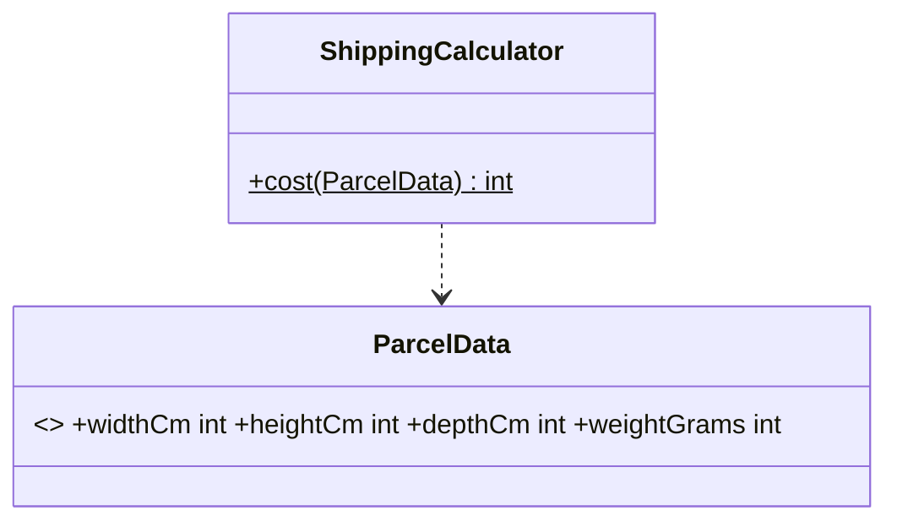
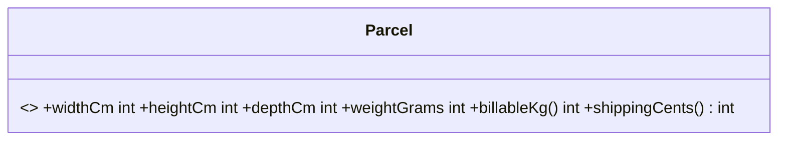
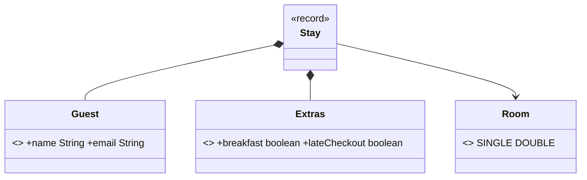
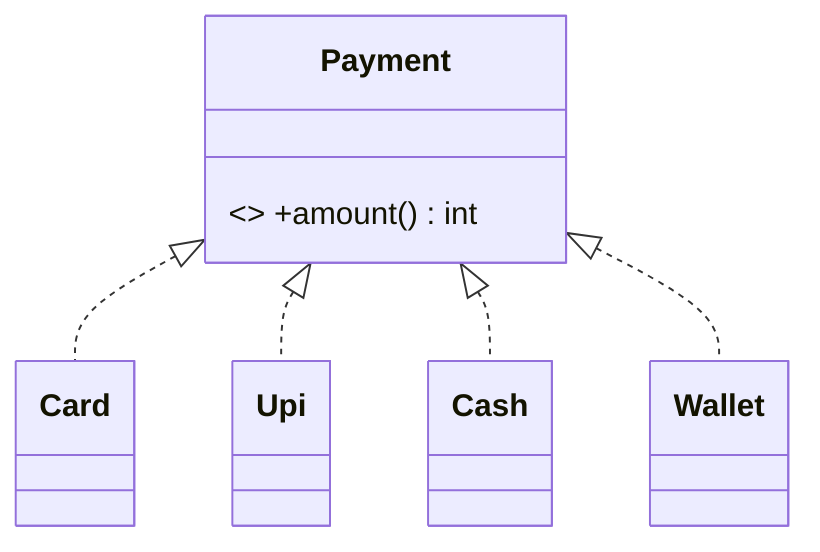

# Chapter 27 — Smells and refactoring

## What and why

A **code smell** is a surface symptom that usually points to a design problem. A **refactoring** changes structure without changing behaviour. Papers ask you to name the smell in a snippet (2 marks), name the refactoring that removes it (3 marks), and rewrite the code (5–8 marks). This chapter is a short catalogue: nine smells with compiled before/after code, and a rule for doing it safely.

## Exam flash rules

- Refactoring changes structure, not observable behaviour.
- Run the tests before, after, and between every step; with no tests, write a test that pins current behaviour first.
- A smell is a hint, not a bug: it may be acceptable, and the program may still be correct.
- Long Method → **Extract Method**. Name the piece after what it does, not how.
- Magic number → named constant.
- Long Parameter List → **Introduce Parameter Object** (a `record`); same-typed neighbours (`String, String, String`) can be swapped silently.
- Primitive Obsession → **value object**: `Money` in cents or `BigDecimal`, never `double`; validate in the constructor.
- Feature Envy (a method uses another class's data more than its own) → **Move Method**.
- `switch` on a type code with a silent `default` → sealed interface + `switch` **without** `default`; the compiler lists the missing case.
- Boolean flag parameter → two methods named for what they do.
- Returning `null` for "absent" → `Optional<T>` for a single value, an empty collection for many.
- `Optional` is a return type; do not use it for fields or parameters, and do not call `get()` without a check.
- Refused Bequest (subclass inherits members it does not want) → replace inheritance with a private field.
- Extracting code that assigns to a local changes nothing for the caller: Java passes by value. Return the result.
- A refactoring that changes the order of integer operations can change the result (`a * p / 100` vs `p / 100 * a`).

## Catalogue

| Smell | Symptom | Refactoring | Proof |
|-------|---------|-------------|-------|
| Long Method (+ magic numbers) | one method sums, discounts, ships and formats | Extract Method, named constants | `longmethod/LongMethodDemo.java`, `LongMethodSteps.java` |
| Long Parameter List | six arguments, three of them `String` | Introduce Parameter Object | `params/LongParamsDemo.java` |
| Primitive Obsession | `double` money, `String` email | Replace Primitive with Object | `primitive/PrimitiveObsessionDemo.java` |
| Feature Envy | a calculator reads four fields of a data holder | Move Method | `envy/FeatureEnvyDemo.java` |
| Switch on type code | `default -> 0` swallows a new constant | Sealed interface, exhaustive `switch` | `switchtype/SwitchTypeDemo.java` |
| Boolean flag | `describe(item, false, 0, 0)` | Split into two methods | `flag/BooleanFlagDemo.java` |
| Null returns | `null` means "absent" | `Optional`, empty collection | `nulls/NullReturnDemo.java` |
| Refused Bequest | `extends HashMap` to reuse storage | Replace inheritance with delegation | `bequest/RefusedBequestDemo.java` |
| Duplicated code | one rule in two places | Extract and call (chapter 26) | `principles/dry/DryDemo.java` |
| Message chain | `a.b().c().d()` | Hide Delegate (chapter 26) | `principles/demeter/DemeterDemo.java` |
| Speculative generality | unused plugins and flags | Delete (chapter 26) | `principles/yagni/YagniDemo.java` |
| Data class + outside rules | getter/setter holder | Tell, Don't Ask (chapter 26) | `principles/tda/TellDontAskDemo.java` |
| Large class / divergent change | one class, many reasons to change | Extract Class (chapter 21) | `srp/before/InvoiceGod.java` |

## Rules table

| Case | Result | Compiler message |
|------|--------|------------------|
| Swap `Room` and `Guest` arguments after the parameter-object refactor | fails | `incompatible types: Room cannot be converted to Guest` |
| `switch` over a sealed type missing one subtype, no `default` | fails | `the switch expression does not cover all possible input values` |
| Assign an `Optional<String>` to a `String` | fails | `incompatible types: Optional<String> cannot be converted to String` |
| Write a record's field from outside (`m.cents = -5`) | fails | `cents has private access in Money` |
| Call a package-private helper from another package | fails | `volumetricKg() is not public in Parcel; cannot be accessed from outside package` |
| Extend a record | fails | `cannot inherit from final Money` |
| Record with a compact constructor that validates and normalizes | compiles | — |

## Long Method → Extract Method

```java
{{#include ../../code/part-02-solid/src/main/java/solid/smells/longmethod/LongMethodDemo.java:long-before}}
```

Four jobs (sum, discount, shipping, format) and the `%d.%02d` format repeated four times. The numbers `5000`, `10`, `5`, `10000`, `499` have no names.

```java
{{#include ../../code/part-02-solid/src/main/java/solid/smells/longmethod/LongMethodDemo.java:long-after}}
```

```java
{{#include ../../code/part-02-solid/src/main/java/solid/smells/longmethod/LongMethodDemo.java:long-main}}
```

```text
{{#include ../../code/part-02-solid/out/run/LongMethodDemo.txt}}
```

### Stepwise: one safe change at a time

```java
{{#include ../../code/part-02-solid/src/main/java/solid/smells/longmethod/LongMethodSteps.java:steps-1}}
```

```java
{{#include ../../code/part-02-solid/src/main/java/solid/smells/longmethod/LongMethodSteps.java:steps-2}}
```

```java
{{#include ../../code/part-02-solid/src/main/java/solid/smells/longmethod/LongMethodSteps.java:steps-main}}
```

```text
{{#include ../../code/part-02-solid/out/run/LongMethodSteps.txt}}
```

Every step is compared against the original on the same inputs. `SmellsTest.everyRefactoringStepKeepsTheOutput` does the same over eight baskets, including the edge values 4999 and 5000.

## Long Parameter List → parameter object

```java
{{#include ../../code/part-02-solid/src/main/java/solid/smells/params/LongParamsDemo.java:params-before}}
```

```java
{{#include ../../code/part-02-solid/src/main/java/solid/smells/params/LongParamsDemo.java:params-after}}
```

```java
{{#include ../../code/part-02-solid/src/main/java/solid/smells/params/LongParamsDemo.java:params-main}}
```

```text
{{#include ../../code/part-02-solid/out/run/LongParamsDemo.txt}}
```

The second line is the bug: the email and room swapped, still compiled, and the output looks plausible. After the refactor the swap is a compile error (C1).

## Primitive Obsession → value objects

```java
{{#include ../../code/part-02-solid/src/main/java/solid/smells/primitive/PrimitiveObsessionDemo.java:prim-before}}
```

```java
{{#include ../../code/part-02-solid/src/main/java/solid/smells/primitive/PrimitiveObsessionDemo.java:prim-after}}
```

```java
{{#include ../../code/part-02-solid/src/main/java/solid/smells/primitive/PrimitiveObsessionDemo.java:prim-main}}
```

```text
{{#include ../../code/part-02-solid/out/run/PrimitiveObsessionDemo.txt}}
```

`double` cannot represent `0.10` exactly; cents in a `long` can. The `Email` constructor is the one place the rule lives (Java 16+ records).

## Feature Envy → Move Method

```java
{{#include ../../code/part-02-solid/src/main/java/solid/smells/envy/FeatureEnvyDemo.java:envy-before}}
```

```java
{{#include ../../code/part-02-solid/src/main/java/solid/smells/envy/FeatureEnvyDemo.java:envy-after}}
```

```java
{{#include ../../code/part-02-solid/src/main/java/solid/smells/envy/FeatureEnvyDemo.java:envy-main}}
```

```text
{{#include ../../code/part-02-solid/out/run/FeatureEnvyDemo.txt}}
```

Same costs (700, 450), and the helper `volumetricKg()` is now package-private: callers use `shippingCents()` (C5).

## Switch on type code → sealed types

```java
{{#include ../../code/part-02-solid/src/main/java/solid/smells/switchtype/SwitchTypeDemo.java:switch-before}}
```

```java
{{#include ../../code/part-02-solid/src/main/java/solid/smells/switchtype/SwitchTypeDemo.java:switch-after}}
```

```java
{{#include ../../code/part-02-solid/src/main/java/solid/smells/switchtype/SwitchTypeDemo.java:switch-main}}
```

```text
{{#include ../../code/part-02-solid/out/run/SwitchTypeDemo.txt}}
```

`WALLET` was added to the enum; `default -> 0` charged nothing and nobody was told. Sealed interfaces and pattern `switch` are Java 17+/21; older papers use `enum` + `abstract` methods for the same fix. Chapter 22 covers this under OCP.

## Boolean flag → two methods

```java
{{#include ../../code/part-02-solid/src/main/java/solid/smells/flag/BooleanFlagDemo.java:flag-before}}
```

```java
{{#include ../../code/part-02-solid/src/main/java/solid/smells/flag/BooleanFlagDemo.java:flag-after}}
```

```java
{{#include ../../code/part-02-solid/src/main/java/solid/smells/flag/BooleanFlagDemo.java:flag-main}}
```

```text
{{#include ../../code/part-02-solid/out/run/BooleanFlagDemo.txt}}
```

## Null returns → Optional and empty collections

```java
{{#include ../../code/part-02-solid/src/main/java/solid/smells/nulls/NullReturnDemo.java:null-before}}
```

```java
{{#include ../../code/part-02-solid/src/main/java/solid/smells/nulls/NullReturnDemo.java:null-after}}
```

```java
{{#include ../../code/part-02-solid/src/main/java/solid/smells/nulls/NullReturnDemo.java:null-main}}
```

```text
{{#include ../../code/part-02-solid/out/run/NullReturnDemo.txt}}
```

## Refused Bequest → delegation

```java
{{#include ../../code/part-02-solid/src/main/java/solid/smells/bequest/RefusedBequestDemo.java:bequest-before}}
```

```java
{{#include ../../code/part-02-solid/src/main/java/solid/smells/bequest/RefusedBequestDemo.java:bequest-after}}
```

```java
{{#include ../../code/part-02-solid/src/main/java/solid/smells/bequest/RefusedBequestDemo.java:bequest-main}}
```

```text
{{#include ../../code/part-02-solid/out/run/RefusedBequestDemo.txt}}
```

`put("pen", -3)` bypassed the rule that `stock` enforces, and `clear()` wiped everything. See chapters 11 and 26.

## Tests that prove the benefit

```java
{{#include ../../code/part-02-solid/src/test/java/solid/smells/SmellsTest.java}}
```

| Test | What it proves |
|------|----------------|
| `everyRefactoringStepKeepsTheOutput` | each step equals the original on 8 baskets × member/non-member |
| `extractedPiecesAreTestableOnTheirOwn` | the pieces can be tested alone, including the 4999/5000 boundary |
| `parameterObjectKeepsTheText` | same text; the old signature still accepts a swap |
| `valueObjectsRejectBadInputAndFixMoney` | `double` error, cents exact, bad email rejected |
| `movedMethodGivesTheSameCost` | Move Method preserves results |
| `sealedSwitchHandlesWhatTheDefaultSwallowed` | `WALLET` is 0 before, 50 after |
| `separateMethodsReplaceTheFlag` | same strings, no dummy arguments |
| `absenceIsInTheType` | `null` throws; `Optional`/empty list do not |
| `compositionKeepsTheRule` | inherited `put` bypasses the rule; the wrapper does not |

## Predict the output

**P1.** `PredictDoubleMoney`

```java
{{#include ../../code/part-02-solid/src/main/java/solid/smells/exam/PredictDoubleMoney.java:predict-double-money}}
```

<details><summary>Answer</summary>

```text
{{#include ../../code/part-02-solid/out/run/PredictDoubleMoney.txt}}
```

Three additions of binary `0.1` are not `0.3`. Cents: 10 × 3 = 30, and records compare components.

</details>

**P2.** `PredictSwapArgs`

```java
{{#include ../../code/part-02-solid/src/main/java/solid/smells/exam/PredictSwapArgs.java:predict-swap-args}}
```

<details><summary>Answer</summary>

```text
{{#include ../../code/part-02-solid/out/run/PredictSwapArgs.txt}}
```

Line 2 prints the room in the email slot: three `String` parameters, no error. Line 3 swaps the two booleans' meaning (`+breakfast` instead of `+late`).

</details>

**P3.** `PredictSwitchDefault`

```java
{{#include ../../code/part-02-solid/src/main/java/solid/smells/exam/PredictSwitchDefault.java:predict-switch-default}}
```

<details><summary>Answer</summary>

```text
{{#include ../../code/part-02-solid/out/run/PredictSwitchDefault.txt}}
```

`CARD` 2% of 2000 = 40, `UPI` 1% = 20, `CASH` 0, `WALLET` hits `default` → 0. The sealed version charges the wallet 50.

</details>

**P4.** `PredictNullFind`

```java
{{#include ../../code/part-02-solid/src/main/java/solid/smells/exam/PredictNullFind.java:predict-null-find}}
```

<details><summary>Answer</summary>

```text
{{#include ../../code/part-02-solid/out/run/PredictNullFind.txt}}
```

`Optional.empty` prints as `Optional.empty`. `map` on an empty `Optional` is skipped, so `orElse(-1)` wins. The empty list loops zero times. `get()` on empty throws `NoSuchElementException("No value present")`.

</details>

**P5.** `PredictInheritedClear`

```java
{{#include ../../code/part-02-solid/src/main/java/solid/smells/exam/PredictInheritedClear.java:predict-inherited-clear}}
```

<details><summary>Answer</summary>

```text
{{#include ../../code/part-02-solid/out/run/PredictInheritedClear.txt}}
```

`stock` merges: 2 + 3 = 5. Inherited `put` replaces the total with 1; inherited `remove` empties the map. `stock("ink", 0)` throws before touching the map, so the size stays 0.

</details>

**P6.** `PredictFlagCall`

```java
{{#include ../../code/part-02-solid/src/main/java/solid/smells/exam/PredictFlagCall.java:predict-flag-call}}
```

<details><summary>Answer</summary>

```text
{{#include ../../code/part-02-solid/out/run/PredictFlagCall.txt}}
```

With `false`, `3` and `7` are ignored. With `true`, `0, 0` is accepted and prints a total of 0. The last line is the length of the verbose string.

</details>

**P7.** `PredictExtractBug`

```java
{{#include ../../code/part-02-solid/src/main/java/solid/smells/exam/PredictExtractBug.java:predict-extract-bug}}
```

<details><summary>Answer</summary>

```text
{{#include ../../code/part-02-solid/out/run/PredictExtractBug.txt}}
```

`2000 * 15 / 100` = 300. The "extracted" `rate(15)` is `15 / 100` = 0 in integer arithmetic, so the result is 0. At 100% both give 2000, which is why a single test case would miss the bug.

</details>

## Compile or not?

**C1.** Swap the `Room` and `Guest` arguments of the parameter object. Fails.

```java
{{#include ../../code/part-02-solid/broken/SmellArgOrderBroken.java}}
```

```text
{{#include ../../code/part-02-solid/out/broken/SmellArgOrderBroken.txt}}
```

**C2.** A `switch` expression over the sealed `Payment` without `Wallet`. Fails.

```java
{{#include ../../code/part-02-solid/broken/SmellSealedMissingBroken.java}}
```

```text
{{#include ../../code/part-02-solid/out/broken/SmellSealedMissingBroken.txt}}
```

**C3.** Use an `Optional<String>` as a `String`. Fails.

```java
{{#include ../../code/part-02-solid/broken/SmellOptionalAssignBroken.java}}
```

```text
{{#include ../../code/part-02-solid/out/broken/SmellOptionalAssignBroken.txt}}
```

**C4.** Assign to a record component from outside. Fails.

```java
{{#include ../../code/part-02-solid/broken/SmellRecordMutateBroken.java}}
```

```text
{{#include ../../code/part-02-solid/out/broken/SmellRecordMutateBroken.txt}}
```

**C5.** Call the package-private helper that moved into `Parcel`. Fails.

```java
{{#include ../../code/part-02-solid/broken/SmellMovedMethodHiddenBroken.java}}
```

```text
{{#include ../../code/part-02-solid/out/broken/SmellMovedMethodHiddenBroken.txt}}
```

**C6.** Extend a record. Fails.

```java
{{#include ../../code/part-02-solid/broken/SmellExtendRecordBroken.java}}
```

```text
{{#include ../../code/part-02-solid/out/broken/SmellExtendRecordBroken.txt}}
```

**C7.** Compiles: records with compact constructors, equality by component.

```java
{{#include ../../code/part-02-solid/src/main/java/solid/smells/exam/CompileOkRecordEmail.java:compile-ok-record-email}}
```

```text
{{#include ../../code/part-02-solid/out/run/CompileOkRecordEmail.txt}}
```

## Gotchas

```java
{{#include ../../code/part-02-solid/src/main/java/solid/smells/gotchas/SmellsGotchas.java:g1-extract-local}}
```

```java
{{#include ../../code/part-02-solid/src/main/java/solid/smells/gotchas/SmellsGotchas.java:g3-switch-statement}}
```

```java
{{#include ../../code/part-02-solid/src/main/java/solid/smells/gotchas/SmellsGotchas.java:g5-record-alias}}
```

```java
{{#include ../../code/part-02-solid/src/main/java/solid/smells/gotchas/SmellsGotchas.java:g-main}}
```

```text
{{#include ../../code/part-02-solid/out/run/SmellsGotchas.txt}}
```

1. **G1** — `addAllBroken(total, xs)` compiles, runs, and leaves the caller's `total` at 0: the helper updated its own copy. Return the value.
2. **G2** — `Optional.get()` on an empty value throws `NoSuchElementException`; it moves the `NullPointerException` rather than removing it. Use `map`/`orElse`/`orElseThrow`.
3. **G3** — A `switch` *statement* over an enum may silently skip `CRITICAL` (`ignore`); a `switch` *expression* without `default` must cover every constant.
4. **G4** — `BigDecimal("1.0").equals(BigDecimal("1.00"))` is `false` (scale counts); `compareTo` is `0`. Money value objects need a stated equality rule.
5. **G5** — A record holding a `List` aliases it: adding to the caller's list changed the basket's `items`. Copy in the compact constructor with `List.copyOf`.

## UML

Before:



After:



Parameter object:



Sealed hierarchy:



## Short answers (marks trail)

| Marks | Prompt | Answer |
|-------|--------|--------|
| 2 | Define refactoring | Changing internal structure without changing observable behaviour. |
| 2 | Define a code smell | A surface symptom that often indicates a deeper design problem. |
| 2 | Fix for Long Method | Extract Method. |
| 3 | Name the smell: `foo(String, String, String, int, boolean, boolean)` | Long Parameter List; Introduce Parameter Object. |
| 3 | Why is `default -> 0` dangerous? | A new constant falls into it silently (`WALLET` charged 0). |
| 5 | Why use cents instead of `double`? | `0.1 + 0.1 + 0.1 != 0.3` in binary floating point (`PredictDoubleMoney`). |
| 5 | What must you have before refactoring? | Tests that pin current behaviour; run them after every step. |
| 10 | Refactor a 25-line receipt method | Tests first, extract money, extract rules with named constants, compare each step (`LongMethodSteps`). |

## Interview Q&A

1. **Q:** Refactoring versus rewriting? **A:** Refactoring keeps behaviour and proceeds in small, tested steps; a rewrite replaces the code.
2. **Q:** What if there are no tests? **A:** Write characterization tests that pin today's output, then refactor (`LongMethodSteps` compares to the original).
3. **Q:** First sign of a Long Method? **A:** A comment or blank line separating "phases"; each phase is an extraction candidate.
4. **Q:** Why replace a `String` argument with a type? **A:** The compiler stops a swap (`SmellArgOrderBroken`) and the rule lives in one place (`Email`).
5. **Q:** What is Feature Envy? **A:** A method that touches another class's data more than its own; move it there (`Parcel.shippingCents`).
6. **Q:** Why is a boolean flag a smell? **A:** The call site is unreadable and the flag hides two methods (`describe("pen", false, 0, 0)`).
7. **Q:** `Optional` or `null`? **A:** `Optional` for a returned single value; never as a field or parameter; empty collections for many.
8. **Q:** What does a sealed `switch` give over an enum `default`? **A:** A compile error when a subtype is added (`SmellSealedMissingBroken`).
9. **Q:** When is inheriting `HashMap` wrong? **A:** When only a few operations are wanted: inherited `put`/`clear` skip the class's rules (`PredictInheritedClear`).
10. **Q:** Can extraction change behaviour? **A:** Yes: locals are passed by value (G1), and reordered integer arithmetic differs (`PredictExtractBug`).
11. **Q:** Which smells have a chapter-26 fix? **A:** Duplication (DRY), message chains (Demeter), speculative generality (YAGNI), data class (Tell, Don't Ask).
12. **Q:** Does a smell always need fixing? **A:** No: a one-off script with a long method may be fine; weigh against the cost of change.

## Exam writing prompts

1. (5) Name the smell and rewrite: `void draw(int x1, int y1, int x2, int y2, int w, String color)`.
2. (5) Replace `String save(String k, String v, boolean overwrite)` with two methods; state the smell.
3. (8) Refactor `class Report { int total(List<Rect> r) { ...r.get(i).w * r.get(i).h... } }` so that area lives in `Rect`; name the smell and the refactoring.
4. (5) Rewrite `User find(String name)` (returns `null` when missing) and a caller that prints the age or `-1`.
5. (3) Show a one-line change to an extracted percentage helper that breaks integer results, and name the test input that exposes it.

## Exercises

Solutions are in `code/part-02-solid/solutions/ch27/`.

1. Extract min, max and mean from one method — `SolutionExtractStats.java`.
2. Parameter object for a six-argument call — `SolutionPointObject.java`.
3. Split a boolean flag into two methods — `SolutionSplitFlag.java`.
4. Replace a `null` lookup with `Optional` — `SolutionFindUser.java`.
5. Move the area rule into the rectangle — `SolutionMoveArea.java`.
6. A `Percentage` value object — `SolutionPercentage.java`.

```text
{{#include ../../code/part-02-solid/out/solutions/SolutionExtractStats.txt}}
```

## Recap checklist

- [x] Short catalogue with before/after — nine smells, `solid/smells/*`
- [x] Stepwise refactor with equivalence check — `LongMethodSteps`
- [x] Tests — `SmellsTest`
- [x] Exam banks: flash rules (15), predict (7), compile (6 fail + 1 pass), writing (5), exercises (6)
- [x] UML before/after
