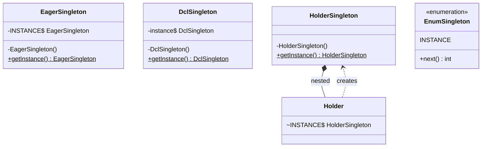

# Chapter 28 — Singleton

## What and why

Singleton = one instance of a class per JVM class loader, with one global access point. Exams ask for the **variants** (eager, lazy, synchronized, double-checked, holder, enum) and the **ways each one breaks** (threads, reflection, serialization, `clone`).

## Problem

Several parts of a program must share exactly one object (configuration, registry, runtime handle). `new` everywhere gives many copies; a plain global gives no control over creation.

Pattern recipe: **private constructor** + **static field** + **static accessor**.

## Exam flash rules

- A singleton needs a **private constructor**, a **static instance**, and a **static `getInstance()`**.
- Eager singleton: instance is created when the class is **initialized**, not when the JVM starts; any first static use (even an unrelated static method) triggers it.
- Lazy singleton without synchronization is **not thread-safe** (two threads can both see `null`).
- `synchronized getInstance()` is correct but locks on every call.
- Double-checked locking is correct only if the field is **`volatile`** (Java 5+).
- Initialization-on-demand holder is **lazy, lock-free, thread-safe** because class initialization is guarded by the JVM.
- Enum singleton is the simplest safe variant: thread-safe, serialization-safe, reflection-safe.
- Reflection with `setAccessible(true)` can call a private constructor; an enum cannot be created reflectively.
- A `Serializable` singleton needs **`readResolve()`** returning the instance, or deserialization makes a copy.
- A `Cloneable` singleton with a public `clone()` breaks the pattern; do not implement `Cloneable`.
- Enum singleton cannot extend another class (it may implement interfaces).
- Singleton is **per class loader**, not per JVM, when several loaders load the class.
- A singleton is global mutable state: it makes unit tests order-dependent.

## Rules table — what the compiler rejects

| Mistake | Compiler message |
|---------|------------------|
| `new` on a class with a private constructor, from another class | `HolderSingleton() has private access in HolderSingleton` |
| `new` on an enum | `enum classes may not be instantiated` |
| Subclass of a class whose only constructor is private | `PrivateCtorBase() has private access in PrivateCtorBase` |
| Extending a `final` singleton | `cannot inherit from final EagerSingleton` |
| Extending an enum | `cannot inherit from final EnumSingleton` + `enum classes are not extensible` |
| Static accessor returns an instance field | `non-static variable instance cannot be referenced from a static context` |

## Walkthrough

### 1. Eager

```java
{{#include ../../code/part-03-patterns/src/main/java/patterns/creational/singleton/EagerSingleton.java:eager-singleton}}
```

Simple and thread-safe (class initialization is synchronized by the JVM). Costs memory if the instance is never used.

### 2. Lazy, not thread-safe (do not use)

```java
{{#include ../../code/part-03-patterns/src/main/java/patterns/creational/singleton/LazyUnsafeSingleton.java:lazy-unsafe-singleton}}
```

```java
{{#include ../../code/part-03-patterns/src/main/java/patterns/creational/singleton/UnsafeRaceDemo.java:unsafe-race-demo}}
```

```text
{{#include ../../code/part-03-patterns/output/UnsafeRaceDemo.txt}}
```

Two threads, two instances: the check-then-act is not atomic.

### 3. Synchronized accessor

```java
{{#include ../../code/part-03-patterns/src/main/java/patterns/creational/singleton/SynchronizedSingleton.java:synchronized-singleton}}
```

### 4. Double-checked locking

```java
{{#include ../../code/part-03-patterns/src/main/java/patterns/creational/singleton/DclSingleton.java:dcl-singleton}}
```

Without `volatile`, another thread may see a non-null reference to a not-fully-constructed object (instruction reordering). The outer check avoids the lock once the instance exists.

### 5. Initialization-on-demand holder

```java
{{#include ../../code/part-03-patterns/src/main/java/patterns/creational/singleton/HolderSingleton.java:holder-singleton}}
```

`Holder` is initialized only when `getInstance()` first touches `Holder.INSTANCE`.

### 6. Enum

```java
{{#include ../../code/part-03-patterns/src/main/java/patterns/creational/singleton/EnumSingleton.java:enum-singleton}}
```

### Variants side by side

```java
{{#include ../../code/part-03-patterns/src/main/java/patterns/creational/singleton/SingletonVariantsDemo.java:singleton-variants-demo}}
```

```text
{{#include ../../code/part-03-patterns/output/SingletonVariantsDemo.txt}}
```

Note when `EagerSingleton created` and `HolderSingleton created` print: on first access.

| Variant | Lazy | Thread-safe | Reflection-safe | Serialization-safe | Cost |
|---------|------|-------------|-----------------|--------------------|------|
| Eager | no | yes | no | needs `readResolve` | memory if unused |
| Lazy, unsynchronized | yes | **no** | no | needs `readResolve` | — |
| `synchronized` accessor | yes | yes | no | needs `readResolve` | lock per call |
| Double-checked + `volatile` | yes | yes | no | needs `readResolve` | complexity |
| Holder | yes | yes | no | needs `readResolve` | none |
| Enum | on first use | yes | **yes** | **yes** | cannot extend a class |

### Pitfall — reflection

```java
{{#include ../../code/part-03-patterns/src/main/java/patterns/creational/singleton/ReflectionBreakDemo.java:reflection-break-demo}}
```

```text
{{#include ../../code/part-03-patterns/output/ReflectionBreakDemo.txt}}
```

`HolderSingleton created` prints twice: the second construction came from reflection. The guarded variant refuses it:

```java
{{#include ../../code/part-03-patterns/src/main/java/patterns/creational/singleton/GuardedSingleton.java:guarded-singleton}}
```

### Pitfall — serialization

```java
{{#include ../../code/part-03-patterns/src/main/java/patterns/creational/singleton/SerialSingleton.java:serial-singleton}}
```

```java
{{#include ../../code/part-03-patterns/src/main/java/patterns/creational/singleton/SafeSerialSingleton.java:safe-serial-singleton}}
```

```java
{{#include ../../code/part-03-patterns/src/main/java/patterns/creational/singleton/SerializationBreakDemo.java:serialization-break-demo}}
```

```text
{{#include ../../code/part-03-patterns/output/SerializationBreakDemo.txt}}
```

### Pitfall — clone

```java
{{#include ../../code/part-03-patterns/src/main/java/patterns/creational/singleton/CloneableSingleton.java:cloneable-singleton}}
```

See predict stem P6 for the output.

### Where the JDK uses it

```java
{{#include ../../code/part-03-patterns/src/main/java/patterns/creational/singleton/JdkSingletonDemo.java:jdk-singleton-demo}}
```

```text
{{#include ../../code/part-03-patterns/output/JdkSingletonDemo.txt}}
```

- `Runtime.getRuntime()` — the textbook JDK singleton.
- `LogManager.getLogManager()` — one manager per JVM.
- `Desktop.getDesktop()` — one per application context.
- `Collections.emptyList()` — a shared immutable instance (a shared constant, not a lazily built singleton).

## Singleton vs similar

| | Singleton | Static utility class | Monostate | Flyweight | DI "singleton scope" |
|---|-----------|----------------------|-----------|-----------|----------------------|
| Instances | exactly one | zero (never created) | many, share static state | many shared per key | one per container |
| Can implement an interface | yes | no | yes | yes | yes |
| Swappable in tests | hard | hard | hard | easy | **easy** |
| Created by | the class itself | — | anyone | factory | container |

## Predict the output

**P1.** Eager singleton: when does `ctor` print?

```java
{{#include ../../code/part-03-patterns/src/main/java/patterns/creational/singleton/exam/PredictEagerTiming.java:predict-eager-timing}}
```

<details><summary>Answer</summary>

```text
{{#include ../../code/part-03-patterns/output/PredictEagerTiming.txt}}
```

Trace: `Eager.hello()` initializes the class → static field runs `ctor` → `hello`.

</details>

**P2.** Holder variant, same main shape.

```java
{{#include ../../code/part-03-patterns/src/main/java/patterns/creational/singleton/exam/PredictHolderLazy.java:predict-holder-lazy}}
```

<details><summary>Answer</summary>

```text
{{#include ../../code/part-03-patterns/output/PredictHolderLazy.txt}}
```

Trace: `Lazy.hello()` does not initialize `Holder`; `Lazy.get()` does.

</details>

**P3.** Enum singleton.

```java
{{#include ../../code/part-03-patterns/src/main/java/patterns/creational/singleton/exam/PredictEnumCounter.java:predict-enum-counter}}
```

<details><summary>Answer</summary>

```text
{{#include ../../code/part-03-patterns/output/PredictEnumCounter.txt}}
```

Trace: `valueOf` returns the same constant; the counter is shared state.

</details>

**P4.** Serialization round trips.

```java
{{#include ../../code/part-03-patterns/src/main/java/patterns/creational/singleton/exam/PredictSerialIdentity.java:predict-serial-identity}}
```

<details><summary>Answer</summary>

```text
{{#include ../../code/part-03-patterns/output/PredictSerialIdentity.txt}}
```

Trace: no `readResolve` → new object each time (`false`, `false`); with `readResolve` → `true`.

</details>

**P5.** Synchronized singleton construction count.

```java
{{#include ../../code/part-03-patterns/src/main/java/patterns/creational/singleton/exam/PredictSyncCount.java:predict-sync-count}}
```

<details><summary>Answer</summary>

```text
{{#include ../../code/part-03-patterns/output/PredictSyncCount.txt}}
```

Trace: `0` before first access → one construction → `true`, `1`.

</details>

**P6.** Cloneable singleton.

```java
{{#include ../../code/part-03-patterns/src/main/java/patterns/creational/singleton/exam/PredictCloneSingleton.java:predict-clone-singleton}}
```

<details><summary>Answer</summary>

```text
{{#include ../../code/part-03-patterns/output/PredictCloneSingleton.txt}}
```

Trace: `clone()` is a new object of the same class (`false`, `true`, `true`).

</details>

## Compile or not?

**C1.** `new HolderSingleton()` from another class.

```java
{{#include ../../code/part-03-patterns/broken/SingletonNewPrivateBroken.java}}
```

<details><summary>Answer — fails</summary>

```text
{{#include ../../code/part-03-patterns/output/broken/SingletonNewPrivateBroken.txt}}
```

</details>

**C2.** `new EnumSingleton()`.

```java
{{#include ../../code/part-03-patterns/broken/SingletonNewEnumBroken.java}}
```

<details><summary>Answer — fails</summary>

```text
{{#include ../../code/part-03-patterns/output/broken/SingletonNewEnumBroken.txt}}
```

</details>

**C3.** Subclass of a class with only a private constructor.

```java
{{#include ../../code/part-03-patterns/broken/SingletonExtendBroken.java}}
```

<details><summary>Answer — fails</summary>

```text
{{#include ../../code/part-03-patterns/output/broken/SingletonExtendBroken.txt}}
```

</details>

**C4.** Extending a final singleton.

```java
{{#include ../../code/part-03-patterns/broken/SingletonExtendFinalBroken.java}}
```

<details><summary>Answer — fails</summary>

```text
{{#include ../../code/part-03-patterns/output/broken/SingletonExtendFinalBroken.txt}}
```

</details>

**C5.** Static accessor reading an instance field.

```java
{{#include ../../code/part-03-patterns/broken/SingletonStaticContextBroken.java}}
```

<details><summary>Answer — fails</summary>

```text
{{#include ../../code/part-03-patterns/output/broken/SingletonStaticContextBroken.txt}}
```

</details>

**C6.** Extending an enum.

```java
{{#include ../../code/part-03-patterns/broken/SingletonEnumExtendsBroken.java}}
```

<details><summary>Answer — fails</summary>

```text
{{#include ../../code/part-03-patterns/output/broken/SingletonEnumExtendsBroken.txt}}
```

</details>

## Gotchas

1. Lazy without a lock creates two instances — `UnsafeRaceDemo`.
2. Reflection builds a second instance of a private-constructor class — `ReflectionBreakDemo`.
3. Deserialization builds a second instance unless `readResolve` exists — `SerializationBreakDemo`.
4. `Cloneable` + public `clone()` — `CloneableSingleton`, P6.
5. "Eager" means "at class initialization", and any static call triggers it — `PredictEagerTiming`.

## UML



## Interview Q&A

1. **Q:** Name the three parts of a singleton. **A:** Private constructor, static instance, static accessor.
2. **Q:** Why is the naive lazy version unsafe? **A:** Two threads can pass the `null` check together — `UnsafeRaceDemo` printed `created=2`.
3. **Q:** Why must the DCL field be `volatile`? **A:** To stop reordering that publishes a reference before construction finishes.
4. **Q:** How does the holder idiom stay lazy and lock-free? **A:** The JVM initializes `Holder` once, on first use — `PredictHolderLazy`.
5. **Q:** Why prefer an enum singleton? **A:** The JVM guarantees one constant; serialization and reflection cannot duplicate it.
6. **Q:** How does reflection break a singleton? **A:** `setAccessible(true)` then `newInstance()` — `ReflectionBreakDemo`.
7. **Q:** How do you fix serialization? **A:** `readResolve()` returning the instance — `SafeSerialSingleton`.
8. **Q:** Why is `Cloneable` dangerous here? **A:** `clone()` returns a new object — P6.
9. **Q:** Is a singleton unique per JVM? **A:** Per class loader.
10. **Q:** Singleton vs static class? **A:** A singleton is an object (can implement interfaces, be passed around); a static class cannot.
11. **Q:** Why do tests dislike singletons? **A:** Shared global state survives between tests.
12. **Q:** Name a JDK singleton. **A:** `Runtime.getRuntime()` — `JdkSingletonDemo`.

## Exam writing prompts

1. (5) Write a thread-safe lazy singleton `Logger` using the holder idiom.
2. (5) Write a double-checked-locking singleton and state why `volatile` is needed.
3. (3) Make this serializable singleton safe: add the missing method.
4. (2) Write an enum singleton with a method `next()` that returns increasing ints.

Model answers: see exercises below (`Config`, `FixedLazy`, `Registry`, `IdGenerator`).

## Exercises

1. Write a holder-based `Config` singleton — `solutions/ch28/Ch28Solutions.java`.

```java
{{#include ../../code/part-03-patterns/solutions/ch28/Ch28Solutions.java:ch28-ex1}}
```

2. Repair the unsafe lazy singleton with a lock.

```java
{{#include ../../code/part-03-patterns/solutions/ch28/Ch28Solutions.java:ch28-ex2}}
```

3. Keep one instance across serialization.

```java
{{#include ../../code/part-03-patterns/solutions/ch28/Ch28Solutions.java:ch28-ex3}}
```

4. Refuse `clone`.

```java
{{#include ../../code/part-03-patterns/solutions/ch28/Ch28Solutions.java:ch28-ex4}}
```

5. Enum singleton id generator.

```java
{{#include ../../code/part-03-patterns/solutions/ch28/Ch28Solutions.java:ch28-ex5}}
```

```text
{{#include ../../code/part-03-patterns/output/Ch28Solutions.txt}}
```

## Recap checklist

- [x] Eager, lazy-unsafe, synchronized, DCL, holder, enum variants
- [x] Reflection, serialization, clone, class-init-timing pitfalls
- [x] Compiler errors for private/enum/final/static misuse
- [x] JDK usage and comparison table
- [x] Exam banks: flash rules, predict ×6, compile ×6, writing ×4, exercises ×5
