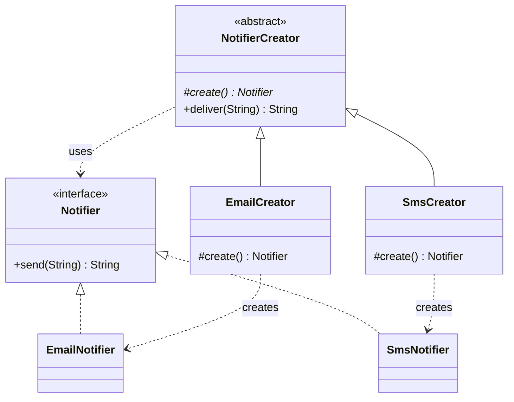

# Chapter 29 — Factory Method

## What and why

Factory Method = a creator declares an abstract method that returns a product; **subclasses decide which concrete class to instantiate**. Exams ask for the roles (creator, product), the difference from a static factory and from Abstract Factory, and JDK examples (`Integer.valueOf`, `NumberFormat.getInstance`).

## Problem

Client code that writes `new EmailNotifier()` is welded to one class. Adding SMS means editing every caller. Move the `new` into an overridable method so the surrounding algorithm (`deliver`) stays unchanged.

## Exam flash rules

- Factory Method is **one method** (`create()`), overridden by subclasses; the pattern relies on **inheritance**.
- Roles: **Product** (interface), **ConcreteProduct**, **Creator** (declares factory method, uses it), **ConcreteCreator** (overrides it).
- The creator's other methods call the factory method — that is the point (a template around creation).
- A factory method's return type is the **product interface**, not a concrete class.
- Overriding rules apply: same signature, **return type must be compatible**, access cannot be weaker.
- A "static factory method" (`Integer.valueOf`, `List.of`) is **not** the GoF Factory Method.
- Static factories can have names, cache instances, and return subtypes; constructors cannot.
- `Integer.valueOf(127) == Integer.valueOf(127)` is `true`; `128` gives `false` (cache is -128..127).
- `Arrays.asList` allows `set` but not `add`; `List.of` allows neither.
- The "simple factory" (one class with a `switch`) is **not** a GoF pattern; adding a kind edits the switch (violates OCP).
- Abstract class or interface cannot be instantiated with `new`.
- Factory Method creates **one** product; Abstract Factory creates a **family**.

## Rules table — what the compiler rejects

| Mistake | Compiler message |
|---------|------------------|
| `new` on abstract creator | `NotifierCreator is abstract; cannot be instantiated` |
| `new` on product interface | `Notifier is abstract; cannot be instantiated` |
| Concrete creator without factory method | `... is not abstract and does not override abstract method create() in NotifierCreator` |
| Factory method returns unrelated type | `create() in ... cannot override create() in NotifierCreator` / `return type String is not compatible with Notifier` |
| Override weaker than `protected` | `attempting to assign weaker access privileges; was protected` |

## Walkthrough

### Product and creator

```java
{{#include ../../code/part-03-patterns/src/main/java/patterns/creational/factorymethod/Notifier.java:notifier}}
```

```java
{{#include ../../code/part-03-patterns/src/main/java/patterns/creational/factorymethod/NotifierCreator.java:notifier-creator}}
```

```java
{{#include ../../code/part-03-patterns/src/main/java/patterns/creational/factorymethod/EmailNotifier.java:email-notifier}}
```

```java
{{#include ../../code/part-03-patterns/src/main/java/patterns/creational/factorymethod/SmsNotifier.java:sms-notifier}}
```

```java
{{#include ../../code/part-03-patterns/src/main/java/patterns/creational/factorymethod/EmailCreator.java:email-creator}}
```

```java
{{#include ../../code/part-03-patterns/src/main/java/patterns/creational/factorymethod/SmsCreator.java:sms-creator}}
```

```java
{{#include ../../code/part-03-patterns/src/main/java/patterns/creational/factorymethod/FactoryMethodDemo.java:factory-method-demo}}
```

```text
{{#include ../../code/part-03-patterns/output/FactoryMethodDemo.txt}}
```

`deliver` is written once; the creator subclass picks the product.

### Static factory methods (not the GoF pattern)

```java
{{#include ../../code/part-03-patterns/src/main/java/patterns/creational/factorymethod/Temperature.java:temperature}}
```

```java
{{#include ../../code/part-03-patterns/src/main/java/patterns/creational/factorymethod/StaticFactoryDemo.java:static-factory-demo}}
```

```text
{{#include ../../code/part-03-patterns/output/StaticFactoryDemo.txt}}
```

### Parameterized factory with a registry

```java
{{#include ../../code/part-03-patterns/src/main/java/patterns/creational/factorymethod/RegistryFactory.java:registry-factory}}
```

```java
{{#include ../../code/part-03-patterns/src/main/java/patterns/creational/factorymethod/RegistryDemo.java:registry-demo}}
```

```text
{{#include ../../code/part-03-patterns/output/RegistryDemo.txt}}
```

### Where the JDK uses it

```java
{{#include ../../code/part-03-patterns/src/main/java/patterns/creational/factorymethod/JdkFactoryDemo.java:jdk-factory-demo}}
```

```text
{{#include ../../code/part-03-patterns/output/JdkFactoryDemo.txt}}
```

| JDK API | Role |
|---------|------|
| `Collection.iterator()` | Textbook Factory Method: each collection returns its own `Iterator` |
| `Integer.valueOf`, `Boolean.valueOf`, `List.of`, `Path.of` | Static factory methods |
| `NumberFormat.getInstance`, `Calendar.getInstance` | Static factory returning a locale-specific subtype |
| `ThreadFactory.newThread` | Factory interface used by `Executors` |

## Factory Method vs similar

| | Factory Method | Abstract Factory | Static factory method | Simple factory | Builder |
|---|----------------|------------------|-----------------------|----------------|---------|
| Mechanism | subclass overrides a method | object with several creation methods | static method on the class | one class with `switch` | step-by-step assembly |
| Products | one | family | one | several kinds | one complex |
| Extend by | new creator subclass | new factory class | edit the class | edit the switch | new builder |
| GoF pattern | yes | yes | no | no | yes |

## Predict the output

**P1.**

```java
{{#include ../../code/part-03-patterns/src/main/java/patterns/creational/factorymethod/exam/PredictCreatorDispatch.java:predict-creator-dispatch}}
```

<details><summary>Answer</summary>

```text
{{#include ../../code/part-03-patterns/output/PredictCreatorDispatch.txt}}
```

Trace: runtime type of `c` decides `create()`; the variable's static type is irrelevant.

</details>

**P2.**

```java
{{#include ../../code/part-03-patterns/src/main/java/patterns/creational/factorymethod/exam/PredictIntegerCache.java:predict-integer-cache}}
```

<details><summary>Answer</summary>

```text
{{#include ../../code/part-03-patterns/output/PredictIntegerCache.txt}}
```

Trace: cache covers -128..127; `128` makes two objects; `equals` compares values.

</details>

**P3.**

```java
{{#include ../../code/part-03-patterns/src/main/java/patterns/creational/factorymethod/exam/PredictListFactories.java:predict-list-factories}}
```

<details><summary>Answer</summary>

```text
{{#include ../../code/part-03-patterns/output/PredictListFactories.txt}}
```

Trace: `Arrays.asList` is fixed-size but writable; `List.of` is immutable.

</details>

**P4.**

```java
{{#include ../../code/part-03-patterns/src/main/java/patterns/creational/factorymethod/exam/PredictAnonymousCreator.java:predict-anonymous-creator}}
```

<details><summary>Answer</summary>

```text
{{#include ../../code/part-03-patterns/output/PredictAnonymousCreator.txt}}
```

Trace: anonymous creator returns a lambda `Notifier`; `deliver` calls it.

</details>

**P5.**

```java
{{#include ../../code/part-03-patterns/src/main/java/patterns/creational/factorymethod/exam/PredictBooleanValueOf.java:predict-boolean-valueof}}
```

<details><summary>Answer</summary>

```text
{{#include ../../code/part-03-patterns/output/PredictBooleanValueOf.txt}}
```

Trace: parsing is case-insensitive `"true"` only; anything else (including `null`) is `false`; `valueOf` returns the shared `Boolean.TRUE`.

</details>

**P6.**

```java
{{#include ../../code/part-03-patterns/src/main/java/patterns/creational/factorymethod/exam/PredictRegistryUnknown.java:predict-registry-unknown}}
```

<details><summary>Answer</summary>

```text
{{#include ../../code/part-03-patterns/output/PredictRegistryUnknown.txt}}
```

Trace: keys are case-sensitive; the exception is caught; execution continues.

</details>

## Compile or not?

**C1.** `new NotifierCreator()`.

```java
{{#include ../../code/part-03-patterns/broken/FactoryAbstractNewBroken.java}}
```

<details><summary>Answer — fails</summary>

```text
{{#include ../../code/part-03-patterns/output/broken/FactoryAbstractNewBroken.txt}}
```

</details>

**C2.** Concrete creator with no `create()`.

```java
{{#include ../../code/part-03-patterns/broken/FactoryMissingCreateBroken.java}}
```

<details><summary>Answer — fails</summary>

```text
{{#include ../../code/part-03-patterns/output/broken/FactoryMissingCreateBroken.txt}}
```

</details>

**C3.** Factory method returns `String`.

```java
{{#include ../../code/part-03-patterns/broken/FactoryWrongReturnBroken.java}}
```

<details><summary>Answer — fails</summary>

```text
{{#include ../../code/part-03-patterns/output/broken/FactoryWrongReturnBroken.txt}}
```

The `@Override` error is a consequence of the incompatible override.

</details>

**C4.** Override with package-private access.

```java
{{#include ../../code/part-03-patterns/broken/FactoryNarrowAccessBroken.java}}
```

<details><summary>Answer — fails</summary>

```text
{{#include ../../code/part-03-patterns/output/broken/FactoryNarrowAccessBroken.txt}}
```

</details>

**C5.** `new Notifier()`.

```java
{{#include ../../code/part-03-patterns/broken/FactoryInterfaceNewBroken.java}}
```

<details><summary>Answer — fails</summary>

```text
{{#include ../../code/part-03-patterns/output/broken/FactoryInterfaceNewBroken.txt}}
```

</details>

## Gotchas

1. Confusing a static factory method with the GoF pattern — `Temperature`.
2. `Integer` identity comparison beyond the cache — `PredictIntegerCache`.
3. `Arrays.asList` vs `List.of` mutability — `PredictListFactories`.
4. A factory method that returns a concrete type loses the pattern's benefit — `FactoryWrongReturnBroken` shows the compiler enforcing the product type.
5. The registry's `switch`-free design still fails at runtime for unknown keys — `PredictRegistryUnknown`.

## UML



## Interview Q&A

1. **Q:** What does Factory Method abstract? **A:** The `new` call, via an overridable method.
2. **Q:** Which role calls the factory method? **A:** The creator's own methods (`deliver`).
3. **Q:** Is `Integer.valueOf` a Factory Method? **A:** It is a static factory method, not the GoF pattern.
4. **Q:** Factory Method vs Abstract Factory? **A:** One product via inheritance vs a family via composition.
5. **Q:** Why is a `switch` factory not OCP-friendly? **A:** Each new kind edits it; subclasses or a registry do not.
6. **Q:** Can the factory method be `static`? **A:** Not as the pattern: static methods are not overridden.
7. **Q:** Why return the interface? **A:** So callers and the creator depend on the abstraction — `FactoryWrongReturnBroken`.
8. **Q:** Name a JDK Factory Method. **A:** `Collection.iterator()`.
9. **Q:** Can a lambda be a product? **A:** Yes if the product is a functional interface — `PredictAnonymousCreator`.
10. **Q:** Why does `Integer.valueOf(128) == Integer.valueOf(128)` fail? **A:** Outside the cache, each call allocates.
11. **Q:** What access should the factory method have? **A:** Usually `protected`; weaker is a compile error.
12. **Q:** Disadvantage? **A:** A new creator subclass per product kind.

## Exam writing prompts

1. (5) Write `Shape`, `Circle`, `Square`, abstract `ShapeMaker` with factory method `make()` and a method `describe()` that uses it.
2. (3) Write a static factory `Money.of(String)` that rejects `null`.
3. (5) Add a `PushNotifier` without editing existing classes (see exercise 1).
4. (2) State two differences between a static factory method and a constructor.

## Exercises

1. Add a `PushCreator`.

```java
{{#include ../../code/part-03-patterns/solutions/ch29/Ch29Solutions.java:ch29-ex1}}
```

2. Static factory with validation.

```java
{{#include ../../code/part-03-patterns/solutions/ch29/Ch29Solutions.java:ch29-ex2}}
```

3. Write a simple factory with a switch expression.

```java
{{#include ../../code/part-03-patterns/solutions/ch29/Ch29Solutions.java:ch29-ex3}}
```

4. Creator whose factory method alternates products.

```java
{{#include ../../code/part-03-patterns/solutions/ch29/Ch29Solutions.java:ch29-ex4}}
```

5. Register a new kind at runtime.

```java
{{#include ../../code/part-03-patterns/solutions/ch29/Ch29Solutions.java:ch29-ex5}}
```

```text
{{#include ../../code/part-03-patterns/output/Ch29Solutions.txt}}
```

## Recap checklist

- [x] Roles: product, creator, factory method
- [x] Static factory vs GoF Factory Method vs simple factory
- [x] Registry-based factory, lambda products
- [x] JDK usage and comparison table
- [x] Exam banks: flash rules, predict ×6, compile ×5, writing ×4, exercises ×5
