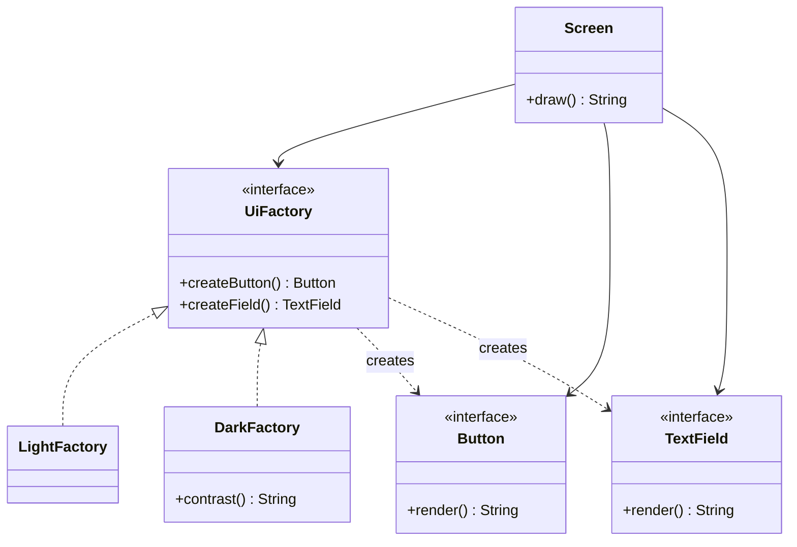

# Chapter 30 — Abstract Factory

## What and why

Abstract Factory = an interface with **one creation method per product** in a family; each concrete factory produces a consistent family (light theme, dark theme). Exams ask for roles, why it guarantees family consistency, and what breaks when a new product type is added.

## Problem

A UI needs buttons **and** text fields that match. Writing `new LightButton()` next to `new DarkField()` mixes styles. Put all creation behind one factory object, chosen once.

## Exam flash rules

- Abstract Factory creates **families of related products** without naming concrete classes.
- Roles: **AbstractFactory**, **ConcreteFactory**, **AbstractProduct**, **ConcreteProduct**, **Client**.
- The client holds the factory by its **interface type** and never uses `new` on a concrete product.
- One concrete factory ⇒ one family: products from the same factory are guaranteed to match.
- Adding a **new family** = add one factory class (no edits elsewhere).
- Adding a **new product type** = edit the factory interface and **every** concrete factory.
- Abstract Factory is usually implemented with **Factory Methods** (one per product).
- A concrete-only method is invisible through the interface type — `cannot find symbol`.
- Casting a factory to the wrong concrete type throws `ClassCastException`.
- If the client accepts several factories, a mixed family is possible; pass **one** factory.
- A concrete factory is often a singleton.
- `new` on an interface or abstract class fails to compile.

## Rules table — what the compiler rejects

| Mistake | Compiler message |
|---------|------------------|
| Concrete factory omits a creation method | `... is not abstract and does not override abstract method createField() in UiFactory` |
| `new UiFactory()` | `UiFactory is abstract; cannot be instantiated` |
| Factory returns a non-product | `incompatible types: String cannot be converted to Button` |
| Calling a concrete-only method via the interface | `cannot find symbol ... method contrast()` |

## Walkthrough

### Products and the abstract factory

```java
{{#include ../../code/part-03-patterns/src/main/java/patterns/creational/abstractfactory/Button.java:af-button}}
```

```java
{{#include ../../code/part-03-patterns/src/main/java/patterns/creational/abstractfactory/TextField.java:af-text-field}}
```

```java
{{#include ../../code/part-03-patterns/src/main/java/patterns/creational/abstractfactory/UiFactory.java:ui-factory}}
```

### Two families

```java
{{#include ../../code/part-03-patterns/src/main/java/patterns/creational/abstractfactory/LightFactory.java:light-factory}}
```

```java
{{#include ../../code/part-03-patterns/src/main/java/patterns/creational/abstractfactory/DarkFactory.java:dark-factory}}
```

### Client and selection

```java
{{#include ../../code/part-03-patterns/src/main/java/patterns/creational/abstractfactory/Screen.java:screen}}
```

```java
{{#include ../../code/part-03-patterns/src/main/java/patterns/creational/abstractfactory/UiFactories.java:ui-factories}}
```

```java
{{#include ../../code/part-03-patterns/src/main/java/patterns/creational/abstractfactory/AbstractFactoryDemo.java:abstract-factory-demo}}
```

```text
{{#include ../../code/part-03-patterns/output/AbstractFactoryDemo.txt}}
```

### Gotcha — mixed families

```java
{{#include ../../code/part-03-patterns/src/main/java/patterns/creational/abstractfactory/MixedFamilyGotcha.java:mixed-family-gotcha}}
```

```text
{{#include ../../code/part-03-patterns/output/MixedFamilyGotcha.txt}}
```

The first line is a mixed family: the pattern only helps if the client receives **one** factory.

### Where the JDK uses it

```java
{{#include ../../code/part-03-patterns/src/main/java/patterns/creational/abstractfactory/JdkAbstractFactoryDemo.java:jdk-abstract-factory-demo}}
```

```text
{{#include ../../code/part-03-patterns/output/JdkAbstractFactoryDemo.txt}}
```

- `DocumentBuilderFactory` / `TransformerFactory` / `SAXParserFactory` — pluggable XML family (`newInstance()` finds the implementation).
- `java.sql.Connection` — creates `Statement`, `PreparedStatement`, `CallableStatement` that belong to one driver.
- `java.awt.Toolkit` — creates platform-matched peers.

## Abstract Factory vs similar

| | Abstract Factory | Factory Method | Builder | Prototype | Singleton |
|---|------------------|----------------|---------|-----------|-----------|
| Creates | **family** of products | one product | one complex product | copies of a prototype | one instance |
| Mechanism | object composition | inheritance | step-wise object | clone/copy | static instance |
| Add a new product type | edit all factories | add creator | add method | n/a | n/a |
| Add a new family | one new class | n/a | n/a | register prototype | n/a |

## Predict the output

**P1.**

```java
{{#include ../../code/part-03-patterns/src/main/java/patterns/creational/abstractfactory/exam/PredictFamilyConsistency.java:predict-family-consistency}}
```

<details><summary>Answer</summary>

```text
{{#include ../../code/part-03-patterns/output/PredictFamilyConsistency.txt}}
```

Trace: both products come from `DarkFactory`.

</details>

**P2.**

```java
{{#include ../../code/part-03-patterns/src/main/java/patterns/creational/abstractfactory/exam/PredictThemeSwitch.java:predict-theme-switch}}
```

<details><summary>Answer</summary>

```text
{{#include ../../code/part-03-patterns/output/PredictThemeSwitch.txt}}
```

Trace: `first` captured its products at construction; reassigning `f` later does not change it.

</details>

**P3.**

```java
{{#include ../../code/part-03-patterns/src/main/java/patterns/creational/abstractfactory/exam/PredictUnknownTheme.java:predict-unknown-theme}}
```

<details><summary>Answer</summary>

```text
{{#include ../../code/part-03-patterns/output/PredictUnknownTheme.txt}}
```

Trace: `switch` on strings is case-sensitive.

</details>

**P4.**

```java
{{#include ../../code/part-03-patterns/src/main/java/patterns/creational/abstractfactory/exam/PredictCastFactory.java:predict-cast-factory}}
```

<details><summary>Answer</summary>

```text
{{#include ../../code/part-03-patterns/output/PredictCastFactory.txt}}
```

Trace: cast to `DarkFactory` works only when the object really is one.

</details>

**P5.**

```java
{{#include ../../code/part-03-patterns/src/main/java/patterns/creational/abstractfactory/exam/PredictMixedFamily.java:predict-mixed-family}}
```

<details><summary>Answer</summary>

```text
{{#include ../../code/part-03-patterns/output/PredictMixedFamily.txt}}
```

Trace: two factories ⇒ two families in one result.

</details>

**P6.** `MixedFamilyGotcha` (above) — predict all three lines.

<details><summary>Answer</summary>

```text
{{#include ../../code/part-03-patterns/output/MixedFamilyGotcha.txt}}
```

</details>

## Compile or not?

**C1.** Factory missing one creation method.

```java
{{#include ../../code/part-03-patterns/broken/AbstractFactoryMissingMethodBroken.java}}
```

<details><summary>Answer — fails</summary>

```text
{{#include ../../code/part-03-patterns/output/broken/AbstractFactoryMissingMethodBroken.txt}}
```

</details>

**C2.** `new UiFactory()`.

```java
{{#include ../../code/part-03-patterns/broken/AbstractFactoryNewInterfaceBroken.java}}
```

<details><summary>Answer — fails</summary>

```text
{{#include ../../code/part-03-patterns/output/broken/AbstractFactoryNewInterfaceBroken.txt}}
```

</details>

**C3.** Factory returns a `String` as a `Button`.

```java
{{#include ../../code/part-03-patterns/broken/AbstractFactoryWrongProductBroken.java}}
```

<details><summary>Answer — fails</summary>

```text
{{#include ../../code/part-03-patterns/output/broken/AbstractFactoryWrongProductBroken.txt}}
```

</details>

**C4.** `f.contrast()` where `f` is `UiFactory`.

```java
{{#include ../../code/part-03-patterns/broken/AbstractFactoryInterfaceTypeBroken.java}}
```

<details><summary>Answer — fails</summary>

```text
{{#include ../../code/part-03-patterns/output/broken/AbstractFactoryInterfaceTypeBroken.txt}}
```

</details>

## Gotchas

1. Two factories in one client ⇒ mixed family — `MixedFamilyGotcha`.
2. Adding a product type ripples through every factory — `Ch30Solutions` ex2 (`WideUiFactory`).
3. Down-casting a factory defeats the abstraction — `PredictCastFactory`.
4. Static type hides concrete-only methods — `AbstractFactoryInterfaceTypeBroken`.
5. Choosing the family from a raw string is case-sensitive — `PredictUnknownTheme`.

## UML



## Interview Q&A

1. **Q:** What problem does Abstract Factory solve? **A:** Creating matching products from one family without naming concrete classes.
2. **Q:** How is it different from Factory Method? **A:** It is an object with several creation methods; Factory Method is one overridable method.
3. **Q:** What is easy to add? **A:** A new family (one class).
4. **Q:** What is hard to add? **A:** A new product type — every factory changes (`Ch30Solutions` ex2).
5. **Q:** How is consistency enforced? **A:** The client gets one factory — `MixedFamilyGotcha` shows the failure mode.
6. **Q:** Does the client use `new`? **A:** Never for products.
7. **Q:** Can factories be lambdas? **A:** Only when the factory interface has one method; here it has two.
8. **Q:** JDK example? **A:** `DocumentBuilderFactory`.
9. **Q:** How is the family chosen? **A:** Once, at startup (`UiFactories.of`).
10. **Q:** Why return interfaces from the factory? **A:** The compiler then rejects non-products — `AbstractFactoryWrongProductBroken`.
11. **Q:** Abstract Factory vs Prototype? **A:** Factory classes vs cloning registered instances.
12. **Q:** Is a concrete factory a singleton? **A:** Often, since it is stateless.

## Exam writing prompts

1. (8) Write `Chair`/`Table` interfaces, `ModernFactory` and `ClassicFactory`, and a client method that uses only the factory interface.
2. (3) Add a `Checkbox` product: list every class that must change.
3. (3) Write the `switch` expression that returns a `UiFactory` for `"light"` or `"dark"` and throws otherwise.

## Exercises

1. Add a third family.

```java
{{#include ../../code/part-03-patterns/solutions/ch30/Ch30Solutions.java:ch30-ex1}}
```

2. Add a new product type.

```java
{{#include ../../code/part-03-patterns/solutions/ch30/Ch30Solutions.java:ch30-ex2}}
```

3. Build a factory from data with a record.

```java
{{#include ../../code/part-03-patterns/solutions/ch30/Ch30Solutions.java:ch30-ex3}}
```

4. Decorate a factory to count products.

```java
{{#include ../../code/part-03-patterns/solutions/ch30/Ch30Solutions.java:ch30-ex4}}
```

5. Make a mixed family impossible by API shape.

```java
{{#include ../../code/part-03-patterns/solutions/ch30/Ch30Solutions.java:ch30-ex5}}
```

```text
{{#include ../../code/part-03-patterns/output/Ch30Solutions.txt}}
```

## Recap checklist

- [x] Roles and family consistency
- [x] Add family vs add product type
- [x] Mixed-family gotcha, cast gotcha
- [x] JDK usage and comparison table
- [x] Exam banks: flash rules, predict ×6, compile ×4, writing ×3, exercises ×5
