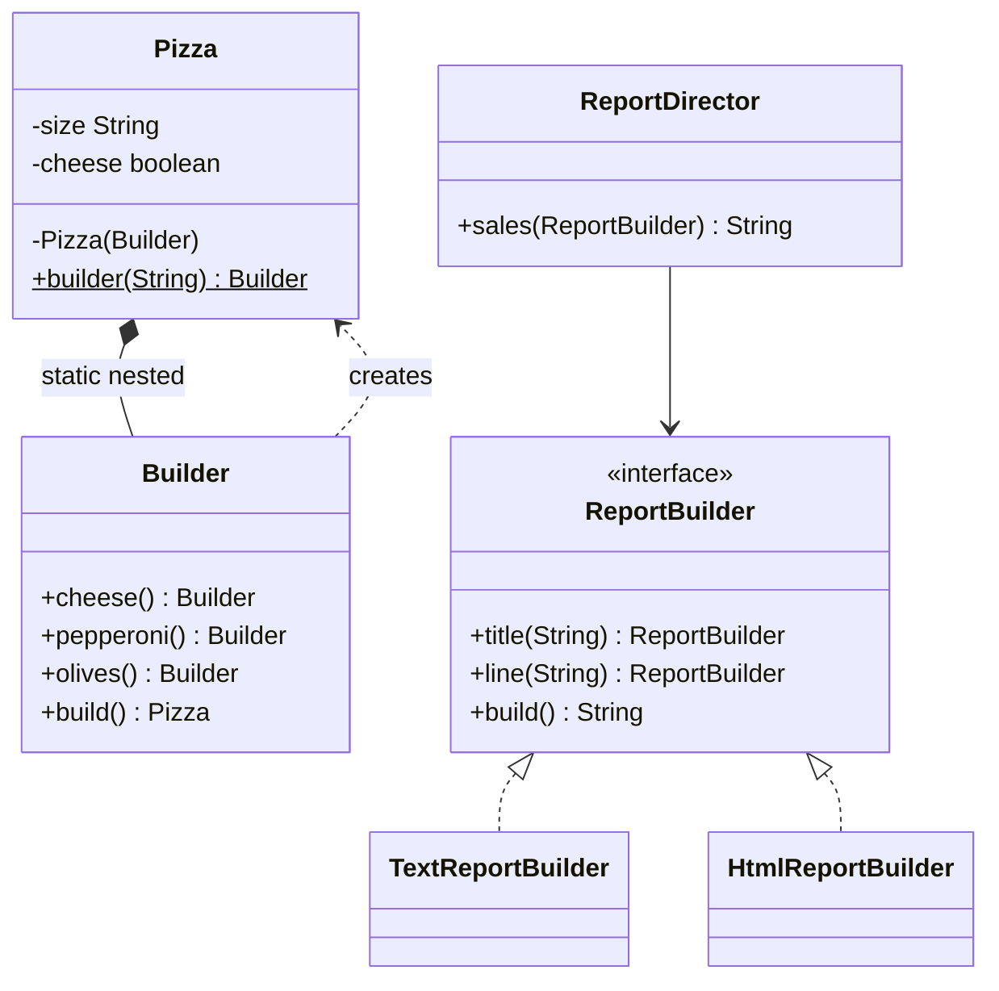

# Chapter 31 — Builder

## What and why

Builder = construct a complex object step by step, validate once in `build()`, and get an immutable result. Exams ask for the telescoping-constructor problem, the fluent nested builder, the GoF Director form, and where the JDK uses builders.

## Problem

A class with one required and several optional fields needs many constructors (telescoping) or setters (half-built, mutable objects). `new TelescopingPizza("L", true, false, true)` hides which boolean is which.

## Exam flash rules

- Builder separates **construction** from **representation**: same steps, different products (GoF) or readable construction of one product (nested builder).
- Roles (GoF): **Builder**, **ConcreteBuilder**, **Director**, **Product**. The nested-builder form drops the Director; the caller is the director.
- Fluent setters `return this`, so calls chain.
- `build()` is the **only** place that validates cross-field rules and creates the product.
- The product constructor is **private**; only the builder can call it.
- The nested builder must be **`static`**; a non-static inner class needs an enclosing instance.
- Required fields go in the builder's constructor; optional fields have defaults.
- A builder that stores a mutable collection must **copy** it when building, or later calls change old products.
- Builder solves telescoping constructors and boolean-argument confusion.
- `StringBuilder` is a builder for `String` (mutable accumulator, `toString()` finishes).
- `String` is immutable: `s.concat("zz")` without assignment changes nothing.
- A fluent method that forgets `return this;` fails: `missing return statement`.

## Rules table — what the compiler rejects

| Mistake | Compiler message |
|---------|------------------|
| `new Pizza(...)` outside the class | `Pizza(Builder) has private access in Pizza` |
| Reassigning a `final` product field | `cannot assign a value to final variable size` |
| `new Product.Builder()` for a non-static nested class | `an enclosing instance that contains Product.Builder is required` |
| Fluent method without `return` | `missing return statement` |
| Forgetting `.build()` | `incompatible types: Builder cannot be converted to Pizza` |

## Walkthrough

### The problem

```java
{{#include ../../code/part-03-patterns/src/main/java/patterns/creational/builder/TelescopingPizza.java:telescoping-pizza}}
```

### Nested fluent builder

```java
{{#include ../../code/part-03-patterns/src/main/java/patterns/creational/builder/Pizza.java:pizza}}
```

### GoF form: builder interface + director

```java
{{#include ../../code/part-03-patterns/src/main/java/patterns/creational/builder/ReportBuilder.java:report-builder}}
```

```java
{{#include ../../code/part-03-patterns/src/main/java/patterns/creational/builder/TextReportBuilder.java:text-report-builder}}
```

```java
{{#include ../../code/part-03-patterns/src/main/java/patterns/creational/builder/HtmlReportBuilder.java:html-report-builder}}
```

```java
{{#include ../../code/part-03-patterns/src/main/java/patterns/creational/builder/ReportDirector.java:report-director}}
```

```java
{{#include ../../code/part-03-patterns/src/main/java/patterns/creational/builder/BuilderDemo.java:builder-demo}}
```

```text
{{#include ../../code/part-03-patterns/output/BuilderDemo.txt}}
```

### Gotcha — builder reuse and mutable state

```java
{{#include ../../code/part-03-patterns/src/main/java/patterns/creational/builder/BuilderReuseGotcha.java:builder-reuse-gotcha}}
```

```text
{{#include ../../code/part-03-patterns/output/BuilderReuseGotcha.txt}}
```

### Where the JDK uses it

```java
{{#include ../../code/part-03-patterns/src/main/java/patterns/creational/builder/JdkBuilderDemo.java:jdk-builder-demo}}
```

```text
{{#include ../../code/part-03-patterns/output/JdkBuilderDemo.txt}}
```

`StringBuilder`, `Stream.builder()`, `HttpRequest.newBuilder()`, `Locale.Builder`, `ProcessBuilder`, `Calendar.Builder`.

## Builder vs similar

| | Builder | Telescoping ctors | JavaBean setters | Factory Method | Abstract Factory |
|---|---------|-------------------|------------------|----------------|------------------|
| Readable call site | yes (named steps) | no (positional) | yes | n/a | n/a |
| Immutable product | yes | yes | no | n/a | n/a |
| Validation point | `build()` | constructor | none (half-built object) | factory | factory |
| Focus | **how** one object is assembled | — | — | **which** class | **which family** |

## Predict the output

**P1.**

```java
{{#include ../../code/part-03-patterns/src/main/java/patterns/creational/builder/exam/PredictFluentChain.java:predict-fluent-chain}}
```

<details><summary>Answer</summary>

```text
{{#include ../../code/part-03-patterns/output/PredictFluentChain.txt}}
```

Trace: every setter returns the same builder (`b == same`).

</details>

**P2.**

```java
{{#include ../../code/part-03-patterns/src/main/java/patterns/creational/builder/exam/PredictValidation.java:predict-validation}}
```

<details><summary>Answer</summary>

```text
{{#include ../../code/part-03-patterns/output/PredictValidation.txt}}
```

Trace: first `build()` ok (two toppings) → `olives()` makes three → rule fails; `null` size fails the required check.

</details>

**P3.**

```java
{{#include ../../code/part-03-patterns/src/main/java/patterns/creational/builder/exam/PredictTelescopingOrder.java:predict-telescoping-order}}
```

<details><summary>Answer</summary>

```text
{{#include ../../code/part-03-patterns/output/PredictTelescopingOrder.txt}}
```

Trace: positional booleans; the third argument is `pepperoni`, the fourth `olives`.

</details>

**P4.**

```java
{{#include ../../code/part-03-patterns/src/main/java/patterns/creational/builder/exam/PredictDirector.java:predict-director}}
```

<details><summary>Answer</summary>

```text
{{#include ../../code/part-03-patterns/output/PredictDirector.txt}}
```

Trace: same construction steps, different concrete builder.

</details>

**P5.**

```java
{{#include ../../code/part-03-patterns/src/main/java/patterns/creational/builder/exam/PredictStringBuilderChain.java:predict-string-builder-chain}}
```

<details><summary>Answer</summary>

```text
{{#include ../../code/part-03-patterns/output/PredictStringBuilderChain.txt}}
```

Trace: `append` returns `this`, so `a` and `b` are one object; `reverse()` mutates it; `String.concat` returns a new string that is discarded.

</details>

**P6.** `BuilderReuseGotcha` — predict both lines.

<details><summary>Answer</summary>

```text
{{#include ../../code/part-03-patterns/output/BuilderReuseGotcha.txt}}
```

Trace: the leaky product shares the builder's list; the safe one took a snapshot.

</details>

## Compile or not?

**C1.** `new Pizza(null)` from outside.

```java
{{#include ../../code/part-03-patterns/broken/BuilderPrivateCtorBroken.java}}
```

<details><summary>Answer — fails</summary>

```text
{{#include ../../code/part-03-patterns/output/broken/BuilderPrivateCtorBroken.txt}}
```

</details>

**C2.** Reassigning a final field.

```java
{{#include ../../code/part-03-patterns/broken/BuilderFinalFieldBroken.java}}
```

<details><summary>Answer — fails</summary>

```text
{{#include ../../code/part-03-patterns/output/broken/BuilderFinalFieldBroken.txt}}
```

</details>

**C3.** Non-static nested builder.

```java
{{#include ../../code/part-03-patterns/broken/BuilderInnerNotStaticBroken.java}}
```

<details><summary>Answer — fails</summary>

```text
{{#include ../../code/part-03-patterns/output/broken/BuilderInnerNotStaticBroken.txt}}
```

</details>

**C4.** Fluent method without `return`.

```java
{{#include ../../code/part-03-patterns/broken/BuilderMissingReturnBroken.java}}
```

<details><summary>Answer — fails</summary>

```text
{{#include ../../code/part-03-patterns/output/broken/BuilderMissingReturnBroken.txt}}
```

</details>

**C5.** Missing `.build()`.

```java
{{#include ../../code/part-03-patterns/broken/BuilderForgotBuildBroken.java}}
```

<details><summary>Answer — fails</summary>

```text
{{#include ../../code/part-03-patterns/output/broken/BuilderForgotBuildBroken.txt}}
```

</details>

## Gotchas

1. Positional booleans in telescoping constructors — `PredictTelescopingOrder`.
2. Builder holding a mutable list without a copy — `BuilderReuseGotcha`.
3. Validation only in setters misses cross-field rules — `Pizza.Builder.build()` (`PredictValidation`).
4. Forgetting `build()` — `BuilderForgotBuildBroken`.
5. `StringBuilder` aliasing and `String` immutability — `PredictStringBuilderChain`.

## UML



## Interview Q&A

1. **Q:** What problem does Builder solve? **A:** Telescoping constructors and half-built mutable objects.
2. **Q:** Why a private product constructor? **A:** Only `build()` may create it — `BuilderPrivateCtorBroken`.
3. **Q:** Why must the nested builder be `static`? **A:** No enclosing instance exists before the product — `BuilderInnerNotStaticBroken`.
4. **Q:** Role of the Director? **A:** Fixes the construction order; the builder decides the format.
5. **Q:** Where do you validate? **A:** In `build()`.
6. **Q:** How does `StringBuilder` relate? **A:** Mutable builder for `String`.
7. **Q:** Why copy lists in `build()`? **A:** Else later builder calls change built products — `BuilderReuseGotcha`.
8. **Q:** Builder vs Abstract Factory? **A:** One object assembled stepwise vs a family created in one call.
9. **Q:** Can a builder be reused? **A:** Yes if `build()` takes snapshots.
10. **Q:** Builder vs JavaBean setters? **A:** Setters leave an object in invalid intermediate states and block immutability.
11. **Q:** JDK builders? **A:** `HttpRequest.newBuilder()`, `Stream.builder()`, `Locale.Builder`.
12. **Q:** Downside? **A:** Extra class and duplicated field list.

## Exam writing prompts

1. (8) Write an immutable `Car` with required `model` and optional `color`, `year` using a static nested `Builder`.
2. (3) Add validation: `year` must be ≥ 1886; throw `IllegalStateException` from `build()`.
3. (5) Write the GoF form for a `Meal` with `VegBuilder` and `NonVegBuilder` plus a `Director`.
4. (2) Fix: a fluent method returns `void`; chain call fails. State the one-line change.

## Exercises

1. Required name, optional age.

```java
{{#include ../../code/part-03-patterns/solutions/ch31/Ch31Solutions.java:ch31-ex1}}
```

2. Cross-field validation in `build()`.

```java
{{#include ../../code/part-03-patterns/solutions/ch31/Ch31Solutions.java:ch31-ex2}}
```

3. Record + `toBuilder()`.

```java
{{#include ../../code/part-03-patterns/solutions/ch31/Ch31Solutions.java:ch31-ex3}}
```

4. Defensive copy.

```java
{{#include ../../code/part-03-patterns/solutions/ch31/Ch31Solutions.java:ch31-ex4}}
```

5. New concrete builder for the existing director.

```java
{{#include ../../code/part-03-patterns/solutions/ch31/Ch31Solutions.java:ch31-ex5}}
```

```text
{{#include ../../code/part-03-patterns/output/Ch31Solutions.txt}}
```

## Recap checklist

- [x] Telescoping problem, nested fluent builder, GoF builder + director
- [x] Validation in `build()`, immutability, defensive copy
- [x] Compiler errors for private ctor / final / non-static nested / missing return
- [x] JDK usage and comparison table
- [x] Exam banks: flash rules, predict ×6, compile ×5, writing ×4, exercises ×5
