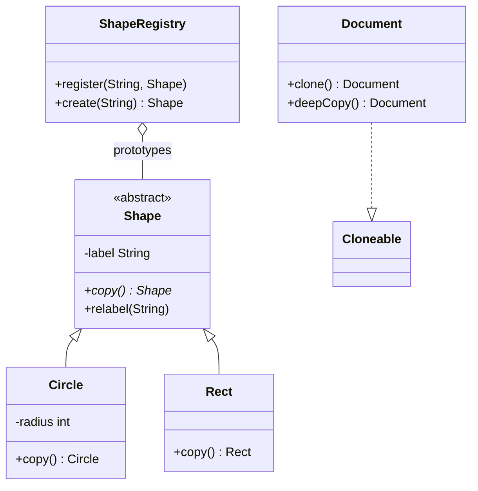

# Chapter 32 — Prototype

## What and why

Prototype = create new objects by **copying an existing instance** instead of calling a constructor. Exams ask for shallow vs deep copy, the `Cloneable` / `Object.clone()` rules, and copy constructors as the safer alternative.

## Problem

Building an object is expensive or needs configuration that a registered "template" already has. Copy the template; change what differs. The copier must not depend on the concrete class.

## Exam flash rules

- Prototype declares a **copy operation** (`copy()` / `clone()`); clients call it through the base type.
- `Object.clone()` is **`protected`**; a class must override it (usually `public`) to expose copying.
- A class must implement **`Cloneable`**, otherwise `super.clone()` throws `CloneNotSupportedException`.
- `Cloneable` has **no methods**; it is a marker that enables `Object.clone()`.
- `super.clone()` is **shallow**: primitive fields copied, reference fields **shared**.
- Deep copy = copy referenced mutable objects too (copy constructor, manual field copy).
- `clone()` does **not call a constructor**.
- An override may use a **covariant return** (`Document clone()`) and drop the `throws` clause.
- An override cannot **weaken** access (protected → package-private fails).
- Arrays: `array.clone()` copies the top level; nested arrays are shared.
- `new ArrayList<>(other)` and `List.copyOf` copy the container, not the elements.
- Copy constructors and `copy()` factory methods avoid `Cloneable`'s pitfalls.
- A prototype registry returns **copies**, never the stored original.

## Rules table — what the compiler rejects

| Mistake | Compiler message |
|---------|------------------|
| `obj.clone()` on a plain `Object` from outside | `clone() has protected access in Object` |
| `super.clone()` without handling the checked exception | `unreported exception CloneNotSupportedException; must be caught or declared to be thrown` |
| Override with weaker access | `attempting to assign weaker access privileges; was protected` |
| Override with a primitive return type | `return type int is not compatible with Object` |
| `new` on the abstract prototype | `Shape is abstract; cannot be instantiated` |

## Walkthrough

### Copy method + registry (preferred style)

```java
{{#include ../../code/part-03-patterns/src/main/java/patterns/creational/prototype/Shape.java:shape}}
```

```java
{{#include ../../code/part-03-patterns/src/main/java/patterns/creational/prototype/Circle.java:circle}}
```

```java
{{#include ../../code/part-03-patterns/src/main/java/patterns/creational/prototype/Rect.java:rect}}
```

```java
{{#include ../../code/part-03-patterns/src/main/java/patterns/creational/prototype/ShapeRegistry.java:shape-registry}}
```

```java
{{#include ../../code/part-03-patterns/src/main/java/patterns/creational/prototype/PrototypeDemo.java:prototype-demo}}
```

```text
{{#include ../../code/part-03-patterns/output/PrototypeDemo.txt}}
```

### `Cloneable` — shallow vs deep

```java
{{#include ../../code/part-03-patterns/src/main/java/patterns/creational/prototype/Document.java:document}}
```

```java
{{#include ../../code/part-03-patterns/src/main/java/patterns/creational/prototype/CloneDemo.java:clone-demo}}
```

```text
{{#include ../../code/part-03-patterns/output/CloneDemo.txt}}
```

### Edge cases

```java
{{#include ../../code/part-03-patterns/src/main/java/patterns/creational/prototype/CloneEdgeDemo.java:clone-edge-demo}}
```

```text
{{#include ../../code/part-03-patterns/output/CloneEdgeDemo.txt}}
```

### Where the JDK uses it

```java
{{#include ../../code/part-03-patterns/src/main/java/patterns/creational/prototype/JdkPrototypeDemo.java:jdk-prototype-demo}}
```

```text
{{#include ../../code/part-03-patterns/output/JdkPrototypeDemo.txt}}
```

`Object.clone`, `ArrayList.clone`, `HashMap.clone`, array `clone()`, `Cloneable`; copy constructors such as `new ArrayList<>(collection)`.

## Prototype vs similar

| | Prototype | Factory Method | Abstract Factory | Builder | Singleton |
|---|-----------|----------------|------------------|---------|-----------|
| Creates by | copying an instance | subclass `new` | factory object `new` | step-by-step | one shared instance |
| Needs class name at call site | no | no | no | yes (builder) | no |
| Handles runtime-configured templates | **yes** | no | no | no | no |
| Pitfall | shallow copy | class explosion | new product ripples | extra class | global state |

## Predict the output

**P1.**

```java
{{#include ../../code/part-03-patterns/src/main/java/patterns/creational/prototype/exam/PredictShallowShared.java:predict-shallow-shared}}
```

<details><summary>Answer</summary>

```text
{{#include ../../code/part-03-patterns/output/PredictShallowShared.txt}}
```

Trace: the clone shares `pages`; both objects show `y`.

</details>

**P2.**

```java
{{#include ../../code/part-03-patterns/src/main/java/patterns/creational/prototype/exam/PredictDeepCopy.java:predict-deep-copy}}
```

<details><summary>Answer</summary>

```text
{{#include ../../code/part-03-patterns/output/PredictDeepCopy.txt}}
```

Trace: independent lists.

</details>

**P3.**

```java
{{#include ../../code/part-03-patterns/src/main/java/patterns/creational/prototype/exam/PredictCtorNotCalled.java:predict-ctor-not-called}}
```

<details><summary>Answer</summary>

```text
{{#include ../../code/part-03-patterns/output/PredictCtorNotCalled.txt}}
```

Trace: only `new` ran the constructor; `clone` did not.

</details>

**P4.**

```java
{{#include ../../code/part-03-patterns/src/main/java/patterns/creational/prototype/exam/PredictArrayClone.java:predict-array-clone}}
```

<details><summary>Answer</summary>

```text
{{#include ../../code/part-03-patterns/output/PredictArrayClone.txt}}
```

Trace: 1-D clone is independent; 2-D clone shares the inner arrays.

</details>

**P5.**

```java
{{#include ../../code/part-03-patterns/src/main/java/patterns/creational/prototype/exam/PredictRegistryCopy.java:predict-registry-copy}}
```

<details><summary>Answer</summary>

```text
{{#include ../../code/part-03-patterns/output/PredictRegistryCopy.txt}}
```

Trace: changes to the first copy never reach the stored prototype.

</details>

**P6.**

```java
{{#include ../../code/part-03-patterns/src/main/java/patterns/creational/prototype/exam/PredictCovariantCopy.java:predict-covariant-copy}}
```

<details><summary>Answer</summary>

```text
{{#include ../../code/part-03-patterns/output/PredictCovariantCopy.txt}}
```

Trace: `copy()` is dispatched on the runtime class; the covariant return avoids a cast.

</details>

## Compile or not?

**C1.** `o.clone()` on an `Object`.

```java
{{#include ../../code/part-03-patterns/broken/PrototypeProtectedCloneBroken.java}}
```

<details><summary>Answer — fails</summary>

```text
{{#include ../../code/part-03-patterns/output/broken/PrototypeProtectedCloneBroken.txt}}
```

</details>

**C2.** `super.clone()` unhandled.

```java
{{#include ../../code/part-03-patterns/broken/PrototypeUncheckedBroken.java}}
```

<details><summary>Answer — fails</summary>

```text
{{#include ../../code/part-03-patterns/output/broken/PrototypeUncheckedBroken.txt}}
```

</details>

**C3.** Package-private `clone()`.

```java
{{#include ../../code/part-03-patterns/broken/PrototypeWeakerAccessBroken.java}}
```

<details><summary>Answer — fails</summary>

```text
{{#include ../../code/part-03-patterns/output/broken/PrototypeWeakerAccessBroken.txt}}
```

</details>

**C4.** `public int clone()`.

```java
{{#include ../../code/part-03-patterns/broken/PrototypeWrongReturnBroken.java}}
```

<details><summary>Answer — fails</summary>

```text
{{#include ../../code/part-03-patterns/output/broken/PrototypeWrongReturnBroken.txt}}
```

</details>

**C5.** `new Shape("x")`.

```java
{{#include ../../code/part-03-patterns/broken/PrototypeAbstractNewBroken.java}}
```

<details><summary>Answer — fails</summary>

```text
{{#include ../../code/part-03-patterns/output/broken/PrototypeAbstractNewBroken.txt}}
```

</details>

## Gotchas

1. `clone()` is shallow — `CloneDemo`, `PredictShallowShared`.
2. Missing `Cloneable` ⇒ `CloneNotSupportedException` — `CloneEdgeDemo`.
3. Constructors are skipped — `PredictCtorNotCalled`.
4. `int[][].clone()` shares the rows — `PredictArrayClone`.
5. `ArrayList.clone()` copies the list, not the `StringBuilder` elements — `CloneEdgeDemo`.

## UML



## Interview Q&A

1. **Q:** What does Prototype do? **A:** Creates objects by copying a registered instance.
2. **Q:** Why is `Object.clone()` protected? **A:** Classes opt in by overriding and exposing it — `PrototypeProtectedCloneBroken`.
3. **Q:** What does `Cloneable` contain? **A:** Nothing; it is a marker.
4. **Q:** Shallow vs deep? **A:** Shallow shares reference fields — `CloneDemo`.
5. **Q:** Does `clone()` call constructors? **A:** No — `PredictCtorNotCalled`.
6. **Q:** Why prefer copy constructors? **A:** No `Cloneable`, no checked exception, works with `final` fields.
7. **Q:** Can `clone()` return a subtype? **A:** Yes, covariant return.
8. **Q:** How do you deep-clone a list field? **A:** `new ArrayList<>(list)` for immutable elements; copy each element otherwise.
9. **Q:** What does a registry add? **A:** Named templates; callers get copies — `ShapeRegistry`.
10. **Q:** JDK examples? **A:** `ArrayList.clone()`, `HashMap.clone()`, array `clone()`.
11. **Q:** Does `List.copyOf` deep-copy? **A:** No, elements are shared.
12. **Q:** Prototype vs Factory? **A:** Copies an instance vs instantiates a class.

## Exam writing prompts

1. (5) Write `Employee` with a `List<String> skills`; implement `clone()` as a **deep** copy.
2. (3) Write a copy constructor for `Point(int x, int y)`.
3. (5) Complete `PrototypeRegistry` with `register(String, Shape)` and `create(String)` returning a copy; throw `IllegalArgumentException` for an unknown key.
4. (2) State why `class A { public Object clone() { return super.clone(); } }` fails to compile.

## Exercises

1. Copy constructor with deep list copy.

```java
{{#include ../../code/part-03-patterns/solutions/ch32/Ch32Solutions.java:ch32-ex1}}
```

2. New prototype type.

```java
{{#include ../../code/part-03-patterns/solutions/ch32/Ch32Solutions.java:ch32-ex2}}
```

3. `clone()` with an array field.

```java
{{#include ../../code/part-03-patterns/solutions/ch32/Ch32Solutions.java:ch32-ex3}}
```

4. Container copy vs element copy.

```java
{{#include ../../code/part-03-patterns/solutions/ch32/Ch32Solutions.java:ch32-ex4}}
```

5. Registry independence.

```java
{{#include ../../code/part-03-patterns/solutions/ch32/Ch32Solutions.java:ch32-ex5}}
```

```text
{{#include ../../code/part-03-patterns/output/Ch32Solutions.txt}}
```

## Recap checklist

- [x] Copy method + registry; `Cloneable` clone
- [x] Shallow vs deep, constructor not called, array clone
- [x] Compiler errors for protected/unchecked/weaker/return/abstract
- [x] JDK usage and comparison table
- [x] Exam banks: flash rules, predict ×6, compile ×5, writing ×4, exercises ×5
