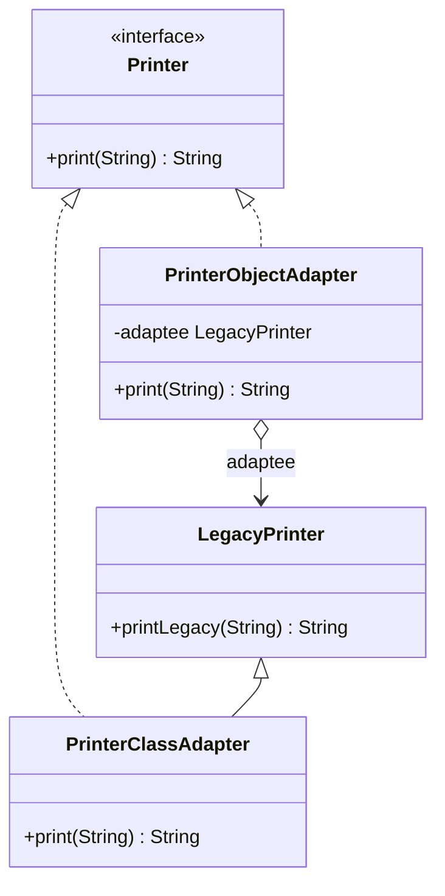

# Chapter 33 — Adapter

## What and why

Adapter = a wrapper that makes an existing class (the **adaptee**) fit the interface a client expects (the **target**) without changing either. Exams ask for object vs class adapter, which one Java allows in which case, and JDK adapters (`Arrays.asList`, `InputStreamReader`).

## Problem

`LegacyPrinter.printLegacy(String)` works, but the client calls `Printer.print(String)`. The legacy class cannot be edited (library, generated code). Write a small class that translates one call into the other.

## Exam flash rules

- Roles: **Target** (what the client uses), **Adaptee** (existing class), **Adapter** (translates), **Client**.
- **Object adapter** = composition: the adapter *has* an adaptee and implements the target.
- **Class adapter** = inheritance: the adapter *extends* the adaptee and implements the target (Java: one class + interfaces).
- Class adapter cannot adapt a **`final`** adaptee and is tied to **one** adaptee class.
- Object adapter works with the adaptee **and its subclasses**.
- Adapter changes the **interface**, not the behaviour; Decorator keeps the interface and adds behaviour.
- A target with one abstract method can be adapted with a **lambda**.
- Calling an adaptee-only method through the target type: `cannot find symbol`.
- `Objects.requireNonNull` in the constructor fails fast on a null adaptee.
- `Arrays.asList(array)` is a **write-through view**; it is fixed-size.
- `Arrays.asList(int[])` yields a one-element `List<int[]>`.
- `InputStreamReader` adapts bytes to characters; `Collections.enumeration` adapts a collection to `Enumeration`.
- Two-way adapter implements both interfaces over one state.

## Rules table — what the compiler rejects

| Mistake | Compiler message |
|---------|------------------|
| Adapter omits the target method | `... is not abstract and does not override abstract method print(String) in Printer` |
| Class adapter extends a final adaptee | `cannot inherit from final FinalLegacy` |
| Assigning an adaptee to the target type | `incompatible types: LegacyPrinter cannot be converted to Printer` |
| Adaptee method through the target type | `cannot find symbol` (`symbol: method printLegacy(String)`) |
| Return type not converted | `incompatible types: String cannot be converted to int` |

## Walkthrough

### Target, adaptee, two adapters

```java
{{#include ../../code/part-03-patterns/src/main/java/patterns/structural/adapter/Printer.java:printer}}
```

```java
{{#include ../../code/part-03-patterns/src/main/java/patterns/structural/adapter/LegacyPrinter.java:legacy-printer}}
```

```java
{{#include ../../code/part-03-patterns/src/main/java/patterns/structural/adapter/PrinterObjectAdapter.java:printer-object-adapter}}
```

```java
{{#include ../../code/part-03-patterns/src/main/java/patterns/structural/adapter/PrinterClassAdapter.java:printer-class-adapter}}
```

### Lambda adapter and conversion

```java
{{#include ../../code/part-03-patterns/src/main/java/patterns/structural/adapter/CelsiusSource.java:celsius-source}}
```

```java
{{#include ../../code/part-03-patterns/src/main/java/patterns/structural/adapter/FahrenheitSensor.java:fahrenheit-sensor}}
```

```java
{{#include ../../code/part-03-patterns/src/main/java/patterns/structural/adapter/AdapterDemo.java:adapter-demo}}
```

```text
{{#include ../../code/part-03-patterns/output/AdapterDemo.txt}}
```

### Edge cases

```java
{{#include ../../code/part-03-patterns/src/main/java/patterns/structural/adapter/AdapterEdgeDemo.java:adapter-edge-demo}}
```

```text
{{#include ../../code/part-03-patterns/output/AdapterEdgeDemo.txt}}
```

### Where the JDK uses it

```java
{{#include ../../code/part-03-patterns/src/main/java/patterns/structural/adapter/JdkAdapterDemo.java:jdk-adapter-demo}}
```

```text
{{#include ../../code/part-03-patterns/output/JdkAdapterDemo.txt}}
```

| JDK adapter | Adapts |
|-------------|--------|
| `Arrays.asList` | array → `List` |
| `InputStreamReader` / `OutputStreamWriter` | byte stream ↔ character stream |
| `Collections.enumeration`, `Collections.list` | `Collection` ↔ `Enumeration` |
| `Executors.callable` | `Runnable` → `Callable` |

## Adapter vs similar

| | Adapter | Decorator | Facade | Proxy | Bridge |
|---|---------|-----------|--------|-------|--------|
| Interface | **changes** (old → expected) | same | **new, simpler** | same | abstraction/implementor split up front |
| Intent | make incompatible things work together | add responsibilities | simplify a subsystem | control access | decouple two hierarchies |
| Wraps | one object | one object | many objects | one object | one implementor |
| Designed | after the fact | up front | up front | up front | up front |

## Predict the output

**P1.**

```java
{{#include ../../code/part-03-patterns/src/main/java/patterns/structural/adapter/exam/PredictObjectAdapter.java:predict-object-adapter}}
```

<details><summary>Answer</summary>

```text
{{#include ../../code/part-03-patterns/output/PredictObjectAdapter.txt}}
```

Trace: delegate, direct call, and the object adapter is **not** a `LegacyPrinter` (`false`).

</details>

**P2.**

```java
{{#include ../../code/part-03-patterns/src/main/java/patterns/structural/adapter/exam/PredictClassAdapter.java:predict-class-adapter}}
```

<details><summary>Answer</summary>

```text
{{#include ../../code/part-03-patterns/output/PredictClassAdapter.txt}}
```

Trace: the class adapter **is** a `LegacyPrinter`, so the cast succeeds.

</details>

**P3.**

```java
{{#include ../../code/part-03-patterns/src/main/java/patterns/structural/adapter/exam/PredictAsListWriteThrough.java:predict-as-list-write-through}}
```

<details><summary>Answer</summary>

```text
{{#include ../../code/part-03-patterns/output/PredictAsListWriteThrough.txt}}
```

Trace: view and array share storage (`9, 8`); fixed size ⇒ `remove` fails; `int[]` becomes a single element.

</details>

**P4.**

```java
{{#include ../../code/part-03-patterns/src/main/java/patterns/structural/adapter/exam/PredictSensorLambda.java:predict-sensor-lambda}}
```

<details><summary>Answer</summary>

```text
{{#include ../../code/part-03-patterns/output/PredictSensorLambda.txt}}
```

Trace: \((f-32)\cdot 5/9\) for 212, 32, −40, 50.

</details>

**P5.**

```java
{{#include ../../code/part-03-patterns/src/main/java/patterns/structural/adapter/exam/PredictNullAdaptee.java:predict-null-adaptee}}
```

<details><summary>Answer</summary>

```text
{{#include ../../code/part-03-patterns/output/PredictNullAdaptee.txt}}
```

Trace: `requireNonNull(adaptee, "adaptee")` throws before `created` prints.

</details>

**P6.**

```java
{{#include ../../code/part-03-patterns/src/main/java/patterns/structural/adapter/exam/PredictEnumerationAdapter.java:predict-enumeration-adapter}}
```

<details><summary>Answer</summary>

```text
{{#include ../../code/part-03-patterns/output/PredictEnumerationAdapter.txt}}
```

Trace: the enumeration is consumed once; afterwards `hasMoreElements()` is `false`.

</details>

## Compile or not?

**C1.** Adapter without `print`.

```java
{{#include ../../code/part-03-patterns/broken/AdapterMissingMethodBroken.java}}
```

<details><summary>Answer — fails</summary>

```text
{{#include ../../code/part-03-patterns/output/broken/AdapterMissingMethodBroken.txt}}
```

</details>

**C2.** Class adapter on a final adaptee.

```java
{{#include ../../code/part-03-patterns/broken/AdapterFinalAdapteeBroken.java}}
```

<details><summary>Answer — fails</summary>

```text
{{#include ../../code/part-03-patterns/output/broken/AdapterFinalAdapteeBroken.txt}}
```

</details>

**C3.** Assigning the adaptee to the target.

```java
{{#include ../../code/part-03-patterns/broken/AdapterNotATargetBroken.java}}
```

<details><summary>Answer — fails</summary>

```text
{{#include ../../code/part-03-patterns/output/broken/AdapterNotATargetBroken.txt}}
```

</details>

**C4.** Adaptee method through the target type.

```java
{{#include ../../code/part-03-patterns/broken/AdapterAdapteeMethodBroken.java}}
```

<details><summary>Answer — fails</summary>

```text
{{#include ../../code/part-03-patterns/output/broken/AdapterAdapteeMethodBroken.txt}}
```

</details>

**C5.** Returning the adaptee's `String` as `int`.

```java
{{#include ../../code/part-03-patterns/broken/AdapterReturnTypeBroken.java}}
```

<details><summary>Answer — fails</summary>

```text
{{#include ../../code/part-03-patterns/output/broken/AdapterReturnTypeBroken.txt}}
```

</details>

## Gotchas

1. Class adapter locks you to one adaptee class — `AdapterFinalAdapteeBroken`; object adapter accepts subtypes — `AdapterEdgeDemo`.
2. `Arrays.asList` writes through and cannot grow — `PredictAsListWriteThrough`.
3. `Arrays.asList(int[])` is a one-element list — `PredictAsListWriteThrough`.
4. A null adaptee fails late unless checked in the constructor — `PredictNullAdaptee`.
5. An enumeration is single-pass — `PredictEnumerationAdapter`.

## UML



## Interview Q&A

1. **Q:** What does Adapter change? **A:** The interface, not the behaviour.
2. **Q:** Object vs class adapter? **A:** Composition vs inheritance — `PrinterObjectAdapter` vs `PrinterClassAdapter`.
3. **Q:** Why can't a class adapter wrap a final class? **A:** Final classes cannot be extended — `AdapterFinalAdapteeBroken`.
4. **Q:** Which adapter handles adaptee subclasses? **A:** Object adapter — `AdapterEdgeDemo`.
5. **Q:** Adapter vs Decorator? **A:** Adapter changes the interface; Decorator keeps it and adds behaviour.
6. **Q:** Adapter vs Facade? **A:** One object, interface translated vs many objects, interface simplified.
7. **Q:** Can a lambda be an adapter? **A:** Yes, if the target has one abstract method — `CelsiusSource`.
8. **Q:** JDK adapters? **A:** `Arrays.asList`, `InputStreamReader`, `Collections.enumeration`.
9. **Q:** What is a two-way adapter? **A:** One that implements both interfaces — `Ch33Solutions` ex4.
10. **Q:** Does `Arrays.asList` copy? **A:** No, it is a write-through view — `PredictAsListWriteThrough`.
11. **Q:** Where should null checks go? **A:** Adapter constructor.
12. **Q:** When is Adapter a smell? **A:** When you control both sides; change the interface instead.

## Exam writing prompts

1. (5) Given `class Square { double side() }` and `interface Shape { double area(); }`, write an object adapter.
2. (5) Rewrite the adapter as a class adapter and state one limitation.
3. (3) Write a lambda that adapts `Supplier<String>` to `Callable<String>`.
4. (2) Name two JDK adapters and what each adapts.

## Exercises

1. `Enumeration` → `Iterator`.

```java
{{#include ../../code/part-03-patterns/solutions/ch33/Ch33Solutions.java:ch33-ex1}}
```

2. `Runnable` → `Callable<Void>`.

```java
{{#include ../../code/part-03-patterns/solutions/ch33/Ch33Solutions.java:ch33-ex2}}
```

3. Lambda adapter with extra behaviour.

```java
{{#include ../../code/part-03-patterns/solutions/ch33/Ch33Solutions.java:ch33-ex3}}
```

4. Two-way adapter.

```java
{{#include ../../code/part-03-patterns/solutions/ch33/Ch33Solutions.java:ch33-ex4}}
```

5. Null-safe adapter.

```java
{{#include ../../code/part-03-patterns/solutions/ch33/Ch33Solutions.java:ch33-ex5}}
```

```text
{{#include ../../code/part-03-patterns/output/Ch33Solutions.txt}}
```

## Recap checklist

- [x] Target / adaptee / adapter roles; object vs class adapter
- [x] Lambda adapter, null check, two-way adapter
- [x] Compiler errors for missing method, final adaptee, wrong types
- [x] JDK usage and comparison table
- [x] Exam banks: flash rules, predict ×6, compile ×5, writing ×4, exercises ×5
