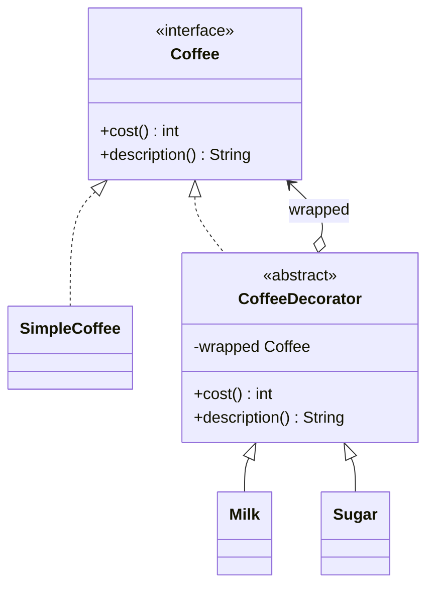

# Chapter 34 — Decorator

## What and why

Decorator = wrap an object in another object with the **same interface** to add behaviour at runtime, stackable in any order. Exams ask for the structure (is-a **and** has-a), why order matters, subclass explosion, and the `java.io` chain.

## Problem

Coffee with milk, sugar, vanilla: subclassing gives `MilkSugarCoffee`, `MilkVanillaCoffee`, … (2ⁿ classes). Wrap instead: `new Sugar(new Milk(new SimpleCoffee()))`.

## Exam flash rules

- Decorator **implements the component interface** and **holds a component** (is-a + has-a).
- Each decorator forwards to the wrapped object and adds before/after behaviour.
- Decorators are **stackable**; the **order** of wrapping can change the result.
- Client code uses the interface type and cannot tell a decorator from the original.
- `decorated instanceof ConcreteComponent` is **`false`**: type checks on the concrete class break.
- Decorator avoids a **class explosion** from combining features by inheritance.
- Decorator adds behaviour at **runtime**; inheritance fixes it at compile time.
- Decorator vs Adapter: same interface + added behaviour vs different interface.
- Decorator vs Proxy: add features vs control access (structure is the same).
- Wrapped component is usually `private final` in the base; subclasses use `super`.
- A subclass without an explicit `super(...)` call fails if the base has no no-arg constructor.
- `java.io`: `new BufferedReader(new InputStreamReader(in))` is a decorator chain.
- `Collections.unmodifiableList` returns a **live read-only view**, not a copy.

## Rules table — what the compiler rejects

| Mistake | Compiler message |
|---------|------------------|
| Implementing the component without all methods | `... is not abstract and does not override abstract method description() in Coffee` |
| Subclass reads the base's private field | `wrapped has private access in CoffeeDecorator` |
| Wrapping the wrong type | `incompatible types: String cannot be converted to Coffee` |
| Subclass constructor without `super(...)` | `constructor CoffeeDecorator in class CoffeeDecorator cannot be applied to given types;` |
| `new` on the abstract decorator base | `CoffeeDecorator is abstract; cannot be instantiated` |

## Walkthrough

### Component and decorators

```java
{{#include ../../code/part-03-patterns/src/main/java/patterns/structural/decorator/Coffee.java:coffee}}
```

```java
{{#include ../../code/part-03-patterns/src/main/java/patterns/structural/decorator/SimpleCoffee.java:simple-coffee}}
```

```java
{{#include ../../code/part-03-patterns/src/main/java/patterns/structural/decorator/CoffeeDecorator.java:coffee-decorator}}
```

```java
{{#include ../../code/part-03-patterns/src/main/java/patterns/structural/decorator/Milk.java:milk}}
```

```java
{{#include ../../code/part-03-patterns/src/main/java/patterns/structural/decorator/Sugar.java:sugar}}
```

### Functional decorators — order matters

```java
{{#include ../../code/part-03-patterns/src/main/java/patterns/structural/decorator/TextSource.java:text-source}}
```

```java
{{#include ../../code/part-03-patterns/src/main/java/patterns/structural/decorator/DecoratorDemo.java:decorator-demo}}
```

```text
{{#include ../../code/part-03-patterns/output/DecoratorDemo.txt}}
```

### Where the JDK uses it

```java
{{#include ../../code/part-03-patterns/src/main/java/patterns/structural/decorator/JdkDecoratorDemo.java:jdk-decorator-demo}}
```

```text
{{#include ../../code/part-03-patterns/output/JdkDecoratorDemo.txt}}
```

`BufferedInputStream`, `DataOutputStream`, `BufferedReader`, `FilterWriter` family, `Collections.unmodifiableX`, `Collections.synchronizedX`, `Collections.checkedX`.

## Decorator vs similar

| | Decorator | Adapter | Proxy | Composite | Strategy |
|---|-----------|---------|-------|-----------|----------|
| Interface | same as wrapped | different | same | same | strategy interface |
| Adds | behaviour | translation | access control / lazy / remote | tree structure | swappable algorithm |
| Stackable | **yes** | rarely | rarely | n/a | no |
| Wraps | one component | one adaptee | one subject | many children | n/a |
| Changes object **skin** vs **guts** | skin (wrapper) | skin | skin | structure | guts (algorithm inside) |

## Predict the output

**P1.**

```java
{{#include ../../code/part-03-patterns/src/main/java/patterns/structural/decorator/exam/PredictStackOrder.java:predict-stack-order}}
```

<details><summary>Answer</summary>

```text
{{#include ../../code/part-03-patterns/output/PredictStackOrder.txt}}
```

Trace: the **inner** decorator's text comes first; costs add commutatively.

</details>

**P2.**

```java
{{#include ../../code/part-03-patterns/src/main/java/patterns/structural/decorator/exam/PredictInstanceofAfterWrap.java:predict-instanceof-after-wrap}}
```

<details><summary>Answer</summary>

```text
{{#include ../../code/part-03-patterns/output/PredictInstanceofAfterWrap.txt}}
```

Trace: the outer object is a `Milk`, not a `SimpleCoffee`.

</details>

**P3.**

```java
{{#include ../../code/part-03-patterns/src/main/java/patterns/structural/decorator/exam/PredictTextOrder.java:predict-text-order}}
```

<details><summary>Answer</summary>

```text
{{#include ../../code/part-03-patterns/output/PredictTextOrder.txt}}
```

Trace: trim-then-append vs append-then-trim; the base source is unchanged.

</details>

**P4.**

```java
{{#include ../../code/part-03-patterns/src/main/java/patterns/structural/decorator/exam/PredictUnmodifiableView.java:predict-unmodifiable-view}}
```

<details><summary>Answer</summary>

```text
{{#include ../../code/part-03-patterns/output/PredictUnmodifiableView.txt}}
```

Trace: the view sees later changes to `base`; `List.copyOf` is a snapshot.

</details>

**P5.**

```java
{{#include ../../code/part-03-patterns/src/main/java/patterns/structural/decorator/exam/PredictBufferedRead.java:predict-buffered-read}}
```

<details><summary>Answer</summary>

```text
{{#include ../../code/part-03-patterns/output/PredictBufferedRead.txt}}
```

Trace: an empty line is `""`, not `null`; `null` means end of stream.

</details>

**P6.** `DecoratorDemo` — predict the description and cost of `new Sugar(new Milk(new Milk(plain)))`.

<details><summary>Answer</summary>

```text
{{#include ../../code/part-03-patterns/output/DecoratorDemo.txt}}
```

Trace: 200 + 50 + 50 + 20 = 320.

</details>

## Compile or not?

**C1.** Missing `description()`.

```java
{{#include ../../code/part-03-patterns/broken/DecoratorMissingMethodBroken.java}}
```

<details><summary>Answer — fails</summary>

```text
{{#include ../../code/part-03-patterns/output/broken/DecoratorMissingMethodBroken.txt}}
```

</details>

**C2.** Subclass reads `wrapped`.

```java
{{#include ../../code/part-03-patterns/broken/DecoratorPrivateWrappedBroken.java}}
```

<details><summary>Answer — fails</summary>

```text
{{#include ../../code/part-03-patterns/output/broken/DecoratorPrivateWrappedBroken.txt}}
```

</details>

**C3.** `new Milk("espresso")`.

```java
{{#include ../../code/part-03-patterns/broken/DecoratorWrongArgBroken.java}}
```

<details><summary>Answer — fails</summary>

```text
{{#include ../../code/part-03-patterns/output/broken/DecoratorWrongArgBroken.txt}}
```

</details>

**C4.** No `super(...)` call.

```java
{{#include ../../code/part-03-patterns/broken/DecoratorNoSuperCallBroken.java}}
```

<details><summary>Answer — fails</summary>

```text
{{#include ../../code/part-03-patterns/output/broken/DecoratorNoSuperCallBroken.txt}}
```

</details>

**C5.** `new CoffeeDecorator(...)`.

```java
{{#include ../../code/part-03-patterns/broken/DecoratorAbstractNewBroken.java}}
```

<details><summary>Answer — fails</summary>

```text
{{#include ../../code/part-03-patterns/output/broken/DecoratorAbstractNewBroken.txt}}
```

</details>

## Gotchas

1. `instanceof` on the concrete class fails after wrapping — `PredictInstanceofAfterWrap`.
2. Order of wrapping changes results — `PredictTextOrder`, `PredictStackOrder`.
3. `unmodifiableList` is a live view, not a copy — `PredictUnmodifiableView`.
4. `readLine()` returns `null` only at end of stream — `PredictBufferedRead`.
5. Forgetting to close the **outermost** wrapper — `JdkDecoratorDemo` uses try-with-resources on the outer reader/stream.

## UML



## Interview Q&A

1. **Q:** What two relations does a decorator have to the component? **A:** Is-a (implements the interface) and has-a (holds one).
2. **Q:** Why not subclass for each combination? **A:** Class explosion — 2ⁿ combinations.
3. **Q:** Does order matter? **A:** Often — `PredictTextOrder`.
4. **Q:** How does it differ from Adapter? **A:** Same interface, adds behaviour.
5. **Q:** How does it differ from Proxy? **A:** Decorator adds responsibilities; Proxy controls access.
6. **Q:** JDK example? **A:** `new BufferedReader(new InputStreamReader(System.in))`.
7. **Q:** Can you detect the concrete type through a decorator? **A:** No — `PredictInstanceofAfterWrap`.
8. **Q:** What should the abstract decorator do by default? **A:** Forward every method.
9. **Q:** Is `Collections.unmodifiableList` a decorator? **A:** Yes — it wraps and blocks mutators (`JdkDecoratorDemo`).
10. **Q:** Disadvantage? **A:** Many small objects; identity and stack traces are harder to follow.
11. **Q:** Can decorators be lambdas? **A:** For single-method components — `TextSource.then`.
12. **Q:** Which stream do you close? **A:** The outermost; it closes the inner ones.

## Exam writing prompts

1. (8) Write `Pizza`, `PlainPizza`, abstract `ToppingDecorator`, `Cheese`, `Olives`, and print the cost of `Cheese(Olives(PlainPizza))`.
2. (3) Write a `LoggingList<E>` decorator that counts `add` calls (see exercise 4).
3. (3) State why `Sugar(Milk(c))` and `Milk(Sugar(c))` have the same cost but different descriptions.
4. (2) Write the one-line `java.io` chain that reads lines from a `String`.

## Exercises

1. Add a `Vanilla` decorator.

```java
{{#include ../../code/part-03-patterns/solutions/ch34/Ch34Solutions.java:ch34-ex1}}
```

2. Counting decorator.

```java
{{#include ../../code/part-03-patterns/solutions/ch34/Ch34Solutions.java:ch34-ex2}}
```

3. `FilterWriter` decorator.

```java
{{#include ../../code/part-03-patterns/solutions/ch34/Ch34Solutions.java:ch34-ex3}}
```

4. Counting list.

```java
{{#include ../../code/part-03-patterns/solutions/ch34/Ch34Solutions.java:ch34-ex4}}
```

5. Stack the same decorator twice.

```java
{{#include ../../code/part-03-patterns/solutions/ch34/Ch34Solutions.java:ch34-ex5}}
```

```text
{{#include ../../code/part-03-patterns/output/Ch34Solutions.txt}}
```

## Recap checklist

- [x] Is-a + has-a structure; stackable; order matters
- [x] Functional decorators; `java.io` and `Collections` decorators
- [x] Compiler errors for missing method, private field, wrong arg, no `super`
- [x] JDK usage and comparison table
- [x] Exam banks: flash rules, predict ×6, compile ×5, writing ×4, exercises ×5
