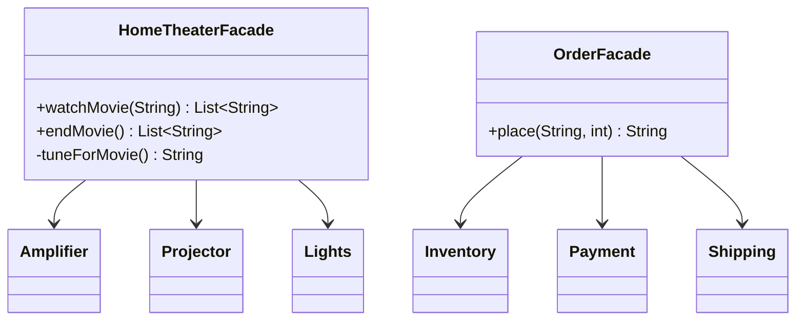

# Chapter 35 — Facade

## What and why

Facade = one simple class in front of a group of classes, exposing only the few operations clients need. Exams ask for the definition, facade vs adapter, whether a facade hides the subsystem, and JDK examples (`Files`, `String.format`).

## Problem

Starting a movie means dimming lights, switching on the projector and amplifier, setting volume — in the right order. Every client repeating that sequence couples itself to five classes. One `watchMovie(title)` call removes the coupling.

## Exam flash rules

- Facade provides a **simplified, unified interface** to a subsystem.
- The subsystem classes **do not know** the facade exists.
- A facade adds **no new behaviour** beyond coordination (order, rollback, defaults).
- Facade does **not** forbid direct subsystem use unless the subsystem is made package-private.
- Facade reduces **coupling** between clients and subsystem classes.
- Facade vs Adapter: Adapter makes **one** incompatible interface fit; Facade makes **many** classes easier to use.
- Facade vs Mediator: Facade is one-way (client → subsystem); Mediator coordinates colleagues talking to each other.
- Facade is often a **Singleton** or a stateless helper.
- A facade method should hide checked exceptions of subsystems (or translate them).
- A private helper in the facade cannot be called from outside: `has private access`.
- A package-private subsystem class cannot be imported or instantiated from another package.
- `Files.readString`/`writeString` hide streams, buffers, charsets and `close()`.
- `String.format` is a facade over `java.util.Formatter`.

## Rules table — what the compiler rejects

| Mistake | Compiler message |
|---------|------------------|
| Using a package-private subsystem class from another package | `Amplifier is not public in patterns.structural.facade.subsystem; cannot be accessed from outside package` |
| Calling a private facade helper | `tuneForMovie() has private access in HomeTheaterFacade` |
| Calling a method the facade does not offer | `cannot find symbol` (`method pauseMovie()`) |
| Bypassing the facade ignores the subsystem's checked exception | `unreported exception PaymentDeclinedException; must be caught or declared to be thrown` |
| Wrong argument type | `incompatible types: int cannot be converted to String` |

## Walkthrough

### Hidden subsystem + facade

```java
{{#include ../../code/part-03-patterns/src/main/java/patterns/structural/facade/subsystem/Amplifier.java:facade-amplifier}}
```

```java
{{#include ../../code/part-03-patterns/src/main/java/patterns/structural/facade/subsystem/Projector.java:facade-projector}}
```

```java
{{#include ../../code/part-03-patterns/src/main/java/patterns/structural/facade/subsystem/Lights.java:facade-lights}}
```

```java
{{#include ../../code/part-03-patterns/src/main/java/patterns/structural/facade/subsystem/HomeTheaterFacade.java:home-theater-facade}}
```

### Coordinating public subsystems, with rollback

```java
{{#include ../../code/part-03-patterns/src/main/java/patterns/structural/facade/Inventory.java:facade-inventory}}
```

```java
{{#include ../../code/part-03-patterns/src/main/java/patterns/structural/facade/Payment.java:facade-payment}}
```

```java
{{#include ../../code/part-03-patterns/src/main/java/patterns/structural/facade/Shipping.java:facade-shipping}}
```

```java
{{#include ../../code/part-03-patterns/src/main/java/patterns/structural/facade/OrderFacade.java:order-facade}}
```

```java
{{#include ../../code/part-03-patterns/src/main/java/patterns/structural/facade/FacadeDemo.java:facade-demo}}
```

```text
{{#include ../../code/part-03-patterns/output/FacadeDemo.txt}}
```

### Gotcha — public subsystem can be bypassed

```java
{{#include ../../code/part-03-patterns/src/main/java/patterns/structural/facade/FacadeBypassGotcha.java:facade-bypass-gotcha}}
```

```text
{{#include ../../code/part-03-patterns/output/FacadeBypassGotcha.txt}}
```

### Where the JDK uses it

```java
{{#include ../../code/part-03-patterns/src/main/java/patterns/structural/facade/JdkFacadeDemo.java:jdk-facade-demo}}
```

```text
{{#include ../../code/part-03-patterns/output/JdkFacadeDemo.txt}}
```

`java.nio.file.Files`, `String.format`/`Formatter`, `java.net.URL.openStream()`, `Executors`, `javax.faces.context.FacesContext`.

## Facade vs similar

| | Facade | Adapter | Mediator | Proxy | Abstract Factory |
|---|--------|---------|----------|-------|------------------|
| Goal | simplify | convert interface | decouple peers | control access | create families |
| Wraps | many classes | one class | colleagues (two-way) | one class | n/a |
| Interface | **new, smaller** | target's | mediator's | same as subject | factory's |
| Subsystem aware of it | no | no | **yes** (colleagues call it) | no | no |

## Predict the output

**P1.**

```java
{{#include ../../code/part-03-patterns/src/main/java/patterns/structural/facade/exam/PredictTheaterLog.java:predict-theater-log}}
```

<details><summary>Answer</summary>

```text
{{#include ../../code/part-03-patterns/output/PredictTheaterLog.txt}}
```

Trace: six steps, dim first, play last; `endMovie` restores lights last.

</details>

**P2.**

```java
{{#include ../../code/part-03-patterns/src/main/java/patterns/structural/facade/exam/PredictOrderRollback.java:predict-order-rollback}}
```

<details><summary>Answer</summary>

```text
{{#include ../../code/part-03-patterns/output/PredictOrderRollback.txt}}
```

Trace: reserve → payment fails → release (stock back to 1) → second order succeeds → stock 0.

</details>

**P3.**

```java
{{#include ../../code/part-03-patterns/src/main/java/patterns/structural/facade/exam/PredictOutOfStock.java:predict-out-of-stock}}
```

<details><summary>Answer</summary>

```text
{{#include ../../code/part-03-patterns/output/PredictOutOfStock.txt}}
```

Trace: `ink` has 5; `cap` unknown (0); `pen` has 1, the second order finds none.

</details>

**P4.**

```java
{{#include ../../code/part-03-patterns/src/main/java/patterns/structural/facade/exam/PredictFilesFacade.java:predict-files-facade}}
```

<details><summary>Answer</summary>

```text
{{#include ../../code/part-03-patterns/output/PredictFilesFacade.txt}}
```

Trace: `writeString` truncates; `"z"` is 1 byte; after delete the path no longer exists.

</details>

**P5.**

```java
{{#include ../../code/part-03-patterns/src/main/java/patterns/structural/facade/exam/PredictFormatFacade.java:predict-format-facade}}
```

<details><summary>Answer</summary>

```text
{{#include ../../code/part-03-patterns/output/PredictFormatFacade.txt}}
```

Trace: `%05d` zero-pads, `%5s` right-aligns, `%-5s` left-aligns, `%b` with `null` is `false`.

</details>

**P6.**

```java
{{#include ../../code/part-03-patterns/src/main/java/patterns/structural/facade/exam/PredictFacadeBypass.java:predict-facade-bypass}}
```

<details><summary>Answer</summary>

```text
{{#include ../../code/part-03-patterns/output/PredictFacadeBypass.txt}}
```

Trace: someone reserved the only pen directly, so the facade finds none.

</details>

## Compile or not?

**C1.** Importing a package-private subsystem class.

```java
{{#include ../../code/part-03-patterns/broken/FacadeSubsystemHiddenBroken.java}}
```

<details><summary>Answer — fails</summary>

```text
{{#include ../../code/part-03-patterns/output/broken/FacadeSubsystemHiddenBroken.txt}}
```

</details>

**C2.** Calling a private helper.

```java
{{#include ../../code/part-03-patterns/broken/FacadePrivateHelperBroken.java}}
```

<details><summary>Answer — fails</summary>

```text
{{#include ../../code/part-03-patterns/output/broken/FacadePrivateHelperBroken.txt}}
```

</details>

**C3.** `pauseMovie()`.

```java
{{#include ../../code/part-03-patterns/broken/FacadeMissingMethodBroken.java}}
```

<details><summary>Answer — fails</summary>

```text
{{#include ../../code/part-03-patterns/output/broken/FacadeMissingMethodBroken.txt}}
```

</details>

**C4.** Direct `Payment.charge` without handling.

```java
{{#include ../../code/part-03-patterns/broken/FacadeCheckedBroken.java}}
```

<details><summary>Answer — fails</summary>

```text
{{#include ../../code/part-03-patterns/output/broken/FacadeCheckedBroken.txt}}
```

</details>

**C5.** `watchMovie(42)`.

```java
{{#include ../../code/part-03-patterns/broken/FacadeWrongArgBroken.java}}
```

<details><summary>Answer — fails</summary>

```text
{{#include ../../code/part-03-patterns/output/broken/FacadeWrongArgBroken.txt}}
```

</details>

## Gotchas

1. A facade over **public** classes can be bypassed — `FacadeBypassGotcha`, `PredictFacadeBypass`.
2. Failure midway leaves subsystems inconsistent unless the facade compensates — `PredictOrderRollback`.
3. A facade that grows business logic becomes a God class — keep it to coordination.
4. Hiding checked exceptions means translating them deliberately — `FacadeCheckedBroken` vs `OrderFacade`.
5. `Files.writeString` overwrites by default — `PredictFilesFacade`.

## UML



## Interview Q&A

1. **Q:** What does Facade simplify? **A:** Use of a subsystem, via one higher-level interface.
2. **Q:** Does it replace the subsystem? **A:** No; the subsystem remains usable — `FacadeBypassGotcha`.
3. **Q:** How do you force clients through it? **A:** Make subsystem types package-private — `FacadeSubsystemHiddenBroken`.
4. **Q:** Facade vs Adapter? **A:** Many classes simplified vs one interface converted.
5. **Q:** Facade vs Mediator? **A:** Mediator's colleagues know it; subsystem classes do not know the facade.
6. **Q:** Where should rollback live? **A:** In the facade — `OrderFacade.place`.
7. **Q:** JDK facade? **A:** `Files`, `String.format`.
8. **Q:** Can there be several facades per subsystem? **A:** Yes, per use case.
9. **Q:** Does a facade have state? **A:** It may hold subsystem references; usually little else.
10. **Q:** When is a facade overkill? **A:** One subsystem call and no ordering concerns.
11. **Q:** Coupling effect? **A:** Clients depend on one class instead of many.
12. **Q:** Testing? **A:** Inject the subsystems through the constructor — `OrderFacade`.

## Exam writing prompts

1. (8) A `Computer` starts `CPU`, `Memory`, `HardDrive`. Write the three classes and a `ComputerFacade.start()` that calls them in order.
2. (3) Make `HardDrive` unreachable outside its package while the facade stays public.
3. (3) Write a facade method that translates a checked exception into `IllegalStateException`.
4. (2) Differentiate Facade and Adapter in two sentences.

## Exercises

1. Facade over `Properties`.

```java
{{#include ../../code/part-03-patterns/solutions/ch35/Ch35Solutions.java:ch35-ex1}}
```

2. Bulk facade method.

```java
{{#include ../../code/part-03-patterns/solutions/ch35/Ch35Solutions.java:ch35-ex2}}
```

3. Validating wrapper facade.

```java
{{#include ../../code/part-03-patterns/solutions/ch35/Ch35Solutions.java:ch35-ex3}}
```

4. Text facade.

```java
{{#include ../../code/part-03-patterns/solutions/ch35/Ch35Solutions.java:ch35-ex4}}
```

5. Show that bypassing leaves the system inconsistent.

```java
{{#include ../../code/part-03-patterns/solutions/ch35/Ch35Solutions.java:ch35-ex5}}
```

```text
{{#include ../../code/part-03-patterns/output/Ch35Solutions.txt}}
```

## Recap checklist

- [x] Facade definition, coordination, rollback
- [x] Package-private subsystem vs public subsystem bypass
- [x] Compiler errors for access, missing method, checked exceptions
- [x] JDK usage and comparison table
- [x] Exam banks: flash rules, predict ×6, compile ×5, writing ×4, exercises ×5
