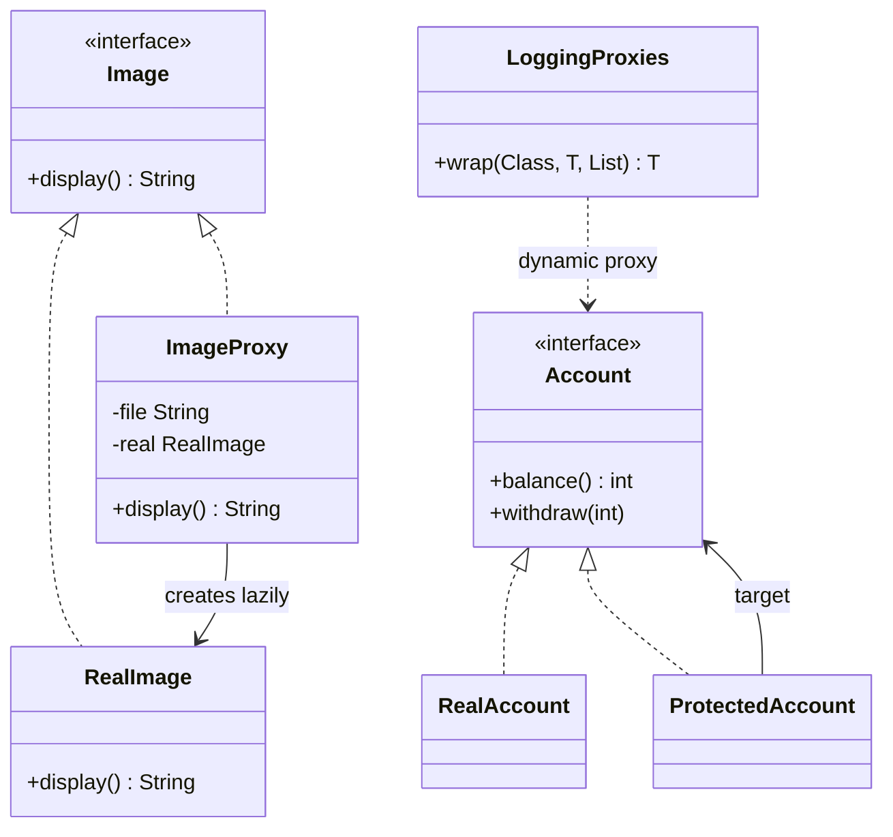

# Chapter 36 — Proxy

## What and why

Proxy = a stand-in with the **same interface** as the real object that controls access to it (lazy creation, permission checks, logging, caching, remote calls). Exams ask for the proxy kinds, how a proxy differs from a decorator, and `java.lang.reflect.Proxy`.

## Problem

Creating a `RealImage` is expensive and the image may never be shown. A guest must not withdraw from an account. Add a layer that looks identical to the client but decides **whether and when** to forward the call.

## Exam flash rules

- Proxy and RealSubject implement the **same Subject interface**; the client cannot tell them apart.
- **Virtual proxy** delays creating an expensive object; **protection proxy** checks permissions; **remote proxy** hides the network; **caching/logging proxy** adds bookkeeping.
- The proxy **controls access**; a Decorator **adds responsibilities** — the class structure is the same.
- A lazily created target field cannot be `final`: `cannot assign a value to final variable`.
- A proxy is **not** an instance of the real class: `(RealAccount) proxy` fails (`ClassCastException`).
- `java.lang.reflect.Proxy` creates a proxy at runtime for **interfaces only**.
- A dynamic proxy needs an `InvocationHandler` with the three-parameter `invoke(proxy, method, args)`.
- `Proxy.newProxyInstance` returns `Object`; it must be cast to the interface.
- Methods inherited from `Object` (`toString`, `hashCode`, `equals`) also go through the handler.
- Exceptions thrown by the target arrive wrapped in `InvocationTargetException`; unwrap with `getCause()`.
- Spring AOP, Hibernate lazy loading and RMI stubs are proxy-based.
- Proxy vs Adapter: Adapter changes the interface; Proxy keeps it.

## Rules table — what the compiler rejects

| Mistake | Compiler message |
|---------|------------------|
| Proxy omits a subject method | `... is not abstract and does not override abstract method withdraw(int) in Account` |
| Assigning a subject reference to the real type | `incompatible types: Image cannot be converted to RealImage` |
| Assigning to a `final` lazy field | `cannot assign a value to final variable real` |
| Using `newProxyInstance` result without a cast | `incompatible types: Object cannot be converted to Image` |
| Two-parameter lambda for `InvocationHandler` | `incompatible types: incompatible parameter types in lambda expression` |

## Walkthrough

### Virtual proxy

```java
{{#include ../../code/part-03-patterns/src/main/java/patterns/structural/proxy/Image.java:proxy-image}}
```

```java
{{#include ../../code/part-03-patterns/src/main/java/patterns/structural/proxy/RealImage.java:real-image}}
```

```java
{{#include ../../code/part-03-patterns/src/main/java/patterns/structural/proxy/ImageProxy.java:image-proxy}}
```

### Protection proxy

```java
{{#include ../../code/part-03-patterns/src/main/java/patterns/structural/proxy/Account.java:proxy-account}}
```

```java
{{#include ../../code/part-03-patterns/src/main/java/patterns/structural/proxy/ProtectedAccount.java:protected-account}}
```

### Dynamic proxy

```java
{{#include ../../code/part-03-patterns/src/main/java/patterns/structural/proxy/LoggingProxies.java:logging-proxies}}
```

```java
{{#include ../../code/part-03-patterns/src/main/java/patterns/structural/proxy/ProxyDemo.java:proxy-demo}}
```

```text
{{#include ../../code/part-03-patterns/output/ProxyDemo.txt}}
```

### Edge cases

```java
{{#include ../../code/part-03-patterns/src/main/java/patterns/structural/proxy/ProxyEdgeDemo.java:proxy-edge-demo}}
```

```text
{{#include ../../code/part-03-patterns/output/ProxyEdgeDemo.txt}}
```

### Where the JDK uses it

- `java.lang.reflect.Proxy` — runtime proxies for interfaces.
- `java.rmi` stubs — remote proxies.
- `Collections.synchronizedList` — same-interface wrapper that serializes access (also described as a decorator; the line between the two is intent).

## Proxy vs similar

| | Proxy | Decorator | Adapter | Facade | Flyweight |
|---|-------|-----------|---------|--------|-----------|
| Interface | same | same | different | new | same |
| Intent | **control access** | add behaviour | convert | simplify | share state |
| Who creates the target | proxy often does (lazy) | client passes it in | client passes it in | facade | factory |
| Typical use | lazy load, security, remote | I/O streams, UI | legacy integration | libraries | glyphs, pools |

## Predict the output

**P1.**

```java
{{#include ../../code/part-03-patterns/src/main/java/patterns/structural/proxy/exam/PredictVirtualProxyLoads.java:predict-virtual-proxy-loads}}
```

<details><summary>Answer</summary>

```text
{{#include ../../code/part-03-patterns/output/PredictVirtualProxyLoads.txt}}
```

Trace: nothing loads at proxy creation; first `display()` per proxy loads once.

</details>

**P2.**

```java
{{#include ../../code/part-03-patterns/src/main/java/patterns/structural/proxy/exam/PredictProtectionProxy.java:predict-protection-proxy}}
```

<details><summary>Answer</summary>

```text
{{#include ../../code/part-03-patterns/output/PredictProtectionProxy.txt}}
```

Trace: reads allowed, guest write denied; changing the real object directly shows through the proxy.

</details>

**P3.**

```java
{{#include ../../code/part-03-patterns/src/main/java/patterns/structural/proxy/exam/PredictDynamicProxyLog.java:predict-dynamic-proxy-log}}
```

<details><summary>Answer</summary>

```text
{{#include ../../code/part-03-patterns/output/PredictDynamicProxyLog.txt}}
```

Trace: 10 − 3 − 2 = 5; the log keeps call order.

</details>

**P4.**

```java
{{#include ../../code/part-03-patterns/src/main/java/patterns/structural/proxy/exam/PredictProxyCast.java:predict-proxy-cast}}
```

<details><summary>Answer</summary>

```text
{{#include ../../code/part-03-patterns/output/PredictProxyCast.txt}}
```

Trace: a JDK proxy class implements the interface only; it does not extend `RealAccount`.

</details>

**P5.**

```java
{{#include ../../code/part-03-patterns/src/main/java/patterns/structural/proxy/exam/PredictProxyException.java:predict-proxy-exception}}
```

<details><summary>Answer</summary>

```text
{{#include ../../code/part-03-patterns/output/PredictProxyException.txt}}
```

Trace: the handler logs first, then unwraps `InvocationTargetException`, so the caller sees the original exception.

</details>

**P6.**

```java
{{#include ../../code/part-03-patterns/src/main/java/patterns/structural/proxy/exam/PredictLazyIdentity.java:predict-lazy-identity}}
```

<details><summary>Answer</summary>

```text
{{#include ../../code/part-03-patterns/output/PredictLazyIdentity.txt}}
```

Trace: same visible behaviour, different objects and classes, both are `Image`.

</details>

## Compile or not?

**C1.** Proxy missing `withdraw`.

```java
{{#include ../../code/part-03-patterns/broken/ProxyMissingMethodBroken.java}}
```

<details><summary>Answer — fails</summary>

```text
{{#include ../../code/part-03-patterns/output/broken/ProxyMissingMethodBroken.txt}}
```

</details>

**C2.** `RealImage real = img;`

```java
{{#include ../../code/part-03-patterns/broken/ProxyDowncastBroken.java}}
```

<details><summary>Answer — fails</summary>

```text
{{#include ../../code/part-03-patterns/output/broken/ProxyDowncastBroken.txt}}
```

</details>

**C3.** Lazy assignment to a `final` field.

```java
{{#include ../../code/part-03-patterns/broken/ProxyFinalLazyBroken.java}}
```

<details><summary>Answer — fails</summary>

```text
{{#include ../../code/part-03-patterns/output/broken/ProxyFinalLazyBroken.txt}}
```

</details>

**C4.** `newProxyInstance` without a cast.

```java
{{#include ../../code/part-03-patterns/broken/ProxyNoCastBroken.java}}
```

<details><summary>Answer — fails</summary>

```text
{{#include ../../code/part-03-patterns/output/broken/ProxyNoCastBroken.txt}}
```

</details>

**C5.** Lambda with two parameters for `InvocationHandler`.

```java
{{#include ../../code/part-03-patterns/broken/ProxyLambdaHandlerBroken.java}}
```

<details><summary>Answer — fails</summary>

```text
{{#include ../../code/part-03-patterns/output/broken/ProxyLambdaHandlerBroken.txt}}
```

</details>

## Gotchas

1. Proxy is not an instance of the real class — `PredictProxyCast`.
2. Dynamic proxies reject classes (`IllegalArgumentException`) — `ProxyEdgeDemo`.
3. `toString`/`hashCode`/`equals` also reach the handler — `ProxyEdgeDemo` log shows `toString`.
4. Unwrap `InvocationTargetException` or callers see the wrong exception — `PredictProxyException`.
5. A lazy proxy that is not thread-safe may create the target twice — the `if (real == null)` check in `ImageProxy` is unsynchronized by design for this single-threaded demo.

## UML



## Interview Q&A

1. **Q:** What defines a Proxy? **A:** Same interface as the subject plus control over access.
2. **Q:** Name four kinds. **A:** Virtual, protection, remote, caching/logging.
3. **Q:** Proxy vs Decorator? **A:** Control of access vs added behaviour; identical structure.
4. **Q:** Why can't the lazy field be `final`? **A:** It is assigned after construction — `ProxyFinalLazyBroken`.
5. **Q:** What does `Proxy.newProxyInstance` need? **A:** Class loader, interfaces, handler.
6. **Q:** Why does the class-based call fail? **A:** JDK proxies implement interfaces only — `ProxyEdgeDemo`.
7. **Q:** Can you cast a dynamic proxy to the real class? **A:** No — `PredictProxyCast`.
8. **Q:** Which methods hit the handler? **A:** Every interface method plus `toString`, `hashCode`, `equals`.
9. **Q:** Where do frameworks use proxies? **A:** Spring AOP, Hibernate lazy loading, RMI.
10. **Q:** Proxy vs Adapter? **A:** Same interface vs different interface.
11. **Q:** Who creates the real subject in a virtual proxy? **A:** The proxy, on first use.
12. **Q:** Downside? **A:** Extra indirection; lazy proxies need thread-safety.

## Exam writing prompts

1. (8) Write `Document`, `RealDocument` (prints "loading" in its constructor) and `DocumentProxy` that loads on first `read()`.
2. (5) Write a protection proxy that allows `read()` for everyone and `write()` only for role `"admin"`.
3. (3) Write the `InvocationHandler` lambda that prints the method name and forwards to `target`.
4. (2) State two differences between a proxy class you write and `java.lang.reflect.Proxy`.

## Exercises

1. Caching proxy.

```java
{{#include ../../code/part-03-patterns/solutions/ch36/Ch36Solutions.java:ch36-ex1}}
```

2. Counting proxy.

```java
{{#include ../../code/part-03-patterns/solutions/ch36/Ch36Solutions.java:ch36-ex2}}
```

3. Read-only proxy.

```java
{{#include ../../code/part-03-patterns/solutions/ch36/Ch36Solutions.java:ch36-ex3}}
```

4. Record method names with a dynamic proxy.

```java
{{#include ../../code/part-03-patterns/solutions/ch36/Ch36Solutions.java:ch36-ex4}}
```

5. Generic lazy holder.

```java
{{#include ../../code/part-03-patterns/solutions/ch36/Ch36Solutions.java:ch36-ex5}}
```

```text
{{#include ../../code/part-03-patterns/output/Ch36Solutions.txt}}
```

## Recap checklist

- [x] Virtual, protection and dynamic proxy
- [x] Proxy vs Decorator vs Adapter
- [x] Compiler errors for missing method, downcast, final lazy field, cast, lambda
- [x] JDK usage and comparison table
- [x] Exam banks: flash rules, predict ×6, compile ×5, writing ×4, exercises ×5
