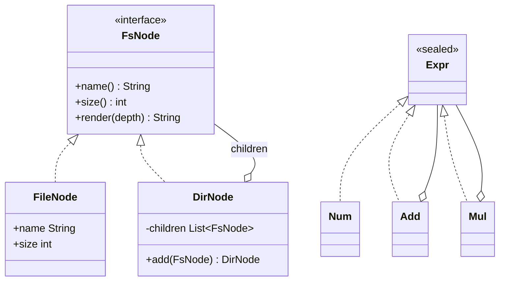

# Chapter 37 — Composite

## What and why

Composite = treat a **tree of objects** (file + directory, expression + operators, menu + combo) through **one component interface**, so clients recurse without knowing leaf vs group. Exams ask for the UML roles, transparent vs safe composite, and sealed/`switch` trees in modern Java.

## Problem

A directory’s size is the sum of its children’s sizes. An empty folder is still a node. Clients should call `size()` / `render()` on the root and get a recursive answer — without a special case for “is this a file?” at every call site.

## Exam flash rules

- **Component** defines the shared API; **Leaf** has no children; **Composite** holds a list of Components and forwards.
- Clients talk only to the Component type — they do not branch on leaf vs composite for the shared operations.
- **Safe composite**: `add` lives only on the Composite type (compile-time: leaves have no `add`).
- **Transparent composite**: `add` lives on the Component; a leaf throws at run time (`UnsupportedOperationException`).
- A composite must reject adding **itself** (cycle) — `IllegalArgumentException` in `DirNode`.
- Sharing one child across two parents is allowed by reference; both parents see the same object.
- Sealed `Expr` + records + pattern `switch` is a Composite with compile-time exhaustiveness (**Java 17+ / 21**).
- Extending a sealed type outside `permits` fails: `class is not allowed to extend sealed class`.
- A non-exhaustive `switch` on a sealed type fails: `does not cover all possible input values`.
- `DefaultMutableTreeNode` is the JDK’s classic Composite.
- Composite vs Decorator: tree of many children vs single wrapped peer.
- Composite vs Flyweight: structure (parent/child) vs shared intrinsic state.

## Rules table — what the compiler rejects

| Mistake | Compiler message |
|---------|------------------|
| Call `add` on an `FsNode` (safe design) | `cannot find symbol` … `method add(FileNode)` |
| Pass a non-`FsNode` child | `incompatible types: String cannot be converted to FsNode` |
| Mutate a record component | `size has private access in FileNode` |
| Extra sealed implementor | `class is not allowed to extend sealed class: Expr` |
| Incomplete pattern switch | `the switch expression does not cover all possible input values` |

## Walkthrough

### Safe file-system tree

```java
{{#include ../../code/part-03-patterns/src/main/java/patterns/structural/composite/FsNode.java:fs-node}}
```

```java
{{#include ../../code/part-03-patterns/src/main/java/patterns/structural/composite/FileNode.java:file-node}}
```

```java
{{#include ../../code/part-03-patterns/src/main/java/patterns/structural/composite/DirNode.java:dir-node}}
```

### Expression tree (sealed + switch)

```java
{{#include ../../code/part-03-patterns/src/main/java/patterns/structural/composite/Expr.java:expr}}
```

```java
{{#include ../../code/part-03-patterns/src/main/java/patterns/structural/composite/CompositeDemo.java:composite-demo}}
```

```text
{{#include ../../code/part-03-patterns/output/CompositeDemo.txt}}
```

### Transparent variant

```java
{{#include ../../code/part-03-patterns/src/main/java/patterns/structural/composite/TransparentComposite.java:transparent-composite}}
```

```text
{{#include ../../code/part-03-patterns/output/TransparentComposite.txt}}
```

### Where the JDK uses it

```java
{{#include ../../code/part-03-patterns/src/main/java/patterns/structural/composite/JdkCompositeDemo.java:jdk-composite-demo}}
```

```text
{{#include ../../code/part-03-patterns/output/JdkCompositeDemo.txt}}
```

- `javax.swing.tree.DefaultMutableTreeNode` — nodes and children.
- `java.awt.Container` — components that contain components.
- XML / DOM node trees — same recursive shape.

## Composite vs similar

| | Composite | Decorator | Flyweight | Iterator |
|---|-----------|-----------|-----------|----------|
| Structure | tree | chain of wrappers | shared pool | walker over a collection |
| Shared API | Component | same as peer | flyweight + extrinsic args | `hasNext`/`next` |
| Intent | uniform tree ops | add behaviour | save memory | traverse without exposing structure |
| Children | many | usually one | none (shared type) | N/A |

## Predict the output

**P1.**

```java
{{#include ../../code/part-03-patterns/src/main/java/patterns/structural/composite/exam/PredictTreeSize.java:predict-tree-size}}
```

<details><summary>Answer</summary>

```text
{{#include ../../code/part-03-patterns/output/PredictTreeSize.txt}}
```

Trace: sizes sum recursively; empty dir contributes 0.

</details>

**P2.**

```java
{{#include ../../code/part-03-patterns/src/main/java/patterns/structural/composite/exam/PredictRender.java:predict-render}}
```

<details><summary>Answer</summary>

```text
{{#include ../../code/part-03-patterns/output/PredictRender.txt}}
```

Trace: indent grows with depth; directory line shows total size.

</details>

**P3.**

```java
{{#include ../../code/part-03-patterns/src/main/java/patterns/structural/composite/exam/PredictExprEval.java:predict-expr-eval}}
```

<details><summary>Answer</summary>

```text
{{#include ../../code/part-03-patterns/output/PredictExprEval.txt}}
```

Trace: `(1+2)*3` → 9; `show` keeps parentheses around `Add`.

</details>

**P4.**

```java
{{#include ../../code/part-03-patterns/src/main/java/patterns/structural/composite/exam/PredictSharedChild.java:predict-shared-child}}
```

<details><summary>Answer</summary>

```text
{{#include ../../code/part-03-patterns/output/PredictSharedChild.txt}}
```

Trace: one `FileNode` instance is a child of two dirs; both sizes include it.

</details>

**P5.**

```java
{{#include ../../code/part-03-patterns/src/main/java/patterns/structural/composite/exam/PredictSelfAdd.java:predict-self-add}}
```

<details><summary>Answer</summary>

```text
{{#include ../../code/part-03-patterns/output/PredictSelfAdd.txt}}
```

Trace: adding a directory to itself is rejected before the list grows.

</details>

**P6.**

```java
{{#include ../../code/part-03-patterns/src/main/java/patterns/structural/composite/exam/PredictTransparentLeaf.java:predict-transparent-leaf}}
```

<details><summary>Answer</summary>

```text
{{#include ../../code/part-03-patterns/output/PredictTransparentLeaf.txt}}
```

Trace: transparent `add` on a leaf throws; group `add` works.

</details>

## Compile or not?

**C1.** `add` on an `FsNode` reference.

```java
{{#include ../../code/part-03-patterns/broken/CompositeLeafAddBroken.java}}
```

<details><summary>Answer — fails</summary>

```text
{{#include ../../code/part-03-patterns/output/broken/CompositeLeafAddBroken.txt}}
```

</details>

**C2.** Wrong child type.

```java
{{#include ../../code/part-03-patterns/broken/CompositeWrongChildBroken.java}}
```

<details><summary>Answer — fails</summary>

```text
{{#include ../../code/part-03-patterns/output/broken/CompositeWrongChildBroken.txt}}
```

</details>

**C3.** Sealed implementor not permitted.

```java
{{#include ../../code/part-03-patterns/broken/CompositeSealedExtendBroken.java}}
```

<details><summary>Answer — fails</summary>

```text
{{#include ../../code/part-03-patterns/output/broken/CompositeSealedExtendBroken.txt}}
```

</details>

**C4.** Incomplete `switch` on sealed `Expr`.

```java
{{#include ../../code/part-03-patterns/broken/CompositeSwitchMissingCaseBroken.java}}
```

<details><summary>Answer — fails</summary>

```text
{{#include ../../code/part-03-patterns/output/broken/CompositeSwitchMissingCaseBroken.txt}}
```

</details>

**C5.** Mutating a record field.

```java
{{#include ../../code/part-03-patterns/broken/CompositeRecordMutateBroken.java}}
```

<details><summary>Answer — fails</summary>

```text
{{#include ../../code/part-03-patterns/output/broken/CompositeRecordMutateBroken.txt}}
```

</details>

**C6.** Exhaustive switch with a default still compiles.

```java
{{#include ../../code/part-03-patterns/src/main/java/patterns/structural/composite/exam/CompileOkSwitchDefault.java:compile-ok-switch-default}}
```

<details><summary>Answer — compiles</summary>

```text
{{#include ../../code/part-03-patterns/output/CompileOkSwitchDefault.txt}}
```

</details>

## Gotchas

1. Safe vs transparent — compile reject vs run-time throw (`CompositeLeafAddBroken` vs `PredictTransparentLeaf`).
2. Self-add cycles — `PredictSelfAdd`.
3. Shared children inflate both parents’ sizes — `PredictSharedChild`.
4. Sealed trees need every permitted type in the `switch` — `CompositeSwitchMissingCaseBroken`.
5. Record leaves are immutable; “change size” means replace the node — `CompositeRecordMutateBroken`.

## UML



## Interview Q&A

1. **Q:** What problem does Composite solve? **A:** Uniform operations over trees of leaf and group nodes.
2. **Q:** Name the three roles. **A:** Component, Leaf, Composite.
3. **Q:** Safe vs transparent? **A:** `add` only on composite vs `add` on component with leaf throwing.
4. **Q:** Why reject self-add? **A:** Avoid infinite recursion / cycles.
5. **Q:** How does `Expr` relate? **A:** Sealed composite with pattern-switch visitors.
6. **Q:** JDK example? **A:** `DefaultMutableTreeNode`, AWT `Container`.
7. **Q:** Composite vs Decorator? **A:** Many children vs one wrappee.
8. **Q:** Can one leaf have two parents? **A:** Yes by reference; both see the same object.
9. **Q:** What does sealing buy? **A:** Exhaustive `switch` and a closed set of node kinds.
10. **Q:** Downside of transparent? **A:** Leaf `add` fails only at run time.
11. **Q:** Where does size live? **A:** On the component; composites sum children.
12. **Q:** Is an empty directory still a composite? **A:** Yes — zero children, size 0.

## Exam writing prompts

1. (8) Write `Graphic` with `draw()`, `Dot` leaf, and `Group` that draws all children.
2. (5) Implement `int depth(Expr e)` for the sealed expression tree (a `Num` has depth 1).
3. (3) State two differences between safe and transparent Composite.
4. (2) Why does calling `add` on an `FsNode` fail to compile in this chapter’s file tree?

## Exercises

1. Menu / combo pricing.

```java
{{#include ../../code/part-03-patterns/solutions/ch37/Ch37Solutions.java:ch37-ex1}}
```

2. Expression depth.

```java
{{#include ../../code/part-03-patterns/solutions/ch37/Ch37Solutions.java:ch37-ex2}}
```

3. Count leaves.

```java
{{#include ../../code/part-03-patterns/solutions/ch37/Ch37Solutions.java:ch37-ex3}}
```

4. Path finder.

```java
{{#include ../../code/part-03-patterns/solutions/ch37/Ch37Solutions.java:ch37-ex4}}
```

5. Flatten to list.

```java
{{#include ../../code/part-03-patterns/solutions/ch37/Ch37Solutions.java:ch37-ex5}}
```

```text
{{#include ../../code/part-03-patterns/output/Ch37Solutions.txt}}
```

## Recap checklist

- [x] Safe file tree + sealed expression composite
- [x] Transparent leaf throws on `add`
- [x] Compiler errors for add/types/sealed/switch/record
- [x] JDK `DefaultMutableTreeNode` + comparison table
- [x] Exam banks: flash rules, predict ×6, compile ×6, writing ×4, exercises ×5
