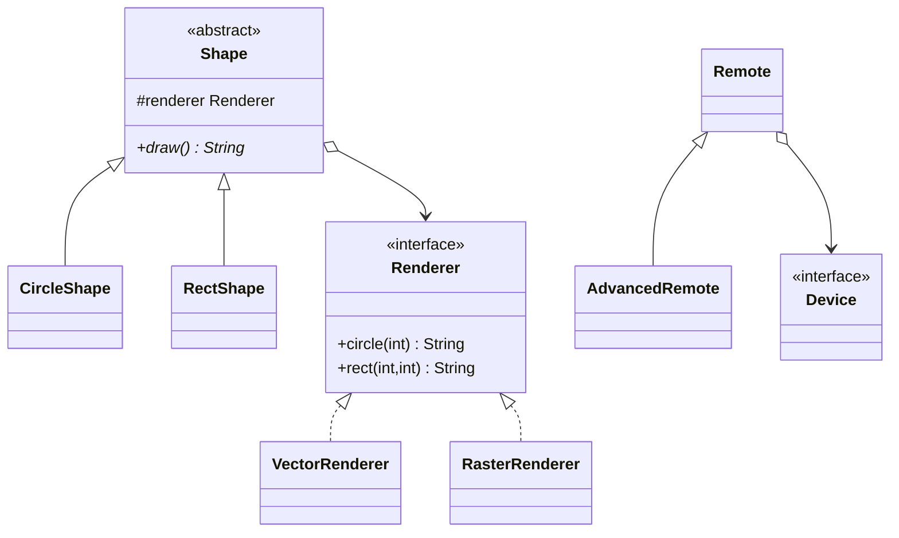

# Chapter 38 — Bridge

## What and why

Bridge = split an **abstraction** hierarchy from an **implementation** hierarchy and connect them by composition, so each can grow independently (shapes × renderers, remotes × devices). Exams ask why Bridge beats a class explosion, and how it differs from Adapter/Strategy.

## Problem

Two shapes and two drawing backends become four subclasses if you subclass every combination. Add a third backend and you rewrite the shape hierarchy again. Keep shapes and renderers as separate trees; inject a `Renderer` into each `Shape`.

## Exam flash rules

- Bridge has two hierarchies: **Abstraction** (refined) and **Implementor** (concrete).
- The abstraction **holds a reference** to the implementor and **delegates** low-level work.
- Prefer composition over an N×M subclass grid — 2 shapes + 2 renderers → 4 objects, not 4 subclasses.
- `Shape` is abstract; `new Shape(...)` fails: `Shape is abstract; cannot be instantiated`.
- A `final` implementor field cannot be reassigned after construction.
- `Renderer` has two methods → **not** a functional interface; a lambda fails.
- Wrong implementor type fails at compile time (`Tv` is not a `Renderer`).
- Refined abstractions (`AdvancedRemote`) add operations without touching devices.
- The same implementor instance can be shared by several abstractions.
- Bridge vs Adapter: planned independent evolution vs retrofit of an existing API.
- Bridge vs Strategy: structural decoupling of two hierarchies vs swapping one algorithm.
- JDBC (`Driver` / `Connection`) and AWT peers are classic Bridge-shaped APIs.

## Rules table — what the compiler rejects

| Mistake | Compiler message |
|---------|------------------|
| Instantiate abstract `Shape` | `Shape is abstract; cannot be instantiated` |
| Reassign `final` renderer | `cannot assign a value to final variable renderer` |
| Lambda for multi-method `Renderer` | `Renderer is not a functional interface` |
| Missing implementor method | `... does not override abstract method rect(int,int) in Renderer` |
| Call unknown implementor method | `cannot find symbol` … `method triangle(int)` |
| Pass wrong implementor type | `incompatible types: Tv cannot be converted to Renderer` |

## Walkthrough

### Shapes × renderers

```java
{{#include ../../code/part-03-patterns/src/main/java/patterns/structural/bridge/Renderer.java:renderer}}
```

```java
{{#include ../../code/part-03-patterns/src/main/java/patterns/structural/bridge/VectorRenderer.java:vector-renderer}}
```

```java
{{#include ../../code/part-03-patterns/src/main/java/patterns/structural/bridge/RasterRenderer.java:raster-renderer}}
```

```java
{{#include ../../code/part-03-patterns/src/main/java/patterns/structural/bridge/Shape.java:shape}}
```

```java
{{#include ../../code/part-03-patterns/src/main/java/patterns/structural/bridge/CircleShape.java:circle-shape}}
```

```java
{{#include ../../code/part-03-patterns/src/main/java/patterns/structural/bridge/RectShape.java:rect-shape}}
```

```java
{{#include ../../code/part-03-patterns/src/main/java/patterns/structural/bridge/BridgeDemo.java:bridge-demo}}
```

```text
{{#include ../../code/part-03-patterns/output/BridgeDemo.txt}}
```

### Remotes × devices

```java
{{#include ../../code/part-03-patterns/src/main/java/patterns/structural/bridge/Device.java:device}}
```

```java
{{#include ../../code/part-03-patterns/src/main/java/patterns/structural/bridge/Remote.java:remote}}
```

```java
{{#include ../../code/part-03-patterns/src/main/java/patterns/structural/bridge/AdvancedRemote.java:advanced-remote}}
```

```java
{{#include ../../code/part-03-patterns/src/main/java/patterns/structural/bridge/RemoteDemo.java:remote-demo}}
```

```text
{{#include ../../code/part-03-patterns/output/RemoteDemo.txt}}
```

### Edge cases

```java
{{#include ../../code/part-03-patterns/src/main/java/patterns/structural/bridge/BridgeEdgeDemo.java:bridge-edge-demo}}
```

```text
{{#include ../../code/part-03-patterns/output/BridgeEdgeDemo.txt}}
```

### Where the JDK uses it

```java
{{#include ../../code/part-03-patterns/src/main/java/patterns/structural/bridge/JdkBridgeDemo.java:jdk-bridge-demo}}
```

```text
{{#include ../../code/part-03-patterns/output/JdkBridgeDemo.txt}}
```

- JDBC: application code → `Driver` / `Connection` implementors.
- AWT: component abstraction vs platform peers.
- `Logger` APIs that bind a facade to a backend appender (often Bridge-like).

## Bridge vs similar

| | Bridge | Adapter | Strategy | Proxy |
|---|--------|---------|----------|-------|
| When designed | up front | after the fact | up front | up front |
| Hierarchies | **two** | usually one wrap | context + strategies | subject + proxy |
| Intent | independent evolution | make APIs match | swap algorithm | control access |
| Client sees | abstraction API | target API | context API | subject API |

## Predict the output

**P1.**

```java
{{#include ../../code/part-03-patterns/src/main/java/patterns/structural/bridge/exam/PredictBridgeCombos.java:predict-bridge-combos}}
```

<details><summary>Answer</summary>

```text
{{#include ../../code/part-03-patterns/output/PredictBridgeCombos.txt}}
```

Trace: each shape×renderer pair delegates once.

</details>

**P2.**

```java
{{#include ../../code/part-03-patterns/src/main/java/patterns/structural/bridge/exam/PredictRuntimeSwap.java:predict-runtime-swap}}
```

<details><summary>Answer</summary>

```text
{{#include ../../code/part-03-patterns/output/PredictRuntimeSwap.txt}}
```

Trace: new shape instances with a different renderer change the draw text; the old object stays vector.

</details>

**P3.**

```java
{{#include ../../code/part-03-patterns/src/main/java/patterns/structural/bridge/exam/PredictRemote.java:predict-remote}}
```

<details><summary>Answer</summary>

```text
{{#include ../../code/part-03-patterns/output/PredictRemote.txt}}
```

Trace: power toggles; volume steps by 10 on the shared device API.

</details>

**P4.**

```java
{{#include ../../code/part-03-patterns/src/main/java/patterns/structural/bridge/exam/PredictRefined.java:predict-refined}}
```

<details><summary>Answer</summary>

```text
{{#include ../../code/part-03-patterns/output/PredictRefined.txt}}
```

Trace: `AdvancedRemote.mute()` sets volume 0 without changing the device types.

</details>

**P5.**

```java
{{#include ../../code/part-03-patterns/src/main/java/patterns/structural/bridge/exam/PredictSharedRenderer.java:predict-shared-renderer}}
```

<details><summary>Answer</summary>

```text
{{#include ../../code/part-03-patterns/output/PredictSharedRenderer.txt}}
```

Trace: one renderer instance serves two shapes; identity `==` is true.

</details>

**P6.**

```java
{{#include ../../code/part-03-patterns/src/main/java/patterns/structural/bridge/exam/PredictNullRenderer.java:predict-null-renderer}}
```

<details><summary>Answer</summary>

```text
{{#include ../../code/part-03-patterns/output/PredictNullRenderer.txt}}
```

Trace: `Objects.requireNonNull` rejects a null implementor at construction.

</details>

## Compile or not?

**C1.** `new Shape(...)`.

```java
{{#include ../../code/part-03-patterns/broken/BridgeAbstractNewBroken.java}}
```

<details><summary>Answer — fails</summary>

```text
{{#include ../../code/part-03-patterns/output/broken/BridgeAbstractNewBroken.txt}}
```

</details>

**C2.** Reassign final renderer.

```java
{{#include ../../code/part-03-patterns/broken/BridgeFinalRendererBroken.java}}
```

<details><summary>Answer — fails</summary>

```text
{{#include ../../code/part-03-patterns/output/broken/BridgeFinalRendererBroken.txt}}
```

</details>

**C3.** Lambda for `Renderer`.

```java
{{#include ../../code/part-03-patterns/broken/BridgeLambdaRendererBroken.java}}
```

<details><summary>Answer — fails</summary>

```text
{{#include ../../code/part-03-patterns/output/broken/BridgeLambdaRendererBroken.txt}}
```

</details>

**C4.** Missing `rect`.

```java
{{#include ../../code/part-03-patterns/broken/BridgeMissingImplMethodBroken.java}}
```

<details><summary>Answer — fails</summary>

```text
{{#include ../../code/part-03-patterns/output/broken/BridgeMissingImplMethodBroken.txt}}
```

</details>

**C5.** Unknown implementor method / wrong type.

```java
{{#include ../../code/part-03-patterns/broken/BridgeUnknownImplMethodBroken.java}}
```

<details><summary>Answer — fails</summary>

```text
{{#include ../../code/part-03-patterns/output/broken/BridgeUnknownImplMethodBroken.txt}}
```

</details>

```java
{{#include ../../code/part-03-patterns/broken/BridgeWrongImplTypeBroken.java}}
```

<details><summary>Answer — fails</summary>

```text
{{#include ../../code/part-03-patterns/output/broken/BridgeWrongImplTypeBroken.txt}}
```

</details>

**C6.** Anonymous implementor compiles.

```java
{{#include ../../code/part-03-patterns/src/main/java/patterns/structural/bridge/exam/CompileOkAnonymousRenderer.java:compile-ok-anonymous-renderer}}
```

<details><summary>Answer — compiles</summary>

```text
{{#include ../../code/part-03-patterns/output/CompileOkAnonymousRenderer.txt}}
```

</details>

## Gotchas

1. Class explosion without Bridge — subclass every pair instead of composing.
2. Final implementor field blocks “swap in place”; build a new abstraction — `BridgeFinalRendererBroken`.
3. Multi-method implementor is not lambda-friendly — `BridgeLambdaRendererBroken`.
4. Null implementor fails fast — `PredictNullRenderer`.
5. Sharing one implementor is fine; mutable shared state needs care — `PredictSharedRenderer`.

## UML



## Interview Q&A

1. **Q:** What does Bridge separate? **A:** Abstraction hierarchy from implementation hierarchy.
2. **Q:** How are they linked? **A:** Composition — abstraction holds an implementor reference.
3. **Q:** Why not subclass every combo? **A:** N×M class explosion.
4. **Q:** Bridge vs Adapter? **A:** Designed split vs retrofit.
5. **Q:** Bridge vs Strategy? **A:** Two evolving hierarchies vs one swappable algorithm.
6. **Q:** Can implementors be shared? **A:** Yes — `PredictSharedRenderer`.
7. **Q:** Why is `Shape` abstract? **A:** Only refined shapes know how to call the renderer.
8. **Q:** JDK example? **A:** JDBC drivers, AWT peers.
9. **Q:** Can you lambda a `Renderer`? **A:** No — two abstract methods.
10. **Q:** What is a refined abstraction? **A:** Subclass that adds operations (`AdvancedRemote`).
11. **Q:** Who owns the life cycle of the implementor? **A:** Usually the client that injects it.
12. **Q:** Downside? **A:** Extra indirection; more types to name.

## Exam writing prompts

1. (8) Design `Message` (abstraction) and `Sender` (implementor) with `EmailSender` / `SmsSender` and `UrgentMessage`.
2. (5) Explain with numbers: 3 shapes × 4 renderers — classes with Bridge vs without.
3. (3) Write why `Renderer r = radius -> "..."` fails for this chapter’s interface.
4. (2) Name one difference between Bridge and Adapter.

## Exercises

1. Window × OS implementor sketch.

```java
{{#include ../../code/part-03-patterns/solutions/ch38/Ch38Solutions.java:ch38-ex1}}
```

2. Count combinations helper.

```java
{{#include ../../code/part-03-patterns/solutions/ch38/Ch38Solutions.java:ch38-ex2}}
```

3. Mute-all remotes.

```java
{{#include ../../code/part-03-patterns/solutions/ch38/Ch38Solutions.java:ch38-ex3}}
```

4. Logging renderer decorator-style wrapper.

```java
{{#include ../../code/part-03-patterns/solutions/ch38/Ch38Solutions.java:ch38-ex4}}
```

5. Device power cycle helper.

```java
{{#include ../../code/part-03-patterns/solutions/ch38/Ch38Solutions.java:ch38-ex5}}
```

```text
{{#include ../../code/part-03-patterns/output/Ch38Solutions.txt}}
```

## Recap checklist

- [x] Shape/Renderer and Remote/Device bridges
- [x] Bridge vs Adapter vs Strategy
- [x] Compiler errors for abstract new, final field, lambda, missing/wrong methods
- [x] JDK usage and comparison table
- [x] Exam banks: flash rules, predict ×6, compile ×6, writing ×4, exercises ×5
