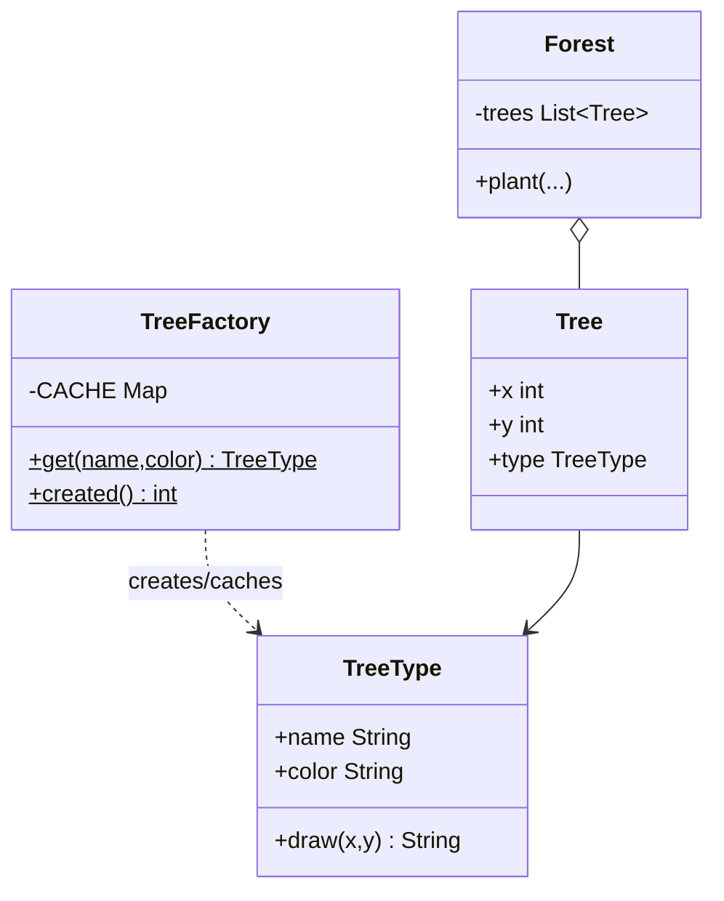

# Chapter 39 — Flyweight

## What and why

Flyweight = share **immutable intrinsic** state across many objects and keep **extrinsic** state outside (coordinates, document position), so a forest of trees or a page of glyphs does not allocate a fat object per instance. Exams ask intrinsic vs extrinsic, factory caches, and JDK pools (`Integer`, `String`).

## Problem

Planting 100 000 trees each holding `name` + `color` + texture wastes memory. Factor the shared type into one cached `TreeType`; each `Tree` stores only `(x, y)` plus a reference to the shared type.

## Exam flash rules

- **Intrinsic** state is shared and immutable; **extrinsic** state is passed in per operation.
- A **factory** returns the cached flyweight for a key (`computeIfAbsent`).
- Package-private constructor + private factory ctor stop clients from `new` bypassing the cache.
- `final` flyweight class cannot be subclassed; `final` fields cannot be reassigned.
- Sharing a **mutable** flyweight leaks mutations to every client — classic trap.
- `Integer.valueOf` / autoboxing cache −128…127; outside that range, `==` may be false.
- String literals and `intern()` share pool instances; `new String("a")` does not.
- Records are natural immutable flyweights (**Java 16+**).
- Flyweight vs Singleton: many shared typed instances vs one global instance.
- Flyweight vs Composite: sharing type data vs parent/child structure (often used together: forest).
- Thread-unsafe `HashMap` caches need locking or `ConcurrentHashMap` under concurrency.
- Identity (`==`) of factory results proves sharing; `equals` alone does not.

## Rules table — what the compiler rejects

| Mistake | Compiler message |
|---------|------------------|
| `new TreeFactory()` | `TreeFactory() has private access in TreeFactory` |
| Assign `final` field | `cannot assign a value to final variable color` |
| Extend `final` flyweight | `cannot inherit from final TreeType` |
| Wrong factory arity | `method get ... cannot be applied to given types` |
| Wrong cache value type | `incompatible types: int cannot be converted to TreeType` |

## Walkthrough

### Forest of shared tree types

```java
{{#include ../../code/part-03-patterns/src/main/java/patterns/structural/flyweight/TreeType.java:tree-type}}
```

```java
{{#include ../../code/part-03-patterns/src/main/java/patterns/structural/flyweight/TreeFactory.java:tree-factory}}
```

```java
{{#include ../../code/part-03-patterns/src/main/java/patterns/structural/flyweight/Tree.java:tree}}
```

```java
{{#include ../../code/part-03-patterns/src/main/java/patterns/structural/flyweight/Forest.java:forest}}
```

```java
{{#include ../../code/part-03-patterns/src/main/java/patterns/structural/flyweight/FlyweightDemo.java:flyweight-demo}}
```

```text
{{#include ../../code/part-03-patterns/output/FlyweightDemo.txt}}
```

### Glyphs

```java
{{#include ../../code/part-03-patterns/src/main/java/patterns/structural/flyweight/GlyphDemo.java:glyph-demo}}
```

```text
{{#include ../../code/part-03-patterns/output/GlyphDemo.txt}}
```

### Mutable shared state trap

```java
{{#include ../../code/part-03-patterns/src/main/java/patterns/structural/flyweight/MutableFlyweightGotcha.java:mutable-flyweight-gotcha}}
```

```text
{{#include ../../code/part-03-patterns/output/MutableFlyweightGotcha.txt}}
```

### Where the JDK uses it

```java
{{#include ../../code/part-03-patterns/src/main/java/patterns/structural/flyweight/JdkFlyweightDemo.java:jdk-flyweight-demo}}
```

```text
{{#include ../../code/part-03-patterns/output/JdkFlyweightDemo.txt}}
```

- `Integer` / `Long` / `Short` / `Byte` caches.
- `String` pool / `intern()`.
- `Boolean.TRUE` / `FALSE`.
- Font / glyph caches in UI toolkits.

## Flyweight vs similar

| | Flyweight | Singleton | Composite | Prototype |
|---|-----------|-----------|-----------|-----------|
| Count | many shared by key | one | tree of nodes | clones |
| State | intrinsic shared | global | per node | copied |
| Identity | `==` after factory | `==` always | distinct nodes | new instances |
| Risk | mutable share | global coupling | cycles | shallow copy |

## Predict the output

**P1.**

```java
{{#include ../../code/part-03-patterns/src/main/java/patterns/structural/flyweight/exam/PredictForestCount.java:predict-forest-count}}
```

<details><summary>Answer</summary>

```text
{{#include ../../code/part-03-patterns/output/PredictForestCount.txt}}
```

Trace: many trees, few created types.

</details>

**P2.**

```java
{{#include ../../code/part-03-patterns/src/main/java/patterns/structural/flyweight/exam/PredictSharedTypes.java:predict-shared-types}}
```

<details><summary>Answer</summary>

```text
{{#include ../../code/part-03-patterns/output/PredictSharedTypes.txt}}
```

Trace: same key → same instance (`==` true).

</details>

**P3.**

```java
{{#include ../../code/part-03-patterns/src/main/java/patterns/structural/flyweight/exam/PredictIntegerCache.java:predict-integer-cache}}
```

<details><summary>Answer</summary>

```text
{{#include ../../code/part-03-patterns/output/PredictIntegerCache.txt}}
```

Trace: cached range shares identity; outside may allocate anew.

</details>

**P4.**

```java
{{#include ../../code/part-03-patterns/src/main/java/patterns/structural/flyweight/exam/PredictStringPool.java:predict-string-pool}}
```

<details><summary>Answer</summary>

```text
{{#include ../../code/part-03-patterns/output/PredictStringPool.txt}}
```

Trace: literals share; `new String` does not until `intern()`.

</details>

**P5.**

```java
{{#include ../../code/part-03-patterns/src/main/java/patterns/structural/flyweight/exam/PredictMutableShared.java:predict-mutable-shared}}
```

<details><summary>Answer</summary>

```text
{{#include ../../code/part-03-patterns/output/PredictMutableShared.txt}}
```

Trace: mutating a shared object changes every holder’s view.

</details>

**P6.**

```java
{{#include ../../code/part-03-patterns/src/main/java/patterns/structural/flyweight/exam/PredictRecordIdentity.java:predict-record-identity}}
```

<details><summary>Answer</summary>

```text
{{#include ../../code/part-03-patterns/output/PredictRecordIdentity.txt}}
```

Trace: factory-cached records share identity; value equality still holds for equal components.

</details>

## Compile or not?

**C1.** Private factory constructor.

```java
{{#include ../../code/part-03-patterns/broken/FlyPrivateCtorBroken.java}}
```

<details><summary>Answer — fails</summary>

```text
{{#include ../../code/part-03-patterns/output/broken/FlyPrivateCtorBroken.txt}}
```

</details>

**C2.** Assign final field.

```java
{{#include ../../code/part-03-patterns/broken/FlyFinalFieldBroken.java}}
```

<details><summary>Answer — fails</summary>

```text
{{#include ../../code/part-03-patterns/output/broken/FlyFinalFieldBroken.txt}}
```

</details>

**C3.** Subclass final flyweight.

```java
{{#include ../../code/part-03-patterns/broken/FlySubclassFinalBroken.java}}
```

<details><summary>Answer — fails</summary>

```text
{{#include ../../code/part-03-patterns/output/broken/FlySubclassFinalBroken.txt}}
```

</details>

**C4.** Wrong factory arguments / cache value.

```java
{{#include ../../code/part-03-patterns/broken/FlyWrongArgsBroken.java}}
```

<details><summary>Answer — fails</summary>

```text
{{#include ../../code/part-03-patterns/output/broken/FlyWrongArgsBroken.txt}}
```

</details>

```java
{{#include ../../code/part-03-patterns/broken/FlyWrongValueBroken.java}}
```

<details><summary>Answer — fails</summary>

```text
{{#include ../../code/part-03-patterns/output/broken/FlyWrongValueBroken.txt}}
```

</details>

**C5.** Record flyweight compiles.

```java
{{#include ../../code/part-03-patterns/src/main/java/patterns/structural/flyweight/exam/CompileOkRecordFlyweight.java:compile-ok-record-flyweight}}
```

<details><summary>Answer — compiles</summary>

```text
{{#include ../../code/part-03-patterns/output/CompileOkRecordFlyweight.txt}}
```

</details>

## Gotchas

1. Mutable intrinsic state — `MutableFlyweightGotcha` / `PredictMutableShared`.
2. Relying on `Integer` `==` outside −128…127 — `PredictIntegerCache`.
3. Bypassing the factory with `new` defeats sharing — private ctor blocks it.
4. Extrinsic state must not be stored on the shared object.
5. Unsynchronized cache under threads can duplicate entries.

## UML



## Interview Q&A

1. **Q:** Intrinsic vs extrinsic? **A:** Shared immutable vs per-use context.
2. **Q:** Who creates flyweights? **A:** A factory with a cache.
3. **Q:** Why immutable? **A:** Shared mutation affects every client.
4. **Q:** JDK examples? **A:** `Integer` cache, `String` pool.
5. **Q:** Flyweight vs Singleton? **A:** Many keyed instances vs one.
6. **Q:** How do you prove sharing? **A:** `a == b` after two `get` calls with the same key.
7. **Q:** Where do coordinates live? **A:** Extrinsic — on `Tree` or as `draw` args.
8. **Q:** Can flyweights be records? **A:** Yes — immutable carriers.
9. **Q:** Memory win condition? **A:** High duplication of intrinsic state.
10. **Q:** Concurrency risk? **A:** Duplicate creates or lost updates in the cache.
11. **Q:** Composite + Flyweight? **A:** Forest of light nodes pointing at shared types.
12. **Q:** Downside? **A:** Harder reasoning; extrinsic plumbing; identity surprises.

## Exam writing prompts

1. (8) Design `Glyph` flyweight + `GlyphFactory` + a `Document` that stores char indices and positions.
2. (5) Explain why `Integer a = 200; Integer b = 200; a == b` may be false.
3. (3) List two rules that keep a flyweight safe to share.
4. (2) Define intrinsic and extrinsic state in one sentence each.

## Exercises

1. Style flyweight factory.

```java
{{#include ../../code/part-03-patterns/solutions/ch39/Ch39Solutions.java:ch39-ex1}}
```

2. Count unique keys helper.

```java
{{#include ../../code/part-03-patterns/solutions/ch39/Ch39Solutions.java:ch39-ex2}}
```

3. Extrinsic draw helper.

```java
{{#include ../../code/part-03-patterns/solutions/ch39/Ch39Solutions.java:ch39-ex3}}
```

4. Clear/reset cache.

```java
{{#include ../../code/part-03-patterns/solutions/ch39/Ch39Solutions.java:ch39-ex4}}
```

5. Identity check utility.

```java
{{#include ../../code/part-03-patterns/solutions/ch39/Ch39Solutions.java:ch39-ex5}}
```

```text
{{#include ../../code/part-03-patterns/output/Ch39Solutions.txt}}
```

## Recap checklist

- [x] TreeType factory + Forest extrinsic positions
- [x] Integer/String JDK pools + mutable gotcha
- [x] Compiler errors for private ctor, final, subclass, arity/types
- [x] Comparison table and UML
- [x] Exam banks: flash rules, predict ×6, compile ×5, writing ×4, exercises ×5
