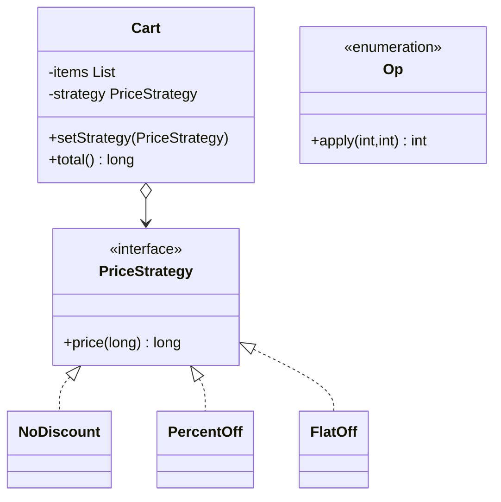

# Chapter 40 — Strategy

## What and why

Strategy = package a family of **interchangeable algorithms** behind one interface and let a **context** select/swap them at run time (discounts, shipping, sort order). Exams ask Strategy vs State vs Template Method, `@FunctionalInterface` + lambdas, and `Comparator` as the JDK’s Strategy.

## Problem

A cart hard-codes `if (coupon == …)` for every discount. Each new rule edits the cart. Inject a `PriceStrategy` and swap `NoDiscount` / `PercentOff` / lambda without touching checkout flow.

## Exam flash rules

- **Context** holds data and a Strategy reference; it **delegates** the varying algorithm.
- Strategies are interchangeable: same signature, different behaviour.
- A single-abstract-method Strategy is a `@FunctionalInterface` — lambdas and method refs fit.
- Lambda arity must match: two parameters for `price(long)` fails.
- Captured locals must be **final or effectively final**.
- Implementing method access cannot narrow (`price` must stay `public`).
- Enum constants with abstract methods are strategies with a closed set.
- `Comparator` / `Collections.sort` / `List.sort` are Strategies for ordering.
- Strategy vs State: client chooses algorithm vs object changes behaviour with its state.
- Strategy vs Template Method: composition/delegation vs inheritance + hooks.
- Null strategy should fail fast (`Objects.requireNonNull`).
- Prefer Strategy over long `switch`/`if` chains when the set of algorithms grows.

## Rules table — what the compiler rejects

| Mistake | Compiler message |
|---------|------------------|
| Missing `price` | `... does not override abstract method price(long) in PriceStrategy` |
| Narrower access | `attempting to assign weaker access privileges; was public` |
| Lambda returns wrong type | `incompatible types: bad return type in lambda expression` |
| Two-arg lambda for one-arg SAM | `incompatible parameter types in lambda expression` |
| Mutate captured local | `local variables referenced from a lambda expression must be final or effectively final` |
| `new` an enum constant type | `enum classes may not be instantiated` |

## Walkthrough

### Discount strategies

```java
{{#include ../../code/part-03-patterns/src/main/java/patterns/behavioral/strategy/PriceStrategy.java:price-strategy}}
```

```java
{{#include ../../code/part-03-patterns/src/main/java/patterns/behavioral/strategy/NoDiscount.java:no-discount}}
```

```java
{{#include ../../code/part-03-patterns/src/main/java/patterns/behavioral/strategy/PercentOff.java:percent-off}}
```

```java
{{#include ../../code/part-03-patterns/src/main/java/patterns/behavioral/strategy/FlatOff.java:flat-off}}
```

```java
{{#include ../../code/part-03-patterns/src/main/java/patterns/behavioral/strategy/Cart.java:cart}}
```

```java
{{#include ../../code/part-03-patterns/src/main/java/patterns/behavioral/strategy/StrategyDemo.java:strategy-demo}}
```

```text
{{#include ../../code/part-03-patterns/output/StrategyDemo.txt}}
```

### Enum strategies

```java
{{#include ../../code/part-03-patterns/src/main/java/patterns/behavioral/strategy/Op.java:op}}
```

```java
{{#include ../../code/part-03-patterns/src/main/java/patterns/behavioral/strategy/EnumStrategyDemo.java:enum-strategy-demo}}
```

```text
{{#include ../../code/part-03-patterns/output/EnumStrategyDemo.txt}}
```

### Edge cases

```java
{{#include ../../code/part-03-patterns/src/main/java/patterns/behavioral/strategy/StrategyEdgeDemo.java:strategy-edge-demo}}
```

```text
{{#include ../../code/part-03-patterns/output/StrategyEdgeDemo.txt}}
```

### Where the JDK uses it

```java
{{#include ../../code/part-03-patterns/src/main/java/patterns/behavioral/strategy/JdkStrategyDemo.java:jdk-strategy-demo}}
```

```text
{{#include ../../code/part-03-patterns/output/JdkStrategyDemo.txt}}
```

- `Comparator` for sort / priority queues.
- `ThreadPoolExecutor` rejection handlers.
- `javax.net.ssl.HostnameVerifier`, layout managers in Swing — pluggable policies.

## Strategy vs similar

| | Strategy | State | Template Method | Command |
|---|----------|-------|-----------------|---------|
| Who chooses | usually client / config | context’s current state | superclass skeleton | invoker schedules |
| Focus | algorithm family | behaviour per state | fixed steps + hooks | request as object |
| Typical API | `doIt(data)` | `handle()` | `templateMethod()` | `execute()` |
| Swap | anytime | on transition | not at run time | queue / undo stack |

## Predict the output

**P1.**

```java
{{#include ../../code/part-03-patterns/src/main/java/patterns/behavioral/strategy/exam/PredictSwapStrategy.java:predict-swap-strategy}}
```

<details><summary>Answer</summary>

```text
{{#include ../../code/part-03-patterns/output/PredictSwapStrategy.txt}}
```

Trace: same cart items; totals change when the strategy swaps.

</details>

**P2.**

```java
{{#include ../../code/part-03-patterns/src/main/java/patterns/behavioral/strategy/exam/PredictLambdaStrategy.java:predict-lambda-strategy}}
```

<details><summary>Answer</summary>

```text
{{#include ../../code/part-03-patterns/output/PredictLambdaStrategy.txt}}
```

Trace: SAM interface accepts a lambda as the strategy.

</details>

**P3.**

```java
{{#include ../../code/part-03-patterns/src/main/java/patterns/behavioral/strategy/exam/PredictComparator.java:predict-comparator}}
```

<details><summary>Answer</summary>

```text
{{#include ../../code/part-03-patterns/output/PredictComparator.txt}}
```

Trace: sort order is the injected comparison strategy.

</details>

**P4.**

```java
{{#include ../../code/part-03-patterns/src/main/java/patterns/behavioral/strategy/exam/PredictEnumStrategy.java:predict-enum-strategy}}
```

<details><summary>Answer</summary>

```text
{{#include ../../code/part-03-patterns/output/PredictEnumStrategy.txt}}
```

Trace: each enum constant carries its `apply`.

</details>

**P5.**

```java
{{#include ../../code/part-03-patterns/src/main/java/patterns/behavioral/strategy/exam/PredictCapturedState.java:predict-captured-state}}
```

<details><summary>Answer</summary>

```text
{{#include ../../code/part-03-patterns/output/PredictCapturedState.txt}}
```

Trace: effectively-final capture is fixed when the lambda is created.

</details>

**P6.**

```java
{{#include ../../code/part-03-patterns/src/main/java/patterns/behavioral/strategy/exam/PredictBadPercent.java:predict-bad-percent}}
```

<details><summary>Answer</summary>

```text
{{#include ../../code/part-03-patterns/output/PredictBadPercent.txt}}
```

Trace: invalid percent rejected in the strategy constructor; null cart strategy too.

</details>

## Compile or not?

**C1.** Missing method.

```java
{{#include ../../code/part-03-patterns/broken/StrategyMissingMethodBroken.java}}
```

<details><summary>Answer — fails</summary>

```text
{{#include ../../code/part-03-patterns/output/broken/StrategyMissingMethodBroken.txt}}
```

</details>

**C2.** Narrower access.

```java
{{#include ../../code/part-03-patterns/broken/StrategyNarrowAccessBroken.java}}
```

<details><summary>Answer — fails</summary>

```text
{{#include ../../code/part-03-patterns/output/broken/StrategyNarrowAccessBroken.txt}}
```

</details>

**C3.** Wrong lambda return / arity.

```java
{{#include ../../code/part-03-patterns/broken/StrategyWrongReturnBroken.java}}
```

<details><summary>Answer — fails</summary>

```text
{{#include ../../code/part-03-patterns/output/broken/StrategyWrongReturnBroken.txt}}
```

</details>

```java
{{#include ../../code/part-03-patterns/broken/StrategyLambdaTwoArgsBroken.java}}
```

<details><summary>Answer — fails</summary>

```text
{{#include ../../code/part-03-patterns/output/broken/StrategyLambdaTwoArgsBroken.txt}}
```

</details>

**C4.** Non-final capture / enum `new`.

```java
{{#include ../../code/part-03-patterns/broken/StrategyLambdaCaptureBroken.java}}
```

<details><summary>Answer — fails</summary>

```text
{{#include ../../code/part-03-patterns/output/broken/StrategyLambdaCaptureBroken.txt}}
```

</details>

```java
{{#include ../../code/part-03-patterns/broken/StrategyEnumNewBroken.java}}
```

<details><summary>Answer — fails</summary>

```text
{{#include ../../code/part-03-patterns/output/broken/StrategyEnumNewBroken.txt}}
```

</details>

**C5.** Method reference compiles.

```java
{{#include ../../code/part-03-patterns/src/main/java/patterns/behavioral/strategy/exam/CompileOkMethodRef.java:compile-ok-method-ref}}
```

<details><summary>Answer — compiles</summary>

```text
{{#include ../../code/part-03-patterns/output/CompileOkMethodRef.txt}}
```

</details>

## Gotchas

1. Strategy vs State naming confusion — who decides the switch.
2. Capturing a mutated local — `StrategyLambdaCaptureBroken`.
3. Treating enum like a class with `new` — `StrategyEnumNewBroken`.
4. Null strategy in the context — `PredictBadPercent` / `StrategyEdgeDemo`.
5. Multi-method “strategy” interfaces block lambdas — split or use classes.

## UML



## Interview Q&A

1. **Q:** What does Strategy encapsulate? **A:** A family of interchangeable algorithms.
2. **Q:** Who holds the strategy? **A:** The context (`Cart`).
3. **Q:** Strategy vs State? **A:** Client-selected algorithm vs state-driven transitions.
4. **Q:** Strategy vs Template Method? **A:** Composition vs inheritance.
5. **Q:** Why `@FunctionalInterface`? **A:** Lambdas/method refs as strategies.
6. **Q:** JDK example? **A:** `Comparator`, executor rejection handlers.
7. **Q:** Can you swap at run time? **A:** Yes — `setStrategy`.
8. **Q:** Enum strategies? **A:** Each constant implements the abstract method.
9. **Q:** Open/closed link? **A:** Add a strategy class without editing the context.
10. **Q:** Downside? **A:** More types; clients must understand which strategy to pick.
11. **Q:** Must strategies be stateless? **A:** Prefer pure; if stateful, document sharing rules.
12. **Q:** How does sort use Strategy? **A:** `List.sort(Comparator)` injects ordering.

## Exam writing prompts

1. (8) Write `ShippingStrategy` with `Standard` / `Express` and a `Order` context that computes cost from weight.
2. (5) Replace a 4-branch `if` discount calculator with Strategy types (sketch).
3. (3) Write a one-line lambda `PriceStrategy` that caps the total at 1000.
4. (2) State one difference between Strategy and State.

## Exercises

1. Shipping strategies.

```java
{{#include ../../code/part-03-patterns/solutions/ch40/Ch40Solutions.java:ch40-ex1}}
```

2. Compose two strategies.

```java
{{#include ../../code/part-03-patterns/solutions/ch40/Ch40Solutions.java:ch40-ex2}}
```

3. Sort by strategy table.

```java
{{#include ../../code/part-03-patterns/solutions/ch40/Ch40Solutions.java:ch40-ex3}}
```

4. Validate-then-price pipeline.

```java
{{#include ../../code/part-03-patterns/solutions/ch40/Ch40Solutions.java:ch40-ex4}}
```

5. Enum + context calculator.

```java
{{#include ../../code/part-03-patterns/solutions/ch40/Ch40Solutions.java:ch40-ex5}}
```

```text
{{#include ../../code/part-03-patterns/output/Ch40Solutions.txt}}
```

## Recap checklist

- [x] Cart discounts + enum `Op` + JDK `Comparator`
- [x] Strategy vs State vs Template Method
- [x] Compiler errors for SAM, access, capture, enum `new`
- [x] Comparison table and UML
- [x] Exam banks: flash rules, predict ×6, compile ×6, writing ×4, exercises ×5
