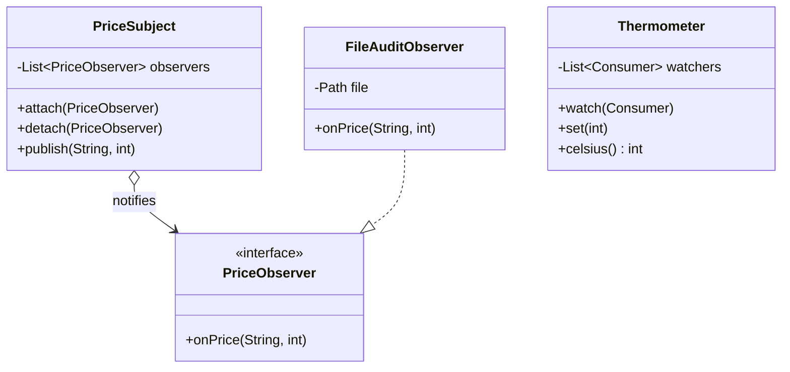

# Chapter 41 — Observer

## What and why

**Observer** = a subject keeps a list of observers and notifies each when its state changes; subject and observers know only an interface. Exams ask for the roles, push vs pull, the notify loop, and the "observer detaches itself during notify" trap.

## Problem

A price feed must update a logger, an alert rule, and an audit file. If the feed calls each of them by name, adding a fourth consumer edits the feed. Observer inverts that: the feed knows `PriceObserver`, nothing else.

## Exam flash rules

- Observer defines a **one-to-many** dependency: one subject, many observers.
- Subject holds `attach` / `detach` / `notify`; observer holds `update` (here `onPrice`).
- **Push**: subject sends the data. **Pull**: subject sends itself; observer calls getters.
- Notification order = registration order for a `List`-backed subject.
- Attaching the same observer twice into a `List` notifies it twice; `detach` removes one copy.
- Iterating the live list while an observer detaches can throw `ConcurrentModificationException` — or silently skip an observer.
- Fix: iterate a **snapshot** (`List.copyOf`, `CopyOnWriteArrayList`).
- An observer that throws aborts the loop for later observers unless the subject catches per observer.
- `java.util.Observable` / `Observer` are **deprecated since Java 9**; use `PropertyChangeListener` or `Flow`.
- `PropertyChangeSupport` does **not** fire when old and new are equal and both non-null.
- A lambda observer cannot mutate a captured local (`count++` fails); use a field or array.
- The subject holds **strong references** to its observers; forgetting `detach` leaks them (lapsed listener).
- Subject and observer are loosely coupled: the subject depends on an interface only.

## Rules table

| Case | Result | Compiler message |
|------|--------|------------------|
| Implement observer interface without the method | fails | `... is not abstract and does not override abstract method onPrice(String,int)` |
| `@Override` with wrong parameter type | fails | `method does not override or implement a method from a supertype` |
| Lambda observer does `count++` on local | fails | `local variables referenced from a lambda expression must be final or effectively final` |
| Lambda observer throws checked `IOException` | fails | `unreported exception IOException; must be caught or declared to be thrown` |
| `Consumer<Integer>` attached to `Subject<String>` | fails | `incompatible types: Consumer<Integer> cannot be converted to Consumer<String>` |

## Walkthrough

### Roles — observer and subject

```java
{{#include ../../code/part-03-patterns/src/main/java/patterns/behavioral/observer/PriceObserver.java:observer-iface}}
```

```java
{{#include ../../code/part-03-patterns/src/main/java/patterns/behavioral/observer/PriceSubject.java:subject}}
```

### Baseline demo — push model

```java
{{#include ../../code/part-03-patterns/src/main/java/patterns/behavioral/observer/ObserverDemo.java:observer-demo}}
```

```text
{{#include ../../code/part-03-patterns/output/ObserverDemo.txt}}
```

### Pull model

```java
{{#include ../../code/part-03-patterns/src/main/java/patterns/behavioral/observer/Thermometer.java:pull-subject}}
```

```java
{{#include ../../code/part-03-patterns/src/main/java/patterns/behavioral/observer/PullDemo.java:pull-demo}}
```

```text
{{#include ../../code/part-03-patterns/output/PullDemo.txt}}
```

| | Push | Pull |
|---|------|------|
| Subject sends | the changed data | itself (`this`) |
| Observer needs | matching signature | getters on subject |
| Coupling | observer coupled to payload shape | observer coupled to subject type |
| Good when | few, fixed fields | observers want different fields |

### Real I/O — an observer that writes a file

```java
{{#include ../../code/part-03-patterns/src/main/java/patterns/behavioral/observer/FileAuditObserver.java:file-audit}}
```

```java
{{#include ../../code/part-03-patterns/src/main/java/patterns/behavioral/observer/FileAuditDemo.java:file-audit-demo}}
```

```text
{{#include ../../code/part-03-patterns/output/FileAuditDemo.txt}}
```

### Edge case — observer detaches itself while being notified

```java
{{#include ../../code/part-03-patterns/src/main/java/patterns/behavioral/observer/NaivePriceSubject.java:naive-subject}}
```

```java
{{#include ../../code/part-03-patterns/src/main/java/patterns/behavioral/observer/SelfRemoveDemo.java:self-remove}}
```

```text
{{#include ../../code/part-03-patterns/output/SelfRemoveDemo.txt}}
```

First block: live list → `CME` (second and third never ran). Second block: snapshot → all three ran.

### Does not compile

<div class="compiler-error">

```java
{{#include ../../code/part-03-patterns/broken/ObserverMissingMethodBroken.java}}
```

```text
{{#include ../../code/part-03-patterns/output/ObserverMissingMethodBroken.txt}}
```

```text
{{#include ../../code/part-03-patterns/output/ObserverWrongSignatureBroken.txt}}
```

```text
{{#include ../../code/part-03-patterns/output/ObserverLambdaCounterBroken.txt}}
```

```text
{{#include ../../code/part-03-patterns/output/ObserverCheckedBroken.txt}}
```

```text
{{#include ../../code/part-03-patterns/output/ObserverGenericMismatchBroken.txt}}
```

</div>

Sources: `broken/ObserverMissingMethodBroken.java`, `ObserverWrongSignatureBroken.java`, `ObserverLambdaCounterBroken.java`, `ObserverCheckedBroken.java`, `ObserverGenericMismatchBroken.java`.

## Observer vs similar patterns

| Pattern | Who is notified | Direction | Key difference |
|---------|-----------------|-----------|----------------|
| **Observer** | many observers of one subject | subject → observers, direct | observers register with the subject itself |
| **Mediator** (ch 47) | colleagues via a hub | colleague ↔ mediator ↔ colleague | hub contains the interaction logic; colleagues do not subscribe to each other |
| **Command** (ch 42) | one receiver | invoker → receiver | request is an object; no subscriber list |
| **Pub-Sub / event bus** | subscribers by topic | publisher → broker → subscriber | publisher does not know subscribers; broker in between |
| **Chain of Responsibility** (ch 45) | first handler that accepts | sequential | stops at one handler; Observer notifies all |

## JDK usage

| API | Role | Note |
|-----|------|------|
| `java.beans.PropertyChangeSupport` / `PropertyChangeListener` | subject helper / observer | no event when old equals new (both non-null) |
| `java.util.concurrent.Flow` + `SubmissionPublisher` | publisher / subscriber with back-pressure | `request(n)` is the pull half |
| `java.util.EventListener` marker, Swing/AWT `ActionListener` | observer interfaces | `addActionListener` = `attach` |
| `java.util.Observable` / `Observer` | classic Observer | **deprecated since 9** — avoid in new code |

```java
{{#include ../../code/part-03-patterns/src/main/java/patterns/behavioral/observer/JdkObserverDemo.java:jdk-bean}}
```

```java
{{#include ../../code/part-03-patterns/src/main/java/patterns/behavioral/observer/JdkObserverDemo.java:jdk-demo}}
```

```text
{{#include ../../code/part-03-patterns/output/JdkObserverDemo.txt}}
```

`Runnable::run` makes `SubmissionPublisher` deliver on the calling thread so the output is deterministic; the default executor delivers on pool threads.

## Predict the output

**P1.** Three observers attached A, B, C. Output?

```java
{{#include ../../code/part-03-patterns/src/main/java/patterns/behavioral/observer/exam/PredictOrder.java:predict-order}}
```

<details><summary>Answer</summary>

```text
{{#include ../../code/part-03-patterns/output/PredictOrder.txt}}
```

Trace: list order = registration order.

</details>

**P2.** Observer A detaches itself; subject iterates a snapshot. Two publishes.

```java
{{#include ../../code/part-03-patterns/src/main/java/patterns/behavioral/observer/exam/PredictSnapshot.java:predict-snapshot}}
```

<details><summary>Answer</summary>

```text
{{#include ../../code/part-03-patterns/output/PredictSnapshot.txt}}
```

Trace: publish 1 → A, B (snapshot of 2); publish 2 → only B.

</details>

**P3.** Same, but the subject iterates the live `ArrayList` and has two observers.

```java
{{#include ../../code/part-03-patterns/src/main/java/patterns/behavioral/observer/exam/PredictNaiveTwo.java:predict-naive-two}}
```

<details><summary>Answer</summary>

```text
{{#include ../../code/part-03-patterns/output/PredictNaiveTwo.txt}}
```

Trace: after A removes itself, `cursor=1` equals `size=1`, so `hasNext()` is false — no CME, **B is silently skipped**. With three observers the next call would throw `ConcurrentModificationException`.

</details>

**P4.** Same observer attached twice, then detached once.

```java
{{#include ../../code/part-03-patterns/src/main/java/patterns/behavioral/observer/exam/PredictDuplicate.java:predict-duplicate}}
```

<details><summary>Answer</summary>

```text
{{#include ../../code/part-03-patterns/output/PredictDuplicate.txt}}
```

Trace: 2 hits, `remove` drops one copy, 1 hit.

</details>

**P5.** The middle observer throws.

```java
{{#include ../../code/part-03-patterns/src/main/java/patterns/behavioral/observer/exam/PredictThrowAborts.java:predict-throw}}
```

<details><summary>Answer</summary>

```text
{{#include ../../code/part-03-patterns/output/PredictThrowAborts.txt}}
```

Trace: `one` → throw → loop aborted (`three` never printed) → catch → `end`.

</details>

**P6.** Which calls fire?

```java
{{#include ../../code/part-03-patterns/src/main/java/patterns/behavioral/observer/exam/PredictBeanEqual.java:predict-bean}}
```

<details><summary>Answer</summary>

```text
{{#include ../../code/part-03-patterns/output/PredictBeanEqual.txt}}
```

Trace: `(1,1)` equal → no event; `(1,2)` fires; `"a"` vs `new String("a")` equal → no event; `(null,null)` fires (null old or new always fires); `(null,"x")` fires.

</details>

## Compile or not?

| # | Source | Answer | Reason |
|---|--------|--------|--------|
| C1 | `ObserverMissingMethodBroken` | **fails** | `is not abstract and does not override abstract method onPrice(String,int)` |
| C2 | `ObserverWrongSignatureBroken` (`long` instead of `int`) | **fails** | `method does not override or implement a method from a supertype` |
| C3 | `ObserverLambdaCounterBroken` — looks fine | **fails** | `local variables referenced from a lambda expression must be final or effectively final` |
| C4 | `ObserverCheckedBroken` — looks fine | **fails** | `unreported exception IOException` — the interface method declares no `throws` |
| C5 | `ObserverGenericMismatchBroken` | **fails** | `Consumer<Integer> cannot be converted to Consumer<String>` |

Real `javac` text is in the Walkthrough section above.

## Gotchas

1. Live-list iteration — silent skip with 2 observers, `CME` with 3: `SelfRemoveDemo`, `PredictNaiveTwo`.
2. Throwing observer aborts the rest: `PredictThrowAborts`; isolating fix `solutions/ch41/SolutionIsolatedNotify.java`.
3. Duplicate attach = duplicate notification: `PredictDuplicate`.
4. `PropertyChangeSupport` fires on `null`, not on equal values: `PredictBeanEqual`.
5. Subject keeps observers alive (lapsed listener); return an unsubscribe handle: `solutions/ch41/SolutionDetachHandle.java`.

## UML



Diagram → code: `o-->` is an aggregation field `List<PriceObserver>`; `..|>` is `implements`.

## Interview Q&A

1. **Q:** Name the Observer roles. **A:** Subject (attach/detach/notify) and Observer (update) — `PriceSubject`, `PriceObserver`.
2. **Q:** Push vs pull? **A:** Push sends data; pull sends the subject — `ObserverDemo` vs `PullDemo`.
3. **Q:** Why iterate a copy? **A:** Observers may detach during notify — `SelfRemoveDemo`.
4. **Q:** Can the naive loop skip an observer without an exception? **A:** Yes, with two observers — `PredictNaiveTwo`.
5. **Q:** What happens if one observer throws? **A:** Later observers do not run unless caught — `PredictThrowAborts`.
6. **Q:** Why is `java.util.Observable` discouraged? **A:** Deprecated since Java 9; it is a class (no multiple inheritance), `Object`-typed payload, not serializable-friendly.
7. **Q:** Does `PropertyChangeSupport` always fire? **A:** No, not for equal non-null values — `PredictBeanEqual`.
8. **Q:** What is the lapsed-listener problem? **A:** The subject's list keeps observers reachable after the client is done; always detach — `SolutionDetachHandle`.
9. **Q:** Observer vs Mediator? **A:** Observer: one subject, many direct subscribers. Mediator: a hub owns the interaction rules (ch 47).
10. **Q:** Is notification order guaranteed? **A:** Only by the subject's data structure; with a `List`, registration order — `PredictOrder`.
11. **Q:** How do you make notify thread-safe? **A:** `CopyOnWriteArrayList` or snapshot under a lock; the callback still runs on the publishing thread.
12. **Q:** Observer with a file side effect — which exception style? **A:** The interface method has no `throws`; wrap `IOException` in `UncheckedIOException` — `FileAuditObserver`.

## Exam writing prompts

1. (5) Write `interface Listener { void changed(String name); }` and a `Subject` with `add`, `remove`, `fire` that is safe when a listener removes itself.
2. (5) Draw the UML for subject, observer, and one concrete observer; then write the Java skeleton.
3. (3) Convert `Subject.fire()` from push (`changed(String)`) to pull (`changed(Subject)`); list the signature changes.
4. (3) Fix a `fire()` that throws `ConcurrentModificationException` when a listener calls `remove(this)`.

## Exercises

1. Observable int that notifies only on change — `solutions/ch41/SolutionObservableInt.java`.
2. `subscribe` returns an unsubscribe handle — `solutions/ch41/SolutionDetachHandle.java`.
3. Isolate failing observers — `solutions/ch41/SolutionIsolatedNotify.java`.
4. Typed event bus keyed by `Class` — `solutions/ch41/SolutionTypedBus.java`.
5. One-shot observer that removes itself — `solutions/ch41/SolutionOnceObserver.java`.

```text
{{#include ../../code/part-03-patterns/output/SolutionObservableInt.txt}}
```

```text
{{#include ../../code/part-03-patterns/output/SolutionDetachHandle.txt}}
```

```text
{{#include ../../code/part-03-patterns/output/SolutionIsolatedNotify.txt}}
```

```text
{{#include ../../code/part-03-patterns/output/SolutionTypedBus.txt}}
```

```text
{{#include ../../code/part-03-patterns/output/SolutionOnceObserver.txt}}
```

## Recap checklist

- [x] Problem, roles, UML
- [x] Push / pull / file-I/O observer / snapshot notify
- [x] vs-similar table and JDK usage
- [x] Exam flash rules, predict (6), compile-or-not (5), writing prompts (4)
- [x] Gotchas, Q&A, exercises with solutions
