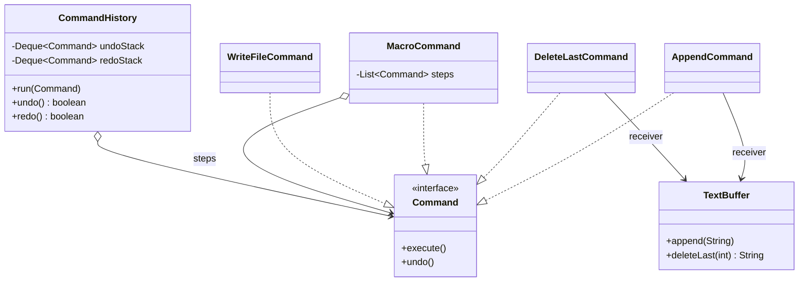

# Chapter 42 — Command

## What and why

**Command** = wrap a request (receiver + action + arguments) in an object. That object can be queued, logged, undone, redone, or composed. Exams ask for the four roles, how undo works, macro commands, and the redo-clearing rule.

## Problem

An editor needs undo/redo. If menu items call `buffer.append(...)` directly, nothing remembers what happened. A `Command` object records what to do **and** how to reverse it; the history is just a stack of commands.

## Exam flash rules

- Roles: **Command** (interface), **ConcreteCommand**, **Receiver** (does the work), **Invoker** (runs/stores commands), **Client** (wires them).
- A command holds a reference to its receiver and the arguments of the request.
- Undo needs state: a command must remember what it changed (`DeleteLastCommand.removed`).
- Undo stack is LIFO: last executed, first undone.
- Running a **new** command clears the redo stack.
- `undo()` on an empty history must be a safe no-op (return `false`), not an exception.
- `ArrayDeque.poll()` returns `null` on empty; `pop()` throws `NoSuchElementException`; `push(null)` throws `NullPointerException`.
- A macro (composite) command executes in order and undoes in **reverse** order.
- `Runnable` is a command without undo; `Callable<V>` is a command with a result and `throws Exception`.
- A lambda is allowed for a command only if the interface has **one** abstract method.
- Lambdas capture variables, not values: a captured mutable object shows later changes; a captured local must be effectively final.
- Commands decouple the **invoker** from the **receiver**; the invoker knows only `execute()`.

## Rules table

| Case | Result | Compiler message |
|------|--------|------------------|
| Anonymous class omits `undo()` | fails | `<anonymous ...> is not abstract and does not override abstract method undo() in Command` |
| Lambda for a two-method `Command` | fails | `Command is not a functional interface` / `multiple non-overriding abstract methods found in interface Command` |
| `Runnable` lambda calls `Thread.sleep` | fails | `unreported exception InterruptedException; must be caught or declared to be thrown` |
| Implement `execute()` without `public` | fails | `attempting to assign weaker access privileges; was public` |
| Implement `void execute()` as `int execute()` | fails | `return type int is not compatible with void` |

## Walkthrough

### Command interface and receiver

```java
{{#include ../../code/part-03-patterns/src/main/java/patterns/behavioral/command/Command.java:command-iface}}
```

```java
{{#include ../../code/part-03-patterns/src/main/java/patterns/behavioral/command/TextBuffer.java:receiver}}
```

### Concrete commands

```java
{{#include ../../code/part-03-patterns/src/main/java/patterns/behavioral/command/AppendCommand.java:append-command}}
```

```java
{{#include ../../code/part-03-patterns/src/main/java/patterns/behavioral/command/DeleteLastCommand.java:delete-command}}
```

### Invoker with undo / redo

```java
{{#include ../../code/part-03-patterns/src/main/java/patterns/behavioral/command/CommandHistory.java:history}}
```

```java
{{#include ../../code/part-03-patterns/src/main/java/patterns/behavioral/command/CommandDemo.java:command-demo}}
```

```text
{{#include ../../code/part-03-patterns/output/CommandDemo.txt}}
```

### Macro command

```java
{{#include ../../code/part-03-patterns/src/main/java/patterns/behavioral/command/MacroCommand.java:macro}}
```

```java
{{#include ../../code/part-03-patterns/src/main/java/patterns/behavioral/command/MacroDemo.java:macro-demo}}
```

```text
{{#include ../../code/part-03-patterns/output/MacroDemo.txt}}
```

One `undo()` on the macro reversed all three steps.

### Real I/O — undoable file writes

```java
{{#include ../../code/part-03-patterns/src/main/java/patterns/behavioral/command/WriteFileCommand.java:write-file}}
```

```java
{{#include ../../code/part-03-patterns/src/main/java/patterns/behavioral/command/FileCommandDemo.java:file-demo}}
```

```text
{{#include ../../code/part-03-patterns/output/FileCommandDemo.txt}}
```

### Does not compile

<div class="compiler-error">

```java
{{#include ../../code/part-03-patterns/broken/CommandAnonymousMissingBroken.java}}
```

```text
{{#include ../../code/part-03-patterns/output/CommandAnonymousMissingBroken.txt}}
```

```text
{{#include ../../code/part-03-patterns/output/CommandLambdaTwoMethodsBroken.txt}}
```

```text
{{#include ../../code/part-03-patterns/output/CommandRunnableCheckedBroken.txt}}
```

```text
{{#include ../../code/part-03-patterns/output/CommandWeakerAccessBroken.txt}}
```

```text
{{#include ../../code/part-03-patterns/output/CommandReturnTypeBroken.txt}}
```

</div>

Sources: `broken/CommandAnonymousMissingBroken.java`, `CommandLambdaTwoMethodsBroken.java`, `CommandRunnableCheckedBroken.java`, `CommandWeakerAccessBroken.java`, `CommandReturnTypeBroken.java`.

## Command vs similar patterns

| Pattern | Encapsulates | Typical use | Difference |
|---------|--------------|-------------|------------|
| **Command** | a request (receiver + action) | undo, queue, macro | object with `execute()` (+ `undo()`) |
| **Strategy** (ch 40) | an algorithm | swap behaviour of a context | no receiver, no undo, no history |
| **Memento** (ch 49) | a state snapshot | restore state | stores state, not the action |
| **Observer** (ch 41) | a subscription | broadcast changes | many receivers, no request object |
| **Chain of Responsibility** (ch 45) | a handler step | pass request along | request travels; command is the request |

Undo by **inverse command** (`AppendCommand.undo` deletes) is small but needs a true inverse; undo by **memento** stores a snapshot and works for any change.

## JDK usage

| API | Command role |
|-----|--------------|
| `java.lang.Runnable` | command without result or undo |
| `java.util.concurrent.Callable<V>` | command with result, may throw |
| `ExecutorService.submit` / `execute` | invoker (runs, queues) |
| `javax.swing.Action` / `AbstractAction` | command bound to menu/button |
| `java.util.function.Supplier`, `Consumer` | lightweight commands |

```java
{{#include ../../code/part-03-patterns/src/main/java/patterns/behavioral/command/JdkCommandDemo.java:jdk-demo}}
```

```text
{{#include ../../code/part-03-patterns/output/JdkCommandDemo.txt}}
```

## Predict the output

**P1.** Three appends, two undos.

```java
{{#include ../../code/part-03-patterns/src/main/java/patterns/behavioral/command/exam/PredictUndoOrder.java:predict-undo-order}}
```

<details><summary>Answer</summary>

```text
{{#include ../../code/part-03-patterns/output/PredictUndoOrder.txt}}
```

Trace: undo C, undo B → `A`.

</details>

**P2.** Undo, then a new command, then redo.

```java
{{#include ../../code/part-03-patterns/src/main/java/patterns/behavioral/command/exam/PredictRedoCleared.java:predict-redo-cleared}}
```

<details><summary>Answer</summary>

```text
{{#include ../../code/part-03-patterns/output/PredictRedoCleared.txt}}
```

Trace: `run(C)` cleared the redo stack, so `redo()` is `false`; buffer `A` + `C`.

</details>

**P3.** Macro execute then undo.

```java
{{#include ../../code/part-03-patterns/src/main/java/patterns/behavioral/command/exam/PredictMacroUndo.java:predict-macro-undo}}
```

<details><summary>Answer</summary>

```text
{{#include ../../code/part-03-patterns/output/PredictMacroUndo.txt}}
```

Trace: forward a, b, c; undo c, b, a.

</details>

**P4.** Commands built before state changes, run after.

```java
{{#include ../../code/part-03-patterns/src/main/java/patterns/behavioral/command/exam/PredictLateBinding.java:predict-late-binding}}
```

<details><summary>Answer</summary>

```text
{{#include ../../code/part-03-patterns/output/PredictLateBinding.txt}}
```

Trace: the lambda captured the **same** `StringBuilder` and array, so mutations before `run` are visible; `copy` is a per-iteration constant.

</details>

**P5.** Empty deque behaviour.

```java
{{#include ../../code/part-03-patterns/src/main/java/patterns/behavioral/command/exam/PredictDequeEmpty.java:predict-deque-empty}}
```

<details><summary>Answer</summary>

```text
{{#include ../../code/part-03-patterns/output/PredictDequeEmpty.txt}}
```

Trace: `poll()` → `null`; `pop()` → `NoSuchElementException`; `push(null)` → `NullPointerException`; size stays 0.

</details>

**P6.** `CommandDemo` — what does the last line print?

<details><summary>Answer</summary>

```text
{{#include ../../code/part-03-patterns/output/CommandDemo.txt}}
```

Trace: after the redo the undo stack holds two commands, so `true true false`, then the buffer is empty.

</details>

## Compile or not?

| # | Source | Answer | Reason |
|---|--------|--------|--------|
| C1 | `CommandAnonymousMissingBroken` | **fails** | anonymous class does not override `undo()` |
| C2 | `CommandLambdaTwoMethodsBroken` — looks fine | **fails** | not a functional interface (two abstract methods) |
| C3 | `CommandRunnableCheckedBroken` — looks fine | **fails** | `Runnable.run` declares no checked exceptions |
| C4 | `CommandWeakerAccessBroken` | **fails** | interface methods are `public`; implementation cannot be package-private |
| C5 | `CommandReturnTypeBroken` | **fails** | `int` is not compatible with `void` (plus two follow-on errors) |

## Gotchas

1. Redo must be cleared when a new command runs: `PredictRedoCleared`, `CommandTest.newCommandClearsRedo`.
2. Undo without stored state is wrong — `DeleteLastCommand` keeps `removed`; `AppendCommand` can invert from its argument.
3. Macro undo order is reversed: `PredictMacroUndo`.
4. Empty-stack `pop()` throws; use `poll()` and return `false`: `PredictDequeEmpty`.
5. Late binding: a queued lambda sees later changes to shared mutable state: `PredictLateBinding`.

## UML



## Interview Q&A

1. **Q:** What are the Command roles? **A:** Command, ConcreteCommand, Receiver, Invoker, Client — `Command`, `AppendCommand`, `TextBuffer`, `CommandHistory`, `CommandDemo`.
2. **Q:** How does undo work? **A:** Each command stores what it needs to reverse itself — `DeleteLastCommand.removed`.
3. **Q:** Why clear redo on a new command? **A:** The redo branch describes a future that no longer exists — `PredictRedoCleared`.
4. **Q:** Command vs Strategy? **A:** Command is a request with a receiver (and undo); Strategy is an interchangeable algorithm of a context.
5. **Q:** Which JDK types are commands? **A:** `Runnable`, `Callable`, `Action`; `ExecutorService` is the invoker — `JdkCommandDemo`.
6. **Q:** Macro command pattern? **A:** Composite of commands; undo in reverse — `MacroCommand`, `PredictMacroUndo`.
7. **Q:** `poll()` vs `pop()`? **A:** `poll()` returns `null` on empty, `pop()` throws — `PredictDequeEmpty`.
8. **Q:** Can a command be undone if it did I/O? **A:** Yes if it captures prior bytes — `WriteFileCommand`, `FileCommandDemo`.
9. **Q:** Why is `Command` with two methods not lambda-friendly? **A:** Not a functional interface — `CommandLambdaTwoMethodsBroken`; provide a factory taking two lambdas (`SolutionLambdaCommand`).
10. **Q:** Memento vs inverse commands for undo? **A:** Inverse commands are small but need a real inverse; memento snapshots work for any change but cost memory (ch 49).
11. **Q:** How do you bound memory of the history? **A:** Drop the oldest entry — `SolutionBoundedHistory`.
12. **Q:** Does `Runnable` support checked exceptions? **A:** No — `CommandRunnableCheckedBroken`; use `Callable` or wrap.

## Exam writing prompts

1. (5) Write `interface Command { void execute(); void undo(); }` and a `LightOnCommand` for a `Light` receiver with `on()` / `off()`.
2. (8) Write an invoker `History` with `run`, `undo`, `redo` using two `Deque<Command>`; state when redo is cleared.
3. (5) Draw the UML for Command, ConcreteCommand, Receiver, Invoker and write the matching skeleton.
4. (3) Make `MacroCommand.undo()` reverse the order of undo; give the loop header.

## Exercises

1. Counter with add/subtract commands and undo — `solutions/ch42/SolutionCounterCommands.java`.
2. Build a `Command` from two lambdas — `solutions/ch42/SolutionLambdaCommand.java`.
3. History limited to N entries — `solutions/ch42/SolutionBoundedHistory.java`.
4. Queue commands that append to a file, run later — `solutions/ch42/SolutionCommandQueue.java`.
5. Toggle command whose undo is itself — `solutions/ch42/SolutionToggleLight.java`.

```text
{{#include ../../code/part-03-patterns/output/SolutionCounterCommands.txt}}
```

```text
{{#include ../../code/part-03-patterns/output/SolutionLambdaCommand.txt}}
```

```text
{{#include ../../code/part-03-patterns/output/SolutionBoundedHistory.txt}}
```

```text
{{#include ../../code/part-03-patterns/output/SolutionCommandQueue.txt}}
```

```text
{{#include ../../code/part-03-patterns/output/SolutionToggleLight.txt}}
```

## Recap checklist

- [x] Problem, roles, UML
- [x] Undo/redo, macro, file-I/O command
- [x] vs-similar table and JDK usage
- [x] Exam flash rules, predict (6), compile-or-not (5), writing prompts (4)
- [x] Gotchas, Q&A, exercises with solutions
