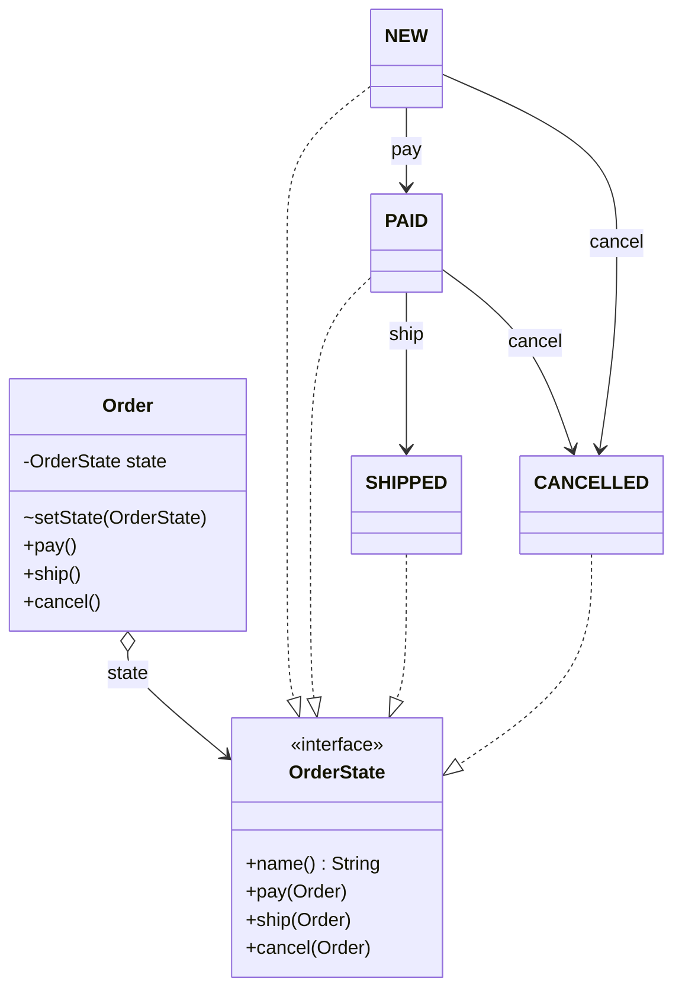

# Chapter 43 — State

## What and why

**State** = an object changes behaviour when its internal state changes; each state is its own object and the context delegates to it. Exams ask for the roles, the `switch`-on-flag problem it removes, who performs the transition, and the difference from Strategy.

## Problem

`SwitchOrder` puts a `switch (status)` in every action. A new status (`REFUNDED`) edits **every** method. State moves each status's rules into one class; the context never branches.

```java
{{#include ../../code/part-03-patterns/src/main/java/patterns/behavioral/state/SwitchOrder.java:switch-order}}
```

```text
{{#include ../../code/part-03-patterns/output/SwitchOrder.txt}}
```

## Exam flash rules

- Roles: **Context** (holds current state), **State** (interface), **ConcreteState** (one per state).
- The context **delegates** each action to `state.action(this)`; it has no `if`/`switch` on the state.
- A transition = the state (or context) calls `setState(next)`.
- Illegal action in a state = exception (`IllegalStateException`) or no-op — decide per state.
- State objects without fields are **stateless**: share one instance (singleton) across all contexts.
- Java 8+ `default` methods let the interface say "illegal" once; concrete states override only legal actions.
- An `enum` constant with a body is a ready-made state; `RED.getClass() != TrafficLight.class` (constant-specific subclass), `getDeclaringClass()` is the enum type.
- `sealed` + `record` + pattern `switch` (Java 21) gives a transition function the compiler checks for exhaustiveness.
- A `switch` **expression** must be exhaustive; a missing enum constant is a compile error.
- Every direct subtype of a `sealed` type must be named in its `permits` clause (or sit in the same file when `permits` is omitted).
- `new` on an enum or an interface is a compile error.
- State vs Strategy: State changes **itself** over time (transitions); Strategy is chosen **by the client** and does not change itself.

## Rules table

| Case | Result | Compiler message |
|------|--------|------------------|
| `switch` expression missing `YELLOW` | fails | `the switch expression does not cover all possible input values` |
| Record implements sealed interface but not in `permits` | fails | `class is not allowed to extend sealed class: Conn (as it is not listed in its 'permits' clause)` |
| `new Light()` for an enum | fails | `enum classes may not be instantiated` |
| `new State()` for an interface | fails | `State is abstract; cannot be instantiated` |
| State class writes a `private` context field | fails | `state has private access in Context` |

## Walkthrough

### State interface with default "illegal"

```java
{{#include ../../code/part-03-patterns/src/main/java/patterns/behavioral/state/OrderState.java:state-iface}}
```

### Concrete states

```java
{{#include ../../code/part-03-patterns/src/main/java/patterns/behavioral/state/OrderStates.java:states}}
```

### Context

```java
{{#include ../../code/part-03-patterns/src/main/java/patterns/behavioral/state/Order.java:context}}
```

`setState` is package-private: states in the same package may transition, clients may not.

### Baseline demo

```java
{{#include ../../code/part-03-patterns/src/main/java/patterns/behavioral/state/OrderDemo.java:order-demo}}
```

```text
{{#include ../../code/part-03-patterns/output/OrderDemo.txt}}
```

### Enum states

```java
{{#include ../../code/part-03-patterns/src/main/java/patterns/behavioral/state/TrafficLight.java:enum-state}}
```

```java
{{#include ../../code/part-03-patterns/src/main/java/patterns/behavioral/state/EnumStateDemo.java:enum-demo}}
```

```text
{{#include ../../code/part-03-patterns/output/EnumStateDemo.txt}}
```

### Java 21 — sealed states and pattern switch

```java
{{#include ../../code/part-03-patterns/src/main/java/patterns/behavioral/state/SealedStateDemo.java:sealed-state}}
```

```java
{{#include ../../code/part-03-patterns/src/main/java/patterns/behavioral/state/SealedStateDemo.java:sealed-demo}}
```

```text
{{#include ../../code/part-03-patterns/output/SealedStateDemo.txt}}
```

Records and sealed types need **Java 16+/17+**; pattern `switch` over them is final in **Java 21**. Older papers use class-per-state.

### Real I/O — a writer that is only valid while OPEN

```java
{{#include ../../code/part-03-patterns/src/main/java/patterns/behavioral/state/LogSession.java:log-session}}
```

```java
{{#include ../../code/part-03-patterns/src/main/java/patterns/behavioral/state/LogSessionDemo.java:log-demo}}
```

```text
{{#include ../../code/part-03-patterns/output/LogSessionDemo.txt}}
```

### Does not compile

<div class="compiler-error">

```java
{{#include ../../code/part-03-patterns/broken/StateSwitchNotExhaustiveBroken.java}}
```

```text
{{#include ../../code/part-03-patterns/output/StateSwitchNotExhaustiveBroken.txt}}
```

```text
{{#include ../../code/part-03-patterns/output/StateSealedPermitsBroken.txt}}
```

```text
{{#include ../../code/part-03-patterns/output/StateEnumNewBroken.txt}}
```

```text
{{#include ../../code/part-03-patterns/output/StateInterfaceNewBroken.txt}}
```

```text
{{#include ../../code/part-03-patterns/output/StatePrivateContextBroken.txt}}
```

</div>

Sources: `broken/StateSwitchNotExhaustiveBroken.java`, `StateSealedPermitsBroken.java`, `StateEnumNewBroken.java`, `StateInterfaceNewBroken.java`, `StatePrivateContextBroken.java`.

## State vs similar patterns

| Pattern | Who decides the variant | Changes at runtime? | Knows siblings? |
|---------|------------------------|---------------------|-----------------|
| **State** | the state itself (transitions) | yes, automatically | yes — a state names its successor |
| **Strategy** (ch 40) | the client | only when the client swaps | no |
| **Command** (ch 42) | the invoker | no | no |
| **Template Method** (ch 44) | the subclass | no (fixed at construction) | no |
| **Memento** (ch 49) | n/a — stores state | restores earlier state | no |

## JDK usage

| API | State machine |
|-----|---------------|
| `Thread.State` / `Thread.getState()` | `NEW → RUNNABLE → … → TERMINATED` |
| `Future.State` (Java 19) / `Future.state()` | `RUNNING`, `SUCCESS`, `FAILED`, `CANCELLED` |
| `java.nio.channels` open/closed channels | `ClosedChannelException` when used in CLOSED state |
| `java.util.Iterator` | before/after `next()` — `remove()` legal once per `next()` |

```java
{{#include ../../code/part-03-patterns/src/main/java/patterns/behavioral/state/JdkStateDemo.java:jdk-demo}}
```

```text
{{#include ../../code/part-03-patterns/output/JdkStateDemo.txt}}
```

`Future.State.RUNNING` is reported for a task that has not completed, including one not yet started.

## Predict the output

**P1.** Pay, cancel, pay again.

```java
{{#include ../../code/part-03-patterns/src/main/java/patterns/behavioral/state/exam/PredictFlow.java:predict-flow}}
```

<details><summary>Answer</summary>

```text
{{#include ../../code/part-03-patterns/output/PredictFlow.txt}}
```

Trace: NEW → PAID → CANCELLED; `CANCELLED` has no `pay` override, so the default throws; state unchanged.

</details>

**P2.** Shared state instances.

```java
{{#include ../../code/part-03-patterns/src/main/java/patterns/behavioral/state/exam/PredictShared.java:predict-shared}}
```

<details><summary>Answer</summary>

```text
{{#include ../../code/part-03-patterns/output/PredictShared.txt}}
```

Trace: both start at `NEW` (same singleton); `a` moves to `PAID`; `b` follows → same `PAID` object again.

</details>

**P3.** Enum states.

```java
{{#include ../../code/part-03-patterns/src/main/java/patterns/behavioral/state/exam/PredictEnumCycle.java:predict-enum-cycle}}
```

<details><summary>Answer</summary>

```text
{{#include ../../code/part-03-patterns/output/PredictEnumCycle.txt}}
```

Trace: 25 + 5 + 30 + 25 = 85, after four `next()` from GREEN → `YELLOW`; the constant has a body so its class is an anonymous subclass (`false`); `YELLOW.ordinal()` is 2.

</details>

**P4.** Sealed switch with a guard (Java 21).

```java
{{#include ../../code/part-03-patterns/src/main/java/patterns/behavioral/state/exam/PredictSealedSwitch.java:predict-sealed-switch}}
```

<details><summary>Answer</summary>

```text
{{#include ../../code/part-03-patterns/output/PredictSealedSwitch.txt}}
```

Trace: guarded case first (`level > 5`), then unguarded `On`, then `Off`; records have value `equals` and `Off[]` as `toString`.

</details>

**P5.** `LogSession` used before `open`.

```java
{{#include ../../code/part-03-patterns/src/main/java/patterns/behavioral/state/exam/PredictLogSession.java:predict-log-session}}
```

<details><summary>Answer</summary>

```text
{{#include ../../code/part-03-patterns/output/PredictLogSession.txt}}
```

Trace: `close()` in CLOSED returns itself (idempotent); `write` in CLOSED throws; state stays CLOSED.

</details>

**P6.** `SealedStateDemo` — what is the first line?

<details><summary>Answer</summary>

```text
{{#include ../../code/part-03-patterns/output/SealedStateDemo.txt}}
```

Trace: `SEND` while `Closed` returns the same state; `OPEN` creates `Open(0)`; two sends → `sent=2`; `CLOSE` → `Closed[]`.

</details>

## Compile or not?

| # | Source | Answer | Reason |
|---|--------|--------|--------|
| C1 | `StateSwitchNotExhaustiveBroken` | **fails** | `YELLOW` not covered in a switch **expression** |
| C2 | `StateSealedPermitsBroken` — looks fine | **fails** | `Broken` is not in `permits` |
| C3 | `StateEnumNewBroken` | **fails** | enum constants cannot be created with `new` |
| C4 | `StateInterfaceNewBroken` | **fails** | an interface cannot be instantiated |
| C5 | `StatePrivateContextBroken` | **fails** | state class is a different class; `private` field not accessible |

## Gotchas

1. Switch on a flag in every method — the problem State removes: `SwitchOrder`.
2. State objects with no fields should be shared, not `new` per transition: `PredictShared`.
3. Enum constant with a body has a different `getClass()`: `PredictEnumCycle`.
4. Forgetting to override an action silently inherits "illegal": `PredictFlow`.
5. A `switch` **statement** may skip a case; a switch **expression** may not: `StateSwitchNotExhaustiveBroken`.

## UML



## Interview Q&A

1. **Q:** Name the State roles. **A:** Context, State, ConcreteState — `Order`, `OrderState`, `OrderStates.*`.
2. **Q:** What smell does State remove? **A:** Repeated `switch`/`if` on a status flag — `SwitchOrder`.
3. **Q:** Who triggers the transition? **A:** Usually the state calls `context.setState(next)` — `OrderStates.NEW.pay`.
4. **Q:** State vs Strategy? **A:** State transitions on its own and states know successors; Strategy is picked by the client and never changes itself.
5. **Q:** Can states be singletons? **A:** Yes when they hold no per-context data — `PredictShared`.
6. **Q:** How do `default` methods help? **A:** One "illegal" implementation; concrete states override only legal actions — `OrderState`.
7. **Q:** Enum as state? **A:** Constants with bodies override abstract methods — `TrafficLight`.
8. **Q:** Why is `RED.getClass() == TrafficLight.class` false? **A:** A constant with a body is an anonymous subclass — `PredictEnumCycle`.
9. **Q:** Table-driven vs class-per-state? **A:** Table for pure transitions (`SolutionDocumentTable`); classes when each state has behaviour.
10. **Q:** What does `sealed` buy in a state machine? **A:** The compiler checks every state is handled in `switch` — `SealedStateDemo`, `StateSealedPermitsBroken`.
11. **Q:** Which JDK types are state machines? **A:** `Thread.State`, `Future.State` — `JdkStateDemo`.
12. **Q:** Illegal transition: exception or ignore? **A:** Exception for programmer errors (`cannot cancel in SHIPPED`); ignore for idempotent actions (`close()` when CLOSED) — `LogSessionDemo`.

## Exam writing prompts

1. (8) Model a `Document` with states `DRAFT`, `REVIEW`, `PUBLISHED`: write `interface DocState`, one class per state, and the `Document` context.
2. (5) Rewrite a method `void push() { if (locked) ... else ... }` using State: show interface, two classes, and the context field.
3. (5) Write an `enum Phase` whose constants override `abstract Phase next()`.
4. (3) Add `permits` and one `switch` expression over a sealed `Conn` that is exhaustive without `default`.

## Exercises

1. Turnstile with `LOCKED`/`UNLOCKED` states — `solutions/ch43/SolutionTurnstile.java`.
2. Table-driven document workflow with `EnumMap` — `solutions/ch43/SolutionDocumentTable.java`.
3. Sealed bulb that burns out — `solutions/ch43/SolutionSealedBulb.java`.
4. Transition log — `solutions/ch43/SolutionTransitionLog.java`.
5. Enum state with a constructor field — `solutions/ch43/SolutionEnumDuration.java`.

```text
{{#include ../../code/part-03-patterns/output/SolutionTurnstile.txt}}
```

```text
{{#include ../../code/part-03-patterns/output/SolutionDocumentTable.txt}}
```

```text
{{#include ../../code/part-03-patterns/output/SolutionSealedBulb.txt}}
```

```text
{{#include ../../code/part-03-patterns/output/SolutionTransitionLog.txt}}
```

```text
{{#include ../../code/part-03-patterns/output/SolutionEnumDuration.txt}}
```

## Recap checklist

- [x] Problem (`switch` on flag), roles, UML
- [x] Class states, enum states, Java 21 sealed states, file-I/O state machine
- [x] vs-similar table and JDK usage
- [x] Exam flash rules, predict (6), compile-or-not (5), writing prompts (4)
- [x] Gotchas, Q&A, exercises with solutions
