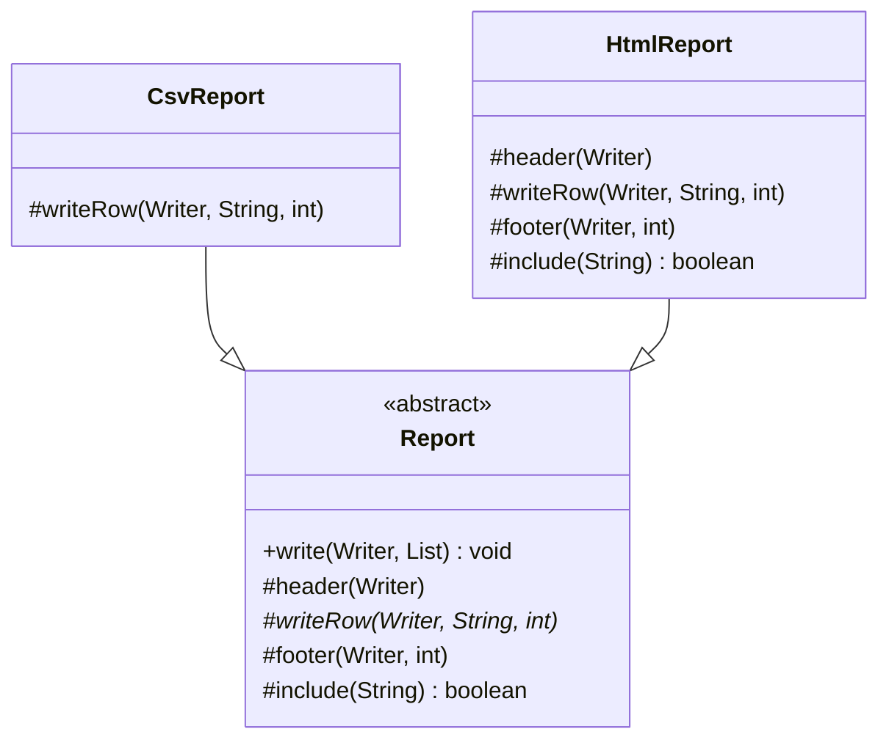

# Chapter 44 — Template Method

## What and why

**Template Method** = a base class fixes the order of an algorithm in a `final` method and leaves some steps to subclasses (abstract steps and optional hooks). Exams ask for `final` on the template, abstract step vs hook, "Hollywood principle", and the constructor-calls-overridable-method trap.

## Problem

A CSV export and an HTML export both: write a header, loop over rows, skip unwanted ones, write a footer. Copy-pasting the loop means every fix is made twice. The loop lives once in `Report.write`; each format supplies only the different steps.

## Exam flash rules

- The **template method** is `final` so subclasses cannot change the order of steps.
- **Abstract step**: subclasses **must** implement it. **Hook**: has a default body; subclasses **may** override it.
- Hollywood principle: "don't call us, we'll call you" — the base class calls the subclass, not the reverse.
- Template Method uses **inheritance**; Strategy uses **composition**.
- An overriding method cannot reduce visibility (`protected` → package-private fails).
- An overriding method cannot add a checked exception the overridden method does not declare.
- `abstract` and `private` cannot be combined (a private method cannot be overridden).
- A class with an abstract method must be declared `abstract`; `new` on it is a compile error.
- A `private` method in the base class is **not** overridden: the template calls the base version.
- A constructor that calls an overridable step runs it **before** the subclass's field initializers.
- A `final` field initialised with a **compile-time constant** is already visible in that early call; non-constant `final` and plain fields are `null`/`0`.
- JDK examples: `AbstractList` (implement `get` + `size`), `InputStream` (implement `read()`), `AbstractMap`, `Comparator.compare` used by `sort`.
- A template can also be written with lambdas (functions as steps) — no subclass needed.

## Rules table

| Case | Result | Compiler message |
|------|--------|------------------|
| Override a `final` template method | fails | `overridden method is final` |
| Concrete subclass misses an abstract step | fails | `... is not abstract and does not override abstract method row() in Report` |
| `new Report()` for an abstract class | fails | `Report is abstract; cannot be instantiated` |
| Override `protected` hook as package-private | fails | `attempting to assign weaker access privileges; was protected` |
| Hook override adds `throws IOException` | fails | `overridden method does not throw IOException` |
| `private abstract void row();` | fails | `illegal combination of modifiers: abstract and private` |

## Walkthrough

### The template and its steps

```java
{{#include ../../code/part-03-patterns/src/main/java/patterns/behavioral/template/Report.java:report}}
```

### Two subclasses

```java
{{#include ../../code/part-03-patterns/src/main/java/patterns/behavioral/template/CsvReport.java:csv-report}}
```

```java
{{#include ../../code/part-03-patterns/src/main/java/patterns/behavioral/template/HtmlReport.java:html-report}}
```

```java
{{#include ../../code/part-03-patterns/src/main/java/patterns/behavioral/template/ReportDemo.java:report-demo}}
```

```text
{{#include ../../code/part-03-patterns/output/ReportDemo.txt}}
```

`CsvReport` uses the default hooks (blank row included); `HtmlReport` overrides `header`, `footer`, and `include`.

### Real I/O — writing through the template to a file

```java
{{#include ../../code/part-03-patterns/src/main/java/patterns/behavioral/template/FileReportDemo.java:file-report}}
```

```text
{{#include ../../code/part-03-patterns/output/FileReportDemo.txt}}
```

52 bytes, not 50: `é` and `ï` are two UTF-8 bytes each. The charset is chosen once, outside the template.

### Edge case — constructor calls an overridable step

```java
{{#include ../../code/part-03-patterns/src/main/java/patterns/behavioral/template/TemplateCtorTrap.java:ctor-trap}}
```

```java
{{#include ../../code/part-03-patterns/src/main/java/patterns/behavioral/template/TemplateCtorTrap.java:ctor-fixed}}
```

```text
{{#include ../../code/part-03-patterns/output/TemplateCtorTrap.txt}}
```

Fix: do not run the template from a constructor; expose an explicit `init()` that the caller invokes after construction.

### Template with lambdas

```java
{{#include ../../code/part-03-patterns/src/main/java/patterns/behavioral/template/LambdaTemplate.java:lambda-template}}
```

```text
{{#include ../../code/part-03-patterns/output/LambdaTemplate.txt}}
```

### Does not compile

<div class="compiler-error">

```java
{{#include ../../code/part-03-patterns/broken/TemplateOverrideFinalBroken.java}}
```

```text
{{#include ../../code/part-03-patterns/output/TemplateOverrideFinalBroken.txt}}
```

```text
{{#include ../../code/part-03-patterns/output/TemplateMissingStepBroken.txt}}
```

```text
{{#include ../../code/part-03-patterns/output/TemplateNewAbstractBroken.txt}}
```

```text
{{#include ../../code/part-03-patterns/output/TemplateHookWeakerBroken.txt}}
```

```text
{{#include ../../code/part-03-patterns/output/TemplateHookCheckedBroken.txt}}
```

```text
{{#include ../../code/part-03-patterns/output/TemplatePrivateAbstractBroken.txt}}
```

</div>

Sources: `broken/TemplateOverrideFinalBroken.java`, `TemplateMissingStepBroken.java`, `TemplateNewAbstractBroken.java`, `TemplateHookWeakerBroken.java`, `TemplateHookCheckedBroken.java`, `TemplatePrivateAbstractBroken.java`.

## Template Method vs similar patterns

| Pattern | Varies | Mechanism | Binding |
|---------|--------|-------|---------|
| **Template Method** | steps inside one algorithm | inheritance + `final` skeleton | compile time (class chosen) |
| **Strategy** (ch 40) | the whole algorithm | composition + interface | runtime, swappable |
| **Factory Method** (ch 29) | which object is created | a template step that returns an object | compile time |
| **State** (ch 43) | behaviour per state | delegation to state objects | runtime, automatic |
| **Visitor** (ch 48) | operation over a structure | double dispatch | per call |

Template Method is often the skeleton that **calls** a Factory Method as one of its steps.

## JDK usage

| API | Template | Steps you supply |
|-----|----------|------------------|
| `java.util.AbstractList` | `toString`, `contains`, `indexOf`, `iterator`, `equals`, `subList` | `get(int)`, `size()` (+ `set`/`add`/`remove` for mutability) |
| `java.io.InputStream` | `readAllBytes`, `read(byte[],int,int)` | `read()` |
| `java.util.AbstractMap` | `get`, `containsKey`, `toString` | `entrySet()` |
| `java.util.Collections` / `List.sort` | sorting skeleton | `Comparator.compare` |

```java
{{#include ../../code/part-03-patterns/src/main/java/patterns/behavioral/template/JdkTemplateDemo.java:jdk-range}}
```

```java
{{#include ../../code/part-03-patterns/src/main/java/patterns/behavioral/template/JdkTemplateDemo.java:jdk-stream}}
```

```java
{{#include ../../code/part-03-patterns/src/main/java/patterns/behavioral/template/JdkTemplateDemo.java:jdk-demo}}
```

```text
{{#include ../../code/part-03-patterns/output/JdkTemplateDemo.txt}}
```

## Predict the output

**P1.** Order of template steps.

```java
{{#include ../../code/part-03-patterns/src/main/java/patterns/behavioral/template/exam/PredictCallOrder.java:predict-call-order}}
```

<details><summary>Answer</summary>

```text
{{#include ../../code/part-03-patterns/output/PredictCallOrder.txt}}
```

Trace: `init`, then `over()`/`turn()` until `turns >= 3`, then `end`.

</details>

**P2.** Constructor calls an abstract step.

```java
{{#include ../../code/part-03-patterns/src/main/java/patterns/behavioral/template/exam/PredictCtorHook.java:predict-ctor-hook}}
```

<details><summary>Answer</summary>

```text
{{#include ../../code/part-03-patterns/output/PredictCtorHook.txt}}
```

Trace: during `Base()` the `Child` initializers have not run: `constant` is a compile-time constant (inlined, `const`), `computed` and `plain` are still `null`. After construction all three are set.

</details>

**P3.** Private step in the base class.

```java
{{#include ../../code/part-03-patterns/src/main/java/patterns/behavioral/template/exam/PredictPrivateStep.java:predict-private-step}}
```

<details><summary>Answer</summary>

```text
{{#include ../../code/part-03-patterns/output/PredictPrivateStep.txt}}
```

Trace: `Base.step()` is `private`, so `Child.step()` is a new method, not an override; `other()` is overridden.

</details>

**P4.** Hooks overridden in a subclass.

```java
{{#include ../../code/part-03-patterns/src/main/java/patterns/behavioral/template/exam/PredictSuperHook.java:predict-super-hook}}
```

<details><summary>Answer</summary>

```text
{{#include ../../code/part-03-patterns/output/PredictSuperHook.txt}}
```

Trace: header hook, `a` skipped (`length() > 1` false), `bb` index 0, `ccc` index 1, footer with count 2.

</details>

**P5.** `AbstractList` with only `get` and `size`.

```java
{{#include ../../code/part-03-patterns/src/main/java/patterns/behavioral/template/exam/PredictAbstractList.java:predict-abstract-list}}
```

<details><summary>Answer</summary>

```text
{{#include ../../code/part-03-patterns/output/PredictAbstractList.txt}}
```

Trace: inherited `toString`/`contains`/`indexOf` work; inherited `add` and `set` default to throwing `UnsupportedOperationException`.

</details>

**P6.** `TemplateCtorTrap` — first line?

<details><summary>Answer</summary>

```text
{{#include ../../code/part-03-patterns/output/TemplateCtorTrap.txt}}
```

Trace: `Base` constructor runs `label()` before `Child`'s `name = "child"` initializer → `null`.

</details>

## Compile or not?

| # | Source | Answer | Reason |
|---|--------|--------|--------|
| C1 | `TemplateOverrideFinalBroken` | **fails** | template method is `final` |
| C2 | `TemplateMissingStepBroken` | **fails** | abstract step not implemented |
| C3 | `TemplateNewAbstractBroken` | **fails** | abstract class cannot be instantiated |
| C4 | `TemplateHookWeakerBroken` — looks fine | **fails** | `protected` → package-private is weaker |
| C5 | `TemplateHookCheckedBroken` — looks fine | **fails** | overriding hook may not add `throws IOException` |
| C6 | `TemplatePrivateAbstractBroken` | **fails** | `abstract` + `private` illegal |

## Gotchas

1. Template not `final` — a subclass can rewrite the algorithm: `TemplateOverrideFinalBroken`.
2. Calling a step from a constructor sees uninitialised subclass fields: `PredictCtorHook`, `TemplateCtorTrap`.
3. `private` step is not overridable: `PredictPrivateStep`.
4. Inherited `add`/`set` on `AbstractList` throw `UnsupportedOperationException`: `PredictAbstractList`.
5. Too many hooks make subclasses hard to follow; prefer lambdas when steps are tiny: `LambdaTemplate`.

## UML



Diagram → code: `*` marks the abstract step; `write` has no marker here but is `final` in code.

## Interview Q&A

1. **Q:** Why is the template method `final`? **A:** To guarantee the algorithm order — `TemplateOverrideFinalBroken`.
2. **Q:** Abstract step vs hook? **A:** Abstract = required; hook = optional with a default body — `Report.writeRow` vs `Report.include`.
3. **Q:** What is the Hollywood principle? **A:** The base class calls subclass steps; subclasses do not call the template.
4. **Q:** Template Method vs Strategy? **A:** Inheritance fixed at compile time vs composition swappable at runtime.
5. **Q:** Why avoid calling steps in a constructor? **A:** Subclass fields are not initialised yet — `PredictCtorHook`.
6. **Q:** Is a `private` step overridable? **A:** No — `PredictPrivateStep`.
7. **Q:** Name a JDK Template Method. **A:** `AbstractList`, `InputStream.readAllBytes` — `JdkTemplateDemo`.
8. **Q:** Can a hook widen access? **A:** Yes (`protected` → `public`); narrowing fails — `TemplateHookWeakerBroken`.
9. **Q:** Can a hook add a checked exception? **A:** No — `TemplateHookCheckedBroken`; declare it in the base hook.
10. **Q:** How does Template Method relate to Factory Method? **A:** A factory method is a template step that creates an object.
11. **Q:** Replace inheritance with lambdas? **A:** Pass the steps as functional parameters — `LambdaTemplate`, `SolutionLambdaPipeline`.
12. **Q:** Why is the file byte count larger than the char count? **A:** UTF-8 uses 2 bytes for `é`/`ï` — `FileReportDemo`.

## Exam writing prompts

1. (8) Write an abstract class `Beverage` with a `final prepare()` that boils water, calls `brew()`, pours, and calls `addCondiments()` only if hook `wantsCondiments()` is true; add `Tea` and `Coffee`.
2. (5) Make a `DataLoader` template (`open`, `readAll`, `close`) where `close` always runs (use `try/finally`) and `parse` is abstract.
3. (3) Identify which of `header`, `writeRow`, `include` are hooks and which are abstract in `Report`; justify.
4. (3) Fix a base constructor that calls `init()` (abstract) so subclass fields are ready.

## Exercises

1. Beverage template with a hook — `solutions/ch44/SolutionBeverage.java`.
2. File line processor (real I/O) — `solutions/ch44/SolutionLineProcessor.java`.
3. Lambda-based template — `solutions/ch44/SolutionLambdaPipeline.java`.
4. Read-only `AbstractList` of multiples — `solutions/ch44/SolutionAbstractListRange.java`.
5. Safe `init()` instead of constructor call — `solutions/ch44/SolutionSafeInit.java`.

```text
{{#include ../../code/part-03-patterns/output/SolutionBeverage.txt}}
```

```text
{{#include ../../code/part-03-patterns/output/SolutionLineProcessor.txt}}
```

```text
{{#include ../../code/part-03-patterns/output/SolutionLambdaPipeline.txt}}
```

```text
{{#include ../../code/part-03-patterns/output/SolutionAbstractListRange.txt}}
```

```text
{{#include ../../code/part-03-patterns/output/SolutionSafeInit.txt}}
```

## Recap checklist

- [x] Problem (duplicated skeleton), roles, UML
- [x] Abstract step, hooks, constructor trap, lambda template, file-I/O template
- [x] vs-similar table and JDK usage
- [x] Exam flash rules, predict (6), compile-or-not (6), writing prompts (4)
- [x] Gotchas, Q&A, exercises with solutions
