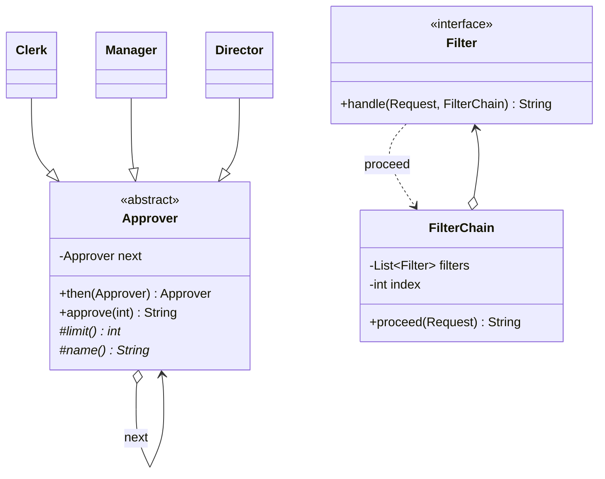

# Chapter 45 — Chain of Responsibility

## What and why

**Chain of Responsibility** = a request travels along a linked list of handlers; each handler either deals with it, passes it on, or stops it. The sender does not know which handler acts. Exams ask for the structure, "first match wins" vs "pipeline" variants, and `catch` order (the JDK's own chain).

## Problem

An expense must be approved by the lowest-level person whose limit covers it. If the client writes `if (a <= 100) clerk… else if (a <= 1000) manager…`, every new level edits the client. With a chain the client calls `first.approve(amount)` and the links decide.

## Exam flash rules

- Roles: **Handler** (interface/abstract class with a `next` link), **ConcreteHandler**, **Client** (starts the chain at the first handler).
- Each handler either **handles**, **forwards** to `next`, or does both (pipeline).
- Classic form: the **first** capable handler handles and the chain stops.
- Pipeline form (servlet filters): every handler runs and decides whether to call `proceed`; **not** calling it **short-circuits**.
- Order of links changes the result: put the most specific/cheapest handler first.
- Always define what happens at the **end** of the chain (default result, error, or no-op) — never dereference a `null` `next`.
- Filters that act after `proceed` returns produce **onion** order: in-x, in-y, in-z, out-z, out-y, out-x.
- A filter chain object with an index is **stateful**: build one chain per request.
- `next` cannot be `final` if it is set after construction (`cannot assign a value to final variable`).
- `try`/`catch` is a chain: the **first** `catch` whose type matches runs; later ones are skipped; `finally` always runs.
- A `catch` for a subclass after its superclass does not compile (`has already been caught`).
- `throw null` throws `NullPointerException`, which a `catch (RuntimeException)` clause catches.
- Chain of Responsibility decouples the sender from the receiver, but a request may go **unhandled**.

## Rules table

| Case | Result | Compiler message |
|------|--------|------------------|
| `catch (RuntimeException)` before `catch (NumberFormatException)` | fails | `exception NumberFormatException has already been caught` |
| `new Approver()` for an abstract class | fails | `Approver is abstract; cannot be instantiated` |
| Concrete handler omits abstract `limit()` | fails | `Clerk is not abstract and does not override abstract method limit() in Approver` |
| `Handler<String>.setNext(Handler<Integer>)` | fails | `incompatible types: Handler<Integer> cannot be converted to Handler<String>` |
| Block lambda for `String handle(...)` without `return` | fails | `incompatible types: bad return type in lambda expression` / `missing return value` |
| Assign `final` `next` in `then()` | fails | `cannot assign a value to final variable next` |

## Walkthrough

### Classic chain — first capable handler wins

```java
{{#include ../../code/part-03-patterns/src/main/java/patterns/behavioral/chain/Approver.java:approver}}
```

```java
{{#include ../../code/part-03-patterns/src/main/java/patterns/behavioral/chain/Clerk.java:clerk}}
```

`Manager` (limit 1 000) and `Director` (limit 10 000) differ only in `limit()` and `name()`.

```java
{{#include ../../code/part-03-patterns/src/main/java/patterns/behavioral/chain/ChainDemo.java:chain-demo}}
```

```text
{{#include ../../code/part-03-patterns/output/ChainDemo.txt}}
```

### Pipeline chain — filters with `proceed`

```java
{{#include ../../code/part-03-patterns/src/main/java/patterns/behavioral/chain/Filter.java:filter}}
```

```java
{{#include ../../code/part-03-patterns/src/main/java/patterns/behavioral/chain/FilterChain.java:filter-chain}}
```

```java
{{#include ../../code/part-03-patterns/src/main/java/patterns/behavioral/chain/FilterChainDemo.java:filter-demo}}
```

```text
{{#include ../../code/part-03-patterns/output/FilterChainDemo.txt}}
```

The second request: `auth` returned `401` without calling `proceed`, so `timing` and the terminal never ran, but `log` still saw the result on the way out.

### Real I/O — a validator chain over real files

```java
{{#include ../../code/part-03-patterns/src/main/java/patterns/behavioral/chain/PathChecks.java:path-checks}}
```

```java
{{#include ../../code/part-03-patterns/src/main/java/patterns/behavioral/chain/PathChecksDemo.java:path-demo}}
```

```text
{{#include ../../code/part-03-patterns/output/PathChecksDemo.txt}}
```

`ghost.txt` stops at `exists()`: `maxSize` would have thrown `NoSuchFileException` on a missing file. Chain order protects later links.

### Does not compile

<div class="compiler-error">

```java
{{#include ../../code/part-03-patterns/broken/ChainCatchOrderBroken.java}}
```

```text
{{#include ../../code/part-03-patterns/output/ChainCatchOrderBroken.txt}}
```

```text
{{#include ../../code/part-03-patterns/output/ChainAbstractNewBroken.txt}}
```

```text
{{#include ../../code/part-03-patterns/output/ChainMissingLimitBroken.txt}}
```

```text
{{#include ../../code/part-03-patterns/output/ChainGenericNextBroken.txt}}
```

```text
{{#include ../../code/part-03-patterns/output/ChainLambdaNoReturnBroken.txt}}
```

```text
{{#include ../../code/part-03-patterns/output/ChainFinalNextBroken.txt}}
```

</div>

Sources: `broken/ChainCatchOrderBroken.java`, `ChainAbstractNewBroken.java`, `ChainMissingLimitBroken.java`, `ChainGenericNextBroken.java`, `ChainLambdaNoReturnBroken.java`, `ChainFinalNextBroken.java`.

## Chain of Responsibility vs similar patterns

| Pattern | Receivers | Relationship | Difference |
|---------|-----------|--------------|------------|
| **Chain of Responsibility** | one (classic) or each (pipeline) in order | linked handlers | sender does not know who acts |
| **Decorator** (ch 34) | all wrappers, always | wrap one object | every layer runs; no "stop"; same interface as the core object |
| **Observer** (ch 41) | all observers | list | every observer is notified; no ordering of responsibility |
| **Command** (ch 42) | one receiver | request object | receiver is fixed by the command |
| **Mediator** (ch 47) | colleagues via a hub | hub-and-spoke | hub knows all participants |

## JDK usage

| API | Chain |
|-----|-------|
| `try` / `catch` clauses | first matching `catch` handles |
| `ClassLoader.getParent()` | parent-first delegation: app → platform → bootstrap |
| `java.util.logging.Logger` parent / `Handler` | records propagate to parent loggers' handlers |
| Servlet `FilterChain.doFilter` (Jakarta, not in the JDK) | same shape as `FilterChain.proceed` here |
| `java.util.stream` pipeline stages | each stage passes elements on; `filter` may drop them |

```java
{{#include ../../code/part-03-patterns/src/main/java/patterns/behavioral/chain/JdkChainDemo.java:jdk-demo}}
```

```text
{{#include ../../code/part-03-patterns/output/JdkChainDemo.txt}}
```

The child logger's level `WARNING` dropped the `INFO` record before it reached the parent's handler.

## Predict the output

**P1.** Boundary values.

```java
{{#include ../../code/part-03-patterns/src/main/java/patterns/behavioral/chain/exam/PredictApprove.java:predict-approve}}
```

<details><summary>Answer</summary>

```text
{{#include ../../code/part-03-patterns/output/PredictApprove.txt}}
```

Trace: `<=` limits: 100 → Clerk; 101 → Manager; 10 000 → Director; 10 001 → end of chain.

</details>

**P2.** Order of links and entry point.

```java
{{#include ../../code/part-03-patterns/src/main/java/patterns/behavioral/chain/exam/PredictOrderMatters.java:predict-order-matters}}
```

<details><summary>Answer</summary>

```text
{{#include ../../code/part-03-patterns/output/PredictOrderMatters.txt}}
```

Trace: `Director` first approves 10 (limit 10 000). Third line: `mgr` is the second node, so the chain starts there.

</details>

**P3.** A filter that does not call `proceed`.

```java
{{#include ../../code/part-03-patterns/src/main/java/patterns/behavioral/chain/exam/PredictShortCircuit.java:predict-short-circuit}}
```

<details><summary>Answer</summary>

```text
{{#include ../../code/part-03-patterns/output/PredictShortCircuit.txt}}
```

Trace: `a` runs, `stop` returns `"blocked"` without `proceed`; `b` and the terminal never run.

</details>

**P4.** Filters that act before and after.

```java
{{#include ../../code/part-03-patterns/src/main/java/patterns/behavioral/chain/exam/PredictOnion.java:predict-onion}}
```

<details><summary>Answer</summary>

```text
{{#include ../../code/part-03-patterns/output/PredictOnion.txt}}
```

Trace: in-x, in-y, in-z, terminal `core`, then out-z, out-y, out-x; the printed result is `core`.

</details>

**P5.** `catch` order, `finally`, and `throw null`.

```java
{{#include ../../code/part-03-patterns/src/main/java/patterns/behavioral/chain/exam/PredictCatchOrder.java:predict-catch-order}}
```

<details><summary>Answer</summary>

```text
{{#include ../../code/part-03-patterns/output/PredictCatchOrder.txt}}
```

Trace: `NumberFormatException` is an `IllegalArgumentException` → `IAE`; `IllegalStateException` skips the first catch → `RTE`; `throw null` raises `NullPointerException`, a `RuntimeException`, so `RTE` runs and `NPE` in `main` never prints. `finally` runs every time.

</details>

**P6.** Real file chain.

```java
{{#include ../../code/part-03-patterns/src/main/java/patterns/behavioral/chain/exam/PredictFileChain.java:predict-file-chain}}
```

<details><summary>Answer</summary>

```text
{{#include ../../code/part-03-patterns/output/PredictFileChain.txt}}
```

Trace: 5 bytes > 3 → first link fails and the `.txt` check never runs; an empty chain passes (`ok`).

</details>

## Compile or not?

| # | Source | Answer | Reason |
|---|--------|--------|--------|
| C1 | `ChainCatchOrderBroken` — looks fine | **fails** | subclass `catch` after its superclass is unreachable |
| C2 | `ChainAbstractNewBroken` | **fails** | abstract class cannot be instantiated |
| C3 | `ChainMissingLimitBroken` | **fails** | abstract `limit()` not implemented |
| C4 | `ChainGenericNextBroken` | **fails** | `Handler<Integer>` is not a `Handler<String>` |
| C5 | `ChainLambdaNoReturnBroken` — looks fine | **fails** | block lambda must return a `String` |
| C6 | `ChainFinalNextBroken` | **fails** | `final` field assigned outside the constructor |

## Gotchas

1. No end-of-chain rule → request silently dropped or `NullPointerException`: `PredictApprove` (`nobody can approve`).
2. Link order changes behaviour: `PredictOrderMatters`.
3. A filter that forgets `proceed` blocks everything after it: `PredictShortCircuit`.
4. `catch` order — subclass first; `throw null` is caught as `RuntimeException`: `PredictCatchOrder`, `ChainCatchOrderBroken`.
5. A `FilterChain` is single-use (stateful index): `FilterChain`; build one per request as in `FilterChainDemo`.

## UML



Diagram → code: the self-association `o--> next` is a field of the same type.

## Interview Q&A

1. **Q:** What are the roles? **A:** Handler (with `next`), ConcreteHandler, Client — `Approver`, `Clerk`, `ChainDemo`.
2. **Q:** Classic chain vs pipeline? **A:** Classic: first capable handler stops the chain; pipeline: every filter runs and may short-circuit — `ChainDemo` vs `FilterChainDemo`.
3. **Q:** What if nobody handles the request? **A:** Define a terminal default or error — `nobody can approve 50000`.
4. **Q:** Chain vs Decorator? **A:** A decorator always delegates and keeps the core interface; a chain link may stop the request.
5. **Q:** Why does `try/catch` count as a chain? **A:** First matching `catch` runs — `PredictCatchOrder`.
6. **Q:** Why does ordering matter? **A:** The first capable handler wins — `PredictOrderMatters`.
7. **Q:** How does a filter wrap the rest? **A:** Code after `proceed` runs on the way back (onion) — `PredictOnion`.
8. **Q:** Why is a `FilterChain` not reusable? **A:** It stores the next index — `FilterChain`.
9. **Q:** JDK examples? **A:** `ClassLoader` delegation, `Logger` parents — `JdkChainDemo`.
10. **Q:** How do you avoid dereferencing `null` `next`? **A:** Check it, or end with a terminal handler — `Approver.approve`.
11. **Q:** Chain vs `if/else` ladder? **A:** The chain lets links be added, reordered, and reused without editing the client.
12. **Q:** Why does validation order matter for files? **A:** Cheap/safe checks first (`exists` before `maxSize`) — `PathChecksDemo`.

## Exam writing prompts

1. (8) Write abstract `Handler` with `setNext` and `handle(int)`, and two concrete handlers `SmallHandler` (≤10) and `LargeHandler` (≤100) that forward otherwise; build the chain in `main`.
2. (5) Write a `Filter`/`FilterChain` pair where a `LoggingFilter` prints before and after `proceed`.
3. (3) Fix a handler whose `next` is `final` but is set by `then()`.
4. (3) Rewrite `try { … } catch (Exception e) {…} catch (IOException e) {…}` so that it compiles; say which clause handles `FileNotFoundException`.

## Exercises

1. Level-based loggers; every matching link writes — `solutions/ch45/SolutionLogLevels.java`.
2. Build a chain from a list of handlers — `solutions/ch45/SolutionBuildChain.java`.
3. Auth filters with a short-circuit — `solutions/ch45/SolutionAuthFilters.java`.
4. Collect **all** failures instead of the first (real files) — `solutions/ch45/SolutionCollectAllFailures.java`.
5. Pipeline chain where every link transforms the value — `solutions/ch45/SolutionFunctionCompose.java`.

```text
{{#include ../../code/part-03-patterns/output/SolutionLogLevels.txt}}
```

```text
{{#include ../../code/part-03-patterns/output/SolutionBuildChain.txt}}
```

```text
{{#include ../../code/part-03-patterns/output/SolutionAuthFilters.txt}}
```

```text
{{#include ../../code/part-03-patterns/output/SolutionCollectAllFailures.txt}}
```

```text
{{#include ../../code/part-03-patterns/output/SolutionFunctionCompose.txt}}
```

## Recap checklist

- [x] Problem, roles, UML
- [x] Classic chain, pipeline filters, real-file validator chain
- [x] vs-similar table and JDK usage
- [x] Exam flash rules, predict (6), compile-or-not (6), writing prompts (4)
- [x] Gotchas, Q&A, exercises with solutions
