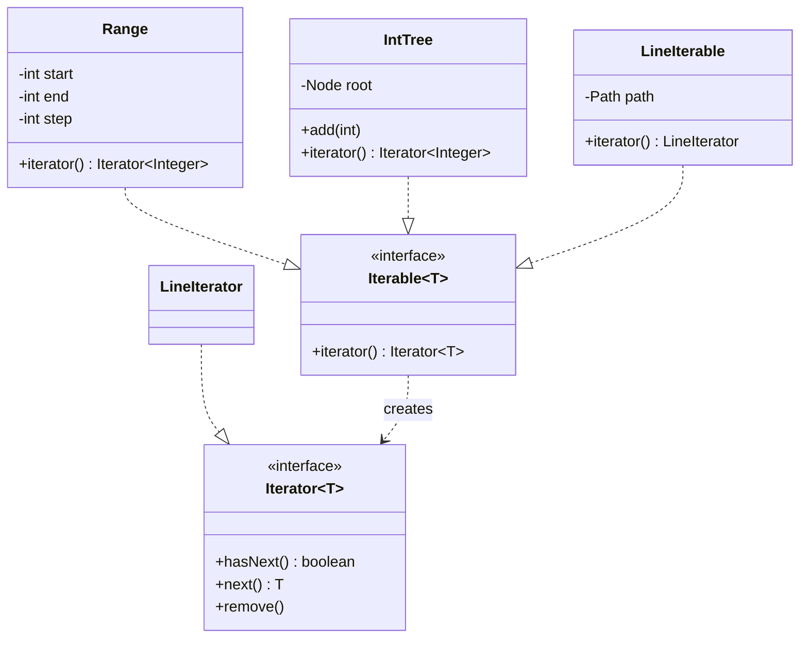

# Chapter 46 — Iterator

## What and why

**Iterator** = access the elements of a collection one by one without exposing how it is stored. In Java it is built into the language: `Iterable` + `Iterator` + the enhanced `for` loop. Exams ask for the two interfaces, what for-each expands to, fail-fast behaviour, and `Iterator.remove`.

## Problem

A binary tree stores nodes in links; a file stores bytes. A client that wants "every element in order" should not learn nodes, stacks, or readers. The aggregate hands out an iterator; the client only calls `hasNext()` / `next()`.

## Exam flash rules

- `Iterable<T>` has one method: `Iterator<T> iterator()`. The for-each loop works on arrays and `Iterable` — **not** on an `Iterator`.
- `Iterator<T>` has `hasNext()`, `next()`, and a default `remove()` that throws `UnsupportedOperationException`.
- `for (T x : c)` is `for (Iterator<T> it = c.iterator(); it.hasNext(); ) { T x = it.next(); … }`.
- Each call to `iterator()` returns a **new, independent** iterator with its own cursor.
- `hasNext()` must not change state; calling it twice returns the same answer.
- `next()` past the end throws `NoSuchElementException`.
- `Iterator.remove()` removes the element last returned by `next()`; calling it before `next()` or twice in a row throws `IllegalStateException`.
- `ArrayList`'s iterator is **fail-fast**: structural change outside the iterator → `ConcurrentModificationException` on the next `next()`.
- Removing the **second-to-last** element inside for-each does **not** throw (`hasNext()` becomes false) — a classic trap; never rely on it.
- `CopyOnWriteArrayList` iterates a **snapshot**; its iterator does not support `remove`.
- A raw `Iterator` returns `Object`; assigning it to `String` fails to compile.
- An implementation of `Iterator<Integer>` must declare `Integer next()`, not `int next()`.
- **External** iteration: the client drives (`while hasNext`). **Internal** iteration: the collection drives (`forEach`, streams).
- Iterator separates **traversal** from the **aggregate**: several traversals of one collection can run at once.

## Rules table

| Case | Result | Compiler message |
|------|--------|------------------|
| for-each over a class that is not `Iterable` | fails | `for-each not applicable to expression type` / `required: array or java.lang.Iterable` |
| for-each over `list.iterator()` | fails | `... found: Iterator<String>` |
| Raw `Iterator`, `String s = it.next()` | fails | `incompatible types: Object cannot be converted to String` |
| `implements Iterator<Integer>` without `next()` | fails | `... does not override abstract method next() in Iterator` |
| `public int next()` in `Iterator<Integer>` | fails | `return type int is not compatible with Integer` |

## Walkthrough

### Iterable + Iterator

```java
{{#include ../../code/part-03-patterns/src/main/java/patterns/behavioral/iterator/Range.java:range}}
```

```java
{{#include ../../code/part-03-patterns/src/main/java/patterns/behavioral/iterator/RangeDemo.java:range-demo}}
```

```text
{{#include ../../code/part-03-patterns/output/RangeDemo.txt}}
```

### Hiding a tree

```java
{{#include ../../code/part-03-patterns/src/main/java/patterns/behavioral/iterator/IntTree.java:int-tree}}
```

```java
{{#include ../../code/part-03-patterns/src/main/java/patterns/behavioral/iterator/TreeDemo.java:tree-demo}}
```

```text
{{#include ../../code/part-03-patterns/output/TreeDemo.txt}}
```

Inserted `5, 2, 8, 1, 3, 8, 7`; duplicate `8` ignored; output is sorted because in-order traversal of a BST is sorted.

### Real I/O — a lazy iterator over file lines

```java
{{#include ../../code/part-03-patterns/src/main/java/patterns/behavioral/iterator/LineIterable.java:line-iterable}}
```

```java
{{#include ../../code/part-03-patterns/src/main/java/patterns/behavioral/iterator/LineDemo.java:line-demo}}
```

```text
{{#include ../../code/part-03-patterns/output/LineDemo.txt}}
```

Only one line is held in memory. The reader closes itself at the last line; stopping early leaves it open, so the iterator is `AutoCloseable` and the covariant return type `LineIterator` lets try-with-resources close it.

### Edge cases — JDK iterators

```java
{{#include ../../code/part-03-patterns/src/main/java/patterns/behavioral/iterator/JdkIteratorDemo.java:jdk-demo}}
```

```text
{{#include ../../code/part-03-patterns/output/JdkIteratorDemo.txt}}
```

### Does not compile

<div class="compiler-error">

```java
{{#include ../../code/part-03-patterns/broken/IteratorNotIterableBroken.java}}
```

```text
{{#include ../../code/part-03-patterns/output/IteratorNotIterableBroken.txt}}
```

```text
{{#include ../../code/part-03-patterns/output/IteratorForEachOverIteratorBroken.txt}}
```

```text
{{#include ../../code/part-03-patterns/output/IteratorRawTypeBroken.txt}}
```

```text
{{#include ../../code/part-03-patterns/output/IteratorMissingNextBroken.txt}}
```

```text
{{#include ../../code/part-03-patterns/output/IteratorPrimitiveReturnBroken.txt}}
```

</div>

Sources: `broken/IteratorNotIterableBroken.java`, `IteratorForEachOverIteratorBroken.java`, `IteratorRawTypeBroken.java`, `IteratorMissingNextBroken.java`, `IteratorPrimitiveReturnBroken.java`.

## Iterator vs similar patterns

| Pattern | Purpose | Relation |
|---------|---------|----------|
| **Iterator** | sequential access to elements | aggregate creates it; holds a cursor |
| **Composite** (ch 37) | tree of part-whole objects | iterator is the usual way to traverse it |
| **Visitor** (ch 48) | new operation over element types | aggregate drives, visitor reacts per type |
| **Memento** (ch 49) | save a state | an iterator's cursor is a tiny memento (copyable position) |
| **Observer** (ch 41) | push changes to many | opposite direction: pull (iterator) vs push (observer) |
| **Factory Method** (ch 29) | create an object | `iterator()` is a factory method |

## JDK usage

| API | Note |
|-----|------|
| `Iterable`, `Iterator`, `ListIterator` | the pattern itself; `ListIterator` adds `previous`, `add`, `set` |
| `Collection.forEach`, streams | internal iteration |
| `Map.entrySet().iterator()` | iterate entries; `remove` supported |
| `java.util.Scanner` | an `Iterator<String>` over tokens |
| `CopyOnWriteArrayList.iterator()` | snapshot iterator, no `remove` |
| `Files.lines`, `DirectoryStream` | lazy I/O sequences; close them |
| `Spliterator` | iterator for streams (splitting for parallelism) |

## Predict the output

**P1.** Nested for-each over one `Iterable`.

```java
{{#include ../../code/part-03-patterns/src/main/java/patterns/behavioral/iterator/exam/PredictIteratorCalls.java:predict-iterator-calls}}
```

<details><summary>Answer</summary>

```text
{{#include ../../code/part-03-patterns/output/PredictIteratorCalls.txt}}
```

Trace: one outer iterator + one inner iterator per outer element (2) = 3; inner and outer cursors are independent.

</details>

**P2.** Removing inside for-each.

```java
{{#include ../../code/part-03-patterns/src/main/java/patterns/behavioral/iterator/exam/PredictRemoveInLoop.java:predict-remove-in-loop}}
```

<details><summary>Answer</summary>

```text
{{#include ../../code/part-03-patterns/output/PredictRemoveInLoop.txt}}
```

Trace: removing `a` (first) or `c` (last) → the next `next()` finds `modCount` changed → CME. Removing `b` (second-to-last): `cursor == size` → `hasNext()` is false → loop ends silently, `c` is never visited.

</details>

**P3.** `Iterator.remove` rules.

```java
{{#include ../../code/part-03-patterns/src/main/java/patterns/behavioral/iterator/exam/PredictIteratorRemove.java:predict-iterator-remove}}
```

<details><summary>Answer</summary>

```text
{{#include ../../code/part-03-patterns/output/PredictIteratorRemove.txt}}
```

Trace: `remove()` needs a preceding `next()`; once per `next()`; `hasNext()` twice is stable; `next()` at the end throws; `1` was removed.

</details>

**P4.** In-order traversal of a BST.

```java
{{#include ../../code/part-03-patterns/src/main/java/patterns/behavioral/iterator/exam/PredictTreeOrder.java:predict-tree-order}}
```

<details><summary>Answer</summary>

```text
{{#include ../../code/part-03-patterns/output/PredictTreeOrder.txt}}
```

Trace: left subtree, node, right subtree; duplicate `4` ignored → sorted ascending.

</details>

**P5.** Snapshot iterator.

```java
{{#include ../../code/part-03-patterns/src/main/java/patterns/behavioral/iterator/exam/PredictCowSnapshot.java:predict-cow-snapshot}}
```

<details><summary>Answer</summary>

```text
{{#include ../../code/part-03-patterns/output/PredictCowSnapshot.txt}}
```

Trace: the loop iterates the array as it was when `iterator()` was called, so `late` is not visited but is in the list afterwards; `COW` iterators reject `remove`.

</details>

**P6.** Self-closing line iterator.

```java
{{#include ../../code/part-03-patterns/src/main/java/patterns/behavioral/iterator/exam/PredictLineClose.java:predict-line-close}}
```

<details><summary>Answer</summary>

```text
{{#include ../../code/part-03-patterns/output/PredictLineClose.txt}}
```

Trace: after reading `two` the look-ahead `readLine()` returns `null` and closes the reader; an empty file is closed immediately.

</details>

## Compile or not?

| # | Source | Answer | Reason |
|---|--------|--------|--------|
| C1 | `IteratorNotIterableBroken` | **fails** | `Playlist` is not `Iterable` (it only has an array field) |
| C2 | `IteratorForEachOverIteratorBroken` — looks fine | **fails** | for-each needs an `Iterable` or array, not an `Iterator` |
| C3 | `IteratorRawTypeBroken` — looks fine | **fails** | raw `Iterator.next()` returns `Object` |
| C4 | `IteratorMissingNextBroken` | **fails** | abstract `next()` not implemented |
| C5 | `IteratorPrimitiveReturnBroken` — looks fine | **fails** | `int` is not a valid return type for `E next()` with `E = Integer` |

## Gotchas

1. `list.remove` inside for-each: `CME`, except for the second-to-last element: `PredictRemoveInLoop`.
2. Returning the **same** iterator from `iterator()` breaks nested loops; create a new one each call: `PredictIteratorCalls`.
3. `Iterator.remove()` twice, or before `next()`: `PredictIteratorRemove`.
4. `hasNext()` with side effects (consuming input) breaks repeated calls; look ahead and cache: `solutions/ch46/SolutionFilterIterator.java`.
5. Lazy file iterators leak the reader when abandoned early: `LineDemo`, `PredictLineClose`.

## UML



## Interview Q&A

1. **Q:** `Iterable` vs `Iterator`? **A:** `Iterable` creates iterators; `Iterator` holds the cursor — `Range`.
2. **Q:** What does for-each compile to? **A:** `iterator()`, then `hasNext()`/`next()` — `RangeDemo`.
3. **Q:** Why does `list.remove` in for-each throw? **A:** Fail-fast `modCount` check — `PredictRemoveInLoop`.
4. **Q:** Why does removing the second-to-last element not throw? **A:** `hasNext()` returns false first — `PredictRemoveInLoop`.
5. **Q:** How to remove safely while iterating? **A:** `Iterator.remove()` or `removeIf` — `JdkIteratorDemo`.
6. **Q:** Can for-each loop over an `Iterator`? **A:** No — `IteratorForEachOverIteratorBroken`.
7. **Q:** Internal vs external iteration? **A:** Client-driven loop vs `forEach`/streams — `RangeDemo`.
8. **Q:** What does `COW` iterator guarantee? **A:** A snapshot; no `CME`, no `remove` — `PredictCowSnapshot`.
9. **Q:** What does `remove()` default to? **A:** `UnsupportedOperationException` — define it only if you can support it.
10. **Q:** Why make a file iterator `AutoCloseable`? **A:** The caller may stop before EOF — `LineIterable.LineIterator`.
11. **Q:** How do you traverse a tree iteratively? **A:** Explicit stack of pending nodes — `IntTree`.
12. **Q:** Iterator vs Visitor? **A:** Iterator yields elements; Visitor adds an operation per element type (ch 48).

## Exam writing prompts

1. (5) Write `class Countdown implements Iterable<Integer>` that yields `n, n-1, …, 1`.
2. (5) Write an `Iterator<Integer>` over an `int[]` with `hasNext`, `next` and the right exception at the end.
3. (3) Rewrite `for (String s : list) { if (s.isEmpty()) list.remove(s); }` so it cannot throw `ConcurrentModificationException`.
4. (3) Expand `for (String s : names) { … }` to the equivalent explicit-iterator code.

## Exercises

1. Bounded Fibonacci iterable — `solutions/ch46/SolutionFibonacci.java`.
2. Reverse iterable using `ListIterator` — `solutions/ch46/SolutionReverse.java`.
3. Zip two iterables — `solutions/ch46/SolutionZip.java`.
4. Filtering iterator with look-ahead — `solutions/ch46/SolutionFilterIterator.java`.
5. Word iterator over a real file — `solutions/ch46/SolutionWordIterator.java`.

```text
{{#include ../../code/part-03-patterns/output/SolutionFibonacci.txt}}
```

```text
{{#include ../../code/part-03-patterns/output/SolutionReverse.txt}}
```

```text
{{#include ../../code/part-03-patterns/output/SolutionZip.txt}}
```

```text
{{#include ../../code/part-03-patterns/output/SolutionFilterIterator.txt}}
```

```text
{{#include ../../code/part-03-patterns/output/SolutionWordIterator.txt}}
```

## Recap checklist

- [x] Problem, roles, UML
- [x] Iterable/Iterator, tree traversal, lazy file iterator, JDK iterators
- [x] vs-similar table and JDK usage
- [x] Exam flash rules, predict (6), compile-or-not (5), writing prompts (4)
- [x] Gotchas, Q&A, exercises with solutions
