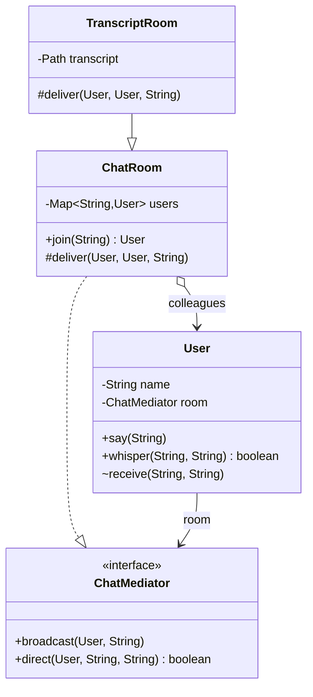

# Chapter 47 — Mediator

## What and why

**Mediator** = an object that encapsulates how a set of colleague objects interact. Colleagues talk only to the mediator; the mediator knows the rules and the colleagues. Exams ask for the roles, why direct many-to-many references are a problem, and the difference from Observer.

## Problem

Chat users that hold references to each other need N × (N − 1) links, and every new user touches everybody. A form where each widget enables/disables others has the same tangle. A mediator holds the routing/enabling rules in **one** place.

```java
{{#include ../../code/part-03-patterns/src/main/java/patterns/behavioral/mediator/CouplingCount.java:coupling}}
```

```text
{{#include ../../code/part-03-patterns/output/CouplingCount.txt}}
```

## Exam flash rules

- Roles: **Mediator** (interface), **ConcreteMediator** (knows colleagues, holds rules), **Colleague** (knows only the mediator).
- Colleagues never reference each other; they call the mediator.
- Mediator turns many-to-many dependencies into one-to-many: N colleagues need about 2N references instead of N(N − 1).
- The mediator is the place where **interaction logic** lives; it can become a "god object" — keep each mediator small and focused.
- Mediator vs Observer: Observer = one subject broadcasts to subscribers (direct, no rules); Mediator = a hub applies rules between peers.
- A colleague that calls the mediator from a constructor leaks `this` before it is fully built; register through the mediator (`join`) instead.
- Registry key collisions overwrite: joining two users with the same name keeps only the last one in the map.
- A change that is "set again to the same value" must not notify the mediator, or linked fields can ping-pong forever.
- `LinkedHashMap` keeps registration order, so broadcast order is deterministic.
- `BlockingQueue` is a JDK mediator: producer and consumer know only the queue; `put` blocks when full, `take` blocks when empty, `null` elements are rejected.
- An `ExecutorService` mediates between task submitters and worker threads.
- A non-static field cannot be read from a `static` method (`non-static variable … cannot be referenced from a static context`).
- A `final` field must be assigned in **every** constructor (`variable … might not have been initialized`).

## Rules table

| Case | Result | Compiler message |
|------|--------|------------------|
| Class omits an interface method | fails | `... does not override abstract method direct(User,String,String) in ChatMediator` |
| Mediator reads colleague's `private` field | fails | `name has private access in User` |
| `Hub<Button>.register(new TextField())` | fails | `incompatible types: TextField cannot be converted to Button` |
| `static` method reads instance field | fails | `non-static variable room cannot be referenced from a static context` |
| `final` mediator field never assigned | fails | `variable mediator might not have been initialized` |

## Walkthrough

### Interface, colleague, concrete mediator

```java
{{#include ../../code/part-03-patterns/src/main/java/patterns/behavioral/mediator/ChatMediator.java:mediator-iface}}
```

```java
{{#include ../../code/part-03-patterns/src/main/java/patterns/behavioral/mediator/User.java:colleague}}
```

```java
{{#include ../../code/part-03-patterns/src/main/java/patterns/behavioral/mediator/ChatRoom.java:chat-room}}
```

### Baseline demo

```java
{{#include ../../code/part-03-patterns/src/main/java/patterns/behavioral/mediator/ChatDemo.java:chat-demo}}
```

```text
{{#include ../../code/part-03-patterns/output/ChatDemo.txt}}
```

### UI mediator — enabling rules in one place

```java
{{#include ../../code/part-03-patterns/src/main/java/patterns/behavioral/mediator/LoginDialog.java:login-dialog}}
```

```java
{{#include ../../code/part-03-patterns/src/main/java/patterns/behavioral/mediator/DialogDemo.java:dialog-demo}}
```

```text
{{#include ../../code/part-03-patterns/output/DialogDemo.txt}}
```

### Real I/O — a new rule added in the mediator only

```java
{{#include ../../code/part-03-patterns/src/main/java/patterns/behavioral/mediator/TranscriptRoom.java:transcript-room}}
```

```java
{{#include ../../code/part-03-patterns/src/main/java/patterns/behavioral/mediator/TranscriptDemo.java:transcript-demo}}
```

```text
{{#include ../../code/part-03-patterns/output/TranscriptDemo.txt}}
```

`User` and `ChatDemo` did not change.

### Edge case — linked fields without ping-pong

```java
{{#include ../../code/part-03-patterns/src/main/java/patterns/behavioral/mediator/TempSync.java:temp-sync}}
```

The mediator writes the other field's `value` directly (not through `set`), and `set` ignores an unchanged value; otherwise `celsius → fahrenheit → celsius …` would never stop.

### Does not compile

<div class="compiler-error">

```java
{{#include ../../code/part-03-patterns/broken/MediatorMissingMethodBroken.java}}
```

```text
{{#include ../../code/part-03-patterns/output/MediatorMissingMethodBroken.txt}}
```

```text
{{#include ../../code/part-03-patterns/output/MediatorPrivateColleagueBroken.txt}}
```

```text
{{#include ../../code/part-03-patterns/output/MediatorGenericColleagueBroken.txt}}
```

```text
{{#include ../../code/part-03-patterns/output/MediatorStaticContextBroken.txt}}
```

```text
{{#include ../../code/part-03-patterns/output/MediatorFinalNotSetBroken.txt}}
```

</div>

Sources: `broken/MediatorMissingMethodBroken.java`, `MediatorPrivateColleagueBroken.java`, `MediatorGenericColleagueBroken.java`, `MediatorStaticContextBroken.java`, `MediatorFinalNotSetBroken.java`.

## Mediator vs similar patterns

| Pattern | Communication | Who knows whom | Logic lives in |
|---------|---------------|----------------|----------------|
| **Mediator** | peers ↔ hub ↔ peers | hub knows colleagues; colleagues know hub | the mediator |
| **Observer** (ch 41) | subject → many observers | subject knows an observer interface | each observer |
| **Facade** (ch 35) | client → subsystem | facade knows subsystem; subsystem unaware | the facade (one-way) |
| **Command** (ch 42) | invoker → receiver | invoker knows command only | the command |
| **Chain of Responsibility** (ch 45) | along a line | each link knows the next | each link |

Facade is **one-directional** (simplifies access to a subsystem); Mediator is **bi-directional** (colleagues call it and it calls them).

## JDK usage

| API | Mediator role |
|-----|---------------|
| `BlockingQueue` | between producers and consumers |
| `ExecutorService` / `Executor` | between task submitters and worker threads |
| `java.util.Timer` | between scheduled tasks and its timer thread |
| `java.nio.channels.Selector` | between many channels and one thread |
| `javax.swing.ButtonGroup` | ensures only one radio button is selected |

```java
{{#include ../../code/part-03-patterns/src/main/java/patterns/behavioral/mediator/JdkMediatorDemo.java:jdk-demo}}
```

```text
{{#include ../../code/part-03-patterns/output/JdkMediatorDemo.txt}}
```

## Predict the output

**P1.** Broadcast skips the sender.

```java
{{#include ../../code/part-03-patterns/src/main/java/patterns/behavioral/mediator/exam/PredictBroadcast.java:predict-broadcast}}
```

<details><summary>Answer</summary>

```text
{{#include ../../code/part-03-patterns/output/PredictBroadcast.txt}}
```

Trace: `a` hears only `b`'s message; `b` hears only `a`'s; `c` hears both in order.

</details>

**P2.** Two users with the same name.

```java
{{#include ../../code/part-03-patterns/src/main/java/patterns/behavioral/mediator/exam/PredictRejoin.java:predict-rejoin}}
```

<details><summary>Answer</summary>

```text
{{#include ../../code/part-03-patterns/output/PredictRejoin.txt}}
```

Trace: the second `join("sam")` replaced the first in the map. The whisper goes to `second` (`0 1`). `first` is no longer registered, but it can still send: its broadcast reaches `zoe` and `second` (the `sam` entry).

</details>

**P3.** Dialog rules.

```java
{{#include ../../code/part-03-patterns/src/main/java/patterns/behavioral/mediator/exam/PredictDialog.java:predict-dialog}}
```

<details><summary>Answer</summary>

```text
{{#include ../../code/part-03-patterns/output/PredictDialog.txt}}
```

Trace: guest on → `login` enabled; `user.type` ignored because the box is disabled. Guest off → needs both fields: false; `user` set → false; `pass` set → true.

</details>

**P4.** Linked fields.

```java
{{#include ../../code/part-03-patterns/src/main/java/patterns/behavioral/mediator/exam/PredictSyncGuard.java:predict-sync-guard}}
```

<details><summary>Answer</summary>

```text
{{#include ../../code/part-03-patterns/output/PredictSyncGuard.txt}}
```

Trace: `set(100)` twice → 1 notification (second is unchanged). `fahrenheit.set(32)` → celsius `0`, 2 notifications. `celsius.set(0)` is unchanged → no notification. `37` → `98`, 3 notifications; `set(98)` again is unchanged.

</details>

**P5.** `BlockingQueue` basics.

```java
{{#include ../../code/part-03-patterns/src/main/java/patterns/behavioral/mediator/exam/PredictQueue.java:predict-queue}}
```

<details><summary>Answer</summary>

```text
{{#include ../../code/part-03-patterns/output/PredictQueue.txt}}
```

Trace: `poll()` and timed `poll` return `null` on empty; `offer` returns `true` on an unbounded queue; FIFO `ab`; `put(null)` throws `NullPointerException`.

</details>

**P6.** `CouplingCount` — for N = 4, how many references with and without a hub?

<details><summary>Answer</summary>

```text
{{#include ../../code/part-03-patterns/output/CouplingCount.txt}}
```

Trace: row `4`: 12 direct, 8 via hub. For N = 3 they tie (6); the hub wins from N = 4.

</details>

## Compile or not?

| # | Source | Answer | Reason |
|---|--------|--------|--------|
| C1 | `MediatorMissingMethodBroken` | **fails** | `direct(...)` not implemented |
| C2 | `MediatorPrivateColleagueBroken` | **fails** | `private` field of another class |
| C3 | `MediatorGenericColleagueBroken` — looks fine | **fails** | `Hub<Button>` accepts only `Button` |
| C4 | `MediatorStaticContextBroken` | **fails** | instance field in `static` method |
| C5 | `MediatorFinalNotSetBroken` — looks fine | **fails** | constructor never assigns the `final` field |

## Gotchas

1. God-object mediator: keep rules per mediator and split by concern — `LoginDialog` has one concern.
2. Duplicate registry keys silently overwrite: `PredictRejoin`.
3. Ping-pong between linked colleagues: `TempSync`, `PredictSyncGuard`.
4. Colleague registering `this` from its constructor leaks a half-built object: use `ChatRoom.join` (`User` has a package-private constructor).
5. Blocking queues reject `null`: `PredictQueue`.

## UML



Diagram → code: two arrows between `ChatRoom` and `User` — the mediator owns a map of colleagues; each colleague holds the mediator interface.

## Interview Q&A

1. **Q:** What problem does Mediator solve? **A:** Tangled many-to-many references — `CouplingCount`.
2. **Q:** Who knows whom? **A:** Colleagues know only the mediator; the mediator knows all colleagues — `User`, `ChatRoom`.
3. **Q:** Mediator vs Observer? **A:** Observer broadcasts from one subject to subscribers; Mediator applies rules between peers.
4. **Q:** Mediator vs Facade? **A:** Facade is one-way (simplifies a subsystem); Mediator is two-way.
5. **Q:** Main risk? **A:** The mediator becomes a god object — split by concern.
6. **Q:** How do you add a new rule (logging)? **A:** Subclass or extend the mediator — `TranscriptRoom` changed no colleague.
7. **Q:** Why avoid `register(this)` in a constructor? **A:** The object is not fully constructed yet; use a factory (`join`).
8. **Q:** JDK examples? **A:** `BlockingQueue`, `ExecutorService`, `Selector` — `JdkMediatorDemo`.
9. **Q:** What does `BlockingQueue.take()` do on empty? **A:** Blocks until an element arrives — `JdkMediatorDemo`; `poll()` returns `null` — `PredictQueue`.
10. **Q:** How to stop linked fields looping? **A:** Notify only on change and write the peer without notifying — `TempSync`.
11. **Q:** Does adding a colleague change other colleagues? **A:** No — only the mediator's registry changes.
12. **Q:** Which UI widget group is a mediator? **A:** `ButtonGroup` (radio buttons) — `SolutionRadioGroup`.

## Exam writing prompts

1. (8) Write `interface Mediator { void notify(Colleague c, String event); }`, two colleagues `Button` and `TextBox`, and a `Dialog` mediator that enables the button when the text box is non-empty.
2. (5) Draw the UML for ChatMediator, ChatRoom, User and write the Java skeleton for `broadcast` that skips the sender.
3. (3) State two differences between Mediator and Observer.
4. (3) Fix a colleague whose constructor calls `mediator.register(this)` so the object is registered after construction.

## Exercises

1. Control tower grants one runway at a time — `solutions/ch47/SolutionTower.java`.
2. Sign-up form enabling submit — `solutions/ch47/SolutionSignupForm.java`.
3. Topic-based routing — `solutions/ch47/SolutionRoomTopics.java`.
4. Count deliveries from the mediator's real transcript file — `solutions/ch47/SolutionTranscriptCount.java`.
5. Radio-button group — `solutions/ch47/SolutionRadioGroup.java`.

```text
{{#include ../../code/part-03-patterns/output/SolutionTower.txt}}
```

```text
{{#include ../../code/part-03-patterns/output/SolutionSignupForm.txt}}
```

```text
{{#include ../../code/part-03-patterns/output/SolutionRoomTopics.txt}}
```

```text
{{#include ../../code/part-03-patterns/output/SolutionTranscriptCount.txt}}
```

```text
{{#include ../../code/part-03-patterns/output/SolutionRadioGroup.txt}}
```

## Recap checklist

- [x] Problem (N × (N − 1) links), roles, UML
- [x] Chat mediator, UI mediator, file-transcript mediator, ping-pong guard
- [x] vs-similar table and JDK usage
- [x] Exam flash rules, predict (6), compile-or-not (5), writing prompts (4)
- [x] Gotchas, Q&A, exercises with solutions
