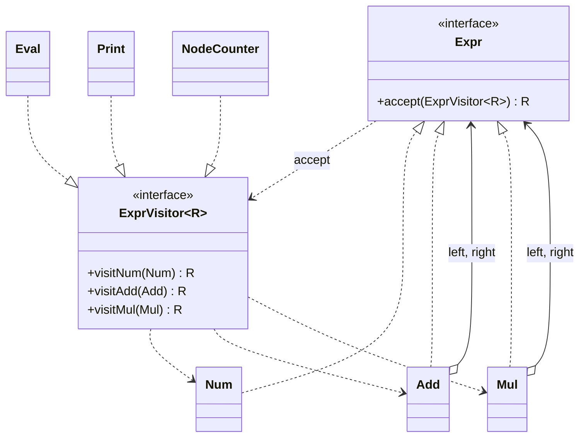

# Chapter 48 — Visitor

## What and why

**Visitor** = put a new operation over a class hierarchy in a separate object, without editing the classes. Each element has `accept(visitor)` and calls back the `visit` method for **its own** type (double dispatch). Exams ask for the roles, why `accept` exists (overloads are resolved at compile time), and the trade-off: easy to add operations, hard to add element types.

## Problem

An expression tree has `Num`, `Add`, `Mul`. We want evaluate, print, count, optimise. Adding each as a method on every node class bloats the nodes. A visitor keeps each operation in one class.

## Exam flash rules

- Roles: **Visitor** (one `visit` per element type), **ConcreteVisitor**, **Element** (`accept`), **ConcreteElement**, **ObjectStructure** (the tree/collection).
- `accept(v)` calls `v.visitX(this)` where `X` is the element's **own** type: that is **double dispatch** (element type, then visitor type).
- Java overloads are chosen at **compile time** from the static type: `v.visit(shape)` with `Shape shape = new Circle()` calls `visit(Shape)`, not `visit(Circle)`.
- Overriding is chosen at **run time**: a `LoudVisitor` that overrides `visit(Shape)` is used even through a `Visitor` reference.
- Adding a **new operation** = one new visitor class; no element changes.
- Adding a **new element type** = a new `visit` method in the interface and **every** visitor must change.
- Use Visitor when the element hierarchy is **stable** and operations change often.
- A generic visitor `ExprVisitor<R>` lets different visitors return different types; `R` must be a reference type (`Integer`, not `int`).
- A visitor that stores results in fields is **stateful**: use a fresh instance per traversal.
- Traversal can live in the elements, the visitor, or a separate iterator; here it lives in the visitor.
- Java 21: `sealed` interface + records + pattern `switch` give the same effect without `accept`; the compiler checks exhaustiveness.
- A record's fields are `final`; a `switch` expression over a sealed type must cover every permitted subtype.
- Record pattern needs the right number of components: `Plus(var l, var r)`.
- Pattern `case` labels are tried top-down; put guarded/specific patterns before general ones (`PredictRecordPatterns`).
- `Files.walkFileTree` + `FileVisitor` is the JDK Visitor: `CONTINUE`, `SKIP_SUBTREE`, `SKIP_SIBLINGS`, `TERMINATE`.

## Rules table

| Case | Result | Compiler message |
|------|--------|------------------|
| Visitor omits `visitMul` | fails | `... does not override abstract method visitMul(Mul) in ExprVisitor` |
| `public int visitNum` for `ExprVisitor<Integer>` | fails | `return type int is not compatible with Integer` |
| `Add.accept` calls `visitNum(this)` | fails | `incompatible types: Add cannot be converted to Num` |
| `switch` over sealed type missing `Times` | fails | `the switch expression does not cover all possible input values` |
| Record pattern with wrong component count | fails | `incorrect number of nested patterns` |
| Assign a record field in a method | fails | `cannot assign a value to final variable value` |

## Walkthrough

### Element and visitor interfaces

```java
{{#include ../../code/part-03-patterns/src/main/java/patterns/behavioral/visitor/Expr.java:expr}}
```

```java
{{#include ../../code/part-03-patterns/src/main/java/patterns/behavioral/visitor/ExprVisitor.java:expr-visitor}}
```

```java
{{#include ../../code/part-03-patterns/src/main/java/patterns/behavioral/visitor/Num.java:num}}
```

`Add` and `Mul` are the same shape with `visitAdd` / `visitMul`.

### Two operations, no element changes

```java
{{#include ../../code/part-03-patterns/src/main/java/patterns/behavioral/visitor/Eval.java:eval}}
```

```java
{{#include ../../code/part-03-patterns/src/main/java/patterns/behavioral/visitor/Print.java:print}}
```

```java
{{#include ../../code/part-03-patterns/src/main/java/patterns/behavioral/visitor/NodeCounter.java:node-counter}}
```

```java
{{#include ../../code/part-03-patterns/src/main/java/patterns/behavioral/visitor/ExprDemo.java:expr-demo}}
```

```text
{{#include ../../code/part-03-patterns/output/ExprDemo.txt}}
```

### Why `accept` exists — overload trap

```java
{{#include ../../code/part-03-patterns/src/main/java/patterns/behavioral/visitor/OverloadTrap.java:overload-trap}}
```

```text
{{#include ../../code/part-03-patterns/output/OverloadTrap.txt}}
```

Line 1: static type `Shape` → `visit(Shape)`. Line 3: `accept` runs in `Circle`, where `this` is statically `Circle` → `visit(Circle)`.

### Java 21 — sealed records and pattern switch

```java
{{#include ../../code/part-03-patterns/src/main/java/patterns/behavioral/visitor/PatternEval.java:pattern-nodes}}
```

```java
{{#include ../../code/part-03-patterns/src/main/java/patterns/behavioral/visitor/PatternEval.java:pattern-demo}}
```

```text
{{#include ../../code/part-03-patterns/output/PatternEval.txt}}
```

Sealed types and records: **Java 16+/17+**; record patterns and pattern `switch`: **Java 21**. Older papers expect `accept`/`visit`.

### Real I/O — the JDK file visitor

```java
{{#include ../../code/part-03-patterns/src/main/java/patterns/behavioral/visitor/SizeVisitor.java:size-visitor}}
```

```java
{{#include ../../code/part-03-patterns/src/main/java/patterns/behavioral/visitor/FileTreeDemo.java:tree-demo}}
```

```text
{{#include ../../code/part-03-patterns/output/FileTreeDemo.txt}}
```

The `skip` directory (100-byte file) is neither counted as a directory nor visited: `SKIP_SUBTREE`.

### Does not compile

<div class="compiler-error">

```java
{{#include ../../code/part-03-patterns/broken/VisitorMissingVisitBroken.java}}
```

```text
{{#include ../../code/part-03-patterns/output/VisitorMissingVisitBroken.txt}}
```

```text
{{#include ../../code/part-03-patterns/output/VisitorPrimitiveResultBroken.txt}}
```

```text
{{#include ../../code/part-03-patterns/output/VisitorWrongAcceptBroken.txt}}
```

```text
{{#include ../../code/part-03-patterns/output/VisitorSealedMissingCaseBroken.txt}}
```

```text
{{#include ../../code/part-03-patterns/output/VisitorRecordArityBroken.txt}}
```

```text
{{#include ../../code/part-03-patterns/output/VisitorRecordMutateBroken.txt}}
```

</div>

Sources: `broken/VisitorMissingVisitBroken.java`, `VisitorPrimitiveResultBroken.java`, `VisitorWrongAcceptBroken.java`, `VisitorSealedMissingCaseBroken.java`, `VisitorRecordArityBroken.java`, `VisitorRecordMutateBroken.java`.

## Visitor vs similar patterns

| Pattern | Adds | Dispatch | Easy to add | Hard to add |
|---------|------|----------|-------------|-------------|
| **Visitor** | an operation over many element types | double dispatch | operations | element types |
| **Strategy** (ch 40) | an interchangeable algorithm for one context | single (polymorphism) | strategies | — |
| **Iterator** (ch 46) | traversal | single | traversals | — (it does not add operations by type) |
| **Composite** (ch 37) | the tree structure itself | polymorphic methods in nodes | element types | operations (edit every node) |
| **Command** (ch 42) | an action as an object | single | commands | — |

Composite and Visitor are usually paired: Composite builds the tree, Visitor adds operations to it.

## JDK usage

| API | Visitor role |
|-----|--------------|
| `java.nio.file.FileVisitor` / `SimpleFileVisitor`, `Files.walkFileTree` | visitor over a directory tree |
| `javax.lang.model.element.ElementVisitor` | annotation-processing visitors over program elements |
| `com.sun.source.tree.TreeVisitor` (jdk.compiler) | visitor over compiler syntax trees |
| `java.util.stream.Collector` | an operation applied to each element (not a classic double dispatch) |
| `switch` over `sealed` types (Java 21) | language-level replacement |

## Predict the output

**P1.** Evaluate and print two trees.

```java
{{#include ../../code/part-03-patterns/src/main/java/patterns/behavioral/visitor/exam/PredictEvalPrint.java:predict-eval-print}}
```

<details><summary>Answer</summary>

```text
{{#include ../../code/part-03-patterns/output/PredictEvalPrint.txt}}
```

Trace: `1 + (2 * 3)` = 7; `(1 + 2) * 3` = 9; the printer parenthesises every operator node.

</details>

**P2.** Overload vs override.

```java
{{#include ../../code/part-03-patterns/src/main/java/patterns/behavioral/visitor/exam/PredictOverload.java:predict-overload}}
```

<details><summary>Answer</summary>

```text
{{#include ../../code/part-03-patterns/output/PredictOverload.txt}}
```

Trace: `v.visit(s)` — static type `Shape` picks `visit(Shape)`, run-time class `LoudVisitor` supplies the override → `LOUD Shape`. `new Circle()` → `visit(Circle)`, which `LoudVisitor` does not override → `Circle`. The cast selects `visit(Circle)`. The last call uses `Visitor`'s own `visit(Shape)`.

</details>

**P3.** Reusing a stateful visitor.

```java
{{#include ../../code/part-03-patterns/src/main/java/patterns/behavioral/visitor/exam/PredictStatefulVisitor.java:predict-stateful}}
```

<details><summary>Answer</summary>

```text
{{#include ../../code/part-03-patterns/output/PredictStatefulVisitor.txt}}
```

Trace: tree has 3 numbers and 2 operators; the second traversal adds to the same fields → `6 4`; the fresh visitor sees a single number.

</details>

**P4.** Record patterns with guards (Java 21).

```java
{{#include ../../code/part-03-patterns/src/main/java/patterns/behavioral/visitor/exam/PredictRecordPatterns.java:predict-record-patterns}}
```

<details><summary>Answer</summary>

```text
{{#include ../../code/part-03-patterns/output/PredictRecordPatterns.txt}}
```

Trace: cases are tried top-down: `Plus(2,2)` hits the guarded first case; `Plus(2,3)` fails the guard → `Plus(Lit l, var r)`; `Plus(Times,3)` has a non-literal left → third case; `Times(5,0)` → `zero`; `Lit(-1)` → guard `v < 0`; `Lit(1)` → `lit`.

</details>

**P5.** File-tree visitor with `SKIP_SUBTREE`.

```java
{{#include ../../code/part-03-patterns/src/main/java/patterns/behavioral/visitor/exam/PredictFileVisitor.java:predict-file-visitor}}
```

<details><summary>Answer</summary>

```text
{{#include ../../code/part-03-patterns/output/PredictFileVisitor.txt}}
```

Trace: directories entered: root, `a`, `b` → `pre=3`. `b` returns `SKIP_SUBTREE`, so `two.txt` is not visited and `postVisitDirectory(b)` is not called → `post=2` (root, `a`). Files: `top.txt`, `one.txt` → 2.

</details>

**P6.** `PatternEval` — what does the last line print?

<details><summary>Answer</summary>

```text
{{#include ../../code/part-03-patterns/output/PatternEval.txt}}
```

Trace: `Times(Plus(1,1), 7)` is not literal × literal, so it falls through to `case Times t` → `times`.

</details>

## Compile or not?

| # | Source | Answer | Reason |
|---|--------|--------|--------|
| C1 | `VisitorMissingVisitBroken` | **fails** | `visitMul` not implemented |
| C2 | `VisitorPrimitiveResultBroken` — looks fine | **fails** | `R = Integer`; `int` return type is incompatible |
| C3 | `VisitorWrongAcceptBroken` | **fails** | `Add` calls the `Num` overload |
| C4 | `VisitorSealedMissingCaseBroken` | **fails** | `Times` not covered |
| C5 | `VisitorRecordArityBroken` | **fails** | `Plus` has two components |
| C6 | `VisitorRecordMutateBroken` — looks fine | **fails** | record components are `final` |

## Gotchas

1. Calling `v.visit(x)` directly instead of `x.accept(v)` — overload picks the static type: `OverloadTrap`, `PredictOverload`.
2. New element type = edit every visitor: `VisitorMissingVisitBroken`.
3. Reusing a stateful visitor accumulates results: `PredictStatefulVisitor`.
4. Copy-paste `accept` bodies: `Add.accept` calling `visitNum` fails (`VisitorWrongAcceptBroken`) — or, if the types happened to match, silently misbehaves.
5. `SKIP_SUBTREE` also skips `postVisitDirectory` for that directory: `PredictFileVisitor`.

## UML



Diagram → code: the cycle `Expr ↔ ExprVisitor` is what makes adding an element type costly.

## Interview Q&A

1. **Q:** What is double dispatch? **A:** Choosing the method by two run-time types: `accept` dispatches on the element, `visitX` on the visitor — `Num.accept`.
2. **Q:** Why not just overload `visit`? **A:** Overloads bind at compile time from the static type — `OverloadTrap`.
3. **Q:** When to use Visitor? **A:** Stable element hierarchy, frequently added operations.
4. **Q:** When not? **A:** When new element types appear often — each one breaks every visitor.
5. **Q:** Why a generic `R`? **A:** Different visitors return different types — `Eval` (`Integer`), `Print` (`String`).
6. **Q:** Where does traversal go? **A:** Element, visitor, or iterator; here in the visitor — `Eval.visitAdd`.
7. **Q:** Visitor vs Strategy? **A:** Visitor dispatches on element type over a structure; Strategy swaps one algorithm of one context.
8. **Q:** How does Java 21 reduce Visitor? **A:** Sealed records + pattern `switch` — `PatternEval`.
9. **Q:** JDK example? **A:** `Files.walkFileTree` with `SimpleFileVisitor` — `SizeVisitor`.
10. **Q:** What do `FileVisitResult` values do? **A:** `CONTINUE`, `SKIP_SUBTREE`, `SKIP_SIBLINGS`, `TERMINATE` steer the walk — `PredictFileVisitor`.
11. **Q:** Does Visitor break encapsulation? **A:** Visitors need access to element state, so elements expose getters (records do) — `Eval` reads `a.left()`.
12. **Q:** Stateful vs stateless visitor? **A:** Stateful accumulates; use a new instance per traversal — `NodeCounter`.

## Exam writing prompts

1. (8) For `Circle` and `Rectangle`, write `Shape` with `accept`, a `ShapeVisitor<R>`, and an `AreaVisitor`.
2. (5) Write the `accept` method for `Add` and explain why it cannot be written in `Expr` once for all subclasses.
3. (5) Predict and explain: `Visitor v = …; Shape s = new Circle(); v.visit(s);` with `visit(Shape)` and `visit(Circle)` overloads.
4. (3) Add a `Neg` element to the visitor version: list every class that must change; then do the same for the sealed-`switch` version.

## Exercises

1. Area and perimeter visitors — `solutions/ch48/SolutionShapeVisitor.java`.
2. Constant-folding visitor returning a new tree — `solutions/ch48/SolutionFolder.java`.
3. Tree depth via pattern `switch` — `solutions/ch48/SolutionSealedDepth.java`.
4. Count `.txt` lines in a real directory tree — `solutions/ch48/SolutionLineCounter.java`.
5. JSON visitor (a third operation, no node edits) — `solutions/ch48/SolutionJsonVisitor.java`.

```text
{{#include ../../code/part-03-patterns/output/SolutionShapeVisitor.txt}}
```

```text
{{#include ../../code/part-03-patterns/output/SolutionFolder.txt}}
```

```text
{{#include ../../code/part-03-patterns/output/SolutionSealedDepth.txt}}
```

```text
{{#include ../../code/part-03-patterns/output/SolutionLineCounter.txt}}
```

```text
{{#include ../../code/part-03-patterns/output/SolutionJsonVisitor.txt}}
```

## Recap checklist

- [x] Problem, roles, UML
- [x] `accept`/`visit`, stateful visitor, overload trap, Java 21 pattern switch, JDK file visitor
- [x] vs-similar table and JDK usage
- [x] Exam flash rules, predict (6), compile-or-not (6), writing prompts (4)
- [x] Gotchas, Q&A, exercises with solutions
