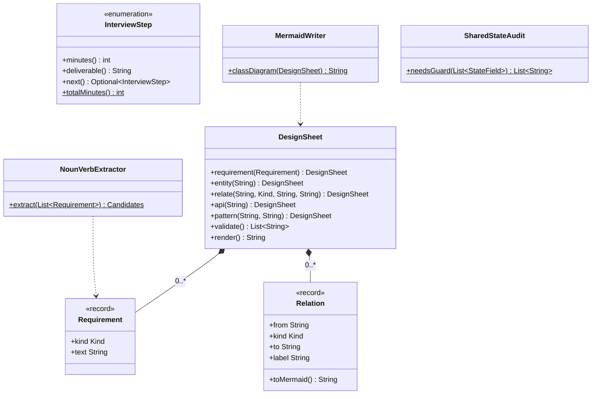

# Chapter 50 — LLD interview framework

## What and why

A low-level-design answer is marked on **process**: scoped requirements, entities, relationships, APIs, justified patterns, extension, concurrency. This chapter fixes that process once so every case study (51–60) reuses it, and it gives the written artefact (`DesignSheet`) examiners accept as a short answer.

## Exam flash rules

- The seven steps, in order: clarify → entities → relationships → APIs → patterns → code → extend/concurrency.
- Write **out-of-scope** items; unlisted features are not required.
- Entities come from **nouns**; methods come from **verbs** in the functional requirements.
- A relationship needs a **kind** (association, aggregation, composition, dependency, inheritance, realization) and a **multiplicity**.
- Composition: the part cannot outlive the whole. Aggregation: it can.
- Use a pattern only when a requirement names the thing that varies (price rule, algorithm, state).
- An interface with one abstract method is a functional interface; a lambda can implement it.
- Mutable **and** shared state needs a guard; immutable or confined state does not.
- Inject time and randomness (a clock, a seed) so tests are deterministic.
- Money is integral (`long` of the smallest unit), never `double`.
- A `record` gives a canonical constructor, accessors, `equals`, `hashCode`, `toString`; its fields are `private final`. (Java 16+)
- An enum constructor is private; `new` on an enum is a compile error.
- A `switch` expression over an enum or sealed type must be exhaustive. (Java 14+ expression, Java 21 sealed patterns)

## Short-answer strip

| Step | Minutes | Deliverable the examiner marks |
|------|---------|--------------------------------|
| Clarify requirements | 5 | Functional, non-functional, out-of-scope lists |
| Identify entities | 5 | Noun list → candidate classes |
| Define relationships | 5 | Edge kind + multiplicity per pair |
| Design APIs | 8 | Public signatures for each use case |
| Apply patterns | 7 | Pattern name + the requirement that forces it |
| Code core | 10 | Compiling core flow + one test |
| Extend and concurrency | 5 | Two extensions, list of shared mutable state |

```java
{{#include ../../code/part-04-lld/src/main/java/lld/framework/InterviewStep.java:interview-step}}
```

The minutes sum to 45. Requirements, entities and relationships take 15 of them before any code (`SolutionChecklist`, exercise 1).

## Requirements

Chapter 50 has no domain; it ships the toy prompt below so each framework artefact has something to chew on.

| Kind | Line |
|------|------|
| Functional | Customer places Order |
| Functional | Barista prepares Drink |
| Non-functional | Orders from many tills at once |
| Out of scope | Payment gateway |

```java
{{#include ../../code/part-04-lld/src/main/java/lld/framework/Requirement.java:requirement}}
```

## Rules table

Language rules the framework code relies on. Each error is the verbatim `javac` line.

| Case | Compiles? | Compiler message |
|------|-----------|------------------|
| `new InterviewStep(3, "x")` | No | `enum classes may not be instantiated` |
| `r.text = "changed"` on a record | No | `text has private access in Requirement` |
| `Relation.Kind k = "COMPOSITION";` | No | `incompatible types: String cannot be converted to Kind` |
| `switch` expression missing enum constants | No | `the switch expression does not cover all possible input values` |

## Walkthrough

### Step 1–2 — requirements → candidate classes

```java
{{#include ../../code/part-04-lld/src/main/java/lld/framework/NounVerbExtractor.java:noun-verb}}
```

### Step 3 — relationships

```java
{{#include ../../code/part-04-lld/src/main/java/lld/framework/Relation.java:relation}}
```

### Steps 1–5 as one artefact

```java
{{#include ../../code/part-04-lld/src/main/java/lld/framework/DesignSheet.java:design-sheet}}
```

```java
{{#include ../../code/part-04-lld/src/main/java/lld/framework/MermaidWriter.java:mermaid-writer}}
```

### Step 7 — concurrency audit

```java
{{#include ../../code/part-04-lld/src/main/java/lld/framework/SharedStateAudit.java:shared-state}}
```

### All together

```java
{{#include ../../code/part-04-lld/src/main/java/lld/framework/FrameworkDemo.java:framework-demo}}
```

```text
{{#include ../../code/part-04-lld/out/framework/FrameworkDemo.txt}}
```

## Tests

```java
{{#include ../../code/part-04-lld/src/test/java/lld/framework/FrameworkTest.java:framework-test}}
```

## Extension discussion

| Prompt twist | What changes in the sheet | Where it shows |
|--------------|---------------------------|----------------|
| "Add a loyalty discount" | New entity `DiscountPolicy`; Strategy | Step 5 |
| "Two tills order simultaneously" | `OrderBook.orders` mutable + shared | `SharedStateAudit` |
| "Drinks differ by size" | Enum or subclass; choose the enum if behaviour is the same | Step 2–3 |
| "Add a payment gateway" | Was out of scope: new requirement line, new Port interface | Step 1 |

Pattern signals, to quote in an answer:

| Signal in the prompt | Pattern |
|----------------------|---------|
| "different pricing / allocation / eviction rules" | Strategy |
| "behaviour depends on the current mode" | State |
| "notify others when X happens" | Observer |
| "undo / queue a request" | Command |
| "build step by step with many options" | Builder |
| "one instance globally" | Singleton (justify; prefer injection) |

## Predict the output

**P1.**

```java
{{#include ../../code/part-04-lld/src/main/java/lld/framework/exam/PredictNextStep.java:predict-next-step}}
```

<details><summary>Answer</summary>

```text
{{#include ../../code/part-04-lld/out/framework/PredictNextStep.txt}}
```

Trace: `DESIGN_APIS.next()` is `APPLY_PATTERNS`; the last step has no next; 5+5+5+8+7+10+5 = 45.

</details>

**P2.**

```java
{{#include ../../code/part-04-lld/src/main/java/lld/framework/exam/PredictRequirementStrip.java:predict-requirement-strip}}
```

<details><summary>Answer</summary>

```text
{{#include ../../code/part-04-lld/out/framework/PredictRequirementStrip.txt}}
```

Trace: compact constructor strips; blank text throws before the record exists; `toString` of a record lists components.

</details>

**P3.**

```java
{{#include ../../code/part-04-lld/src/main/java/lld/framework/exam/PredictExtract.java:predict-extract}}
```

<details><summary>Answer</summary>

```text
{{#include ../../code/part-04-lld/out/framework/PredictExtract.txt}}
```

Trace: out-of-scope line is skipped; first and last words become classes (capitalised); second word lower-cased; `TreeSet` sorts.

</details>

**P4.**

```java
{{#include ../../code/part-04-lld/src/main/java/lld/framework/exam/PredictArrow.java:predict-arrow}}
```

<details><summary>Answer</summary>

```text
{{#include ../../code/part-04-lld/out/framework/PredictArrow.txt}}
```

Trace: `null` label becomes `""`, so no ` : label` suffix.

</details>

**P5.**

```java
{{#include ../../code/part-04-lld/src/main/java/lld/framework/exam/PredictOrphan.java:predict-orphan}}
```

<details><summary>Answer</summary>

```text
{{#include ../../code/part-04-lld/out/framework/PredictOrphan.txt}}
```

Trace: relation endpoints are checked first (`D`), then orphans (`C`); functional requirement and API exist, so nothing else.

</details>

**P6 (mixed).**

```java
{{#include ../../code/part-04-lld/src/main/java/lld/framework/exam/PredictGuard.java:predict-guard}}
```

<details><summary>Answer</summary>

```text
{{#include ../../code/part-04-lld/out/framework/PredictGuard.txt}}
```

Trace: only fields that are both mutable and shared are listed, in input order.

</details>

## Compile or not?

**C1.**

```java
{{#include ../../code/part-04-lld/broken/framework/FrameworkEnumNewBroken.java}}
```

<div class="compiler-error">

```text
{{#include ../../code/part-04-lld/out/framework/FrameworkEnumNewBroken.javac.txt}}
```

</div>

**C2.**

```java
{{#include ../../code/part-04-lld/broken/framework/FrameworkRecordFieldBroken.java}}
```

<div class="compiler-error">

```text
{{#include ../../code/part-04-lld/out/framework/FrameworkRecordFieldBroken.javac.txt}}
```

</div>

**C3.**

```java
{{#include ../../code/part-04-lld/broken/framework/FrameworkSwitchBroken.java}}
```

<div class="compiler-error">

```text
{{#include ../../code/part-04-lld/out/framework/FrameworkSwitchBroken.javac.txt}}
```

</div>

**C4.**

```java
{{#include ../../code/part-04-lld/broken/framework/FrameworkStringKindBroken.java}}
```

<div class="compiler-error">

```text
{{#include ../../code/part-04-lld/out/framework/FrameworkStringKindBroken.javac.txt}}
```

</div>

## Gotchas

1. **Coding first.** The artefact for steps 1–5 is the sheet; `validate()` returns the reviewer's complaints (`PredictOrphan`).
2. **Orphan entities.** A class with no relation is usually noise.
3. **Pattern without a reason.** `DesignSheet.pattern(name, because)` rejects a blank reason in `validate()`.
4. **Shared and mutable.** Missing this is the most common concurrency miss (`PredictGuard`).
5. **Treating a record as mutable.** Its fields are private final (`FrameworkRecordFieldBroken`).

## UML



## Interview Q&A

1. **Q:** What do you do in the first five minutes? **A:** List functional, non-functional and out-of-scope requirements (`Requirement.Kind`).
2. **Q:** How do you find entities? **A:** Nouns in functional lines; verbs become methods (`NounVerbExtractor`).
3. **Q:** Composition vs aggregation? **A:** Composition: part dies with the whole (`Order *-- Drink`); aggregation: part can exist alone (`Compartment o-- Parcel`).
4. **Q:** When do you add an interface? **A:** When a requirement names something that varies; otherwise a class.
5. **Q:** Why inject a clock? **A:** Tests become deterministic; no sleeping.
6. **Q:** Why `long` for money? **A:** Binary floating point cannot represent most decimals exactly.
7. **Q:** How do you spot a thread-safety problem? **A:** List fields that are mutable and shared (`SharedStateAudit`).
8. **Q:** Can an enum be instantiated with `new`? **A:** No — `enum classes may not be instantiated`.
9. **Q:** What does a record forbid? **A:** Assigning its fields from outside; they are private final (`FrameworkRecordFieldBroken`).
10. **Q:** What must a `switch` expression over an enum do? **A:** Cover every constant or have `default` (`FrameworkSwitchBroken`).
11. **Q:** What is a Mermaid arrow for composition? **A:** `*--` (`Relation.Kind.COMPOSITION`).
12. **Q:** What do you say in the last five minutes? **A:** Two extensions and which state is shared and mutable.

## Exam writing prompts

1. (5) Write the seven framework steps with one deliverable each.
2. (5) Given "Rider books Cab; Driver accepts Ride", list candidate classes and methods.
3. (8) Write a `Relation` record whose compact constructor rejects `null` endpoints, and a `toMermaid()` method.
4. (3) Fix a `switch` expression over an enum that omits one constant.

## Exercises

Solutions: `solutions/ch50/SolutionChecklist.java`.

1. Compute the minutes spent before coding starts.
2. Extract candidate classes and methods for a parcel-locker prompt.
3. Build a `DesignSheet` with an aggregation edge and a pattern with a reason.
4. Make `validate()` return an empty list for it.
5. Render the sheet as a Mermaid class diagram.

```java
{{#include ../../code/part-04-lld/solutions/ch50/SolutionChecklist.java}}
```

```text
{{#include ../../code/part-04-lld/out/framework/SolutionChecklist.txt}}
```

## Recap checklist

- [x] Seven steps and time boxes
- [x] Requirements → entities → relationships → APIs → patterns artefact
- [x] Concurrency audit and pattern-signal table
- [x] Exam flash rules, predict (6), compile (4), writing prompts (4)
