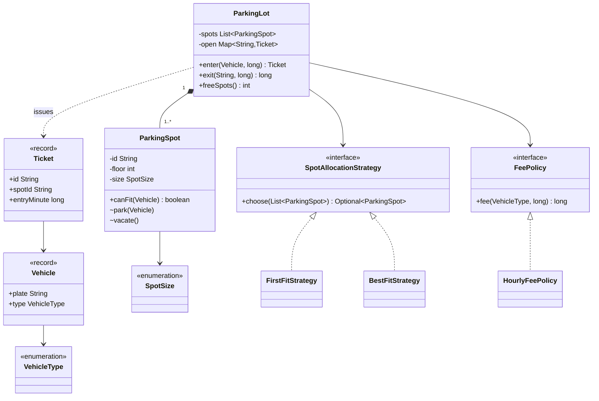

# Chapter 51 — Parking lot

## What and why

Parking lot is the standard "entities + one strategy + one lock" LLD paper question. Exam payoff: Strategy for allocation, a fee policy interface, a checked exception at the gate, and a lock that makes "find a spot and take it" atomic.

## Exam flash rules

- Vehicle, spot, ticket are separate types; a **ticket** links a vehicle to a spot and an entry time.
- A vehicle fits a spot when `spot.size >= vehicle.minimumSpot` (enum order = fit order).
- Allocation varies → **Strategy** (`SpotAllocationStrategy`); pricing varies → **Strategy** (`FeePolicy`).
- Bill **started** hours: `ceil(minutes / 60)`, minimum one hour.
- Check-then-act on shared spots must be one critical section (`synchronized` on the lot).
- A checked exception (`LotFullException`) forces the gate code to handle "full".
- A ticket is single-use: removing it from the open map makes a second `exit` fail.
- The same plate cannot be inside twice.
- `ParkingSpot.park` is package-private: only the lot mutates occupancy.
- A functional interface (`FeePolicy`) may be implemented by a lambda.
- Time is a parameter (`nowMinute`), not `System.currentTimeMillis()`.
- A `final` class cannot be subclassed.

## Short-answer strip

| Item | Answer |
|------|--------|
| Entities | `ParkingLot`, `ParkingSpot`, `Vehicle`, `Ticket` |
| Value types | `VehicleType`, `SpotSize` (enums), `Vehicle`, `Ticket` (records) |
| Relationships | `ParkingLot` **has many** `ParkingSpot` (composition, 1..*); `Ticket` → `Vehicle` (association); `ParkingLot` → `SpotAllocationStrategy`, `FeePolicy` (association to interface) |
| APIs | `Ticket enter(Vehicle, long)`, `long exit(String ticketId, long)`, `int freeSpots()` |
| Patterns | Strategy (allocation, fee), Facade (`ParkingLot`) |
| Concurrency | `spots` occupancy and `open` tickets: mutable + shared → one lock |

## Requirements

| Kind | Line |
|------|------|
| Functional | Lot has several floors; each spot is SMALL, MEDIUM or LARGE |
| Functional | Motorcycle fits any spot, car fits MEDIUM+, truck fits LARGE |
| Functional | Entry issues a ticket; exit takes the ticket and returns the fee |
| Functional | Fee is hourly by vehicle type; any started hour is billed |
| Functional | Reject entry when no fitting spot is free |
| Non-functional | Gates call the lot concurrently; no spot is sold twice |
| Out of scope | Payment, reservations, electric-charging spots |

## Rules table

| Case | Compiles? | Compiler message |
|------|-----------|------------------|
| `new SpotAllocationStrategy()` (interface) | No | `SpotAllocationStrategy is abstract; cannot be instantiated` |
| Call `lot.enter(...)` without `try`/`throws` | No | `unreported exception LotFullException; must be caught or declared to be thrown` |
| Call package-private `spot.park(v)` from another package | No | `park(Vehicle) is not public in ParkingSpot; cannot be accessed from outside package` |
| Implement `FeePolicy` without `fee` | No | `... is not abstract and does not override abstract method fee(VehicleType,long) in FeePolicy` |
| `extends ParkingLot` | No | `cannot inherit from final ParkingLot` |

## Walkthrough

### Value types

```java
{{#include ../../code/part-04-lld/src/main/java/lld/parking/SpotSize.java:spot-size}}
```

```java
{{#include ../../code/part-04-lld/src/main/java/lld/parking/VehicleType.java:vehicle-type}}
```

```java
{{#include ../../code/part-04-lld/src/main/java/lld/parking/Vehicle.java:vehicle}}
```

```java
{{#include ../../code/part-04-lld/src/main/java/lld/parking/Ticket.java:ticket}}
```

### The spot

```java
{{#include ../../code/part-04-lld/src/main/java/lld/parking/ParkingSpot.java:parking-spot}}
```

### Strategies

```java
{{#include ../../code/part-04-lld/src/main/java/lld/parking/SpotAllocationStrategy.java:allocation-strategy}}
```

```java
{{#include ../../code/part-04-lld/src/main/java/lld/parking/FirstFitStrategy.java:first-fit}}
```

```java
{{#include ../../code/part-04-lld/src/main/java/lld/parking/BestFitStrategy.java:best-fit}}
```

```java
{{#include ../../code/part-04-lld/src/main/java/lld/parking/FeePolicy.java:fee-policy}}
```

```java
{{#include ../../code/part-04-lld/src/main/java/lld/parking/HourlyFeePolicy.java:hourly-fee}}
```

### The lot (Facade + lock)

```java
{{#include ../../code/part-04-lld/src/main/java/lld/parking/LotFullException.java:lot-full}}
```

```java
{{#include ../../code/part-04-lld/src/main/java/lld/parking/ParkingLot.java:parking-lot}}
```

### Run

```java
{{#include ../../code/part-04-lld/src/main/java/lld/parking/ParkingDemo.java:parking-demo}}
```

```text
{{#include ../../code/part-04-lld/out/parking/ParkingDemo.txt}}
```

## Tests

```java
{{#include ../../code/part-04-lld/src/test/java/lld/parking/ParkingLotTest.java:parking-test}}
```

The concurrent test releases 40 threads at a latch against 10 spots: exactly 10 are accepted.

## Extension discussion

| Extension | Change | Touches |
|-----------|--------|---------|
| Weekend / dynamic pricing | New `FeePolicy`, or wrap the base one (lambda) | No change to `ParkingLot` (OCP) |
| Allocate nearest to an exit | New `SpotAllocationStrategy` | One class |
| Electric-vehicle spots | Add `SpotKind` (or `ChargingSpot` subclass) + a filter before the strategy | `ParkingSpot`, `canFit` |
| Reservations | `Reservation` entity; `canFit` also checks reservation window | `ParkingSpot`, `ParkingLot.enter` |
| Many lots / high throughput | One lock per floor, or a concurrent free-list per size; keep "choose + park" atomic | `ParkingLot` |
| Lost ticket | Look up by plate (`open` indexed by plate) | `ParkingLot` |

## Predict the output

**P1.**

```java
{{#include ../../code/part-04-lld/src/main/java/lld/parking/exam/PredictBestFit.java:predict-best-fit}}
```

<details><summary>Answer</summary>

```text
{{#include ../../code/part-04-lld/out/parking/PredictBestFit.txt}}
```

Trace: first-fit takes the first fitting spot in list order (LARGE); best-fit picks the smallest sufficient size (SMALL).

</details>

**P2.**

```java
{{#include ../../code/part-04-lld/src/main/java/lld/parking/exam/PredictFee.java:predict-fee}}
```

<details><summary>Answer</summary>

```text
{{#include ../../code/part-04-lld/out/parking/PredictFee.txt}}
```

Trace: 0 min → minimum 1 h → 20; 60 → 1 h; 61 → 2 h → 40; 125 → 3 h × 50.

</details>

**P3.**

```java
{{#include ../../code/part-04-lld/src/main/java/lld/parking/exam/PredictTicketIds.java:predict-ticket-ids}}
```

<details><summary>Answer</summary>

```text
{{#include ../../code/part-04-lld/out/parking/PredictTicketIds.txt}}
```

Trace: ids never reused (T1, T2); first-fit picks the freed LARGE spot again; a used ticket is unknown.

</details>

**P4.**

```java
{{#include ../../code/part-04-lld/src/main/java/lld/parking/exam/PredictFits.java:predict-fits}}
```

<details><summary>Answer</summary>

```text
{{#include ../../code/part-04-lld/out/parking/PredictFits.txt}}
```

Trace: LARGE ≥ SMALL → true; MEDIUM < LARGE → false; `compareTo` returns ordinal difference (0 − 2).

</details>

**P5.**

```java
{{#include ../../code/part-04-lld/src/main/java/lld/parking/exam/PredictDoubleEntry.java:predict-double-entry}}
```

<details><summary>Answer</summary>

```text
{{#include ../../code/part-04-lld/out/parking/PredictDoubleEntry.txt}}
```

Trace: second `enter` throws before touching spots; 3 spots − 1 occupied = 2 free.

</details>

## Compile or not?

**C1.**

```java
{{#include ../../code/part-04-lld/broken/parking/ParkingNewInterfaceBroken.java}}
```

<div class="compiler-error">

```text
{{#include ../../code/part-04-lld/out/parking/ParkingNewInterfaceBroken.javac.txt}}
```

</div>

**C2.**

```java
{{#include ../../code/part-04-lld/broken/parking/ParkingUnreportedBroken.java}}
```

<div class="compiler-error">

```text
{{#include ../../code/part-04-lld/out/parking/ParkingUnreportedBroken.javac.txt}}
```

</div>

**C3.**

```java
{{#include ../../code/part-04-lld/broken/parking/ParkingPackagePrivateBroken.java}}
```

<div class="compiler-error">

```text
{{#include ../../code/part-04-lld/out/parking/ParkingPackagePrivateBroken.javac.txt}}
```

</div>

**C4.**

```java
{{#include ../../code/part-04-lld/broken/parking/ParkingMissingMethodBroken.java}}
```

<div class="compiler-error">

```text
{{#include ../../code/part-04-lld/out/parking/ParkingMissingMethodBroken.javac.txt}}
```

</div>

**C5.**

```java
{{#include ../../code/part-04-lld/broken/parking/ParkingFinalClassBroken.java}}
```

<div class="compiler-error">

```text
{{#include ../../code/part-04-lld/out/parking/ParkingFinalClassBroken.javac.txt}}
```

</div>

## Gotchas

1. **Check-then-act race.** Filtering free spots and then parking without one lock sells a spot twice (`concurrentEntriesNeverOversell`).
2. **Truck in a MEDIUM spot.** Fit uses enum order; `PredictFits`.
3. **0-minute stay is free.** It is not; minimum one hour (`PredictFee`).
4. **Reusable tickets.** `open.remove(id)` is the single-use guard (`PredictTicketIds`).
5. **First-fit wastes LARGE spots on bikes.** Use best-fit (`PredictBestFit`).

## UML



## Interview Q&A

1. **Q:** Which pattern chooses the spot? **A:** Strategy (`SpotAllocationStrategy`); `FirstFitStrategy` and `BestFitStrategy` are the variants.
2. **Q:** Why a checked `LotFullException`? **A:** The gate must handle "full"; the compiler enforces it (`ParkingUnreportedBroken`).
3. **Q:** How do you stop two gates taking the same spot? **A:** `enter` is `synchronized`; filter + `park` is one critical section.
4. **Q:** Why is `park` package-private? **A:** Only the lot may change occupancy (`ParkingPackagePrivateBroken`).
5. **Q:** How is the fee computed? **A:** `max(1, ceil(minutes/60)) × rate(type)` (`PredictFee`).
6. **Q:** How do you add surge pricing? **A:** New `FeePolicy`; `ParkingLot` is unchanged.
7. **Q:** Why is `Ticket` a record? **A:** Immutable data carrier: equality and accessors for free.
8. **Q:** How do you prevent ticket reuse? **A:** `open.remove` returns `null` the second time → `IllegalArgumentException`.
9. **Q:** Why pass `nowMinute`? **A:** Tests control time; no sleeping.
10. **Q:** What changes for 1,000 gates? **A:** Shard the lock (per floor or per size class) and keep choose+park atomic inside a shard.
11. **Q:** Why compare enums with `compareTo`? **A:** Declaration order encodes fit order; no lookup table.
12. **Q:** Why can't `ParkingLot` be extended? **A:** It is `final` (`ParkingFinalClassBroken`); compose instead.

## Exam writing prompts

1. (5) Write `VehicleType` and `SpotSize` enums with a `minimumSpot()` and a `canFit` check.
2. (5) Write `HourlyFeePolicy.fee` billing started hours with a one-hour minimum.
3. (8) Write `ParkingLot.enter` so two threads never get the same spot; say why it is correct.
4. (3) Draw the class diagram for `ParkingLot`, `ParkingSpot`, `Ticket`, `FeePolicy`.

## Exercises

Solutions: `solutions/ch51/SolutionParking.java`.

1. Write a `FeePolicy` where the first 15 minutes are free.
2. Write a lowest-floor `SpotAllocationStrategy` as a lambda.
3. Write a `gate` helper that returns a message instead of throwing `LotFullException`.
4. Prove with 8 threads × 40 vehicles that a 20-spot lot accepts exactly 20.
5. Show the fee for 60 and 61 minutes.

```java
{{#include ../../code/part-04-lld/solutions/ch51/SolutionParking.java}}
```

```text
{{#include ../../code/part-04-lld/out/parking/SolutionParking.txt}}
```

## Recap checklist

- [x] Entities, enums, records, relationships
- [x] Two Strategy points (allocation, fee) and one lock
- [x] Tests incl. concurrency; extension table
- [x] Exam banks: flash 12, predict 5, compile 5, writing 4
